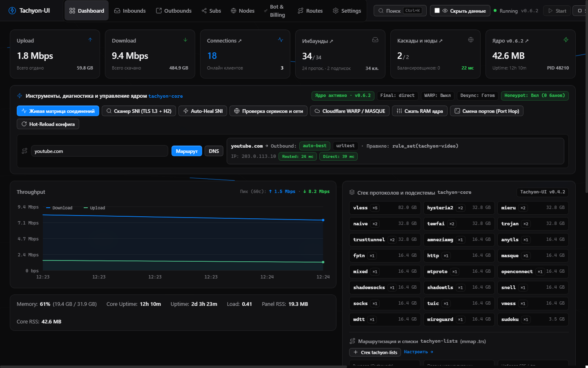
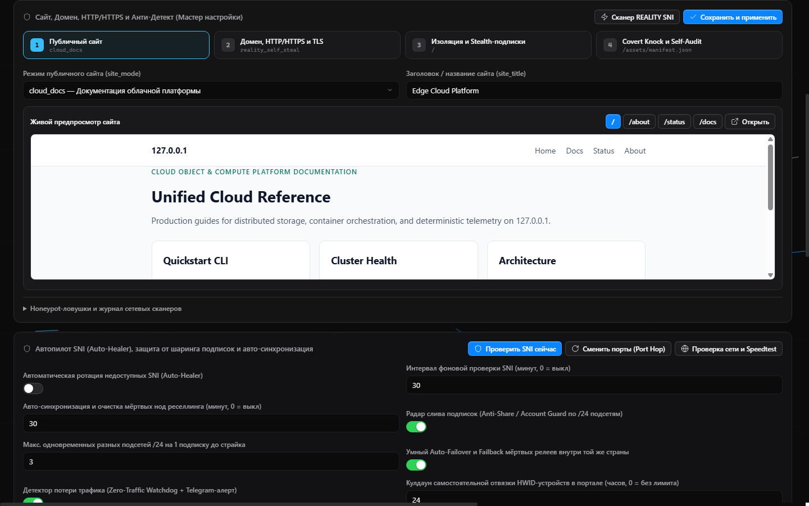
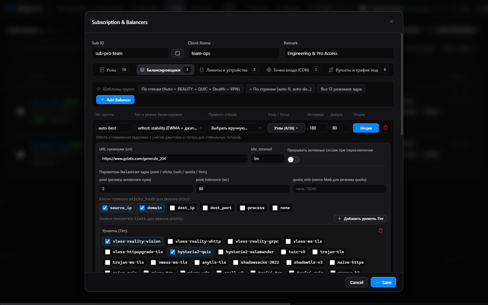

# Tachyon-UI

**English** | [Русский](README.ru.md)

A lightweight, self-contained control panel for `tachyon-core` written in pure Rust: a single static binary with zero C dependencies or external runtimes, an embedded Graphite Dark single-page UI (`src/ui.html`), a dual-protocol HTTP + HTTPS web server, built-in ACME automation, public website masking (`SiteEngine`), 4-level stealth subscriptions with Covert Knock, a built-in Telegram bot + Mini App, and full parity with `tachyon-core` balancers and runtime diagnostics.

---

## Key Features (version `20261123-v20`)

| Subsystem | Capabilities |
| :--- | :--- |
| **Zero-C Pure Rust Stack** | Single static binary (`x86_64-unknown-linux-musl`, ~5.5 MiB) with embedded SPA. TLS powered 100% by pure Rust (`rustls`, `tokio-rustls`, `oxitls-rustcrypto-provider`, no `openssl-sys` or `ring`). |
| **Dual HTTP + HTTPS & SiteEngine** | Simultaneous HTTP and HTTPS on a single port via first-byte inspection (`0x16`), optional dedicated `:80` + `:443`, hot port/cert rebinding. 6 built-in multi-page site templates or custom `.zip` / HTML hosting. |
| **Domains, ACME & REALITY Self-Steal** | 4 binding profiles (`dual_single_port`, `native_80_443`, `reality_self_steal` on `127.0.0.1:8443`, `reverse_proxy` for Nginx/Caddy). ACME HTTP-01, Cloudflare DNS-01, and SAN Self-Signed certificates with 30-day auto-renewal. |
| **Panel Isolation & Self-Audit** | Strict `web_base_path` prefix (requests outside the path never expose panel routes), neutral `nginx/1.26.2` headers, `sid` cookie, active Honeypot, automated 0–100 Self-Audit scorer. |
| **4-Level Stealth Subscriptions & Covert Knock** | Polymorphic paths (`sub`, `static_feed`, `cdn_v2`, `rss_updates`), Zero-Oracle 404 HTML, automated scanner filter, Portal Guard (`?k=`), and HMAC knock (`If-None-Match` / `X-Client-Digest`) over normal website routes. |
| **`tachyon-core` Balancers** | All 12 `urltest` modes, full `balancer` object (`pool`, `pool_tolerance`, `sticky_hash`, `quota_mib`, `tiers`), `selector` (`auto_failover`, live member switching), and multi-hop `chain` (`strip_evasion`, `strip`, `rewrite`). |
| **Protocols & Routing** | VLESS/REALITY, VMess, Trojan, Hysteria/Hy2, TUIC, AnyTLS, Naive, ShadowTLS, WireGuard/AWG (port hopping), MASQUE, MTProto (`telegram-ws`/`kws`), WDTT, Sudoku, Cloudflared, SSH, Tor, Bridge; `time_window`, `rule_set`, `udp_nat_mode`, `smart_queue`. |
| **Cluster, Telegram Bot & Diagnostics** | Multi-node sync and cascades, built-in shop bot with plans, vouchers (`/redeem`) and Mini App, 5-tab live core diagnostics modal, Privacy Mask (`Alt+P`), and Command Palette (`Ctrl+K`). |

---

## Quick Start

### One-Command Installer (Ubuntu / Debian / RHEL / Alpine Linux)

```bash
bash <(curl -Ls https://raw.githubusercontent.com/Dushnilin/tachyon-ui/main/install.sh)
```

The installer sets up the `tachyon-ui` binary, a `systemd` service, and the `tachyon-panel` CLI, opens the panel port in the firewall, and prints the panel URL and initial credentials (change them immediately in Settings after first sign-in).

### Docker Deployment

```bash
docker build -t tachyon-ui .
docker run -d --name tachyon-ui --restart unless-stopped \
  -p 2053:2053 -p 443:443 \
  -v /opt/tachyon-ui/data:/data \
  tachyon-ui
```

See [Chapter 1](docs/en/01-installation-and-cli.md) for source builds, `x86_64-unknown-linux-musl` cross-compilation, and CLI recovery commands (`tachyon-panel info`, `reset-path`, `open-web-ports`).

---

## Interface Overview



| Site, Domain, HTTP/HTTPS & Defense Wizard | Balancer Builder (12 `urltest` Modes, `tiers`, `chain`) |
| :---: | :---: |
|  |  |

---

## Documentation Index

1. [Installation, Docker, Source Build & CLI](docs/en/01-installation-and-cli.md)
2. [Public Website, Dual HTTP+HTTPS, Domain Profiles, ACME & Self-Audit](docs/en/02-stealth-web-domain-tls.md)
3. [Subscriptions, Web Portal, Vouchers & Tachyon Covert Knock](docs/en/03-subscriptions-and-covert-knock.md)
4. [Balancers (12 `urltest` Modes), `chain` Outbounds & Routing](docs/en/04-balancers-chain-and-routes.md)
5. [Protocols, Multi-Node Clusters, Cascades & Telegram Bot](docs/en/05-protocols-nodes-and-tgbot.md)
6. [Core Diagnostics, Privacy Mask (`Alt+P`) & REST API Reference](docs/en/06-diagnostics-privacy-and-api.md)
