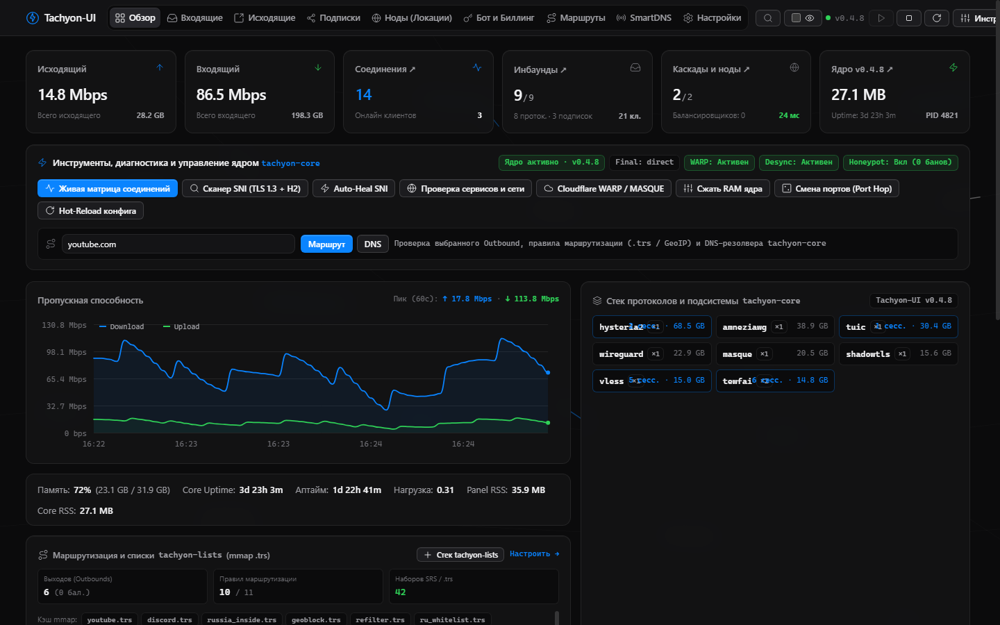
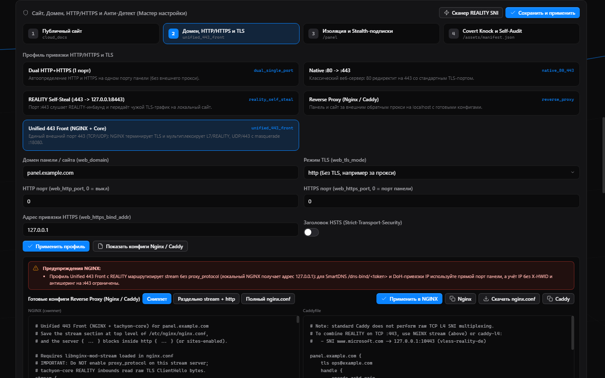
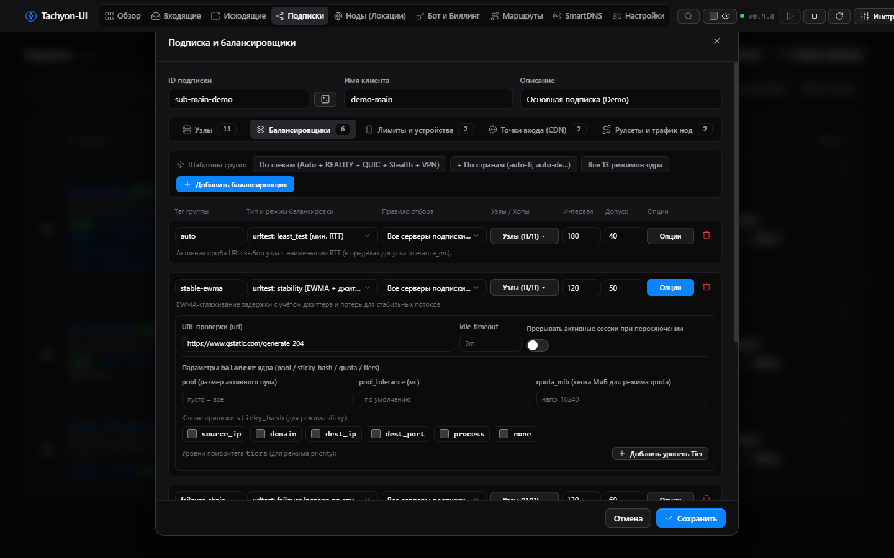
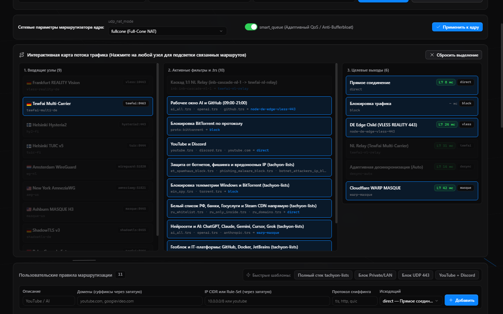
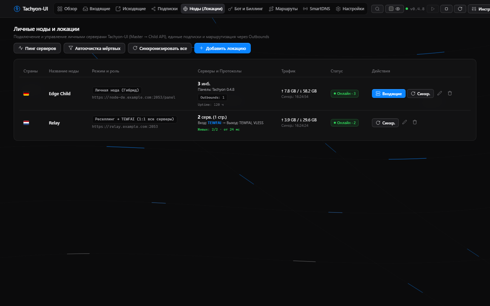

# Tachyon-UI

[English](README.md) | **Русский**

Лёгкая, полностью автономная панель управления движком `tachyon-core` на чистом Rust (`v0.4.12`): единый статический бинарник без C-зависимостей и внешнего рантайма, встроенный веб-интерфейс с 16 темами (13 тёмных и 3 светлые) и редактором тем, двухпротокольный HTTP+HTTPS веб-стек, нативный ACME-менеджер, система маскировки под публичный сайт, профиль `Unified 443 Front`, 4-уровневая защита подписок с Covert Knock, безопасное автоуправление файрволом, встроенный Telegram-бот с Mini App и полный паритет с балансировками, цепочками, маршрутизацией, SmartDNS v2 и кластером `Master → Child`.

---

## Ключевые возможности (версия `v0.4.12`)

| Подсистема | Возможности |
| :--- | :--- |
| **Стек без C-зависимостей, HTTP-кэш и 16 тем** | Единый статический бинарник (`linux-amd64`, `linux-arm64` `musl` и `windows-amd64`) со встроенным адаптивным SPA `ui.html`. TLS на 100% pure-Rust (`rustls`, `tokio-rustls`, `oxitls-rustcrypto-provider`, без `openssl-sys`/`ring`). HTTP-сжатие `gzip` (с учётом `Accept-Encoding` / `gzip;q=0`), предсжатый кэш `UI_HTML` (`~225 КБ` против `~1.05 МБ`), `ETag`/`304 Not Modified` и неблокирующая отдача read-API. **16 встроенных тем** (13 тёмных + 3 светлые: `Material Light`, `Apple Light`, `Gruvbox Light`) и редактор пользовательских тем. |
| **Dual HTTP + HTTPS и SiteEngine** | Одновременный приём HTTP и HTTPS на одном порту через инспекцию первого байта (`0x16`), выделенные `:80` + `:443`, горячий ребинд портов/сертификатов и диагностика активных HTTPS-слушателей в карточке TLS. 6 встроенных многостраничных шаблонов сайтов, загрузка `.zip` (до 15 МБ) и активный Honeypot. |
| **Домены, ACME и Unified 443 Front** | **5 профилей привязки** (`dual_single_port`, `native_80_443`, `reality_self_steal` на `127.0.0.1:8443`, `reverse_proxy` и **`unified_443_front` — NGINX + Core на одном порту `443` TCP/UDP с L7-маршрутизацией, `ssl_preread` без `proxy_protocol` для REALITY и loopback masquerade `:18080` для Hysteria2/TUIC**). Нативный ACME HTTP-01 (со встроенным временным слушателем `:80` без Caddy/Nginx), Cloudflare DNS-01, SAN Self-Signed с автопродлением и кэширование метаданных X.509-сертификатов (`read_cert_info_cached`) с инвалидацией по `(mtime, size)`. |
| **Файрвол и изоляция панели** | Безопасное автоуправление `UFW` / `firewalld` (`firewall-cmd`) / `iptables` с меткой `tachyon-ui:managed`, автоочисткой правил удалённых/изменённых инбаундов и защитой ручных правил администратора и SSH (плюс тумблер отключения `auto_firewall_enabled`). Строгий `web_base_path`, нейтральные заголовки `nginx/1.26.2`, `sid` cookie и 9-критериальный `Self-Audit` (`0–100`). |
| **4-уровневые Stealth-подписки и Covert Knock** | Полиморфные URL (`sub`, `static_feed`, `cdn_v2`, `rss_updates`), Zero-Oracle 404, фильтр сканеров, Portal Guard (`?k=`), HMAC-стук (`If-None-Match` / `X-Client-Digest` / `?v=` + постоянный Covert Knock URL для роутера), боковой **360°-инспектор**, профили подписок, брендинг портала, раздельный учёт мультиподписок (`sub_online_ips`, `InboundUserNameResolver`), переименование `sub_id` на месте (`old_sub_id`), HWID/Anti-Share, `strict_routing_only`, query-фильтры (`?format=`, `?country=`, `?mode=`) и экспорт в `tachyon_json_profile`, `sing-box`, `clash`/`mihomo`, `base64`/`raw`, `sip008`, `wg`/`awg`, `openwrt` + 1-клик скрипт. |
| **Балансировщики `tachyon-core`** | Все 12 режимов `urltest` (включая авто-регенерацию страновых `auto-de`, `auto-nl`, … и фильтрацию по реальным листьям), объект `balancer` (`pool`, `pool_tolerance`, `sticky_hash`, `quota_mib`, `tiers`), `selector` (`auto_failover`, живое переключение) и многохоповые цепочки `chain` (`strip_evasion`, `strip`, `rewrite`). |
| **Протоколы, маршрутизация и автоматика** | **TewFai Multi-Carrier** (пресеты TCP REALITY + QUIC `salamander`/`gecko`, `xhttp`, `desync`, `sni_pool`, `server_ports`, `handover`), VLESS/REALITY, VMess, Trojan, Hysteria/Hy2, TUIC, AnyTLS, Naive, ShadowTLS, WireGuard/AWG (Port Hopping, автовыделение свободного `wg_client_ip`), MASQUE (`keep_alive_period: 20s`, `idle_timeout: 50s`), FPTN, TrustTunnel, OpenConnect, Mieru, Snell, MTProto (`telegram-ws`/`kws`), WDTT, Sudoku, Cloudflared, SSH, Tor, Bridge, **Desync** (автомиграция `udp_fake_packets` → `udp_fake`/`quic_desync`, адаптивная память); массовая разметка стран; списки `.trs`, `time_window`, `udp_nat_mode`, `smart_queue`, интерактивная карта потока, 2-уровневый симулятор маршрутов, SNI-сканер, Auto-Healer, Unlock Probe, Cloudflare DNS Failover и Zero-Traffic Watchdog. |
| **SmartDNS v2 / GeoHide + SNI-прокси** | Встроенный pure-Rust DNS-сервер (UDP/TCP `:53` с авто-фоллбэком от `systemd-resolved`), DoH (RFC 8484 `/dns-query`, копирование адреса **«Без https://»** для роутеров Keenetic/OpenWrt), DoT (`:853`) и прозрачный SNI-прокси (`:443` / `:80`) с выходом `direct`, `socks5` или через мост Child-ноды для PS5, Xbox, Nintendo Switch, SmartTV, ПК и роутеров. Каталог `tachyon-lists`, AdBlock, защита от Open Resolver/Open Proxy (`allow_public=false`, `/dns-bind/<token>`), живой лог и 4-шаговый Мастер настройки. |
| **Кластер `Master → Child`, Telegram-бот и диагностика** | Полноценное управление дочерними нодами (`managed_tachyon_node`), `auto_export_outbounds`, синхронизация `sub_configs`/HWID/лимитов на Child, живой счётчик `Онлайн сейчас: N IP`, служебный туннель `cluster-link-*` (`Master → Child · ∞`), встроенный бот с тарифами, промокодами, ваучерами (`/redeem`), Mini App и live-симулятором, 5-вкладочная живая диагностика ядра, **Live Connections Dock** (`Ctrl+\``), режим скрытия приватных данных (`Alt+P`), палитра команд (`Ctrl+K`), быстрая навигация (`Alt+1..9`) и кольцевой буфер откатов (до 10 снапшотов). |

---

## Быстрый старт

### Установка в одну команду (Ubuntu / Debian / RHEL / Alpine Linux)

```bash
bash <(curl -Ls https://raw.githubusercontent.com/Dushnilin/tachyon-ui/main/install.sh)
```

Скрипт устанавливает бинарник `tachyon-ui`, сервис `systemd`, консольную утилиту `tachyon-panel`, открывает порт панели в фаерволе и выводит адрес и временный пароль входа (после входа их сразу нужно сменить в разделе **Настройки → Учётные данные**).

### Запуск в Docker

```bash
docker build -t tachyon-ui .
docker run -d --name tachyon-ui --restart unless-stopped \
  -p 2053:2053 -p 443:443 \
  -v /opt/tachyon-ui/data:/data \
  tachyon-ui
```

Подробнее о флагах установки (`ADMIN_PASS`, `PANEL_PORT`, `PUBLIC_IP`, `SERVER_COUNTRY`, `OPEN_WEB_PORTS`), кросс-компиляции `x86_64`/`aarch64` `musl`, автоуправлении файрволом и CLI-командах (`tachyon-panel info`, `reset-pass`, `reset-path`, `open-web-ports`, `tachyon-ui --reset-creds`) — в [главе 1](docs/ru/01-installation-and-cli.md).

---

## Интерфейс панели



| Мастер маскировки, домена и `Unified 443 Front` | Конструктор балансировщиков (`urltest`, `tiers`, `chain`) |
| :---: | :---: |
|  |  |

| Карта потока трафика (`#routes`) | Кластер нод `Master → Child` (`#nodes`) |
| :---: | :---: |
|  |  |

---

## Оглавление документации (`v0.4.12`)

> Быстрый переход к новым полным справочникам `v0.4.12`:
> - **[Полный справочник по всем вкладкам и кнопкам UI](docs/ru/11-ui-every-tab-and-button-guide.md)** — разбор каждой кнопки, переключателя, модального окна, горячей клавиши и диалоговой формы панели.
> - **[Энциклопедия всех 27 протоколов (`01..27`)](docs/ru/protocols/README.md)** — детальные спецификации каждого протокола (поля UI, маппинг JSON в `tachyon-core`, пресеты, правила файрвола и форматы подписок).

0. [Сводный путеводитель: от чистого сервера до продакшена (архитектура, 5 сценариев, навигатор по 34 экранам)](docs/ru/00-complete-guide.md)
1. [Установка, сборка, CLI `tachyon-panel`, первый вход, топбар и меню «Инструменты»](docs/ru/01-installation-and-cli.md)
2. [Публичный сайт, Dual HTTP+HTTPS, домен, `Unified 443 Front`, ACME и Self-Audit](docs/ru/02-stealth-web-domain-tls.md)
3. [Подписки, быстрый инвайт, 360°-инспектор, веб-портал, профили и Tachyon Covert Knock](docs/ru/03-subscriptions-and-covert-knock.md)
4. [Балансировщики (12 режимов `urltest`), `chain` и маршрутизация](docs/ru/04-balancers-chain-and-routes.md)
5. [Протоколы (`TewFai Multi-Carrier`), кластер `Master → Child`, каскады и Telegram-бот](docs/ru/05-protocols-nodes-and-tgbot.md)
6. [Диагностика ядра, скрытие приватных данных (`Alt+P`) и REST API](docs/ru/06-diagnostics-privacy-and-api.md)
7. [Полное пошаговое руководство: настройка панели, личные серверы и единая подписка](docs/ru/07-full-setup-and-cluster-guide.md)
8. [Собственный SmartDNS / GeoHide, SNI-прокси, DoH/DoT и Мастер настройки](docs/ru/08-smartdns-geohide-guide.md)
9. [Энциклопедия протоколов Tachyon: от флагманского TewFai до WireGuard, QUIC и служебных транспортов](docs/ru/09-protocols-encyclopedia.md)
10. [Настройка единой подписки `tachyon-ui` для роутера Tachyon 2.0: страны, балансировщики и нативный JSON](docs/ru/10-tachyon-router-subscription-guide.md)
11. [Полный справочник по всем вкладкам, кнопкам и модалкам UI (`v0.4.12`)](docs/ru/11-ui-every-tab-and-button-guide.md)
12. [Каталог всех 27 протокольных гайдов (`docs/ru/protocols/`)](docs/ru/protocols/README.md)
