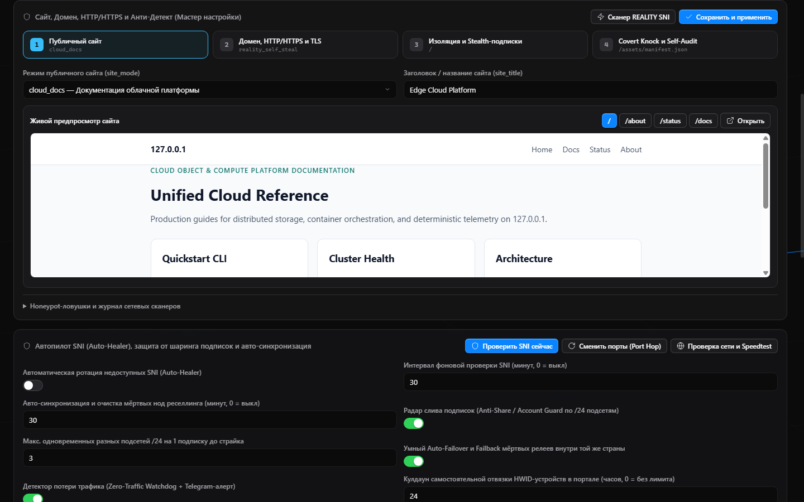
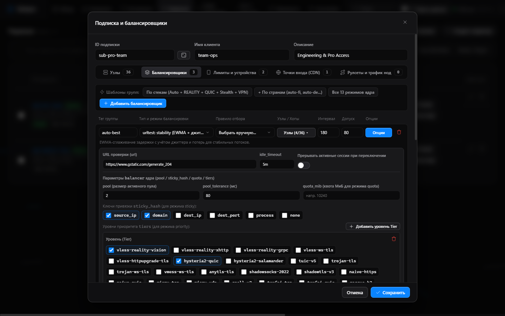

# Tachyon-UI

[English](README.md) | **Русский**

Лёгкая, полностью автономная панель управления движком `tachyon-core` на чистом Rust: единый статический бинарник без C-зависимостей и внешнего рантайма, встроенный веб-интерфейс с 16 темами (13 тёмных и 3 светлые) и редактором тем, двухпротокольный HTTP+HTTPS веб-стек, нативный ACME-менеджер, система маскировки под публичный сайт, профиль `Unified 443 Front`, 4-уровневая защита подписок с Covert Knock, безопасное автоуправление файрволом, встроенный Telegram-бот с Mini App и полный паритет с балансировками, цепочками, маршрутизацией и диагностикой `tachyon-core`.

---

## Ключевые возможности (версия `v0.4.5`)

| Подсистема | Возможности |
| :--- | :--- |
| **Стек без C-зависимостей, HTTP-кэш и 16 тем** | Единый статический бинарник (`linux-amd64`, `linux-arm64` `musl` и `windows-amd64`) со встроенным адаптивным SPA `src/ui.html`. TLS на 100% pure-Rust (`rustls`, `tokio-rustls`, `oxitls-rustcrypto-provider`, без `openssl-sys`/`ring`). HTTP-сжатие `gzip` (с учётом `Accept-Encoding` / `gzip;q=0`), предсжатый кэш `UI_HTML` (`~225 КБ` против `~1.05 МБ`), `ETag`/`304 Not Modified` и неблокирующая отдача read-API. **16 встроенных тем** (13 тёмных + 3 светлые: `Material Light`, `Apple Light`, `Gruvbox Light`) и редактор пользовательских тем. |
| **Dual HTTP + HTTPS и SiteEngine** | Одновременный приём HTTP и HTTPS на одном порту через инспекцию первого байта (`0x16`), выделенные `:80` + `:443`, горячий ребинд портов/сертификатов и диагностика активных HTTPS-слушателей в карточке TLS. 6 встроенных многостраничных шаблонов сайтов, загрузка `.zip` (до 15 МБ) и активный Honeypot. |
| **Домены, ACME и Unified 443 Front** | **5 профилей привязки** (`dual_single_port`, `native_80_443`, `reality_self_steal` на `127.0.0.1:8443`, `reverse_proxy` и **`unified_443_front` — NGINX + Core на одном порту `443` TCP/UDP с L7-маршрутизацией, `ssl_preread` для REALITY и loopback masquerade `:18080` для Hysteria2/TUIC**). Нативный ACME HTTP-01 (со встроенным временным слушателем `:80` без Caddy/Nginx), Cloudflare DNS-01, SAN Self-Signed с автопродлением и кэширование метаданных X.509-сертификатов (`read_cert_info_cached`) с инвалидацией по `(mtime, size)`. |
| **Файрвол и изоляция панели** | Безопасное автоуправление `UFW` / `firewalld` (`firewall-cmd`) / `iptables` с меткой `tachyon-ui:managed`, автоочисткой правил удалённых/изменённых инбаундов и защитой ручных правил администратора и SSH (плюс тумблер отключения `auto_firewall_enabled`). Строгий `web_base_path`, нейтральные заголовки `nginx/1.26.2`, `sid` cookie и 9-критериальный Self-Audit (`0–100`). |
| **4-уровневые Stealth-подписки и Covert Knock** | Полиморфные URL (`sub`, `static_feed`, `cdn_v2`, `rss_updates`), Zero-Oracle 404, фильтр сканеров, Portal Guard (`?k=`), HMAC-стук (`If-None-Match` / `X-Client-Digest` / `?v=`), профили подписок, брендинг портала, раздельный учёт мультиподписок (`sub_online_ips`, `InboundUserNameResolver`), переименование `sub_id` на месте (`old_sub_id`), HWID/Anti-Share, query-фильтры (`?format=`, `?country=`, `?mode=`) и экспорт в `sing-box`/`tachyon`, `clash`/`mihomo`, `base64`/`raw`, `sip008`, `wg`/`awg`, `openwrt` + 1-клик скрипт. |
| **Балансировщики `tachyon-core`** | Все 12 режимов `urltest`, объект `balancer` (`pool`, `pool_tolerance`, `sticky_hash`, `quota_mib`, `tiers`), `selector` (`auto_failover`, живое переключение) и многохоповые цепочки `chain` (`strip_evasion`, `strip`, `rewrite`). |
| **Протоколы, маршрутизация и автоматика** | VLESS/REALITY, VMess, Trojan, Hysteria/Hy2, TUIC, AnyTLS, Naive, ShadowTLS, WireGuard/AWG (Port Hopping, автовыделение свободного `wg_client_ip`), MASQUE (`keep_alive_period: 20s`, `idle_timeout: 50s` для стабильных роутерных HTTP/3-туннелей), Tewfai, FPTN, TrustTunnel, OpenConnect, Mieru, Snell, MTProto (`telegram-ws`/`kws`), WDTT, Sudoku, Cloudflared, SSH, Tor, Bridge, Desync; группы стран с мгновенной сменой метаданных без перезапуска ядра; списки `.trs`, `time_window`, `udp_nat_mode`, `smart_queue`, SNI-сканер, Auto-Healer, Unlock Probe, Cloudflare DNS Failover, Zero-Traffic Watchdog и Smart Relay Failover. |
| **SmartDNS / GeoHide + SNI-прокси** | Встроенный pure-Rust DNS-сервер (UDP/TCP `:53` с авто-фоллбэком от `systemd-resolved`), DoH (RFC 8484 `/dns-query`), DoT (`:853`) и прозрачный SNI-прокси (`:443` / `:80`) с выходом `direct` или `socks5` для PS5, Xbox, Nintendo Switch, SmartTV, ПК и роутеров. 6 пресетов, AdBlock, защита от Open Resolver/Open Proxy (`allow_public=false`, динамическая ссылка `/dns-bind/<token>`), живой лог и 4-шаговый Мастер настройки. |
| **Кластер, Telegram-бот и диагностика** | Мультинодовая синхронизация и каскады, встроенный бот с тарифами, промокодами, ваучерами (`/redeem`) и Mini App, 5-вкладочная живая диагностика ядра, нижний **Live Connections Dock** (`Ctrl+\``), режим скрытия приватных данных (`Alt+P`), палитра команд (`Ctrl+K`), быстрая навигация (`Alt+1..8`) и кольцевой буфер откатов (до 10 снапшотов). |

---

## Быстрый старт

### Установка в одну команду (Ubuntu / Debian / RHEL / Alpine Linux)

```bash
bash <(curl -Ls https://raw.githubusercontent.com/Dushnilin/tachyon-ui/main/install.sh)
```

Скрипт устанавливает бинарник `tachyon-ui`, сервис `systemd`, консольную утилиту `tachyon-panel`, открывает порт панели в фаерволе и выводит адрес и временный пароль входа (после входа их сразу нужно сменить в разделе Настройки).

### Запуск в Docker

```bash
docker build -t tachyon-ui .
docker run -d --name tachyon-ui --restart unless-stopped \
  -p 2053:2053 -p 443:443 \
  -v /opt/tachyon-ui/data:/data \
  tachyon-ui
```

Подробнее о флагах установки (`ADMIN_PASS`, `PANEL_PORT`, `PUBLIC_IP`, `SERVER_COUNTRY`, `OPEN_WEB_PORTS`), кросс-компиляции `x86_64`/`aarch64` `musl`, автоуправлении файрволом и CLI-командах (`tachyon-panel info`, `reset-pass`, `reset-path`, `open-web-ports`, `tachyon-ui --reset-creds`) — в [главе 1](docs/ru/01-installation-and-cli.md).

---

## Интерфейс панели


| Мастер сайта, домена, HTTP/HTTPS и защиты | Конструктор 12 балансировщиков, `tiers` и `chain` |
| :---: | :---: |
|  |  |

---

## Подробная документация

1. [Установка, Docker, сборка и CLI `tachyon-panel`](docs/ru/01-installation-and-cli.md)
2. [Публичный сайт, Dual HTTP+HTTPS, домен, ACME и Self-Audit](docs/ru/02-stealth-web-domain-tls.md)
3. [Подписки, веб-портал, ваучеры и Tachyon Covert Knock](docs/ru/03-subscriptions-and-covert-knock.md)
4. [Балансировщики (12 режимов `urltest`), `chain` и маршрутизация](docs/ru/04-balancers-chain-and-routes.md)
5. [Протоколы, мультиноды, каскады и Telegram-бот](docs/ru/05-protocols-nodes-and-tgbot.md)
6. [Диагностика ядра, скрытие приватных данных (`Alt+P`) и REST API](docs/ru/06-diagnostics-privacy-and-api.md)
7. [Полное пошаговое руководство: настройка панели, личные серверы и единая подписка](docs/ru/07-full-setup-and-cluster-guide.md)
8. [Собственный SmartDNS / GeoHide, SNI-прокси, DoH/DoT и Мастер настройки](docs/ru/08-smartdns-geohide-guide.md)
