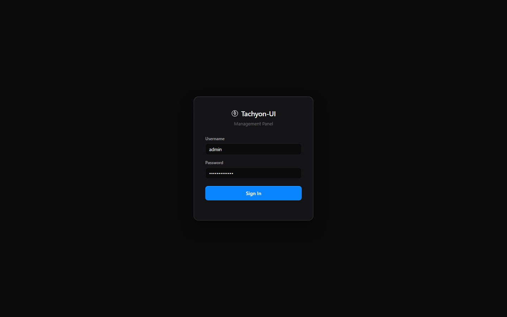
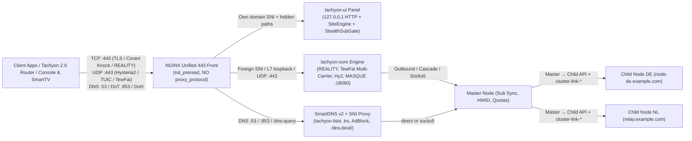
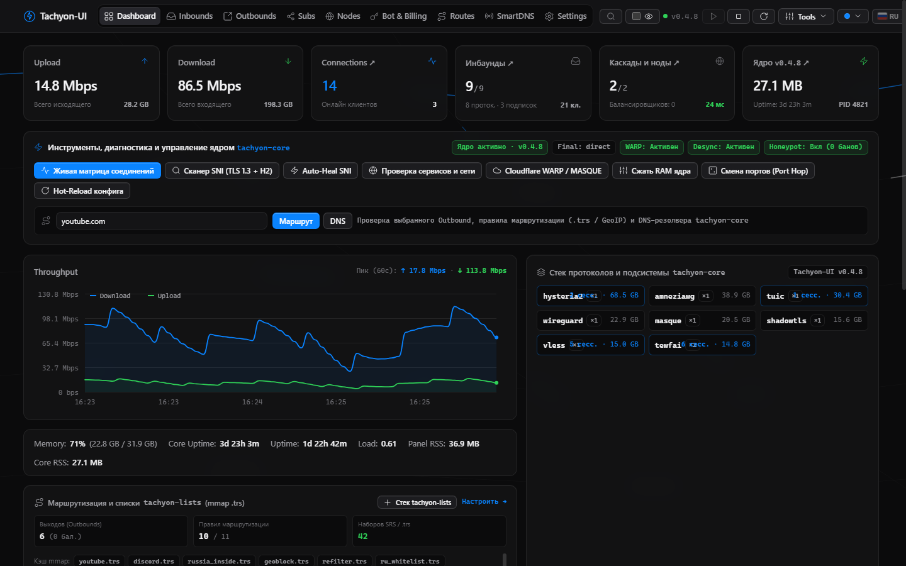

# 0. Complete End-to-End Guide: From Fresh Server to Production (`v0.4.12`)

[Русская версия](../ru/00-complete-guide.md) | [Back to Index](../../README.md)

This master playbook walks you through **Tachyon-UI `v0.4.12`** from a clean Linux VPS to production across all five real-world deployment patterns—single stealth node, multi-node `Master → Child` cluster, Tachyon 2.0 home router, SmartDNS v2 / GeoHide for consoles and SmartTVs, and commercial Telegram Bot + Mini App automation—followed by a complete 34-screen visual index across chapters `01–10`.

> **Quick Reference Guides (`v0.4.12`):**
> - **[Complete UI Reference: Every Tab, Modal & Button](11-ui-every-tab-and-button-guide.md)** — control-by-control reference across Topbar, Hotkeys, Themes, all 9 tabs, Wizards, and Service Modals.
> - **[27-Protocol & Transport Reference Catalog](protocols/README.md)** — field mappings, TLS/REALITY rules, presets, firewall ports, and diagnostics for every protocol (`01..27`), including [01. TewFai](protocols/01-tewfai.md), [02. VLESS](protocols/02-vless.md), [24. Desync](protocols/24-desync.md), and [27. Balancers & Chain](protocols/27-balancers-and-chain.md).

## What's New in `v0.4.11` – `v0.4.12`

- **TewFai REALITY Presets, QUIC-TLS Export & Handover Rotation**: 4 curated [TewFai presets](protocols/01-tewfai.md) (`TewfAI REALITY Multi-Carrier`, `TewfAI REALITY TCP Stealth`, `TewfAI REALITY Video Stream + PQC`, `TewfAI TLS + Custom Domain`), automatic `quic.tls` (`alpn: ["h3"]`, `insecure: true`) injection in client JSON exports when `quic` coexists with `REALITY` (since REALITY binds to the TCP carrier while QUIC uses self-signed H3), plus `sni_pool`, `server_ports`, and periodic `handover` (`rotate_secs` / `rotate_mb`).
- **SmartDNS DoH Router Hint (`Without https://`)**: Both Quick Connect and Step 4 of the SmartDNS Wizard provide a dedicated **"Without `https://`"** copy button (`domain.tld/dns-query?...`) tailored for Keenetic, OpenWrt, and other router firmwares that prepend `https://` automatically or require host and path separately.
- **Desync Migration & Strict Core Validation**: Legacy `udp_fake_packets` fields are automatically migrated to `udp_fake`, `quic_desync`, and `udp_repeats`; `preset: "disorder_tls"` maps to `"fake_disorder"`; invalid `"fooling": "none"` and `fake_ttl: 0` values are stripped; and `tachyon-core` schema validation errors are surfaced directly in the UI.
- **MTProto 32-Hex Secret Normalization**: FakeTLS helper prefixes (`ee`/`dd` + domain hex) in the UI are automatically normalized to the strict 32-hex-character secret expected by `tachyon-core` when writing runtime configs and exporting subscriptions.

---

## Reference Architecture (`v0.4.12`)

---

## Five End-to-End Production Playbooks

### Playbook 1: Single Stealth Server (Clean VPS → A+ Self-Audit)
1. **Install (`01`)**: Run `install.sh` on Ubuntu/Debian/RHEL/Alpine, note the generated credentials, sign in at `http://198.51.100.10:2053`, and immediately change the admin username/password under **Settings**. Confirm **Automatic Firewall Management (`auto_firewall_enabled`)** is enabled so `tachyon-ui:managed` rules stay synchronized while preserving SSH port `22`.
2. **Masking Wizard & `Unified 443 Front` (`02`)**: Open **Settings → Site, Domain, HTTP/HTTPS & Defense**.
   - **Step 1**: Choose a `SiteEngine` template (e.g., `cloud_docs` or `status_page`) or upload a custom `.zip` static site (`<= 15 MiB`). Enable Honeypot if desired.
   - **Step 2**: Point `panel.example.com` to `198.51.100.10`, issue an ACME Let's Encrypt certificate (`HTTP-01` or `Cloudflare DNS-01`), and apply **`unified_443_front`** (or `reality_self_steal` if hosting without NGINX). Export and apply the generated `nginx.conf` (note that `stream { ... }` intentionally omits `proxy_protocol on;` so `tachyon-core` receives raw REALITY `ClientHello`, while Hysteria2/TUIC uses `http://127.0.0.1:18080` masquerade).
   - **Step 3**: Generate a secret `web_base_path` (e.g. `/p-8f3c21a9`), keep `enable_3xui_compat_api` disabled, select a polymorphic `sub_path_style` (`cdn_v2` or `static_feed`), disable `sub_legacy_alias`, enable `sub_block_scanners`, and set `sub_portal_guard = secret_key`.
   - **Step 4**: Enable **Covert Knock** and run **Self-Audit** (`POST /api/web/self-audit`) until you reach `90–100` (`A+`).
3. **Inbounds (`05`)**: Keep or create **`TewFai Multi-Carrier`** (`quic`/`tcp`/`http`, see [Protocol 01](protocols/01-tewfai.md)), **VLESS + REALITY** (run the built-in SNI Scanner first, see [Protocol 02](protocols/02-vless.md)), and **Hysteria2** / **TUIC** (or **MASQUE** when a valid domain cert is active). Assign the 2-letter ISO country code to every inbound.
4. **Subscriptions & Verification (`03`, `06`, `11`)**: Create or edit a subscription under `#subs`, configure device limits and `strict_hwid`, inspect output formats with **Header Inspector**, copy the Covert Knock or polymorphic link, and verify live traffic in the **5-tab Core Diagnostics** console or bottom **Live Connections Dock** (`` Ctrl+` ``). For every tab, button, and modal control, consult [Chapter 11](11-ui-every-tab-and-button-guide.md).

---

### Playbook 2: Multi-Node Cluster (`Master → Child`)
1. **Prepare `Child` Nodes (`01`, `05`)**: Install `tachyon-ui v0.4.12` on each secondary VPS (`198.51.100.20`, `203.0.113.30`), assign country codes to their base inbounds (`DE`, `NL`, etc.), and copy each Child's **Cluster API Token (`node_api_token`)** from **Settings**.
2. **Connect Children on `Master` (`05`, `07`)**: On `Master` (`panel.example.com`), open **Nodes (`#nodes`) → Add Location**, choose **`managed_tachyon_node` (`Master → Child API`)**, enter the Child panel base URL (including any `web_base_path`) and `node_api_token`, and pick a role:
   - `direct` — clients connect directly to the Child node;
   - `hybrid` — direct client access plus outbound export on `Master`;
   - `relay` — hidden from direct client lists and exported purely as `Master → Child` relay outbounds.
3. **Outbound Export & `cluster-link-*` (`05`, `04`)**: Enable **`auto_export_outbounds`** (or click `⇄ Outbound` from `#inbounds` when inspecting a Child). `Master` provisions a dedicated `cluster-link-<master_id>` service account on the Child (`Master → Child · ∞` badge, exempt from HWID/device limits) and registers `node-<id>-inb-<inb_id>` under **Outbounds (`#outbounds`)**.
4. **Unified Subscription & `sub_configs` Sync (`03`, `07`)**: In **Subscriptions (`#subs`)**, check the desired local and managed Child nodes. Whenever you save, extend, disable, or rename (`old_sub_id`), `Master` pushes `sub_configs` metadata (device limits, `strict_hwid`, `devices`, `start_on_first_use`, reset strategy) and client credentials to every Child, aggregates `up`/`down` traffic and live `Online now: N IP` counts, and cleans up deleted subscriptions cluster-wide.

---

### Playbook 3: Home Router Tachyon 2.0 (`tachyon_json_profile`)
1. **Batch Country Tagging (`05`, `10`)**: In **Inbounds (`#inbounds`)**, select all base listeners (`Shift+Click` or group header button) and apply **Batch Set Country** (`FI`, `DE`, `NL`, etc.)—metadata edits apply immediately with zero core reload.
2. **Country & Strategy `urltest` Balancers (`04`, `10`)**: Open the target subscription → **Balancers** tab and generate stack balancers (`auto` with `least_test`, `stable-ewma` with `stability`, `quic-h3`, `reality-fast`, `failover-chain`) plus per-country balancers (`auto-fi`, `auto-de`, `auto-nl`).
3. **Permanent Covert Knock URL (`03`, `10`)**: Open **Links / Knock** on the subscription and copy the **Permanent URL** (`Non-expiring` `?v=<sub_id>.p.<hmac24>`). Never paste a 5-minute ephemeral token into a router.
4. **Router Import (`10`)**: In your Tachyon 2.0 router (`OpenWrt` / `Entware`), add a `subscription` source with `auto_user_agent: false` and explicit `User-Agent: tachyon-core/2.0 (compatible; sing-box 1.14.3)` (or fetch `?format=tachyon` / `?format=openwrt-install`). Verify with **Header Inspector** (`tachyon_json_profile`) that all leaf nodes—including `TewFai`, `MASQUE`, and `AmneziaWG`—and country `urltest` groups export cleanly without synthetic `direct`/`block` collisions.

---

### Playbook 4: SmartDNS v2 / GeoHide for Consoles, SmartTVs & Phones (`08`)
1. **Port Planning & `Unified 443 Front` Check (`02`, `08`)**:
   - SmartDNS listens on UDP/TCP `:53` (automatic fallback from `127.0.0.53` to your external IPv4 when `systemd-resolved` occupies `:53`), SNI Proxy on `:443` / `:80`, DoT on `:853`, and DoH on the panel port (`/dns-query` or `/dns-query/<token>`).
   - **Important when running `Unified 443 Front`**: because NGINX + `tachyon-core` already own `:443` and `stream` runs without `proxy_protocol`, use a dedicated VPS (or move `tachyon-core` off `:443`) for the SmartDNS `:443/:80` SNI Proxy, and always open `/dns-bind/<token>` on the **direct panel port** (not behind `:443` NGINX) so the panel observes your true client IP instead of `127.0.0.1`.
2. **4-Step SmartDNS Wizard (`08`)**: Open `#smartdns`, run **Quick Setup Wizard**, pick `console_tv`, `ai_work`, `full_geohide`, or `adblock_only`, enable curated `tachyon-lists` presets + AdBlock, authorize your home IP/CIDR (`allow_public=false` prevents Open Resolver/Open Proxy abuse), and choose egress:
   - `direct` — fast local VPS egress;
   - `socks5` — chain SNI Proxy egress through a local SOCKS5 inbound or a **Child SOCKS5 bridge** (`127.0.0.1:10808` forwarded over a Child relay) to place console/SmartTV traffic in another country.
3. **Device Setup**: Point PS5 / Xbox / Switch / SmartTV DNS to `effective_proxy_ipv4`, or configure DoH/DoT on Android, iOS, and routers.

---

### Playbook 5: Telegram Bot Sales, Plans, Vouchers & Mini App (`03`, `05`)
1. **Configure Storefront & Plans (`05`)**: Open **Bot & Billing (`#tgbot`)**, paste your Telegram bot token, click **Verify**, set `admin_tg_ids`, configure trial rules (`trial_days`, `trial_traffic_gb`, `trial_device_limit`, `trial_template_sub_id`), referral bonuses, tariffs, and payment gateways (`CryptoBot`, `Telegram Stars`, `SBP/Card`, wallet balance). Preview every user flow in real time inside the **Live Bot Simulator** on the right.
2. **Subscription Profiles & Vouchers (`03`)**: Build reusable presets in **Subscription Profiles** (`Gaming Low-Ping`, `AI & Dev`, `Streaming 4K`), bind them to tariffs, and optionally batch-generate `/redeem` voucher codes.
3. **Telegram Mini App & Portal (`03`, `05`)**: Even with `sub_portal_guard = secret_key` enabled, the Telegram Mini App authenticates automatically via cryptographically signed `tgWebAppData`.
4. **External Subscriptions / Reselling Grant**: All own servers (`Master → Child` `managed_tachyon_node`, `tachyon_node`, local inbounds, and built-in bot sales of your own nodes) work out of the box. Unlocking commercial aggregation/reselling of third-party external subscriptions (`sub_url`, `manual_uris`, cascade reselling) requires a host-bound `TACHYON-GRANT-V1` access grant—**contact the developer directly** with your server's `--host-fp` fingerprint to request one.

---

## Complete 34-Screen Visual Index (`v0.4.12`)

| # | Screenshot | Screen / Feature | Chapter |
| :---: | :--- | :--- | :--- |
| 01 | `../images/en/01-login.png` | Sign-In Screen & Stealth Entry Gate | [01](01-installation-and-cli.md), [02](02-stealth-web-domain-tls.md) |
| 02 | `../images/en/02-dashboard.png` | Main Dashboard (RX/TX, Memory, `tachyon-lists`, Stack) | [01](01-installation-and-cli.md) |
| 03 | `../images/en/03-live-connections-dock.png` | Bottom Live Connections Dock (`` Ctrl+` ``) | [06](06-diagnostics-privacy-and-api.md) |
| 04 | `../images/en/04-inbounds-list.png` | Inbounds List & Country Grouping | [05](05-protocols-nodes-and-tgbot.md) |
| 05 | `../images/en/05-inbound-modal-presets.png` | Inbound Modal & Protocol Presets | [05](05-protocols-nodes-and-tgbot.md) |
| 06 | `../images/en/06-inbound-tewfai-multi.png` | TewFai Multi-Carrier Inbound Editor | [05](05-protocols-nodes-and-tgbot.md), [09](09-protocols-encyclopedia.md) |
| 07 | `../images/en/07-inbound-batch-country.png` | Batch Country Tagging & Floating Bulk Bar | [05](05-protocols-nodes-and-tgbot.md), [10](10-tachyon-router-subscription-guide.md) |
| 08 | `../images/en/08-outbounds-pool.png` | Outbounds Pool, L7 Health Checks & Heat Matrix | [04](04-balancers-chain-and-routes.md), [05](05-protocols-nodes-and-tgbot.md) |
| 09 | `../images/en/09-outbound-tewfai-editor.png` | TewFai Outbound Editor | [05](05-protocols-nodes-and-tgbot.md), [09](09-protocols-encyclopedia.md) |
| 10 | `../images/en/10-subscriptions-list.png` | Subscriptions Table, Online Badges & Saved Views | [03](03-subscriptions-and-covert-knock.md) |
| 11 | `../images/en/11-sub-modal-nodes.png` | Subscription Editor — Tab 1: Nodes & Cluster | [03](03-subscriptions-and-covert-knock.md) |
| 12 | `../images/en/12-sub-modal-balancers.png` | Subscription Editor — Tab 2: Balancers (`urltest`/`tiers`/`chain`) | [04](04-balancers-chain-and-routes.md), [10](10-tachyon-router-subscription-guide.md) |
| 13 | `../images/en/13-sub-modal-devices-limits.png` | Subscription Editor — Tab 3: Devices & Limits (HWID) | [03](03-subscriptions-and-covert-knock.md) |
| 14 | `../images/en/14-sub-modal-hosts-cdn.png` | Subscription Editor — Tab 4: Entry Hosts / CDN | [03](03-subscriptions-and-covert-knock.md) |
| 15 | `../images/en/15-sub-modal-node-rules.png` | Subscription Editor — Tab 5: Node Rules & Strict Routing | [03](03-subscriptions-and-covert-knock.md), [04](04-balancers-chain-and-routes.md) |
| 16 | `../images/en/16-sub-drawer-360.png` | 360° Subscription Inspector Drawer | [03](03-subscriptions-and-covert-knock.md) |
| 17 | `../images/en/17-sub-links-covert-knock.png` | Links, Covert Knock, OpenWrt 1-Click & QR Modal | [03](03-subscriptions-and-covert-knock.md), [10](10-tachyon-router-subscription-guide.md) |
| 18 | `../images/en/18-sub-header-inspector.png` | User-Agent & Happ Routing Header Inspector | [03](03-subscriptions-and-covert-knock.md), [10](10-tachyon-router-subscription-guide.md) |
| 19 | `../images/en/19-sub-profiles.png` | Subscription Profiles & Traffic Templates | [03](03-subscriptions-and-covert-knock.md) |
| 20 | `../images/en/20-routes-topology.png` | Routes 3-Column Flow Topology Map & Rules | [04](04-balancers-chain-and-routes.md) |
| 21 | `../images/en/21-routes-simulator.png` | 2-Tier Route Simulator & Live Core Tracing | [04](04-balancers-chain-and-routes.md) |
| 22 | `../images/en/22-nodes-cluster.png` | Multi-Node Cluster (`Master → Child`) List | [05](05-protocols-nodes-and-tgbot.md), [07](07-full-setup-and-cluster-guide.md) |
| 23 | `../images/en/23-node-drawer-cascade.png` | Node Inspector Drawer & Cascade Builder | [05](05-protocols-nodes-and-tgbot.md), [07](07-full-setup-and-cluster-guide.md) |
| 24 | `../images/en/24-smartdns-overview.png` | SmartDNS v2 / GeoHide & SNI Proxy Overview | [08](08-smartdns-geohide-guide.md) |
| 25 | `../images/en/25-smartdns-wizard.png` | SmartDNS 4-Step Setup Wizard | [08](08-smartdns-geohide-guide.md) |
| 26 | `../images/en/26-tgbot-billing.png` | Telegram Bot, Tariffs, Billing & Live Simulator | [05](05-protocols-nodes-and-tgbot.md) |
| 27 | `../images/en/27-wizard-site-masking.png` | Masking Wizard Step 1: Public Site (`SiteEngine`) | [02](02-stealth-web-domain-tls.md) |
| 28 | `../images/en/28-wizard-domain-unified443.png` | Masking Wizard Step 2: Domain & `Unified 443 Front` | [02](02-stealth-web-domain-tls.md) |
| 29 | `../images/en/29-wizard-stealth-audit.png` | Masking Wizard Steps 3–4: Isolation & Self-Audit | [02](02-stealth-web-domain-tls.md) |
| 30 | `../images/en/30-settings-firewall-themes.png` | Settings: Auto-Firewall, 16 Themes & Updates | [01](01-installation-and-cli.md), [02](02-stealth-web-domain-tls.md) |
| 31 | `../images/en/31-snapshots-rollback.png` | 10-Revision Configuration Snapshot Rollback Ring | [01](01-installation-and-cli.md) |
| 32 | `../images/en/32-core-diagnostics.png` | 5-Tab Live Core Diagnostics Console | [06](06-diagnostics-privacy-and-api.md) |
| 33 | `../images/en/33-privacy-mask-alt-p.png` | Privacy Mask Mode (`Alt+P`) | [06](06-diagnostics-privacy-and-api.md) |
| 34 | `../images/en/34-command-palette.png` | Global Command Palette (`Ctrl+K`) | [06](06-diagnostics-privacy-and-api.md) |

---

## Protocol & UI Quick Index

| Guide | Scope | Link |
| :--- | :--- | :--- |
| **Every Tab & Button UI Guide** | Topbar, Hotkeys, Themes, Dashboard, all 9 tabs, Wizards & Modals | [11-ui-every-tab-and-button-guide.md](11-ui-every-tab-and-button-guide.md) |
| **27-Protocol Reference Catalog** | Complete matrix & technical guides `01..27` (`tachyon-core` parity) | [protocols/README.md](protocols/README.md) |
| **Flagship & Core Protocols** | Multi-carrier `tewfai`, `vless` REALITY/XHTTP, `hysteria2`, `tuic`, `anytls` | [01-tewfai.md](protocols/01-tewfai.md), [02-vless.md](protocols/02-vless.md), [03-hysteria2.md](protocols/03-hysteria2.md), [04-tuic.md](protocols/04-tuic.md), [08-anytls.md](protocols/08-anytls.md) |
| **L3 VPN, Direct Desync & Balancers** | `wireguard`, `amneziawg`, `masque`, `desync`, 12 `urltest` modes & `chain` | [11-masque.md](protocols/11-masque.md), [21-wireguard.md](protocols/21-wireguard.md), [22-amneziawg.md](protocols/22-amneziawg.md), [24-desync.md](protocols/24-desync.md), [27-balancers-and-chain.md](protocols/27-balancers-and-chain.md) |

---

[Back to Index](../../README.md) | Next: [Chapter 1 — Installation, Docker, Source Build & CLI](01-installation-and-cli.md) | [Chapter 11 — Complete UI Reference](11-ui-every-tab-and-button-guide.md)
