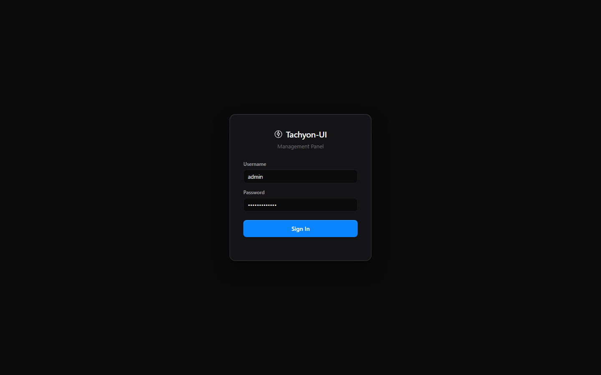
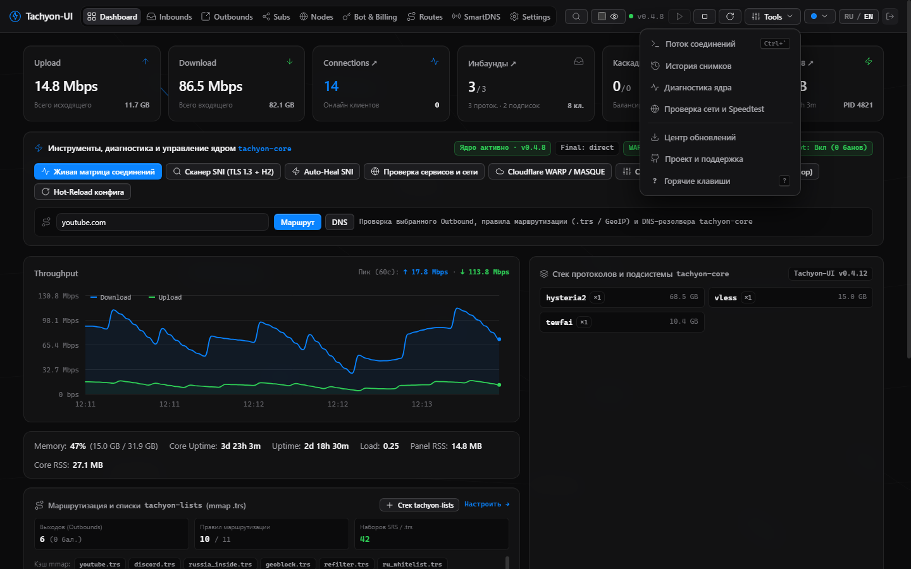
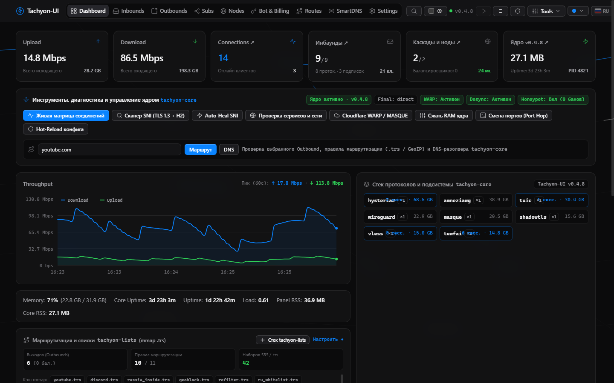
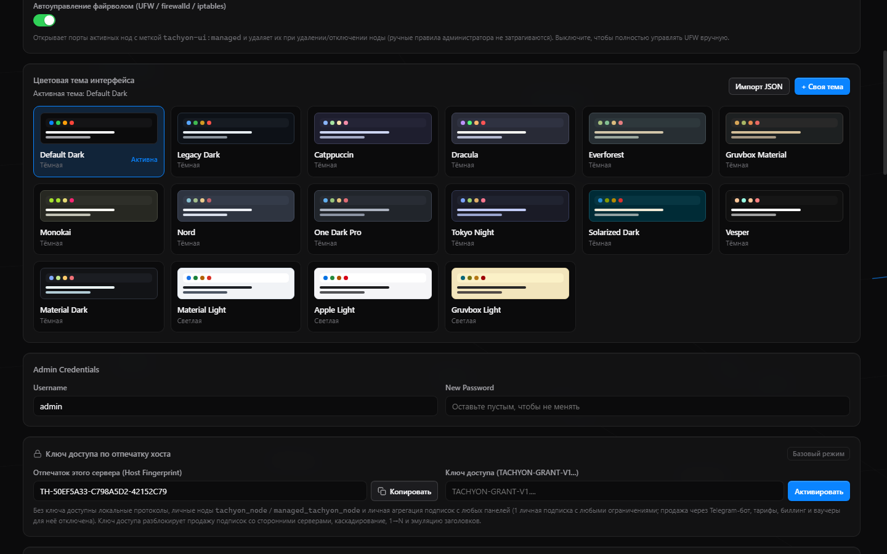
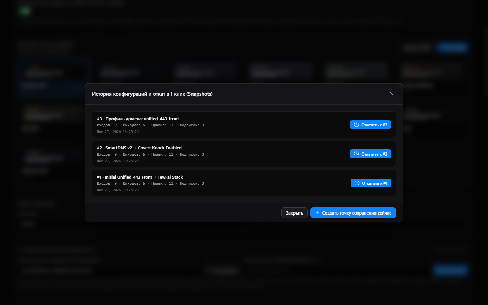

# 1. Installation, Docker, Source Build & CLI

[Русская версия](../ru/01-installation-and-cli.md) | [Complete Guide](00-complete-guide.md) | [Every Tab & Button UI Guide](11-ui-every-tab-and-button-guide.md) | [Back to Index](../../README.md)

## System Requirements

- **OS**: Linux `x86_64` or `aarch64` (Ubuntu, Debian, CentOS/RHEL, Alpine). Windows supports local panel execution and Linux cross-compilation.
- **RAM**: From 64 MiB for the panel itself (total with `tachyon-core` depends on active connections and `.trs` rule-sets).
- **Network**: Open panel TCP port (default `2053`), proxy inbound ports (such as `443/tcp`, `443/udp`), and optionally `80/tcp` / `443/tcp` when using native domain profiles or `Unified 443 Front`.

---

## Option 1: One-Command Installer (Linux + systemd)

```bash
bash <(curl -Ls https://raw.githubusercontent.com/Dushnilin/tachyon-ui/main/install.sh)
```

The [install.sh](https://github.com/Dushnilin/tachyon-ui/blob/main/install.sh) script:
1. Detects host CPU architecture (`x86_64` or `aarch64`) and installs the static `v0.4.12` binary to `/opt/tachyon-ui/tachyon-ui`.
2. Creates `/opt/tachyon-ui/data` (all persistent state lives in `/opt/tachyon-ui/data/tachyon-ui.json`).
3. Downloads the `tachyon-core` engine and extracts archives safely (`tar --no-same-owner --no-same-permissions`).
4. Installs the `tachyon-ui.service` systemd unit and the `/usr/local/bin/tachyon-panel` CLI tool.
5. Opens the panel port in `ufw` / `firewalld` / `iptables` (and also opens `80/tcp`, `443/tcp` when `OPEN_WEB_PORTS=1` or public web ports are enabled).
6. Generates and writes initial admin credentials via `tachyon-ui --reset-creds`, starts the service (launching `tachyon-core` in the background without blocking panel startup), and prints the access URL.

Supported environment variables for non-interactive setup:
- `ADMIN_PASS` — explicit initial password for `admin` on a fresh install (randomly generated via `openssl rand -hex 8` when omitted).
- `PANEL_PORT` — web panel listening port (default `2053`).
- `PUBLIC_IP` — explicit public IPv4 or hostname (e.g., `198.51.100.10`; auto-detected when omitted).
- `SERVER_COUNTRY` — 2-letter ISO server country code (auto-detected neutrally from host metadata when omitted).
- `OPEN_WEB_PORTS=1` — open `80/tcp` and `443/tcp` in the firewall during installation.

---

## Option 2: Docker

The container build creates a compact `debian:bookworm-slim` image storing state in `/data`:

```bash
docker build -t tachyon-ui .
docker run -d \
  --name tachyon-ui \
  --restart unless-stopped \
  --network host \
  -v /opt/tachyon-ui/data:/data \
  tachyon-ui
```

> If you use port mapping (`-p`) instead of `--network host`, expose the panel port (`2053`), HTTP/HTTPS web ports (`80`/`443` if enabled), and all inbound proxy ports (`443/tcp`, `443/udp`, WireGuard/AmneziaWG, etc.).

---

## Option 3: Source Build & Static `musl` Cross-Compilation

`tachyon-ui` uses zero C dependencies and links statically with `rust-lld` without `openssl-sys`, `ring`, or `aws-lc-rs`.

```bash
# Local native build (Windows / Linux)
cargo test
cargo build --release

# Static Linux x86_64 binary (cross-compiled from Windows or Linux)
rustup target add x86_64-unknown-linux-musl
cargo build --release --target x86_64-unknown-linux-musl

# Static Linux ARM64 (aarch64) binary
rustup target add aarch64-unknown-linux-musl
cargo build --release --target aarch64-unknown-linux-musl

# Native Windows x86_64 binary
cargo build --release --target x86_64-pc-windows-msvc
```

Compiled binaries are written to `target/<target>/release/tachyon-ui` (`tachyon-ui.exe` on Windows). Run manually:

```bash
./tachyon-ui /opt/tachyon-ui/data

# Reset admin credentials and bootstrap settings via environment variables (offline, without starting the server)
TACHYON_ADMIN_USER=admin TACHYON_ADMIN_PASS='StrongPass123!' ./tachyon-ui /opt/tachyon-ui/data --reset-creds

# Print the server Host Fingerprint used to request an access grant
./tachyon-ui /opt/tachyon-ui/data --host-fp
```

> To obtain a host-bound access grant (`TACHYON-GRANT-V1`) for external subscription imports or commercial reselling, contact the developer directly and provide your server's `--host-fp` output.

Environment variables supported by `--reset-creds`:

| Variable | Required | Purpose |
| :--- | :--- | :--- |
| `TACHYON_ADMIN_PASS` | Required | New admin password (non-empty; stored as salted iterative SHA-256). |
| `TACHYON_ADMIN_USER` | Optional | New admin username (`settings.admin_user`; keeps existing value when unset). |
| `TACHYON_LISTEN_PORT` | Optional | Web panel TCP listening port (`settings.listen_port`, `1..65535`). |
| `TACHYON_PUBLIC_HOST` | Optional | Public IP address or domain (e.g., `198.51.100.10` or `panel.example.com`). |
| `TACHYON_CORE_BIN` | Optional | Path to the `tachyon-core` binary (`settings.core_bin_path`). |
| `TACHYON_SERVER_COUNTRY` | Optional | 2-letter ISO country code (fills empty `country` fields on non-cascade inbounds). |

The first positional argument sets `data_dir` (defaults to `./data`), containing:
- `tachyon-ui.json` — main store (settings, subscriptions, protocols, routes, bot);
- `snapshots.json` — bounded ring buffer of up to 10 configuration revisions (rollback points);
- `cert.pem`, `key.pem` — active panel/domain TLS certificate;
- `www/` — custom static website root (`custom_static`);
- `tachyon.json` — generated runtime configuration for `tachyon-core`.

---

## First Sign-In & Interface Tour



Sign in with the credentials generated by the installer (starting manually with an empty `data_dir` creates `admin` / `admin` — change this immediately under **Settings → Admin Credentials**). For a full control-by-control reference of every screen, see [Chapter 11 — Complete UI Reference](11-ui-every-tab-and-button-guide.md).

### Sign-In Screen Controls

| Control | Label / Hotkey | ID / Action / API | Purpose |
| :--- | :--- | :--- | :--- |
| **Username input** | `Username` | `#login-user` | Admin account name (set by installer or `--reset-creds`). |
| **Password input** | `Password` (`Enter`) | `#login-pass` | Admin password; pressing `Enter` submits the form immediately. |
| **Sign In button** | `Sign In` | `App.doLogin()` / `POST /api/login` | Authenticates, issues the neutral `sid` session cookie, and loads the SPA. Displays `#login-error` on `401` and respects `web_base_path` when path isolation is enabled. |

---

### Topbar, Tools Menu, Hotkeys & Dashboard Controls



Once signed in, the persistent **Topbar (`#topbar`)** and **9-tab navigation (`#main-nav`)** provide instant access to `tachyon-core` lifecycle controls, diagnostics, themes, and global shortcuts:

| Control | Label / Hotkey | ID / Action / API | Purpose |
| :--- | :--- | :--- | :--- |
| **Mobile Menu** | `Menu` | `.mobile-menu-btn` → `#mobile-nav-overlay` | Opens the slide-out navigation drawer on narrow screens. |
| **Command Palette** | `Search…` (`Ctrl+K` / `Cmd+K`) | `.tb-search-btn` → `#modal-cmdk` | Fuzzy-searches all 9 tabs, panel actions, and live inbounds, outbounds, subscriptions, and nodes (`↑/↓` + `Enter`). |
| **Privacy Mask** | `Hide data` (`Alt+P`) | `#topbar-priv-chk` → `App.togglePrivacyMask()` | Toggles live DOM masking (`MutationObserver`) for IPs, domains, UUIDs, keys, and tokens before taking screenshots or screen-sharing. |
| **Core Status & Version** | `Core: ...` | `.core-status` / `#topbar-core-version` | Displays live `tachyon-core` process state and opens `#modal-core-update` on click. |
| **Core Start / Stop / Restart** | `Start` / `Stop` / `Restart` | `#btn-core-start`, `#btn-core-stop`, `.tb-restart-btn` → `POST /api/core/{start,stop,restart}` | Starts, stops, or restarts the `tachyon-core` process directly from any tab. |
| **Tools Dropdown** | `Tools` | `.tools-menu-btn` → `#topbar-tools-popover` | Opens quick overlays: **Live Connections** (`` Ctrl+` ``), **Snapshots**, **Core Diagnostics** (5 tabs), **Network Check & Speedtest**, **Update Center**, **Project & Support**, and **Keyboard Shortcuts** (`?`). |
| **Theme Picker & Studio** | Current theme | `.theme-trigger` → `#topbar-theme-popover` / `#theme-builder-overlay` | Switches between **16 built-in themes** (13 dark + 3 light) and user palettes, or opens `+ Create Custom Theme...` to customize CSS color variables. |
| **Language Toggle** | `RU` / `EN` | `.tb-lang-btn` → `App.toggleLang()` | Switches the entire UI between Russian and English instantly. |
| **Sign Out** | `Sign Out` | `.tb-logout-btn` → `POST /api/logout` | Invalidates the admin session cookie and returns to the sign-in screen. |
| **Section Tabs (`1..9`)** | `Alt+1` .. `Alt+9` | `App.switchTab(...)` | Jumps directly between `Dashboard` (`Alt+1`), `Inbounds` (`Alt+2`), `Outbounds` (`Alt+3`), `Subs` (`Alt+4`), `Nodes` (`Alt+5`), `Bot & Billing` (`Alt+6`), `Routes` (`Alt+7`), `SmartDNS` (`Alt+8`), and `Settings` (`Alt+9`). |

> **Additional Global Hotkeys:** Press `?` outside input fields to open the Keyboard Shortcuts reference (`#modal-shortcuts`), `Shift+Click` row checkboxes in `Inbounds` / `Outbounds` / `Subs` to select ranges for the floating bulk bar (`#gpui-fab-root`), and `Esc` to close active menus, drawers, modals, or the Live Connections Dock layer by layer.



On the **Dashboard (`#tab-dashboard`)**:
- **Top Action Bar**: **Apply** (`POST /api/core/apply` — regenerates and hot-applies the `tachyon-core` config), **Restart Core**, **Start / Stop**, **Config Preview** (`#modal-config` → `GET /api/config-preview`), and quick-launch buttons for **Core Diagnostics**, **SNI Scanner**, **Unlock Probe**, **RKN Check**, and **Snapshots**.
- **6 KPI Cards (`#dash-kpi-grid`), Subsystem Badges & Stack Matrix**: Live core uptime, active clients, healthy outbounds, subscriptions, Up/Down throughput, and **Memory / RSS** with a one-click **`Trim RAM`** button (`POST /api/core/memory-trim`), plus subsystem status pills (`Core`, `TLS/ACME`, `SmartDNS`, `TG Bot`, `Anti-Share`, `Auto-Healer`, `Failover`, `Watchdog`).
- **2-Button Live Tracer (`#dash-tracer-*`)**: Enter any domain or IP (and optional UDP DNS) and click **Check Route** (`POST /api/core/route-check`) or **Check DNS** (`POST /api/core/dns-check`) inside `tachyon-core`.
- **Throughput Chart, `tachyon-lists` (`.trs`) Card, Active Clients (`Kick` via `POST /api/core/kick`) & Core Logs (`#dash-logs`)**: Live RX/TX throughput curve, `.trs` rule-set summary, per-session kick control, and filterable `tachyon-core` stdout/stderr log viewer.
- **16 Built-In Themes + Custom Theme Studio**: Pick from **13 dark themes** (`Default Dark`, `Legacy Dark`, `Catppuccin`, `Dracula`, `Everforest`, `Gruvbox Material`, `Monokai`, `Nord`, `One Dark Pro`, `Tokyo Night`, `Solarized Dark`, `Vesper`, `Material Dark`) and **3 light themes** (`Material Light`, `Apple Light`, `Gruvbox Light`) from the topbar theme selector or **Settings → Appearance**, or create/import/export custom palettes.



---

## Automated Firewall Management (`ufw` / `firewall-cmd` / `iptables`)

By default, **Automatic Firewall Management** (`auto_firewall_enabled: true`) keeps host firewall rules synchronized safely:
1. **Exact Port & Protocol Rules**: The panel opens only the exact `(port, proto)` (`tcp` or `udp`) required by enabled non-loopback inbounds, active SmartDNS listeners, and public panel listeners (`127.0.0.1` / `localhost` / `::1` bindings and `cloudflared` tunnels are skipped).
2. **`tachyon-ui:managed` Tagging & Auto-Cleanup**: Rules added by the panel carry the `tachyon-ui:managed` comment and are tracked in `managed_firewall_rules`. When an inbound is deleted, disabled, moves ports/protocols, or binds to loopback, its `tachyon-ui:managed` rule is removed automatically — but only if no other active inbound or panel listener uses that same `(port, proto)`.
3. **Preservation of Manual Rules & SSH**: Administrator-created rules, rules added by `install.sh` (including port ranges), and SSH port `22` are never deleted. When `ufw` or `firewalld` (`firewall-cmd`) is active, rules are managed strictly through their native CLI without injecting raw `iptables` rules behind them.
4. **Opt-Out Toggle**: Administrators who manage firewall policies externally can turn off all automatic firewall changes via **Settings → Auto Firewall Management** (`auto_firewall_enabled: false`).

---

## Auto-Updates from GitHub (`tachyon-core` & Panel)

- **Web UI**:
  - Core engine: **Settings → Core Binary Path → Update from GitHub** (`/api/core/releases`, `/api/core/update`). Select any release tag from `Dushnilin/tachyon-core` without losing settings.
  - Panel: `/api/panel/releases` and `/api/panel/self-update` for atomic binary upgrades.
- **CLI**: `tachyon-panel update-core`.

---

## `tachyon-panel` CLI Reference

`/usr/local/bin/tachyon-panel` simplifies server administration and emergency access recovery:

| Command | Purpose |
| :--- | :--- |
| `tachyon-panel` | Interactive management menu (`0–9`). |
| `tachyon-panel info` | Displays service state, TLS mode (`web_tls_mode`), ports (`listen_port`, `web_http_port`, `web_https_port`), `web_domain`, `web_base_path`, `site_mode`, and effective URLs. |
| `tachyon-panel status` | Runs `systemctl status tachyon-ui`. |
| `tachyon-panel start \| stop \| restart` | Controls the panel and engine service. |
| `tachyon-panel logs` | Streams live service logs via `journalctl -u tachyon-ui -f -n 100`. |
| `tachyon-panel reset-pass` | Resets admin username and password via `tachyon-ui --reset-creds` using salted iterative SHA-256 hashing. |
| `tachyon-panel reset-path` | **Access recovery**: backs up `tachyon-ui.json`, resets `settings.web_base_path` to `""` (`/`), restarts the service, and prints the direct URL. |
| `tachyon-panel set-port` | Changes panel port and opens it in the firewall. |
| `tachyon-panel open-web-ports [80] [443]` | Opens `80/tcp` and `443/tcp` safely via `ufw`, `firewalld`, or `iptables`/`ip6tables`. |
| `tachyon-panel update-core` | Downloads the latest `tachyon-core` release from GitHub safely and restarts the service. |

---

## Backups & 10-Revision Snapshot Rollback Ring



- **Config Snapshots (`snapshots.json`)**: Automatic rollback points are saved into a bounded **10-revision snapshot rollback ring** before major changes such as domain profile switches, cascade edits, or batch actions (`/api/snapshots`, `/api/snapshots/restore`). Open **Tools → Snapshots** to inspect timestamps/labels and roll back in one click.
- **JSON Backup / Restore**: Use **Download Backup (.json)** and **Restore Backup** in **Settings** (`/api/backup`, `/api/restore`).
- **Scheduled Telegram Backups**: Configurable under **Bot & Billing** (`auto_backup_hours`) to send store backups directly to admin Telegram chats.

---

## Troubleshooting & Recovery

| Issue | Cause / Diagnostics | Recovery Action |
| :--- | :--- | :--- |
| Lost admin username or password | Sign-in rejected | Run `tachyon-panel reset-pass` or `TACHYON_ADMIN_USER=admin TACHYON_ADMIN_PASS='NewPass123!' ./tachyon-ui /opt/tachyon-ui/data --reset-creds` and restart the service. |
| Forgotten secret `web_base_path` | Root `/` renders the public site | Run `tachyon-panel reset-path`: creates `tachyon-ui.json.bak.<ts>`, resets `web_base_path` to `""`, and restarts the service. |
| Port `80`/`443` conflict or TLS bind error | Port already bound by `nginx`/`caddy`/another process | Inspect `GET /api/tls/status` (`Primary` / `HttpsDedicated` bind warnings) and `ss -tulpn \| grep -E ':80\|:443'`; open firewall ports via `tachyon-panel open-web-ports` or switch to `reverse_proxy` / `unified_443_front`. |
| Bad config after profile or cascade edit | Broken listener or routing state | Roll back to any of the last 10 revisions in `snapshots.json` via UI (**Tools → Snapshots**) or `POST /api/snapshots/restore`. |

---

[Previous: Complete Guide](00-complete-guide.md) | [Back to Index](../../README.md) | [Every Tab & Button UI Guide](11-ui-every-tab-and-button-guide.md) | [Next: Chapter 2 — Public Website, Dual HTTP+HTTPS, Domain Profiles, ACME & Self-Audit](02-stealth-web-domain-tls.md)
