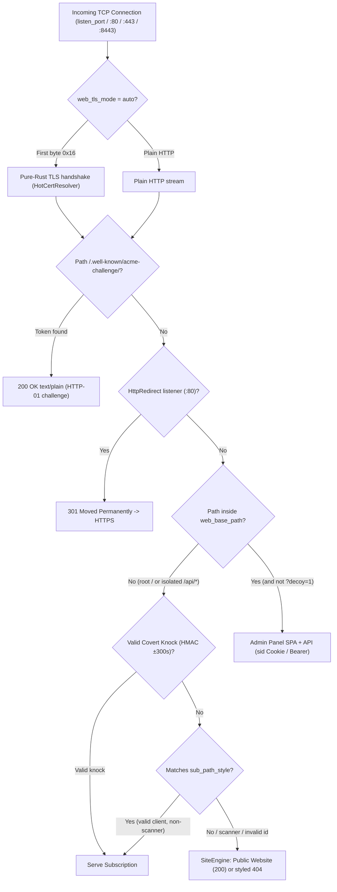
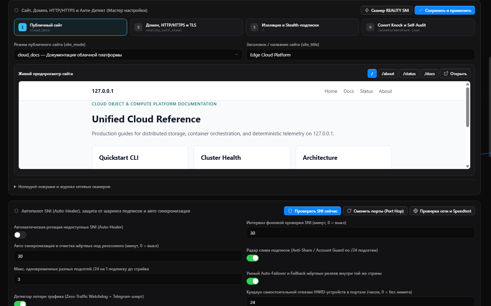
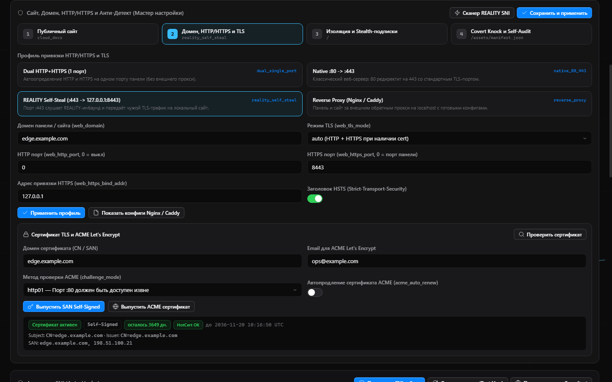
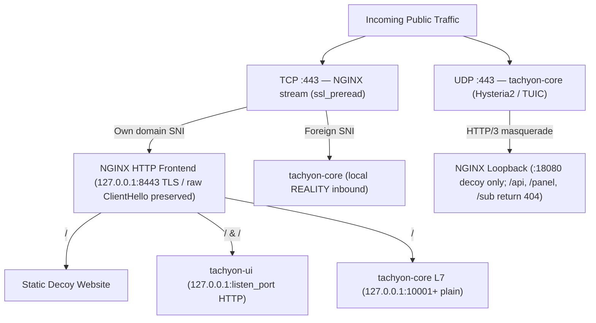
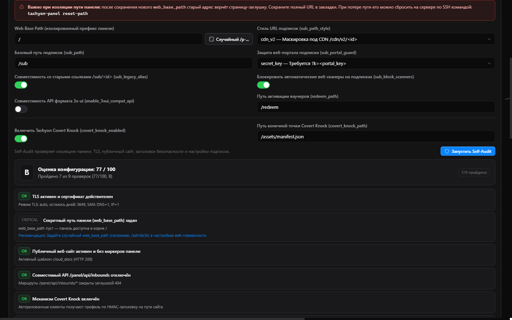

# 2. Public Website, Dual HTTP+HTTPS, Domain Profiles, ACME & Self-Audit

[Русская версия](../ru/02-stealth-web-domain-tls.md) | [Back to Index](../../README.md)

Starting with **v20**, `tachyon-ui` presents a full multi-page public website on its web port and natively terminates both HTTP and HTTPS without requiring an external reverse proxy (while also offering one-click Nginx/Caddy integration when shared hosting is needed).

---

## Request Processing Pipeline

---

## Site, Domain, HTTP/HTTPS & Defense Wizard

Open **Settings → Site, Domain, HTTP/HTTPS & Defense (Setup Wizard)** to configure all four layers step by step.

### Step 1: Public Website (`SiteEngine`)

Controls what regular browsers, crawlers, and active probes see on `/`:

- **6 Built-In Multi-Page Templates** (`site_mode`):
  1. `blank_nginx` — minimal neutral `nginx/1.26.2` page;
  2. `cloud_docs` — cloud documentation portal (`Northwind Cloud Docs`);
  3. `status_page` — infrastructure status dashboard (`Vertex Edge Status`);
  4. `devops_blog` — DevOps/SRE engineering journal;
  5. `corporate_it` — corporate IT portal;
  6. `maintenance` — scheduled maintenance notice.
  Built-in sites serve `/`, `/index.html`, `/about`, `/status`, `/docs`, `/assets/app.css`, `/assets/manifest.json`, `/robots.txt`, `/sitemap.xml`, `/favicon.ico`, and themed `404 Not Found` responses.
- **Custom Static Website (`custom_static`)**:
  - Upload a `.zip` archive (**up to 15 MiB** compressed, max **50 MiB** uncompressed, max **500 files**). The built-in pure-Rust extractor rejects zip-slip path traversal, absolute paths, symlinks, and executable binaries.
  - Content lives in `<data_dir>/www/`, with an inline `www/index.html` editor and reset button.
- **Live Preview**: An embedded `<iframe>` loads `${BASE}/api/site/preview` across `/`, `/about`, `/status`, and `/docs` without leaking admin cookies.
- **Active Honeypot**: Logs scanner probes hitting paths like `/.env`, `/wp-admin`, or `/phpmyadmin`, with optional IP auto-banning.

---

### Step 2: Domain, HTTP/HTTPS & TLS Certificates

#### 5 Binding Profiles (`web_domain_profile`)

| Profile | Ports & Architecture | When to Use |
| :--- | :--- | :--- |
| **`dual_single_port`** | Single port (`listen_port`, e.g. `2053`), `web_tls_mode = auto` | Fastest zero-proxy deployment: one port handles both `http://` and `https://`. |
| **`native_80_443`** | `web_http_port = 80` (ACME HTTP-01 + `301` redirect to HTTPS), `web_https_port = 443` | Standard domain setup on dedicated port `:443` without Nginx/Caddy. |
| **`reality_self_steal`** | `web_https_bind_addr = 127.0.0.1`, `web_https_port = 8443`, `web_http_port = 80`; external `:443` served by REALITY | Recommended for **REALITY Self-Steal**: REALITY listens on public `:443` and proxies unauthenticated TLS handshakes directly to `127.0.0.1:8443` on `tachyon-ui`. |
| **`reverse_proxy`** | Panel runs plain `http` on loopback/panel port behind Nginx or Caddy | Co-hosting alongside existing `:80/:443` sites. The wizard generates copy-ready Nginx and Caddy configs. |
| **`unified_443_front`** | NGINX on `443/tcp` (`ssl_preread` + HTTP/L7), `tachyon-core` on `443/udp` + local `127.0.0.1` inbounds | Consolidates the entire node onto port `443` (`80/tcp` used only for ACME HTTP-01 and redirects). Auto-adapts inbounds and exports complete `nginx.conf` / `Caddyfile`. |

> Clicking **Apply Profile** automatically creates a recovery snapshot (`/api/snapshots`) and rebinds listeners live via `ListenerSupervisor`:
> - For `reality_self_steal`, updates `handshake.server = "127.0.0.1"` and `handshake.server_port = 8443` on REALITY inbounds.
> - For `unified_443_front`, binds active L7 inbounds (`ws`, `httpupgrade`, `grpc`, `xhttp`/`http`) to `127.0.0.1:10001+` without TLS while exporting `<domain>:443` strict TLS (`external_port` / `external_tls`) to clients, and places the primary UDP inbound (`hysteria2` or `tuic`) on `0.0.0.0:443/udp` with `masquerade: http://127.0.0.1:18080`.

#### `Unified 443 Front (NGINX + Core)` Profile

- The generated `stream { ... }` block deliberately omits `proxy_protocol on;` so `tachyon-core` REALITY receives raw TLS `ClientHello` packets.
- The wizard provides a one-click `nginx.conf` download and `Caddyfile` snippet via `GET /api/domain/proxy-snippet?profile=unified_443_front`, while adapted inbounds display an `→ :443 TLS` external front badge.

#### TLS Certificates (`cert.pem` and `key.pem` in `<data_dir>`) & Listener Diagnostics

- **SAN Self-Signed** (`POST /api/tls/self-signed`): Issues an X.509 certificate with DNS/IP SAN extensions and hot-reloads `HotCertResolver`.
- **ACME Let's Encrypt — HTTP-01**: Requires no external Caddy or Nginx. When triggered, `tachyon-ui` opens `80/tcp` in the firewall (when `auto_firewall_enabled` is on), binds a temporary HTTP-01 listener on `:80` if needed, and waits for listener readiness before requesting the challenge. Busy-port or host-firewall errors surface clear diagnostic hints.
- **ACME Let's Encrypt — Cloudflare DNS-01**: Creates and cleans up `_acme-challenge.<domain>` TXT records via Cloudflare API (`cf_api_token` + `cf_zone_id`), ideal when `:80` is closed or `:443` is owned by REALITY.
- **Auto-Renewal (`acme_auto_renew`)**: Checks certificate expiry (`days_left <= 30`) every 12 hours for eligible public domain names (IP literals and `localhost` are skipped automatically) and hot-swaps renewed certificates.
- **Listener & Port Diagnostics (`GET /api/tls/status`)**: Clearly separates the primary auto-TLS panel port (`Primary`) from the dedicated `web_https_port` (`HttpsDedicated`), listing live HTTPS URLs and any port bind conflicts or warnings.

---

### Step 3: Panel Path Isolation & Stealth Defaults

- **`web_base_path` (Secret Admin Prefix)**: When set (e.g. `/p-8f3c21a9`), root paths `/`, `/login`, and `/api/*` stop serving panel assets or API endpoints. Any request outside `<web_base_path>` is routed exclusively through ACME → Covert Knock → `StealthSubGate` → `SiteEngine`.
  > **Recovery if you forget the path:** Run `tachyon-panel reset-path` over SSH to safely reset `web_base_path` back to root `/` (creates a backup automatically).
- **`enable_3xui_compat_api` (default `false`)**: Keeps `/panel/api/inbounds/*` disabled (returns `SiteEngine` 404 HTML).
- **`redeem_path`**: Custom voucher redemption path (scoped inside `<web_base_path>/redeem` when blank and `web_base_path` is set).
- **Neutral HTTP Fingerprint**: Emits `Server: nginx/1.26.2`, RFC-7231 `Date`, proper HTTP reason phrases (`404 Not Found`), neutral `sid=...; HttpOnly; SameSite=Strict` cookies (`+ ; Secure` on TLS), zero `Set-Cookie: 3x-ui`, zero `Access-Control-Allow-Origin: *`, and `/?decoy=1` never leaks the SPA.

---

### Step 4: Covert Knock & Self-Audit (`0–100`)

Click **Run Self-Audit** (`POST /api/web/self-audit`) to execute **9 automated checks** (including a live internal `StealthSubGate` probe for a non-existent `sub_id`) yielding a `0–100` score and grade (`A+` to `F`):

| Check ID | Severity | Verification Criteria | How to Pass |
| :--- | :--- | :--- | :--- |
| `tls_active` | critical | Active built-in TLS (`web_tls_mode != "http"` with valid non-expired SAN cert in `HotCertResolver`) **or** external TLS termination (`reverse_proxy` / `unified_443_front`) with a domain configured | Enable `auto`/`https` and issue a cert, or bind a domain under `reverse_proxy` / `unified_443_front`. |
| `web_base_path_isolated` | critical | Non-empty secret `web_base_path` configured (not `/`) | Generate a `/p-...` path in Step 3 and bookmark it. |
| `public_site_clean` | high | Active `SiteEngine` template (or `www/index.html` for `custom_static`); `/` contains zero `window.__PANEL_BASE__` or session markers | Select a template or upload static HTML in Step 1. |
| `legacy_3xui_disabled` | high | `enable_3xui_compat_api == false` | Keep legacy 3x-ui compatibility routes disabled. |
| `covert_knock_enabled` | medium | `covert_knock_enabled == true` | Enable Covert Knock in Step 4. |
| `scanners_filtered` | medium | `sub_block_scanners == true` | Keep automated scanner filtering enabled in Step 3. |
| `sub_path_obfuscated` | medium | `sub_path_style != "sub"` (or custom `sub_path`) AND `sub_legacy_alias == false` | Use `cdn_v2` / `static_feed` / `rss_updates` and disable legacy `/sub/`. |
| `portal_guard_enabled` | low | `sub_portal_guard == "secret_key"` | Require `?k=<portal_key>` for browser portal views. |
| `zero_oracle_404` | high | Internal non-existent subscription probe returns `404 Not Found` HTML with `Server: nginx/1.26.2` and zero JSON errors | Built-in default on v20. |

---

Next: [Chapter 3 — Subscriptions, Web Portal, Vouchers & Tachyon Covert Knock](03-subscriptions-and-covert-knock.md).
