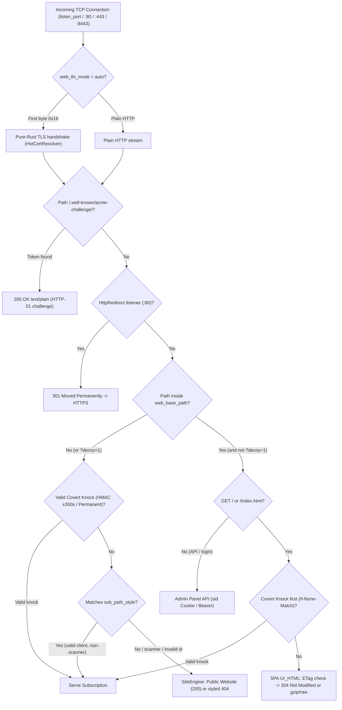
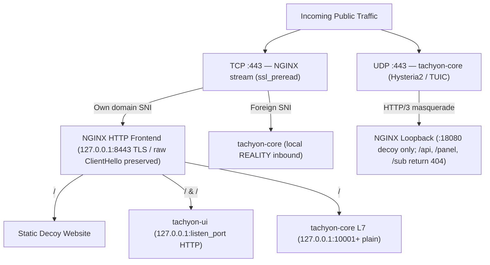

# 2. Public Website, Dual HTTP+HTTPS, Domain Profiles, ACME & Self-Audit

[Русская версия](../ru/02-stealth-web-domain-tls.md) | [Complete Guide](00-complete-guide.md) | [Every Tab & Button UI Guide](11-ui-every-tab-and-button-guide.md) | [27-Protocol Catalog](protocols/README.md) | [Back to Index](../../README.md)

`tachyon-ui` presents a full multi-page public website on its web port and natively terminates both HTTP and HTTPS without requiring an external reverse proxy (while also offering one-click Nginx/Caddy integration via `reverse_proxy` or `unified_443_front`).

---

## Request Processing Pipeline

> **`Covert Knock` vs. `ETag` Caching Order:** For `GET /` (or `/index.html`) inside `web_base_path` (when `?decoy=1` is not set), the server evaluates `Covert Knock` (`If-None-Match` / `X-Client-Digest` / `?v=`) **strictly before** SPA `ETag` / `304 Not Modified` handling (`serve_cached_ui_asset`), which serves the precompressed `UI_HTML` cache (`~225 KB` gzip vs `~1.05 MB` raw, with `Vary: Accept-Encoding` and `Cache-Control: no-cache`). This guarantees browser conditional-GET caching never interferes with covert knocking.

---

## Masking Wizard: Site, Domain, HTTP/HTTPS & Defense

Open **Settings → Site, Domain, HTTP/HTTPS & Defense (Masking Wizard)** to configure all four layers step by step.

### Step 1: Public Website (`SiteEngine`) & Honeypot

Controls what regular browsers, crawlers, and active probes see on `/`:

- **6 Built-In Multi-Page Templates** (`site_mode`):
  1. `blank_nginx` — minimal neutral `nginx/1.26.2` page;
  2. `cloud_docs` — cloud documentation portal (`Northwind Cloud Docs`);
  3. `status_page` — infrastructure status dashboard (`Vertex Edge Status`);
  4. `devops_blog` — DevOps/SRE engineering journal;
  5. `corporate_it` — corporate IT portal;
  6. `maintenance` — scheduled maintenance notice.
  Built-in sites serve `/`, `/index.html`, `/about`, `/status`, `/docs`, `/assets/app.css`, `/assets/manifest.json`, `/robots.txt`, `/sitemap.xml`, `/favicon.ico`, and themed `404 Not Found` responses.
- **Custom Static Website (`custom_static`)**:
  - Upload a `.zip` archive (**up to 15 MiB** compressed, max **50 MiB** uncompressed, max **500 files**). The built-in pure-Rust extractor rejects zip-slip path traversal, absolute paths, symlinks, and executable binaries.
  - Content lives in `<data_dir>/www/`, with an inline `www/index.html` editor and reset button.
- **Live Preview**: An embedded `<iframe>` loads `${BASE}/api/site/preview` across `/`, `/about`, `/status`, and `/docs` without leaking admin cookies.
- **Active Honeypot**: Logs scanner probes hitting paths like `/.env`, `/wp-admin`, or `/phpmyadmin`, with optional IP auto-banning.

| Step 1 Control | Action / API | Purpose |
| :--- | :--- | :--- |
| **Site Mode & Template Selector** | `GET /api/site/info`, `PUT /api/settings` | Switches between `blank_nginx`, `cloud_docs`, `status_page`, `devops_blog`, `corporate_it`, `maintenance`, and `custom_static`. |
| **Custom HTML Editor** | `GET/PUT /api/site/index` | Reads or saves `<data_dir>/www/index.html` inline when using a custom site. |
| **Upload ZIP Archive / Reset Site** | `POST /api/site/upload-zip`, `DELETE /api/site/custom` | Safely extracts a custom static site archive (up to 15 MiB) or clears `<data_dir>/www/`. |
| **Live Preview Frame** | `GET /api/site/preview` | Inspects `/`, `/about`, `/status`, and `/docs` without leaking admin cookies. |
| **Honeypot Log & Clear Button** | `GET /api/security/honeypot`, `POST /api/security/clear-honeypot` | Reviews captured scanner hits and clears the trap log. |

---

### Step 2: Domain, HTTP/HTTPS, 5 Binding Profiles & `Unified 443 Front`

#### All 5 Domain Binding Profiles (`web_domain_profile`)

| Profile | Ports & Architecture | When to Use |
| :--- | :--- | :--- |
| **`dual_single_port`** | Single port (`listen_port`, e.g. `2053`), `web_tls_mode = auto` | Fastest zero-proxy deployment: one port handles both `http://` and `https://`. |
| **`native_80_443`** | `web_http_port = 80` (ACME HTTP-01 + `301` redirect to HTTPS), `web_https_port = 443` | Standard domain setup on dedicated port `:443` without Nginx/Caddy. |
| **`reality_self_steal`** | `web_https_bind_addr = 127.0.0.1`, `web_https_port = 8443`, `web_http_port = 80`; external `:443` served by REALITY | Recommended for **REALITY Self-Steal**: REALITY listens on public `:443` and proxies unauthenticated TLS handshakes directly to `127.0.0.1:8443` on `tachyon-ui`. |
| **`reverse_proxy`** | Panel runs plain `http` on loopback/panel port behind Nginx or Caddy | Co-hosting alongside existing `:80/:443` sites. The wizard generates copy-ready Nginx and Caddy configs. |
| **`unified_443_front`** | NGINX on `443/tcp` (`ssl_preread` + HTTP/L7), `tachyon-core` on `443/udp` + local `127.0.0.1` inbounds | Consolidates the entire node onto port `443` (`80/tcp` used only for ACME HTTP-01 and redirects). Auto-adapts inbounds and exports complete `nginx.conf` / `Caddyfile`. |

> Clicking **Apply Profile** automatically creates a recovery snapshot (`/api/snapshots`) and rebinds listeners live via `ListenerSupervisor`:
> - For `reality_self_steal`, updates `handshake.server = "127.0.0.1"` and `handshake.server_port = 8443` on REALITY inbounds.
> - For `unified_443_front`, binds active L7 inbounds (`ws`, `httpupgrade`, `grpc`, `xhttp`/`http`) to `127.0.0.1:10001+` without TLS while exporting `panel.example.com:443` strict TLS (`external_port` / `external_tls`) to clients, and places the primary UDP inbound (`hysteria2` or `tuic`) on `0.0.0.0:443/udp` with `masquerade: http://127.0.0.1:18080`.

#### `Unified 443 Front (NGINX + Core)` Architecture & Limitations

- **No `proxy_protocol on;` in `stream { ... }`**: The generated NGINX `stream` block deliberately omits `proxy_protocol on;` so `tachyon-core` REALITY receives raw TLS `ClientHello` packets.
- **Consequence of omitting `proxy_protocol` (IP Visibility, Anti-Share & SmartDNS)**: Because NGINX forwards local HTTP traffic without `proxy_protocol`, requests arriving through `:443` appear to `tachyon-ui` from `127.0.0.1` unless standard `X-Real-IP` / `X-Forwarded-For` headers are evaluated by HTTP routes. Specifically:
  - **SmartDNS `/dns-bind/<token>` & DoH IP-binding**: Always open `/dns-bind/<token>` via the **direct panel port** (e.g., `https://panel.example.com:2053/dns-bind/<token>`) or add your external IP manually in `#smartdns` if NGINX passes `127.0.0.1`.
  - **SmartDNS SNI Proxy `:443/:80` Port Conflict**: Since `Unified 443 Front` owns public `:443/tcp` (`ssl_preread`), do not run the built-in SmartDNS SNI Proxy on `:443` of the same host—run SmartDNS SNI Proxy on a dedicated VPS or use UDP/TCP `:53`, DoT `:853`, and DoH on the panel port.
  - **IP Accounting without `X-HWID`**: Clients without an `X-HWID` header hitting `:443` share reduced IP-level Anti-Share visibility compared to direct ports; enable `strict_hwid` on subscriptions when operating behind `Unified 443 Front`.
- **NGINX Version & One-Click Export**: When applying `unified_443_front` directly to NGINX, `tachyon-ui` detects `nginx -v` (`listen ... ssl http2;` for `< 1.25.1` vs `http2 on;` for `>= 1.25.1`), matches the OS worker `user`, deduplicates `:18080` `location` blocks, runs `nginx -t`, and rolls back automatically on error. Adapted L7 inbounds display an `→ :443 TLS` badge.

#### TLS Certificates (`cert.pem` and `key.pem` in `<data_dir>`) & Listener Diagnostics

- **SAN Self-Signed** (`POST /api/tls/self-signed`): Issues an X.509 certificate with DNS/IP SAN extensions and hot-reloads `HotCertResolver`.
- **ACME Let's Encrypt — HTTP-01**: Requires no external Caddy or Nginx. When triggered, `tachyon-ui` opens `80/tcp` in the firewall (when `auto_firewall_enabled` is on), binds a temporary HTTP-01 listener on `:80` if needed, and waits for listener readiness before requesting the challenge. Busy-port or host-firewall errors surface clear diagnostic hints.
- **ACME Let's Encrypt — Cloudflare DNS-01**: Creates and cleans up `_acme-challenge.<domain>` TXT records via Cloudflare API (`cf_api_token` + `cf_zone_id`), ideal when `:80` is closed or `:443` is owned by REALITY.
- **Auto-Renewal (`acme_auto_renew`) & X.509 Caching (`read_cert_info_cached`)**: Checks certificate expiry (`days_left <= 30`) every 12 hours for eligible public domain names (IP literals and `localhost` are skipped automatically) and hot-swaps renewed certificates. Parsed X.509 metadata is cached in memory via `read_cert_info_cached` and automatically invalidated by `(mtime, size)` whenever the certificate file is reissued or updated.
- **Listener & Port Diagnostics (`GET /api/tls/status`)**: Clearly separates the primary auto-TLS panel port (`Primary`) from the dedicated `web_https_port` (`HttpsDedicated`), listing live HTTPS URLs and any port bind conflicts or warnings.

| Step 2 Control | Action / API | Purpose |
| :--- | :--- | :--- |
| **Domain & Binding Profile Selector** | `POST /api/domain/apply-profile` | Selects `dual_single_port`, `native_80_443`, `reality_self_steal`, `reverse_proxy`, or `unified_443_front`, saves a recovery snapshot, and adapts listeners. |
| **Apply NGINX / Get Proxy Snippet** | `POST /api/domain/apply-nginx`, `GET /api/domain/proxy-snippet` | Validates (`nginx -t`), deduplicates `:18080` masquerade blocks, and deploys or exports NGINX / Caddy configs. |
| **Issue Let's Encrypt ACME TLS** | `POST /api/tls/issue-acme` | Runs HTTP-01 (temporary `:80` listener) or Cloudflare DNS-01 issuance and reloads `HotCertResolver`. |
| **Issue Self-Signed TLS** | `POST /api/tls/self-signed` | Generates a SAN X.509 certificate for IP or domain fallback. |
| **TLS Status & Listener Summary** | `GET /api/tls/status` | Displays certificate expiry (`read_cert_info_cached`), SANs, active HTTPS URLs, and port bind warnings. |

> **Protocol TLS & Certificate Requirements:** When consolidating onto `:443` with `Unified 443 Front` or configuring per-inbound certificates, check protocol-specific rules in the [27-Protocol Catalog](protocols/README.md) (for example, strict CA certificate SNI matching on [10. NaiveProxy](protocols/10-naive.md) and [11. MASQUE](protocols/11-masque.md), `quic.tls` export on [01. TewFai](protocols/01-tewfai.md), and raw `ClientHello` REALITY routing on [02. VLESS](protocols/02-vless.md) and [03. Hysteria2](protocols/03-hysteria2.md)).

---

### Step 3: Panel Path Isolation & Automated Firewall (`tachyon-ui:managed`)

- **`web_base_path` (Secret Admin Prefix)**: When set (e.g. `/p-8f3c21a9`), root paths `/`, `/login`, and `/api/*` stop serving panel assets or API endpoints. Any request outside `<web_base_path>` is routed exclusively through ACME → Covert Knock → `StealthSubGate` → `SiteEngine`.
  > **Recovery if you forget the path:** Run `tachyon-panel reset-path` over SSH to safely reset `web_base_path` back to root `/` (creates a backup automatically).
- **`enable_3xui_compat_api` (default `false`)**: Keeps `/panel/api/inbounds/*` disabled (returns `SiteEngine` 404 HTML).
- **`redeem_path`**: Custom voucher redemption path (scoped inside `<web_base_path>/redeem` when blank and `web_base_path` is set).
- **Neutral HTTP Fingerprint**: Emits `Server: nginx/1.26.2`, RFC-7231 `Date`, proper HTTP reason phrases (`404 Not Found`), neutral `sid=...; HttpOnly; SameSite=Strict` cookies (`+ ; Secure` on TLS), zero `Set-Cookie: 3x-ui`, zero `Access-Control-Allow-Origin: *`, and `/?decoy=1` never leaks the SPA.

- **Firewall Automation (`auto_firewall_enabled`)**: Reconciles `UFW` / `firewalld` (`firewall-cmd`) / `iptables` rules tagged `tachyon-ui:managed`, cleans up rules for removed/disabled inbounds, and strictly protects SSH port `22` and manual administrator rules.

| Step 3 Control | Action / API | Purpose |
| :--- | :--- | :--- |
| **Secret Panel Path (`web_base_path`)** | `PUT /api/settings` | Moves admin UI and `/api/*` under a secret URL prefix (e.g. `/p-8f3c21a9`). |
| **Legacy 3x-ui Compat Toggle (`enable_3xui_compat_api`)** | `PUT /api/settings` | Keeps `/panel/api/inbounds/*` disabled (`false` recommended) so probes receive `SiteEngine` 404 HTML. |
| **Polymorphic Subscription Path (`sub_path_style` & `sub_legacy_alias`)** | `PUT /api/settings` | Switches subscription URLs to `static_feed`, `cdn_v2`, `rss_updates`, or a custom path and disables `/sub/`. |
| **Scanner Filter & Portal Guard (`sub_block_scanners`, `sub_portal_guard`)** | `PUT /api/settings` | Drops scanner User-Agents to decoy 404 and requires `?k=<portal_key>` for browser portal views. |
| **Voucher Path (`redeem_path`) & Auto-Firewall Toggle (`auto_firewall_enabled`)** | `PUT /api/settings` | Sets the `/redeem` endpoint and toggles safe `tachyon-ui:managed` firewall synchronization. |

---

### Step 4: Covert Knock & 9-Check Self-Audit (`0–100`)

Click **Run Self-Audit** (`POST /api/web/self-audit`) to execute **9 automated checks** (including a live internal `StealthSubGate` probe for a non-existent `sub_id`) yielding a `0–100` score and grade (`A+` to `D`):

| Check ID | Severity | Verification Criteria | How to Pass |
| :--- | :--- | :--- | :--- |
| `tls_active` | `critical` | Active built-in TLS (`web_tls_mode != "http"`) or external TLS profile (`reverse_proxy` / `unified_443_front`) with a non-`localhost` domain, plus a valid non-expired SAN cert in `HotCertResolver` | Enable `auto`/`https` and issue a SAN cert, or bind a domain under `reverse_proxy` / `unified_443_front` with a valid SAN cert. |
| `web_base_path_isolated` | `critical` | Non-empty secret `web_base_path` configured (not `/`) | Generate a prefix (e.g. `/p-...`) in Step 3 and bookmark it. |
| `public_site_active` | `high` | Active `SiteEngine` template (or `www/index.html` for `custom_static`); `/` contains zero `window.__PANEL_BASE__` or `tachyon_session` markers | Select a template or upload static HTML in Step 1. |
| `compat_3xui_disabled` | `high` | `enable_3xui_compat_api == false` | Keep `/panel/api/inbounds/*` compatibility routes disabled. |
| `covert_knock_enabled` | `medium` | `covert_knock_enabled == true` | Enable Covert Knock in Step 4. |
| `sub_block_scanners` | `high` | `sub_block_scanners == true` | Keep automated scanner filtering enabled in Step 3. |
| `sub_path_obfuscated` | `high` | `sub_path_style != "sub"` (or custom `sub_path`) AND `sub_legacy_alias == false` | Use `static_feed` / `cdn_v2` / `rss_updates` (or a custom path) and disable legacy `/sub/`. |
| `sub_portal_guard_secret` | `high` | `sub_portal_guard == "secret_key"` | Require `?k=<portal_key>` (or Telegram WebApp) for browser portal views. |
| `zero_oracle_neutral_headers` | `critical` | Internal `StealthSubGate` probe for a non-existent subscription returns `ServeDecoy404` HTML `404 Not Found` with `Server: nginx/1.26.2` and zero JSON errors | Built-in default when neutral HTTP headers are preserved. |

---

[Previous: Chapter 1 — Installation, Docker, Source Build & CLI](01-installation-and-cli.md) | [Every Tab & Button UI Guide](11-ui-every-tab-and-button-guide.md) | [27-Protocol Catalog](protocols/README.md) | [Back to Index](../../README.md) | [Next: Chapter 3 — Subscriptions, Web Portal, Vouchers & Tachyon Covert Knock](03-subscriptions-and-covert-knock.md)
