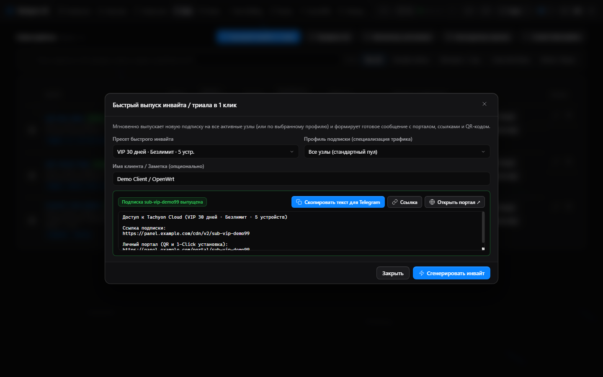
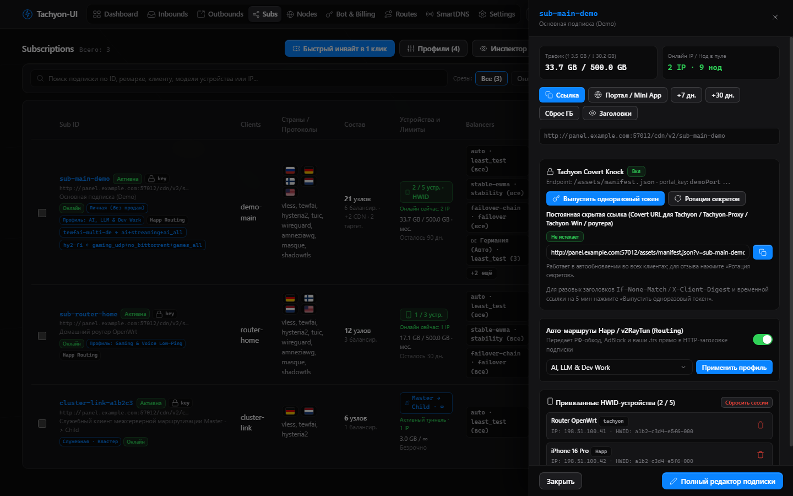
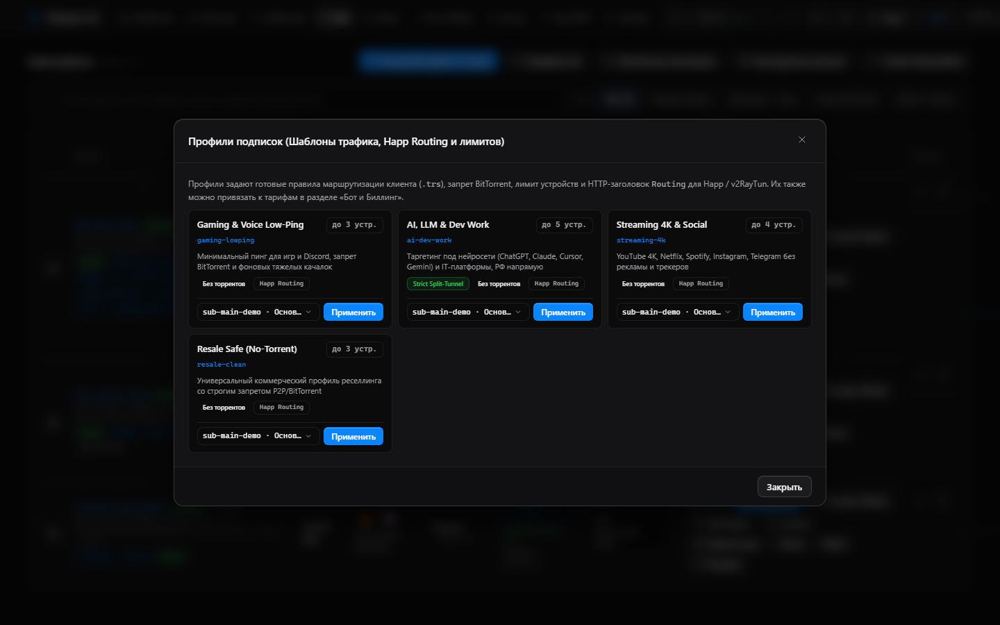
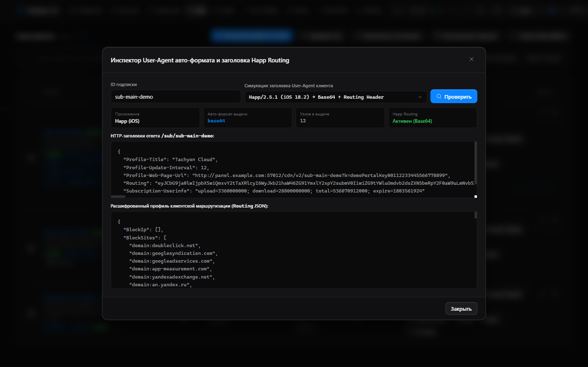

# 3. Subscriptions, Web Portal, Vouchers & Tachyon Covert Knock

[Русская версия](../ru/03-subscriptions-and-covert-knock.md) | [Complete Guide](00-complete-guide.md) | [Every Tab & Button UI Guide](11-ui-every-tab-and-button-guide.md) | [27-Protocol Catalog](protocols/README.md) | [Back to Index](../../README.md)

The **Subscriptions (`#subs`)** module consolidates local inbounds, managed `Master → Child` cluster nodes, custom entry hosts, and balancers into a single adaptive subscription endpoint or web portal while enforcing four layers of stealth protection.


---

## Subscriptions Table, Saved Views & `v0.4.12` Cluster Badges

- **Saved Views & Instant Search**: Filter by `All`, `Online now`, `Expiring < 3d`, `Anti-Share`, or `Overquota`, or search by `sub_id`, remark, client name, device model, or IP.
- **Live `Online now: N IP` Badge**: Every active subscription displays real-time connected IP counts (`Online now: N IP`) derived from `LiveTelemetry` (`sub_online_ips` and disambiguated `user_online_ips`), while expired, disabled, or over-quota clients are evicted immediately.
- **Service Tunnel Badge (`cluster-link-*` → `Master → Child · ∞`)**: When you export a Child node's inbound as an outbound on `Master`, `tachyon-ui` provisions a dedicated `cluster-link-<master_id>` service subscription on the Child. In `#subs`, it renders with a `Service · Cluster` and `Master → Child · ∞` badge—device limits and HWID checks are intentionally disabled (`∞`) so inter-server relays never hit client caps.
- **Atomic In-Place `sub_id` Rename (`old_sub_id`)**: Renaming a `sub_id` in the modal (or via `POST /api/subs` with `old_sub_id`) atomically updates `sub_configs`, `inbounds[].clients`, `tg_bot.users`, `tg_bot.trial_template_sub_id`, and `remote_nodes[].cascade_sub_id` while preserving UUIDs and keys (`409 Conflict` if the target `sub_id` exists).
- **Cluster `sub_configs` / HWID / Device-Limit Sync (`v0.4.12`)**: In a `Master → Child` cluster (`managed_tachyon_node`), saving, extending, disabling, or deleting a subscription on `Master` pushes both client credentials and `sub_configs` metadata (`remark`, `device_limit`, `strict_hwid`, `devices`, `traffic_reset_strategy`, `start_on_first_use`, `expire_duration_days`, `activated_at`) to every linked Child node automatically (excluding `cluster-link-*`), keeping device limits and On-Hold timers identical across all locations.

### Subscriptions Toolbar, Row & Bulk Controls (`#tab-subs`)

| Control | Label / Action | API / Modal | Purpose |
| :--- | :--- | :--- | :--- |
| **Search & Status Slices** | Search (`name`, `sub_id`, note, IP) + Slices (`All`, `Online now`, `Expiring < 3d`, `Anti-Share`, `Overquota`) | Client-side filter | Filters active, expired, over-quota, or strike-flagged subscriptions immediately. |
| **+ Add Sub** | `App.openSubModal()` | `#modal-sub` | Opens the 5-tab subscription editor (or `openPersonalSubModal` in basic single-subscription mode without a grant). |
| **+ 1-Click Quick Invite** | `App.openQuickInviteModal()` | `#modal-quick-invite` → `POST /api/subs/quick-invite` | Issues a ready-to-share guest/trial subscription link and QR code in one click from duration, traffic, and profile presets. |
| **Subscription Profiles** | `App.openSubProfilesModal()` | `#modal-sub-profiles` → `GET /api/sub-profiles`, `POST /api/subs/apply-profile` | Manages reusable node, limit, DNS, and routing templates for plans and bulk assignment. |
| **Header Inspector** | `App.openSubHeaderInspectorModal()` | `#modal-sub-headers` → `POST /api/subs/inspect-headers` | Emulates client `User-Agent` headers and previews exact HTTP headers and payloads. |
| **Portal Builder** | Jumps to `sub_portal_*` in **Settings** | `PUT /api/settings` | Configures branding, client download buttons, instructions, and `sub_portal_guard`. |
| **Import External Sub** | Import external URL / URI list | `POST /api/subs/import-external` | Imports a third-party subscription URL or URI list (`country`, `url`, `text`, `user_agent`, `hwid`). |
| **Row Quick Actions** | `Links / QR`, Enable/Disable toggle, `+30d`, `Rotate Link`, `Clear Strikes`, `Edit`, `Delete` | `#modal-sub-links`, `POST /api/subs/{id}/{toggle,extend,rotate}`, `POST /api/subs/clear-strikes`, `DELETE /api/subs/{id}` | Performs per-user lifecycle actions directly from the table without opening the full editor. |
| **Floating Bulk Bar** | Row checkboxes (`Shift+Click` for range) | `#gpui-fab-root` → `POST /api/subs/batch-action` | Batch extends (`+30d`), enables/disables, applies a subscription profile, or deletes selected subscriptions. |



---

## The 5-Tab Subscription Editor (`#modal-sub`)

### Tab 1: Nodes (`Nodes`)


- **Local Inbounds**: Filter by search query, 2-letter ISO country code, or stack (`REALITY`, `QUIC`, `TLS`, `STEALTH`, `VPN`), and click the route icon on any chip to attach a per-node `.trs` traffic rule directly.
- **Managed Cluster Nodes (`Master → Child API`)**: Toggle **Include all personal nodes automatically** or pick specific `managed_tachyon_node` servers (`direct` / `hybrid`; `relay`-only nodes are omitted from direct client exports).
- **External Aggregation & Access Grant (`TACHYON-GRANT-V1`)**:
  - Personal single-subscription aggregation of external nodes is available for personal use (isolated from Telegram Bot sales).
  - Commercial aggregation, importing third-party `sub_url` / `manual_uris` / `external_nodes` across multiple subscriptions, and client-emulation headers (`User-Agent` / `x-hwid`) require a host-bound `TACHYON-GRANT-V1` access grant (otherwise returning `403 grant_required`). **Contact the developer directly** with your server's `--host-fp` fingerprint to obtain a grant.

### Tab 2: Balancers (`Balancers`)

Configure `urltest` (all 12 modes), `selector`, and sequential `chain` outbounds directly inside the subscription, or generate stack/country groups (`auto`, `auto-de`, `auto-fi`, `auto-nl`) in one click. See [Chapter 4](04-balancers-chain-and-routes.md) for full details.

### Tab 3: Devices & Limits (`Devices & Limits`)


- **`device_limit` & `strict_hwid`**: Caps bound devices / concurrent IPs (`0 = ∞`) and enforces `x-hwid` headers from compatible clients (`Happ`, `Tachyon`). Clients can self-unbind old devices via the portal (`POST <sub_path>/unbind-device`) subject to `sub_unbind_cooldown_hours`.
- **Traffic Quota & Periodic Reset**: `total_limit_bytes` (`traffic_limit_bytes` alias) caps combined `up + down` across local and Child servers; `traffic_reset_strategy` (`none`, `daily`, `weekly`, `monthly`) resets counters automatically and reloads the engine when an over-quota user becomes active again.
- **On-Hold Activation (`start_on_first_use`)**: Starts the `expire_duration_days` countdown only on the user's first actual subscription fetch.
- **Account Guard / Anti-Share**: Tracks concurrent `/24` subnets (`anti_share_max_subnets`), logs `suspect_ips`, and records strikes (`/api/subs/clear-strikes`).
- **Bound Devices List**: Shows each registered device model, app name, `last_ip`, and `HWID` prefix, with one-click reset.

### Tab 4: Entry Hosts / CDN (`Entry Hosts / CDN`)


- Override public address, port, country, `SNI`, and `Host` header for CDN fronting or transit relays.
- Enable **Replace** (`replace_default`) to swap the node's raw IP/host cleanly without duplicating entries, or leave it off to emit both direct and CDN/relay variants.
- Under `unified_443_front`, localhost L7 inbounds (`127.0.0.1:10001+`) automatically export as `<domain>:443` with strict TLS and zero `insecure` flags.

### Tab 5: Node Rules (`Node Rules` + `strict_routing_only`)


- **`strict_routing_only` (Strict Subscription Mode)**: When enabled (or when all nodes use `only_this`), unmatched traffic defaults to `final: direct`, and server-side `tachyon-core` enforces allowed `.trs` rule-sets and ports even if a user connects with a single raw URI.
- **1-Click Presets & Per-Node Policies**: Apply presets (`No BitTorrent`, `YouTube + Discord only`, `AI only`, `Streaming 4K`, `VoIP & Messengers`, `Gaming + UDP`, `Social`, `Web 80/443 no torrent`) or bind individual nodes to specific `.trs` rule-sets, traffic classes, domains, and ports (`only_this` / `prefer_node` with `server_unmatched`: `block` / `direct` / `client_only`).

---

## 360° Subscription Inspector Drawer & Subscription Profiles



Click any `sub_id` (or the **360°** button) in `#subs` to open the **480 px right-side 360° Subscription Inspector Drawer**:
- Live combined `↑ / ↓` traffic vs. quota, live `Online IP` count (`Online now: N IP`) vs. node pool size, and one-click **Reset sessions** (`/tachyon/kick`).
- **Instant action bar**: copy URL, open Portal / Mini App, `+7d` / `+30d` extend, **Reset GB** (`POST /api/subs/{id}/reset-traffic`), **Rotate Link** (`POST /api/subs/{id}/rotate`), **Clear Strikes**, **Edit**, **Delete**, and open **Header Inspector**.
- **Embedded controls**: **Covert Knock** generator (`POST /api/subs/{id}/covert-token` + `POST /api/subs/{id}/rotate-secrets`), **Happ / v2RayTun `Routing`** toggle, **Subscription Profile** selector, and bound **HWID device cards** (`DELETE /api/subs/{id}/devices/{devId}` or `DELETE /api/subs/{id}/devices` to unbind one or all devices, with cluster-aware hints when HWID is managed on `Master` or disabled on `cluster-link-*`).



**Subscription Profiles (`/api/sub-profiles`)** store reusable templates (`Gaming Low-Ping`, `AI & Dev`, `Streaming 4K`, etc.) combining device limits, On-Hold activation, traffic reset intervals, balancer sets, Happ Routing presets, and announcement banners—applied in one click from the drawer, profile modal, **Quick Invite (`/api/subs/quick-invite`)**, or Telegram Bot tariffs.

---

## Links, Covert Knock, OpenWrt 1-Click, QR & Header Inspector


Click **Links / Knock** on any subscription to access:
- **Universal & Format-Specific URLs**: Standard subscription URL, `?format=singbox` / `tachyon`, `?format=clash` / `mihomo`, `?format=raw`, `?format=sip008`, `?format=openwrt`, and **OpenWrt 1-Click Installer (`?format=openwrt-install`)**.
- **Covert Knock Tokens**: Issue both **5-minute ephemeral tokens** (with ready-to-run `curl` snippets using `If-None-Match` or `X-Client-Digest`) and **Permanent (`Non-expiring`) Covert Knock URLs** (`?v=<sub_id>.p.<hmac24>`) recommended for routers, plus one-click secret rotation (`POST /api/subs/:id/rotate-secrets`).
- **QR Code & Web Portal**: Instant scannable QR and direct link to the branded Web Portal (`?k=<portal_key>` when Portal Guard is active).

### Supported Client Output Formats & Dynamic Query Parameters

See the [27-Protocol Catalog](protocols/README.md) for per-protocol URI schemes and client export compatibility (for example, `tewfai://`, `vless://`, `hy2://`, `tuic://`, `anytls://`, `naive+https://`, `masque://`, `amneziawg://`, and SIP008 for Shadowsocks).

| Output Format | Query `?format=` | Notes |
| :--- | :--- | :--- |
| **`tachyon-core` JSON Profile** | `singbox` / `sing-box` / `tachyon` / `json` | Full client JSON profile (`tachyon_json_profile` for `tachyon-core/2.0`) including all 12 `urltest` modes, `balancer`, `chain`, `time_window`, `.trs` rules, and native protocols (`TewFai`, `MASQUE`, `AmneziaWG`). Exported `masque` outbounds set `keep_alive_period: "20s"`, `idle_timeout: "50s"`, and `tls.alpn: ["h3"]`; `tewfai` with `REALITY` + `quic` automatically adds `quic.tls` (`alpn: ["h3"]`, `insecure: true`). |
| **JSON Outbounds Only** | `outbounds` | Returns only the JSON `outbounds` and `endpoints` arrays without route/DNS wrappers. |
| **Clash / Mihomo** | `clash` / `clashmeta` / `meta` / `mihomo` / `yaml` | YAML with `select`, `url-test`, `fallback`, `load-balance`, and `relay` groups (exports only Clash-supported types: `vless`, `trojan`, `anytls`, `vmess`, `hysteria2`, `tuic`, `shadowsocks`, `mieru`, `snell`, `socks`/`http`, `wireguard`). |
| **Raw URI List** | `raw` / `uri` / `plain` | Unencoded line-by-line URI list (`tewfai://`, `vless://`, `hy2://`, `tuic://`, `trojan://`, `ss://`, `vmess://`, etc.). |
| **Base64 (default)** | Auto / generic clients | Base64 URI list with `Subscription-Userinfo`, `Profile-Update-Interval`, and Base64 `Routing` header (`happ_routing_enabled`). |
| **SIP008** | `sip008` | Standard SIP008 JSON profile (`version: 1`, `servers[]`) for Shadowsocks clients only. |
| **OpenWrt Router & 1-Click** | `openwrt` / `router` / `openwrt-install` | Router JSON config or executable 1-click shell installer. |
| **WireGuard / AmneziaWG** | Portal / node export | `.conf` tunnel profile including `jc`/`jmin`/`jmax`/`s1..s4`/`h1..h4`/`i1..i5`. |
| **Web Portal** | `html` / `portal` (or `Accept: text/html`) | Branded portal with quota stats, device unbinding, QR, and client import buttons. |

Append `?country=DE,NL` (or `?cc=US`) to filter by country, and `?mode=antiblock` | `ru-direct` | `gaming` | `full` to switch client routing rules dynamically.

### Header Inspector (`POST /api/subs/inspect-headers`)



Open **Header Inspector** from `#subs` or the 360° drawer to simulate how `tachyon-ui` responds to different `User-Agent` strings (`Happ/2.5.1`, `v2RayTun/3.12.0`, `TachyonClient/1.0` / `tachyon_json_profile`, `FlClash/Mihomo`, `Mozilla/Telegram Mini App`), inspecting `detected_app`, `detected_format`, node count, exact HTTP response headers, and the decoded Base64 `Routing` JSON payload.

---

## Multi-Subscription Accounting & Vouchers

- **Deterministic Client Disambiguation (`core_user_name_for_client` / `InboundUserNameResolver`)**: Shared client names across subscriptions on the same inbound are deterministically formatted as `name [sub_id]` (or `sub_id`, falling back to `name [id]` / `client [id]` on collisions), guaranteeing isolated per-subscription traffic and online tracking.
- **Strict Single-Client Fallback (`single_fallback_client_user`)**: Unattributed inbound-level stats are credited only when an inbound has **strictly one** effectively active client—never misattributed when two or more active clients exist.
- **Automatic `wg_client_ip` Allocation**: Assigning a subscription to WireGuard, AmneziaWG, or MASQUE inbounds picks the lowest unused octet in `2..=254` (`10.10.0.<octet>/32`).
- **Web Portal Branding & Vouchers (`/redeem`)**: Customize layout (`sub_page_layout`), accent color, logo, announcement, support/buy/channel URLs, custom CSS/HTML, and batch-generate `/redeem` activation vouchers (`/api/vouchers/batch`).

---

## 4-Level Stealth Subscription Protection (`StealthSubGate`)

1. **Polymorphic Paths (`sub_path_style`)**: Switch between `sub` (`/sub/<id>`), `static_feed` (`/static/feed/<id>`), `cdn_v2` (`/cdn/v2/<id>`), and `rss_updates` (`/rss/updates/<id>`), and disable `sub_legacy_alias` once migrated.
2. **Zero-Oracle & Scanner Filter (`sub_block_scanners`)**: Missing/expired `sub_id`s and probes from `curl`, `wget`, `zgrab`, `censys`, `shodan`, `nuclei`, `nmap`, etc. receive `SiteEngine` HTML `404 Not Found` with `Server: nginx/1.26.2` and zero JSON errors.
3. **Browser Portal Guard (`sub_portal_guard = secret_key`)**: Requires `?k=<portal_key>` or validated Telegram Mini App `tgWebAppData` in browsers while proxy clients fetch normally.
4. **Tachyon Covert Knock**: Serves subscriptions on normal site routes (such as `/` or `/assets/manifest.json`) only when presented with a constant-time HMAC-SHA256 token (`If-None-Match: W/"<sub_id>.<ts>.<hmac16>"`, `X-Client-Digest`, or `?v=<token>` within `±300s`, or a non-expiring `?v=<sub_id>.p.<hmac24>` router token). Invalid or missing tokens return the normal decoy page/manifest with zero error clues.

```bash
# Without knock header -> normal public site manifest (200 OK, application/json)
curl -s https://panel.example.com/assets/manifest.json

# With valid ETag knock -> live subscription payload
curl -s -A "Happ/2.5.1" \
  -H 'If-None-Match: W/"sub-pro-team.1795400000.a1b2c3d4e5f60708"' \
  https://panel.example.com/assets/manifest.json
```

---

[Previous: Chapter 2 — Public Website, Dual HTTP+HTTPS, Domain Profiles, ACME & Self-Audit](02-stealth-web-domain-tls.md) | [Every Tab & Button UI Guide](11-ui-every-tab-and-button-guide.md) | [27-Protocol Catalog](protocols/README.md) | [Back to Index](../../README.md) | [Next: Chapter 4 — Balancers (12 `urltest` Modes), `chain` Outbounds & Routing](04-balancers-chain-and-routes.md)
