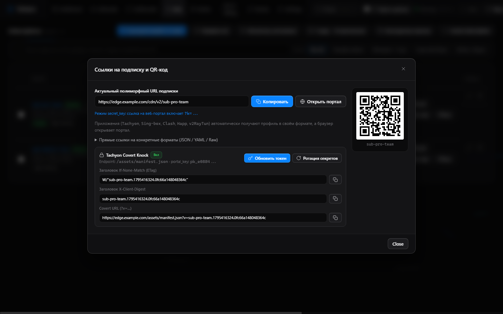

# 3. Subscriptions, Web Portal, Vouchers & Tachyon Covert Knock

[Русская версия](../ru/03-subscriptions-and-covert-knock.md) | [Back to Index](../../README.md)

The **Subscriptions** module consolidates all user protocols and endpoints into a single URL or web portal while enforcing four layers of endpoint protection.



---

## Subscriptions, Profiles & Device Management

- **Grouping by `sub_id`**: Clients sharing the same `sub_id` across different inbound protocols (VLESS+REALITY, Hysteria2, TUIC, WireGuard/AWG, Sudoku, WDTT) are bundled into one subscription.
- **Subscription Profiles (`/api/sub-profiles`)**: Reusable presets (device limit, On-Hold `start_on_first_use`, `daily`/`weekly`/`monthly` traffic reset, balancer sets, `announce` banner) applied in one click.
- **HWID Device Limits**:
  - `device_limit` caps bound devices / concurrent IPs; `strict_hwid` enforces an `x-hwid` header.
  - Clients can self-unbind old devices via the portal (`POST <sub_path>/unbind-device`), governed by `sub_unbind_cooldown_hours`.
- **Account Guard / Anti-Share**: Tracks concurrent `/24` subnets per subscription (`anti_share_max_subnets`), records strikes, and logs `suspect_ips`.
- **Custom Entry Hosts (`hosts`) & Per-Node Rules (`node_rules`)**: Override public host/port/SNI/Host header for CDN or transit relays, and restrict specific nodes to chosen `.trs` rule-sets or traffic classes (`only_this` / `prefer_node`, enforced server-side via `server_unmatched`: `block` / `direct` / `client_only`).
- **Vouchers (`/redeem`)**: Batch-generate redemption codes (`/api/vouchers/batch`) that users exchange for active subscriptions at `/redeem` or a custom `redeem_path`.

---

## Supported Client Output Formats

A single subscription endpoint adapts automatically via `User-Agent`, or explicitly via `?format=`:

| Output Format | Query `?format=` | Notes |
| :--- | :--- | :--- |
| **`tachyon-core` / `sing-box`** | `sing-box` / `tachyon` | Full JSON profile including all 12 `urltest` modes, `balancer`, `chain`, `time_window`, `.trs` rules, and native protocols. |
| **Clash / Mihomo** | `clash` / `mihomo` | YAML with `select`, `url-test`, `fallback`, `load-balance`, and `relay` groups. |
| **Raw / V2Ray / Xray** | `raw` / `v2ray` / `base64` | Base64-encoded URI list (`vless://`, `hy2://`, `tuic://`, `trojan://`, `ss://`, `vmess://`). |
| **Happ / Hiddify / v2rayTun / Shadowrocket / NekoBox** | Auto via `User-Agent` | Client-specific headers (`Subscription-Userinfo`, `Profile-Update-Interval`, Happ routing headers when `happ_routing_enabled`). |
| **WireGuard / AmneziaWG** | `wg` / `awg` | Ready-to-import `.conf` tunnel profile. |
| **Web Portal** | `html` (or browser `Accept: text/html`) | User portal displaying traffic quota, device list, QR code, and one-click client import links. |

---

## 4-Level Stealth Subscription Protection (`StealthSubGate`)

### Level 1 — Polymorphic Paths (`sub_path_style`)

Configured in Wizard Step 3. `resolve_subscription_url` produces consistent URLs across the Web UI, REST API, and Telegram bot:

| `sub_path_style` | URL Pattern |
| :--- | :--- |
| `sub` | `/<sub_path>/<sub_id>` (default `/sub/<sub_id>`) |
| `static_feed` | `/static/feed/<sub_id>` |
| `cdn_v2` | `/cdn/v2/<sub_id>` |
| `rss_updates` | `/rss/updates/<sub_id>` |

Enabling `sub_legacy_alias` preserves backward compatibility with `/sub/<sub_id>` during migration; disable it once clients update to maximize your Self-Audit score.

### Level 2 — Zero-Oracle & Automated Scanner Filtering

- **Zero-Oracle**: Unknown, disabled, or expired `sub_id` requests **never** return JSON errors (`{"error":"subscription not found"}`). They always return `HTTP/1.1 404 Not Found` HTML rendered by `SiteEngine` with `Server: nginx/1.26.2`.
- **Scanner User-Agent Filter (`sub_block_scanners`)**: Requests from automated scanners and crawlers (`curl`, `wget`, `python-requests`, `go-http-client`, `zgrab`, `censys`, `shodan`, `masscan`, `nmap`, `httpx`, `nuclei`, `googlebot`, `bingbot`, `yandex`, `ahrefs`, `semrush`, `sqlmap`, `nikto`) receive the public site or decoy 404 even on **valid** subscription URLs, while legitimate proxy clients (`tachyon`, `sing-box`, `clash`, `mihomo`, `v2ray`, `hiddify`, `nekobox`, `shadowrocket`, `happ`, `streisand`, `karing`, `flclash`) are served normally.

### Level 3 — Browser Portal Guard (`sub_portal_guard`)

When set to `secret_key`, opening a subscription URL in a web browser requires either `?k=<portal_key>` or validated Telegram Mini App `tgWebAppData`. Browsers without the key receive the public decoy response while proxy apps continue fetching without extra query parameters.

### Level 4 — Tachyon Covert Knock (Subscription Delivery over Normal Website Routes)

**Tachyon Covert Knock** eliminates dedicated `/sub/` or `/cdn/v2/` URLs completely. Subscriptions are served on ordinary website routes (such as `/assets/manifest.json` or `/`) only when a valid HMAC knock token is presented.

**How it works:**
1. Every subscription owns a unique `knock_secret`.
2. Tokens follow `<sub_id>.<unix_ts>.<hmac16>`, where `<hmac16>` is the first 16 hex characters of `HMAC-SHA256(knock_secret, "{sub_id}:{unix_ts}")`, verified in constant time (`constant_time_eq`).
3. Requests must fall within a `±300s` replay window (`|now - unix_ts| <= 300`).
4. Clients can send the token via:
   - `If-None-Match: W/"<sub_id>.<ts>.<hmac16>"` (resembles a standard browser HTTP cache ETag);
   - `X-Client-Digest: <sub_id>.<ts>.<hmac16>`;
   - query parameter `?v=<sub_id>.<ts>.<hmac16>` (with optional `&fmt=<format>`).
5. **Behavior**:
   - Valid knock → returns live subscription payload (`200 OK`);
   - Missing, expired, or tampered token → returns normal `200 OK` public site HTML or `/assets/manifest.json` **with zero knock error indicators**.

In the **Links / Knock** modal (`#subs`), you can issue temporary tokens with ready-to-run `curl` snippets (`POST /api/subs/:id/covert-token`) or rotate both `portal_key` and `knock_secret` (`POST /api/subs/:id/rotate-secrets`).

```bash
# Without knock header -> normal public site manifest (200 OK, application/json)
curl -s https://edge.example.com/assets/manifest.json

# With valid ETag knock -> live subscription payload
curl -s -A "Happ/2.5.0" \
  -H 'If-None-Match: W/"sub-pro-team.1795400000.a1b2c3d4e5f60708"' \
  https://edge.example.com/assets/manifest.json
```

---

Next: [Chapter 4 — Balancers (12 `urltest` Modes), `chain` Outbounds & Routing](04-balancers-chain-and-routes.md).
