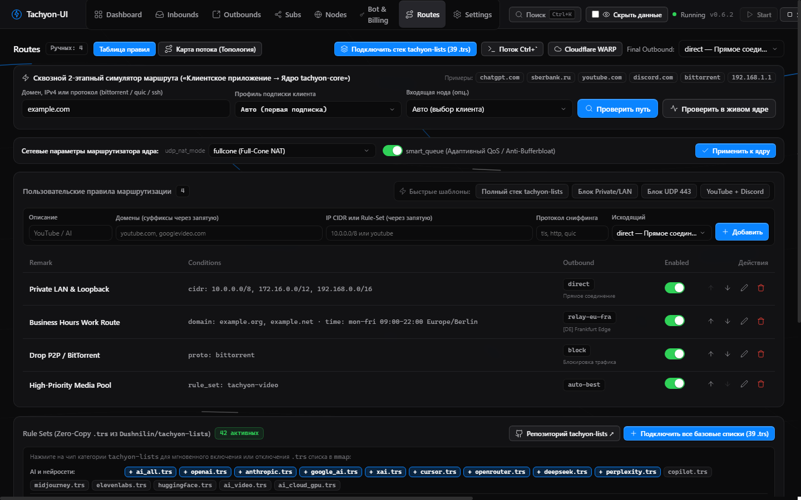

# 4. Balancers (12 `urltest` Modes), `chain` Outbounds & Routing

[Русская версия](../ru/04-balancers-chain-and-routes.md) | [Back to Index](../../README.md)

`tachyon-ui` provides 100% parity with `tachyon-core` group balancers, sequential `chain` outbounds, and routing rules.

---

## Balancer Types & All 12 `urltest` Modes

Balancer groups are configured in the subscription editor (**Balancers** tab), during cascade generation (`POST /api/cascade`), and in `#outbounds`.

### 1. All 12 `urltest` Modes

| Mode (`mode`) | Selection Strategy | Key Fields & Best Use Case |
| :--- | :--- | :--- |
| **`least_test`** | Active periodic `url` probing; picks the outbound with lowest RTT within `tolerance_ms`. | Default general-purpose latency-based routing. |
| **`stability`** | EWMA latency smoothing accounting for jitter and probe packet loss. | Voice calls, live streams, remote desktops, and long-lived TCP flows. |
| **`failover`** | Strict priority order matching `outbounds`: stays on the first healthy node, switches only on failure. | Primary link + dedicated backup relay. |
| **`sticky`** | Deterministic flow pinning using chosen `sticky_hash` keys. | Banking, gaming sessions, SaaS dashboards sensitive to mid-session IP changes. |
| **`least_load`** | Routes new flows to the outbound with the fewest active connections. | Spreading many concurrent clients evenly across equal-capacity relays. |
| **`weighted`** | Probabilistic distribution weighted by `1 / RTT` so lower-latency nodes get proportionally more flows. | Multi-region pools balancing locality with load sharing. |
| **`round_robin`** | Cyclic rotation across all healthy pool members. | Even distribution of high-volume short HTTP/API flows. |
| **`passive`** | Passive circuit-breaker: avoids frequent active URL probes and trips on real connection failures. | Saves battery and background bandwidth on mobile clients and routers. |
| **`priority`** | Tiered failover across `tiers` (`Tier 1 → Tier 2 → ...`): stays in the highest healthy tier. | Primary regional cluster backed by secondary/fallback region tiers. |
| **`hedged`** | Speculative hedged requests: starts a backup attempt when the primary dial stalls. | Lowest page-load tail latency over lossy mobile or wireless networks. |
| **`throughput`** | Selects the member with the highest measured transfer throughput. | Large downloads, high-bitrate media streaming, and bulk transfers. |
| **`quota`** | Tracks byte volume per outbound (`quota_mib`) and rotates when quota is reached. | Multiple VPS relays with strict monthly bandwidth caps. |

#### Nested `urltest` & `balancer` Fields

- **Top-level `urltest` fields**:
  - `url` — probe endpoint (defaults to `https://www.gstatic.com/generate_204`);
  - `interval` (`interval_secs`) — probe interval (e.g. `180s`);
  - `tolerance` (`tolerance_ms`) — hysteresis threshold in ms to prevent flapping;
  - `idle_timeout` — pause background probes after idle duration (e.g. `5m`);
  - `interrupt_exist_connections` — close active flows when switching outbounds.
- **Nested `balancer` object** (omitted when empty, serialized only when at least one option is configured):
  - `pool` — active pool size of top members;
  - `pool_tolerance` — RTT spread tolerance (ms) inside the pool;
  - `sticky_hash` — affinity keys for `sticky` mode (`source_ip`, `domain`, `dest_ip`, `dest_port`, `process`, `none`);
  - `quota_mib` — per-member quota in MiB for `quota` mode;
  - `tiers` — ordered tag arrays (`Vec<Vec<String>>`) for `priority` mode via the visual Tier editor.

---

### 2. Manual `selector` & Live Runtime Controls

- Fields: `outbounds` (members), `default`, `interrupt_exist_connections`, and `auto_failover` (temporary fallback if the selected node goes down).
- On balancer cards and inside Core Diagnostics, live runtime actions work without reloading the engine:
  - switch active `selector` target (`POST /api/core/proxies/select` → Clash `PUT /proxies/<group>`);
  - trigger group/batch latency checks (`POST /api/core/proxies/delay` → `/group/<tag>/delay` or `/tachyon/delay-batch`);
  - reset an outbound circuit-breaker (`POST /api/core/outbound/reset` → `/tachyon/outbound/reset`).

---

### 3. Multi-Hop `chain` Outbounds

**`chain`** connects **2 or more sequential outbounds** (`Hop 1 → Hop 2 → ... → Target`, reordered with Up/Down buttons in the builder):

- `outbounds` — ordered hop list (`len >= 2`);
- `idle_timeout` and `interrupt_exist_connections`;
- `strip_evasion` — strip evasion layers between inner hops;
- `strip` — granular per-feature toggles (`multiplex.padding`, `tls.fragment`, `tls.utls`, `xhttp.padding`);
- `rewrite` — optional JSON header/protocol rewrite object.

---

## Routing (`#routes`) & Live Simulator

### Rules, `.trs` Lists & Per-Client Traffic Policies

- **Rule Matchers**: `inbound`, `auth_user`, `domain_suffix`, `domain_keyword`, `ip_cidr`, `rule_set` (`mmap`-backed binary `.trs` / `.json` sets from `tachyon-lists`), `protocol` (`bittorrent`, `quic`, `tls`, `dns`, `ssh`).
- **Time Schedule (`time_window`)**: Restrict rules by day-of-week, time window, and timezone (e.g. `mon-fri 09:00-22:00 Europe/Berlin`), including midnight wrap-around ranges.
- **Global `route` flags**:
  - `udp_nat_mode`: `""` (default), `fullcone`, `eim_eif`, or `symmetric`;
  - `smart_queue`: interactive packet prioritization and queue shaping.
- **1-Click `tachyon-lists` Pack**: Install curated binary `.trs` rule-sets via `/api/routes/tachyon-lists-pack` — also accessible directly from the Dashboard **Routing & `tachyon-lists`** card below Memory.
- **Traffic Policies & Per-Node Scoping (`POST /api/inbounds/traffic-policy`, `node_rules`)**: Restrict allowed traffic categories on inbounds or subscriptions (`only_this` / `prefer_node`, with server-side enforcement via `server_unmatched`: `block` / `direct` / `client_only`).
- **3-Column Flow Topology Map & Instant Domain Block**: Visualizes `Inbound → Rule / Balancer → Outbound` chains and lets operators block suspicious domains immediately via `POST /api/core/block-domain`.

### 2-Tier Route Simulator & Live Core Tracing (`#routes`)

1. **2-Tier Config Simulation** (`POST /api/routes/simulate`) — evaluates both generated server rules and per-subscription client routing rules offline.
2. **Test in Live Core** (`POST /api/core/route-check` / `POST /api/core/route-domain`) — traces the target directly inside the running `tachyon-core` process, returning the matched rule, `effective_outbound`, resolved/FakeIP addresses, and parallel probes (`Routed`, `Direct`, `Proxy`).

---

Next: [Chapter 5 — Protocols, Multi-Node Clusters, Cascades & Telegram Bot](05-protocols-nodes-and-tgbot.md).
