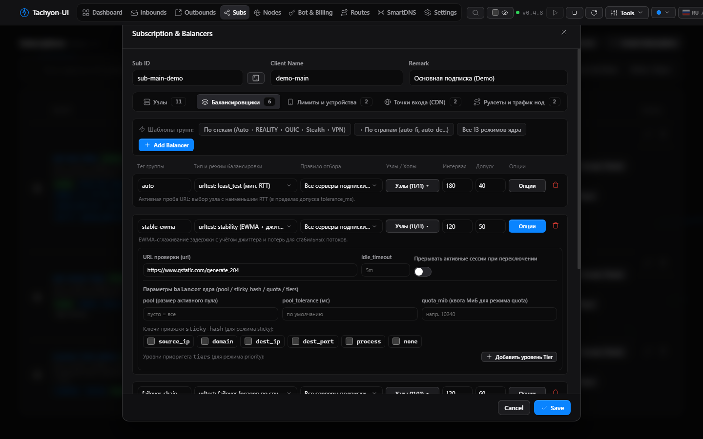
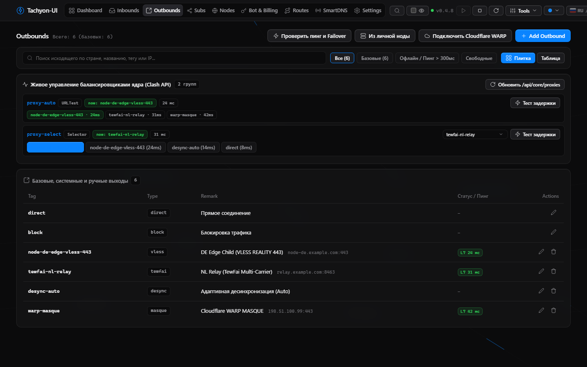
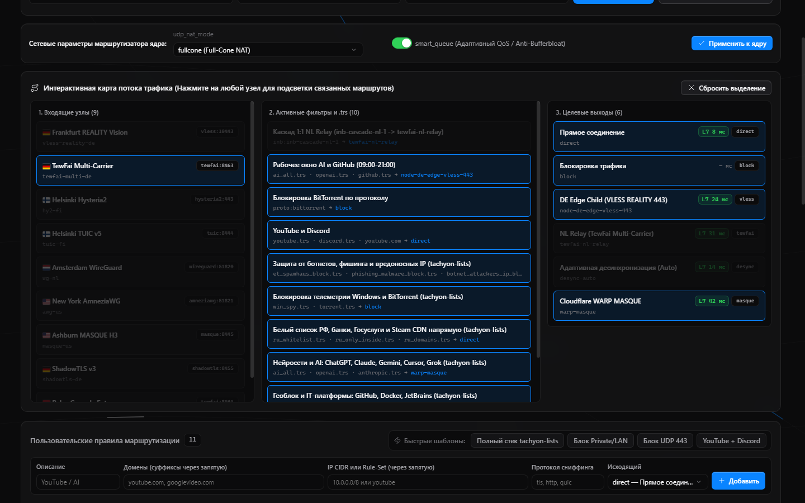
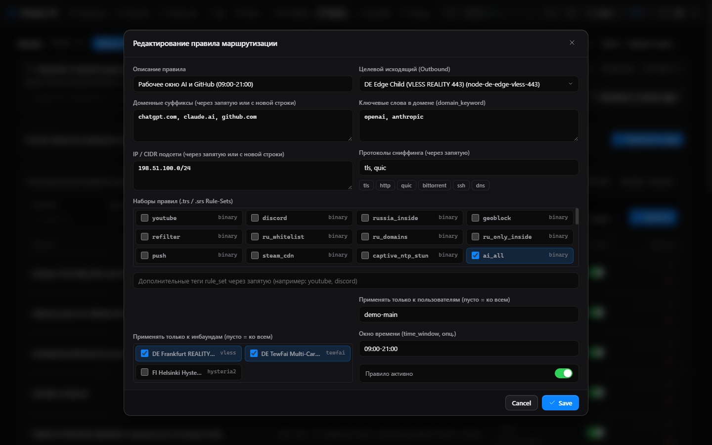
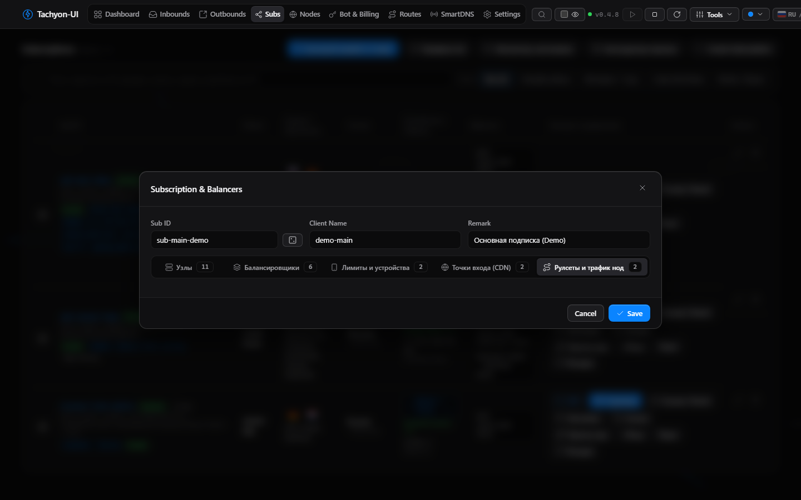
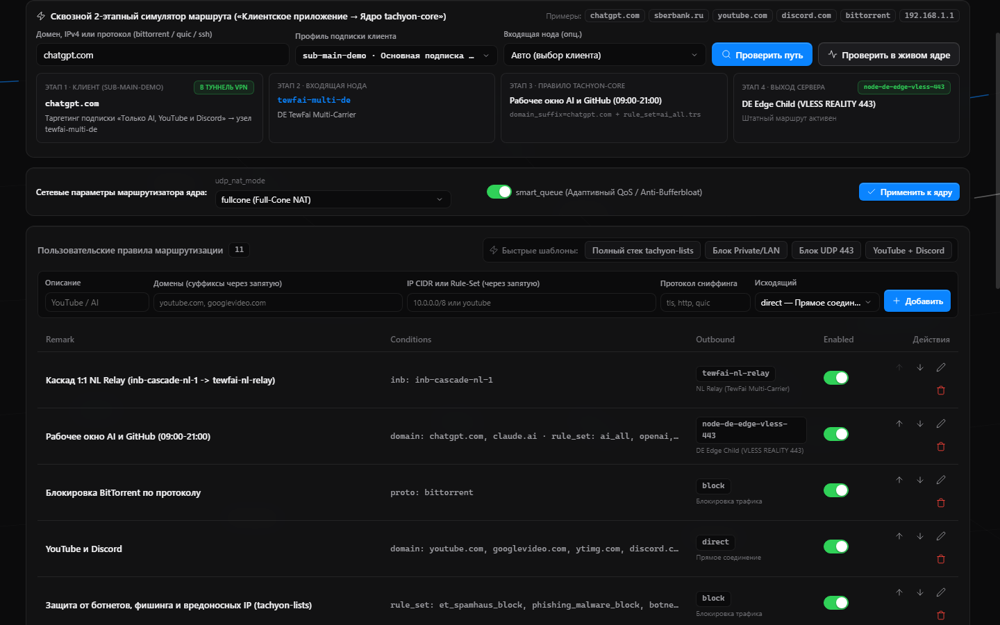

# 4. Balancers (12 `urltest` Modes), `chain` Outbounds & Routing

[Русская версия](../ru/04-balancers-chain-and-routes.md) | [Complete Guide](00-complete-guide.md) | [Protocol 27: Balancers & Chain](protocols/27-balancers-and-chain.md) | [27-Protocol Catalog](protocols/README.md) | [Every Tab & Button UI Guide](11-ui-every-tab-and-button-guide.md) | [Back to Index](../../README.md)

`tachyon-ui` provides 100% parity with `tachyon-core` group balancers, sequential `chain` outbounds, interactive flow topology mapping, and two-tier route simulation.

---

## Balancer Types & All 12 `urltest` Modes

Balancer groups are configured in the subscription editor (**Balancers** tab), during cascade generation (`POST /api/cascade`), and in **Outbounds (`#outbounds`)**. Quick-preset chips let you generate **Stack groups** (`Auto + REALITY + QUIC + Stealth + VPN`), **Country `urltest` groups** (`auto-fi`, `auto-de`, `auto-nl`, etc.), or all core balancer modes in one click.

### 1. All 12 `urltest` Modes

| Mode (`mode`) | Selection Strategy | Key Fields & Best Use Case |
| :--- | :--- | :--- |
| **`least_test`** | Active periodic `url` probing; picks the outbound with lowest RTT within `tolerance_ms`. | Default general-purpose latency-based routing (ideal for `auto` and `auto-<cc>` country balancers). |
| **`stability`** | EWMA latency smoothing accounting for jitter and probe packet loss. | Voice calls, live streams, remote desktops, and long-lived TCP flows. |
| **`failover`** | Strict priority order matching `outbounds`: stays on the first healthy node, switches only on failure. | Primary link + dedicated backup relay. |
| **`sticky`** | Deterministic flow pinning using chosen `sticky_hash` keys. | Banking, gaming sessions, SaaS dashboards sensitive to mid-session IP changes. |
| **`least_load`** | Routes new flows to the outbound with the fewest active connections. | Spreading many concurrent clients evenly across equal-capacity relays. |
| **`weighted`** | Probabilistic distribution weighted by `1 / RTT` so lower-latency nodes get proportionally more flows. | Multi-region pools balancing locality with load sharing. |
| **`round_robin`** | Cyclic rotation across all healthy pool members. | Even distribution of high-volume short HTTP/API flows. |
| **`passive`** | Passive circuit-breaker: avoids frequent active URL probes and trips on real connection failures. | Saves battery and background bandwidth on mobile clients and routers. |
| **`priority`** | Tiered failover across `tiers` (`Tier 1 → Tier 2 → ...`): stays in the highest healthy tier. | Primary regional cluster backed by secondary/fallback region tiers. |
| **`hedged`** | Speculative hedged requests: starts a backup attempt when the primary dial stalls. | Lowest page-load tail latency over lossy mobile or wireless networks. |
| **`throughput`** | Selects the member with the highest measured transfer throughput. | Large downloads, high-bitrate media streaming, and bulk transfers. |
| **`quota`** | Tracks byte volume per outbound (`quota_mib`) and rotates when quota is reached. | Multiple VPS relays with strict monthly bandwidth caps. |

#### Nested `urltest` & `balancer` UI Field Mapping

| UI Control (`#modal-outbound` / `#sub-modal-pane-1`) | JSON Field | Notes & Constraints |
| :--- | :--- | :--- |
| **Member Tags (`out-urltest-tags`)** | `outbounds[]` | Ordered list of target outbound tags. |
| **Balancer Mode (`out-urltest-mode`)** | `mode` | One of the 12 modes above (`least_test` default). |
| **Probe URL (`out-urltest-url`)** | `url` | Defaults to `https://www.gstatic.com/generate_204`. |
| **Interval (`out-urltest-interval`)** | `interval` | `10–600s` (default `180s` on outbound, `300s` on subscription balancers). |
| **Tolerance (`out-urltest-tolerance`)** | `tolerance` | Hysteresis threshold `10–300 ms` (default `50 ms`). |
| **Idle Timeout (`out-urltest-idle`)** | `idle_timeout` | Pauses background probes when idle (e.g. `5m`). |
| **Interrupt Connections (`out-urltest-interrupt`)** | `interrupt_exist_connections` | Closes active flows when switching members. |
| **Active Pool / Tolerance (`out-urltest-pool`, `out-urltest-pool-tol`)** | `balancer.pool`, `balancer.pool_tolerance` | Top pool size and RTT spread tolerance (`0..=15000 ms`). Omitted automatically when `mode` is `least_test` or `failover`. |
| **Quota MiB (`out-urltest-quota`)** | `balancer.quota_mib` | Per-member monthly volume cap for `quota` mode. |
| **Sticky Hash (`out-urltest-sticky`)** | `balancer.sticky_hash` | `source_ip`, `domain`, `dest_ip`, `dest_port`, `process`, or `["none"]` alone. |
| **Priority Tiers (`out-urltest-tiers`)** | `balancer.tiers` | Ordered tag tiers (`string[][]`) for `priority` mode. |

See [Protocol Guide 27 — Balancers & Chain](protocols/27-balancers-and-chain.md) for complete JSON validation rules, Clash Meta mapping, and troubleshooting.

---

### 2. Manual `selector` & Outbounds Pool Live Controls

- **`selector` Controls (`#modal-outbound`)**: `out-selector-tags` (`outbounds[]`), `out-selector-default` (`default`), `out-selector-failover` (`auto_failover`), and `out-selector-interrupt` (`interrupt_exist_connections`).
- **Outbounds Tab Toolbar & Pool Controls (`#tab-outbounds`)**:

| Control | Action / API | Purpose |
| :--- | :--- | :--- |
| **Search, Type Filter & Grid/Table Toggle** | `renderOutboundsMainContentHTML()` | Filters gateways by type (`direct`, `vless`, `tewfai`, `desync`, `selector`, `urltest`, `wireguard`, etc.) and switches between pool cards and table view. |
| **Refresh Live Proxies** | `App.loadLiveCoreProxies()` → `GET /api/core/proxies` | Pulls live `selector`/`urltest` trees and RTT latencies from `tachyon-core`. |
| **Select Member / Probe Group Delay** | `POST /api/core/proxies/select`, `POST /api/core/proxies/delay` | Switches the active `selector` member on the fly or probes group latency against `https://www.gstatic.com/generate_204` (5000 ms timeout). |
| **Run Health Check / Failover** | `App.runOutboundHealthCheck()` → `POST /api/outbounds/health-check` | Probes all outbounds and triggers failover (`apply_failover: true`) on failed gateways. |
| **From Managed Node** | `#modal-managed-outbound` → `POST /api/nodes/{id}/export-outbound` | Exports an inbound from a managed Child node as a ready-to-route outbound on Master (`cluster-link-*`). |
| **Multi-Clone 1→N** | `#modal-multi-clone` → `POST /api/nodes/multi-clone` | Clones an outbound configuration across 1..N target nodes (grant-gated). |
| **Connect Cloudflare WARP** | `App.registerWarpOutbound()` → `POST /api/core/warp-register` | Registers a Cloudflare WARP WireGuard account and creates `warp-out`. |
| **+ Add Outbound** | `#modal-outbound` → `POST/PUT /api/outbounds` | Configures any of **33 outbound types** (`direct`, `block`, `tewfai`, `vless`, `hysteria2`, `tuic`, `anytls`, `masque`, `wireguard`, `amneziawg`, `desync`, `selector`, `urltest`, `chain`, etc.; see the [27-Protocol Catalog](protocols/README.md), including [01. TewFai](protocols/01-tewfai.md), [02. VLESS](protocols/02-vless.md), and [24. Desync](protocols/24-desync.md) with `v0.4.12` auto-migration from legacy `udp_fake_packets` to `udp_fake` + `quic_desync` + `udp_repeats`). |
| **Reset Circuit Breaker / Delete Pool** | `POST /api/core/outbound/reset`, `DELETE /api/outbounds/{tag}` | Clears tripped circuit-breaker state (`close_sessions: true`) or removes pools/selected tags via `#gpui-fab-root` (`POST /api/outbounds/batch-delete`). |

---

### 3. Multi-Hop `chain` Outbounds

**`chain`** connects **2 or more sequential outbounds** (`out-chain-tags` ordered `Entry → ... → Exit`, reordered with Up/Down buttons in the builder):

- `outbounds` — ordered hop list (`len >= 2`);
- `idle_timeout` (`out-chain-idle`) and `interrupt_exist_connections` (`out-chain-interrupt`);
- `strip_evasion` (`out-chain-strip-evasion`) — strip extra masking layers between inner hops;
- `strip` (`.out-chain-strip-chk` checkboxes) — granular per-feature toggles on inner chain hops:
  - `multiplex.padding`
  - `tls.fragment`
  - `tls.utls`
  - `xhttp.padding`
- `rewrite` — optional JSON header/protocol rewrite object.

---

## Routing (`#routes`), Flow Map & Live Simulator

### Routing Controls, `.trs` Rule-Sets & Rule Modal (`#tab-routes`)

| Control | Label / Modal | API | Purpose |
| :--- | :--- | :--- | :--- |
| **View Toggle** | `Table` / `Flow Map` | `renderRoutesFlowTopologyHTML()` | Switches between the ordered rule table and interactive `Inbound → Rule / RuleSet → Outbound` flow topology. |
| **Global Routing Flags** | `udp_nat_mode`, `smart_queue` | `App.saveRouteCoreOptions()` → `PUT /api/routes` | Sets UDP NAT behavior (`fullcone`, `eim_eif`, `symmetric`) and `smart_queue` packet prioritization (requires `Apply`). |
| **Rule Search & Final Outbound** | Search input / `Final Outbound` | `PUT /api/routes` | Filters rules or sets the default fallback `final` outbound (`direct`, `block`, proxy, or balancer). |
| **Auto-Relay 1:1 Spoiler Grid** | Collapsible relay block | `renderRoutesRelayGridHTML()` | Keeps auto-generated 1:1 cascade/bridge routing rules tucked away unless debugging a relay. |
| **Install `tachyon-lists` Pack** | `App.installTachyonListsPack()` | `POST /api/routes/tachyon-lists-pack` | Downloads and connects curated binary `.trs` rule-sets (regional services, blocked domains, ads, AI, streaming). |
| **+ Add Rule** | `App.editRouteRule(...)` | `#modal-route-rule` → `PUT /api/routes` | Creates or edits matchers (`inbound`, `domain`, `domain_suffix`, `domain_keyword`, `ip_cidr`, `port`, `protocol`, `network`, `rule_set`, `time_window`) and target `outbound`; top-to-bottom priority determines first match. |
| **+ Add Rule Set** | `App.editRuleSet(...)` | `#modal-rule-set` → `PUT /api/routes` | Registers local or remote `.trs`/`.srs` rule-sets (`type: local \| remote`, `format: binary \| source`, `url`/path, `download_detour`, `update_interval`). |
| **Row Priority & State Buttons** | Up / Down arrows, Enable/Disable, Edit, Delete | `PUT /api/routes` | Reorders rule precedence, toggles rules without deleting, or removes rules. |

### Rules, `.trs` Lists, `node_rules` & Global Queue Flags

- **Rule Matchers**: `inbound`, `auth_user`, `domain_suffix`, `domain_keyword`, `ip_cidr`, `rule_set` (`mmap`-backed binary `.trs` / `.json` sets from `tachyon-lists`), `protocol` (`bittorrent`, `quic`, `tls`, `dns`, `ssh`).
- **Time Schedule (`time_window`)**: Restrict rules by day-of-week, time window, and timezone (e.g. `mon-fri 09:00-22:00 Europe/Berlin`), including midnight wrap-around ranges.
- **Global `route` flags**:
  - `udp_nat_mode`: `""` (default), `fullcone`, `eim_eif`, or `symmetric`;
  - `smart_queue`: interactive packet prioritization and queue shaping (Bufferbloat control).
- **1-Click `tachyon-lists` Pack**: Install curated binary `.trs` rule-sets (YouTube, Discord, AI, streaming, social platforms, regional subnets) via `/api/routes/tachyon-lists-pack` — also accessible directly from the Dashboard **Routing & `tachyon-lists`** card below Memory.
- **Per-Node & Per-Inbound Traffic Scoping (`node_rules` / `POST /api/inbounds/traffic-policy`)**:

  Restrict allowed traffic categories (`rule_sets`, `traffic_types`, `custom_domains`, `custom_ports`) on inbounds or subscriptions (`only_this` — allow only selected categories/ports, `prefer_node` — prefer this node, with server-side enforcement via `server_unmatched`: `block` / `direct` / `client_only`).
- **Interactive 3-Column Flow Topology Map & Instant Domain Block**: Visualizes live `Inbound → Rule / Balancer → Outbound` paths across your server and lets operators block suspicious domains immediately via `POST /api/core/block-domain`.

### 2-Tier Route Simulator & Live Core Tracing (`#routes`)

At the top of **Routes (`#routes`)**, two tracing modes evaluate any target (domain, IPv4, or protocol):
1. **2-Tier Config Simulation (`POST /api/routes/simulate`)** — evaluates both client-side subscription rules (`sub_id`) and generated server rules (`inbound_tag`) offline (`Client App → tachyon-core`).
2. **Test in Live Core (`POST /api/core/route-check` / `POST /api/core/route-domain`)** — traces the target directly inside the running `tachyon-core` process, returning the matched rule, `effective_outbound`, resolved/FakeIP addresses, and parallel probes (`Routed`, `Direct`, `Proxy`).

---

[Previous: Chapter 3 — Subscriptions, Web Portal, Vouchers & Tachyon Covert Knock](03-subscriptions-and-covert-knock.md) | [Protocol 27: Balancers & Chain](protocols/27-balancers-and-chain.md) | [Every Tab & Button UI Guide](11-ui-every-tab-and-button-guide.md) | [Back to Index](../../README.md) | [Next: Chapter 5 — Protocols, Multi-Node Clusters, Cascades & Telegram Bot](05-protocols-nodes-and-tgbot.md)
