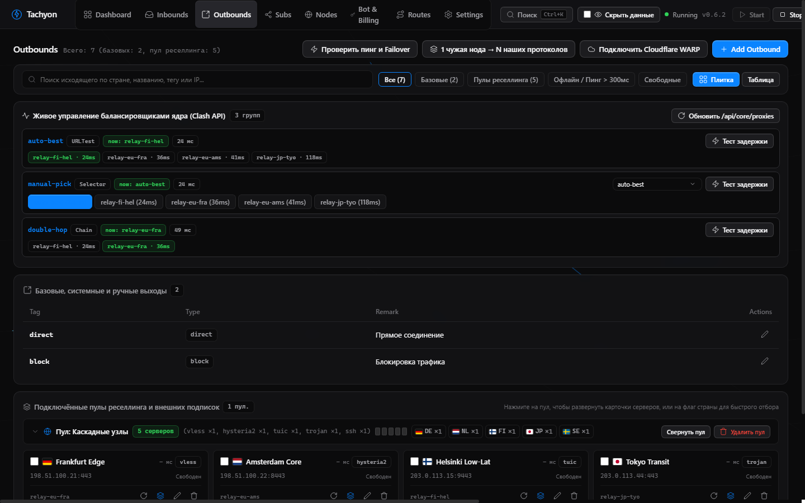
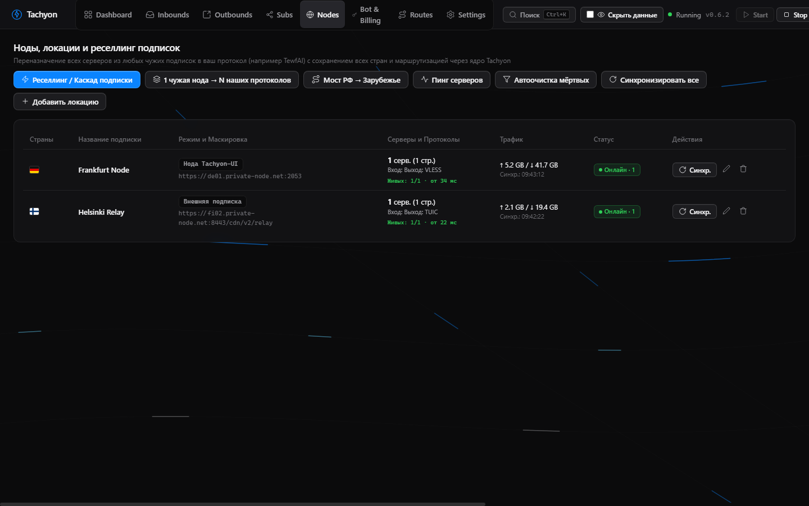
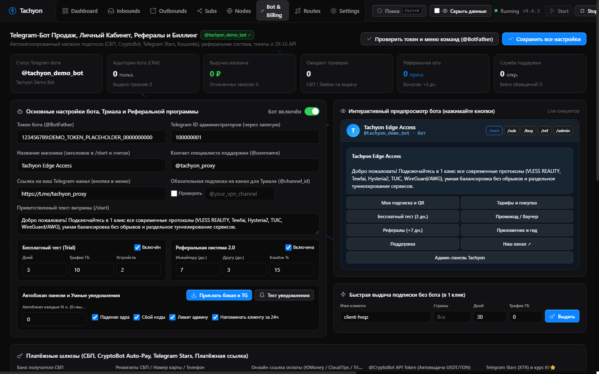

# 5. Protocols, Multi-Node Clusters, Cascades & Telegram Bot

[Русская версия](../ru/05-protocols-nodes-and-tgbot.md) | [Back to Index](../../README.md)

## Inbound & Outbound Protocols

### Inbounds (`#inbounds`)

| Protocol | Capabilities in `tachyon-ui` |
| :--- | :--- |
| **VLESS** (TCP / XHTTP / gRPC / WS) | Supports `xtls-rprx-vision`, XHTTP modes (`auto`, `packet-up`, `stream-up`, `stream-one`) with padding ranges, REALITY (`Self-Steal` + optional post-quantum `reality_pq_key`), TLS, and built-in SNI scanner (`POST /api/tools/sni-scan`). |
| **Hysteria2** | QUIC transport with `up_mbps`/`down_mbps`, `salamander`/`gecko` obfuscation, BBR profiles (`standard`/`conservative`/`aggressive`), and `masquerade`. |
| **TUIC v5** | Congestion control (`bbr`/`cubic`/`new_reno`), `zero_rtt`, and `heartbeat` interval. |
| **AnyTLS / ShadowTLS v3 / Naive / Mieru / Snell** | Padding schemes (AnyTLS), decoy TLS handshake server (`strict_mode` on ShadowTLS v3), HTTP/3 QUIC (Naive), TCP/UDP mux (Mieru), and Snell v5/v6. |
| **Tewfai / FPTN / TrustTunnel / OpenConnect** | Native Tewfai (QUIC, FEC, shaper/morph profiles, PQC), native FPTN (IPv4/DNS pools), TrustTunnel QUIC, and OpenConnect (`anyconnect`, `gp`, `pulse`, `fortinet`). |
| **WireGuard / AmneziaWG** | X25519 key generator, AmneziaWG junk packet parameters (`jc`, `jmin`, `jmax`, `s1`, `s2`, `h1..h4`), `.conf` export, and UDP **Port Hopping** (`wg_server_ports`, `wg_hop_interval`, `wg_hop_interval_max`). |
| **WDTT** | Modes `wg`, `raw`, `csqtt`, `csqtt_v1`; media mimicry (`audio`, `video`, `unified`); SRTP modes (`auto`, `dtls`, `wrap`). |
| **Sudoku** | Shared key, AEAD cipher (`chacha20-poly1305`, etc.), table selection (`prefer_ascii`, custom tables), padding bounds (`padding_min/max`), Pure Downlink, and HTTP mask (`http_mask_mode`, `host`, `path_root`, `multiplex`). |
| **Cloudflared** | Zero-open-port inbound tunnel via Cloudflare (`cloudflared_token`, `ha_connections`, QUIC/HTTP2 protocol, `post_quantum`, `edge_ip_version`, `region`). |
| **MTProto / Trojan / VMess / Shadowsocks 2022 / Mixed / SOCKS / HTTP** | Full set of classic proxies and Telegram MTProto relays (including auto-generated `ee...` secrets and 2022-blake3 keys). |

> Every inbound supports batch operations (`/api/inbounds/batch-action`), SNI Auto-Healer rotation, scheduled Port Hopping, and per-client traffic policies.

### Outbounds (`#outbounds`)

In addition to `direct`, `block`, `vless`, `vmess`, `trojan`, `hysteria2`, `tuic`, `shadowsocks`, `anytls`, `shadowtls`, `wireguard`, `amneziawg`, `masque`, `socks`, and `http`, `tachyon-ui` supports specialized `tachyon-core` drivers:

- **`hysteria` (v1)** — legacy Hysteria v1 servers (`auth_str` / TLS).
- **`ssh`** — SSH server tunneling via password or private key.
- **`tor`** — route selected rules or domains through Tor.
- **`bridge`** — OS network bridge integration (`interface`, `bridge_name`, `iproute2_table_index`, `iproute2_rule_index`).
- **`mtproto`** — outbound relays including `telegram-ws` and `kws` over TLS WebSocket.
- **`sudoku`**, **`wdtt`**, **`desync`** — native outbound transports with automatic key validation (malformed `masque` keys are safely skipped during config generation with dangling references pruned so the core always starts cleanly).
- **1-Click Cloudflare WARP / MASQUE Registration** (`/api/core/warp/register`).

---

## Multi-Node Clusters, External Subscriptions & Cascades (`#nodes`)

**Nodes (Locations)** supports three upstream types:
1. **`tachyon_node`** — pulls subscriptions from another `tachyon-ui` instance using its URL and `remote_sub_id`.
2. **`sub_url`** — imports external subscription URLs periodically with configurable client headers (`User-Agent`, `x-hwid`, `x-device-os`, `x-device-model`).
3. **`manual_uris`** — batch-imports URI lists (`vless://`, `hy2://`, `tuic://`, etc.) and clones multi-node sets (`/api/nodes/multi-clone`).

- **Auto-Failover & Failback**: Monitors relay health and temporarily reroutes traffic to healthy backups in the same country (`relay_auto_failover`).
- **Cascade Builder (`/api/cascade/preview`, `/api/cascade`)**: Wires local inbounds to remote relays via `urltest` (12 modes), `selector`, or `chain` with JSON config preview.

---

## Built-In Telegram Bot, Mini App & Billing (`#tgbot`)

Includes an integrated long-polling Telegram bot with zero external Python/Node dependencies:

- **Self-Service Provisioning & Trials**: Configurable trial access (`trial_days`, `trial_traffic_gb`, `trial_device_limit`), optional channel subscription gate (`require_channel_sub`), and multi-tier referral rewards (bonus days + cashback %).
- **Tariffs & Payments**: Plans, SBP/bank transfer details, external payment links, CryptoBot, Telegram Stars (with RUB exchange rate), and user wallet balances.
- **Promo Codes & Vouchers**: Duration, traffic quota, bonus balance, and discount percentage codes.
- **External Billing Webhook**: `POST /api/billing/issue-sub` protected by constant-time `X-Webhook-Secret` verification.
- **Telegram Mini App & Web Portal**: Authenticated automatically via `tgWebAppData` even when `sub_portal_guard = secret_key` is enabled.
- **Admin Alerts**: Instant notifications for engine crashes/restarts, node failures, quota exhaustion, Zero-Traffic Watchdog triggers, and scheduled DB backups.

---

Next: [Chapter 6 — Core Diagnostics, Privacy Mask (`Alt+P`) & REST API Reference](06-diagnostics-privacy-and-api.md).
