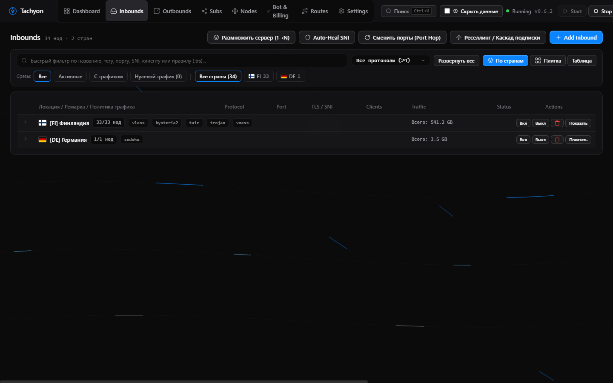

# 5. Protocols, Multi-Node Clusters, Cascades & Telegram Bot

[Русская версия](../ru/05-protocols-nodes-and-tgbot.md) | [Back to Index](../../README.md)

## Inbound & Outbound Protocols

### Inbounds (`#inbounds`)

| Protocol | Capabilities in `tachyon-ui` |
| :--- | :--- |
| **VLESS** (TCP / XHTTP / gRPC / WS) | Supports `xtls-rprx-vision`, XHTTP modes (`auto`, `packet-up`, `stream-up`, `stream-one`) with padding ranges, REALITY (`Self-Steal` + optional post-quantum `reality_pq_key`), TLS, and built-in SNI scanner (`POST /api/tools/sni-scan`). |
| **Hysteria2** | QUIC transport with `up_mbps`/`down_mbps`, `salamander`/`gecko` obfuscation, BBR profiles (`standard`/`conservative`/`aggressive`), and `masquerade`. |
| **TUIC v5** | Congestion control (`bbr`/`cubic`/`new_reno`), `zero_rtt`, and `heartbeat` interval. |
| **AnyTLS / ShadowTLS v3 / Naive / Mieru / Snell** | Padding schemes (AnyTLS), decoy TLS handshake server (`strict_mode` on ShadowTLS v3), HTTP/3 QUIC (Naive), TCP/UDP mux (Mieru), and Snell v5/v6. |
| **Tewfai / FPTN / TrustTunnel / OpenConnect** | Native Tewfai (QUIC, FEC, shaper/morph profiles, PQC), native FPTN (IPv4/DNS pools), TrustTunnel QUIC, and OpenConnect (`anyconnect`, `gp`, `pulse`, `fortinet`). |
| **MASQUE** | HTTP/3 QUIC tunnel (`CONNECT-UDP` / `CONNECT-IP`) with key pairs and custom masking profiles. |
| **WireGuard / AmneziaWG** | X25519 key generator, AmneziaWG junk packet parameters (`jc`, `jmin`, `jmax`, `s1`, `s2`, `h1..h4`), `.conf` export, and UDP **Port Hopping** (`wg_server_ports`, `wg_hop_interval`, `wg_hop_interval_max`). |
| **WDTT** | Modes `wg`, `raw`, `csqtt`, `csqtt_v1`; media mimicry (`audio`, `video`, `unified`); SRTP modes (`auto`, `dtls`, `wrap`). |
| **Sudoku** | Shared key, AEAD cipher (`chacha20-poly1305`, etc.), table selection (`prefer_ascii`, custom tables), padding bounds (`padding_min/max`), Pure Downlink, and HTTP mask (`http_mask_mode`, `host`, `path_root`, `multiplex`). |
| **Cloudflared** | Zero-open-port inbound tunnel via Cloudflare (`cloudflared_token`, `ha_connections`, QUIC/HTTP2 protocol, `post_quantum`, `edge_ip_version`, `region`). |
| **MTProto / Trojan / VMess / Shadowsocks 2022 / Mixed / SOCKS / HTTP** | Full set of classic proxies and Telegram MTProto relays (including auto-generated `ee...` secrets and 2022-blake3 keys). |

#### Country Groups, External Front `:443` & Batch Operations (`#inbounds`)

- **Zero-Reload Metadata Edits**: Editing only `country`, `remark`, `external_port`, or `external_tls` saves immediately without triggering a `tachyon-core` reload or dropping active client sessions (coalesced disk writes avoid write races during rapid edits).
- **Batch Country Assignment & Bulk Bar (`POST /api/inbounds/batch-action`)**: Using `Shift+Click` (Floating Action Bar), the group header country button, or the node inspector drawer, operators can enable, disable, delete, or apply `set_country` across dozens of inbounds in one request.
- **External Front Overrides (`external_port` / `external_tls`)**: Profiles like `Unified 443 Front` keep inbounds bound to `127.0.0.1` without TLS while marking them with an `→ :443 TLS` badge and exporting `:443` + strict TLS to clients.
- **Single-Node Share & Traffic Policy**: Dedicated per-inbound link sharing (`GET /api/share/:id`) and per-client rule-set restrictions (`POST /api/inbounds/traffic-policy`).

### Outbounds (`#outbounds`)

In addition to `direct`, `block`, `vless`, `vmess`, `trojan`, `hysteria2`, `tuic`, `shadowsocks`, `anytls`, `shadowtls`, `wireguard`, `amneziawg`, `masque`, `socks`, and `http`, `tachyon-ui` supports specialized `tachyon-core` drivers:

- **`hysteria` (v1)** — legacy Hysteria v1 servers (`auth_str` / TLS).
- **`ssh`** — SSH server tunneling via password or private key.
- **`tor`** — route selected rules or domains through Tor.
- **`bridge`** — OS network bridge integration (`interface`, `bridge_name`, `iproute2_table_index`, `iproute2_rule_index`).
- **`mtproto`** — outbound relays including `telegram-ws` and `kws` over TLS WebSocket.
- **`sudoku`**, **`wdtt`**, **`desync`** — native outbound transports with automatic key validation (malformed `masque` keys are safely skipped during config generation with dangling references pruned so the core always starts cleanly).
- **1-Click Cloudflare WARP / MASQUE Registration** (`/api/core/warp/register`), plus a **latency heat matrix** and bulk delete (`/api/outbounds/health-check`, `/api/outbounds/batch-delete`).

---

## Multi-Node Clusters, Cascades & Network Automation (`#nodes`)

**Nodes (Locations)** supports three upstream types:
1. **`tachyon_node`** — pulls subscriptions from another `tachyon-ui` instance using its URL and `remote_sub_id`.
2. **`sub_url`** — imports external subscription URLs periodically with configurable client headers (`User-Agent`, `x-hwid`, `x-device-os`, `x-device-model`).
3. **`manual_uris`** — batch-imports URI lists (`vless://`, `hy2://`, `tuic://`, etc.) and clones multi-node sets (`/api/nodes/multi-clone`).

- **Smart Relay Auto-Failover & Failback**: Monitors relay health and temporarily reroutes traffic to healthy backups in the same country (`relay_auto_failover`), failing back upon recovery.
- **Cascade Builder (`/api/cascade/preview`, `/api/cascade`)**: Wires local inbounds to remote relays via `urltest` (12 modes), `selector`, or `chain` with JSON config preview.

### Built-In Network Tools & Automation

- **SNI Scanner (`POST /api/tools/sni-scan`)**: Discovers TLS 1.3 + ALPN `h2` handshake targets suitable for REALITY.
- **Auto-Healer SNI (`auto_heal_enabled`, `POST /api/tools/auto-heal`)**: Periodically audits configured SNI targets and rotates degraded hosts automatically.
- **Port Hopping (`POST /api/tools/port-hop`)**: Rotates inbound ports or port ranges on a schedule (synchronized automatically with host firewall rules when `auto_firewall_enabled` is enabled).
- **Unlock Probe & Regional Connectivity Check (`POST /api/tools/unlock-probe`, `/api/tools/*`)**: Checks streaming/AI service reachability and regional connectivity from the server or selected outbounds.
- **Cloudflare DNS Failover (`POST /api/tools/cloudflare-dns`)**: Updates Cloudflare A records (`cf_record_name`) and rotates to `cf_backup_ips` automatically on primary node failure.
- **Zero-Traffic Watchdog**: Alerts administrators if inbound traffic drops unexpectedly to zero while active sessions are expected.
- **Key & Credential Generators (`/api/generate/*`)**: Generates `uuid`, X25519 `reality-keys`, WireGuard/AWG `wg-keys`, Shadowsocks 2022 `ss-key`, and random passwords.

---

## Built-In Telegram Bot, Mini App & Billing (`#tgbot`)

Includes an integrated long-polling Telegram bot with zero external Python/Node dependencies:

- **Bot Commands**:
  - User commands: `/start`, `/sub`, `/profile`, `/tariffs`, `/buy`, `/trial`, `/promo`, `/ref` (`/referral`), `/apps`, `/support`, `/help`.
  - Admin command (`admin_tg_ids`): `/admin`.
- **Self-Service Provisioning & Trials**: Configurable trial access (`trial_days`, `trial_traffic_gb`, `trial_device_limit`, `trial_template_sub_id`), optional channel subscription gate (`require_channel_sub`), and multi-tier referral rewards (bonus days + cashback %).
- **Tariffs & Payments**: Plans, SBP/bank transfer details, external payment links, CryptoBot, Telegram Stars (with RUB exchange rate), and user wallet balances.
- **Web Admin Controls**: Bot token verification (`/api/tg-bot/verify`), global broadcasts (`/api/tg-bot/broadcast`), direct messages (`/api/tg-bot/send-message`), balance/days/traffic adjustments (`/api/tg-bot/users/adjust`), promo codes (`/api/tg-bot/promo`), order approval (`/api/tg-bot/orders`), support tickets (`/api/tg-bot/tickets`), on-demand Telegram DB backup (`/api/tg-bot/backup-now`), and test alerts (`/api/tg-bot/test-alert`).
- **External Billing Webhook**: `POST /api/billing/issue-sub` protected by constant-time `X-Webhook-Secret` verification.
- **Telegram Mini App & Web Portal**: Authenticated automatically via `tgWebAppData` even when `sub_portal_guard = secret_key` is enabled.
- **Admin Alerts**: Instant notifications for engine crashes/restarts, node failures, quota exhaustion, 24-hour client expiry warnings (`notify_client_expiry_24h`), Zero-Traffic Watchdog triggers, and scheduled DB backups.

---

Next: [Chapter 6 — Core Diagnostics, Privacy Mask (`Alt+P`) & REST API Reference](06-diagnostics-privacy-and-api.md).
