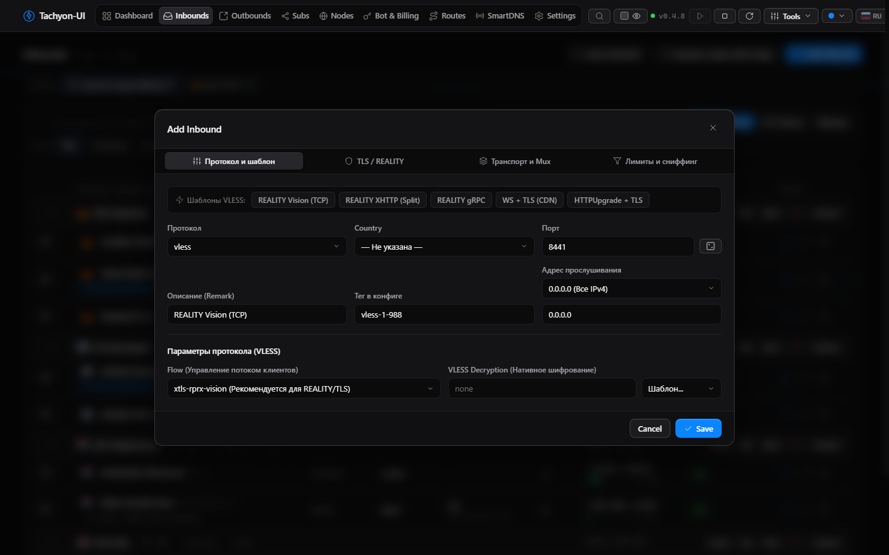
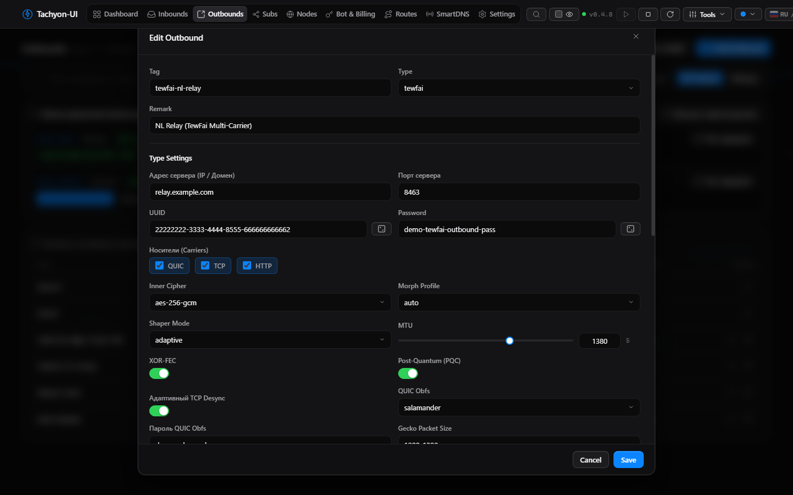
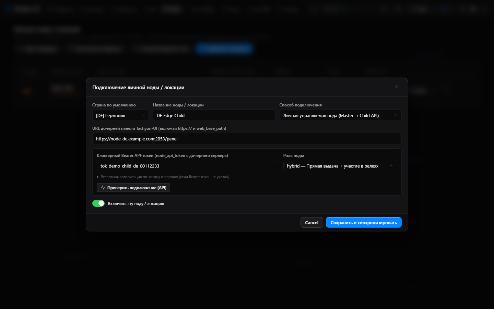
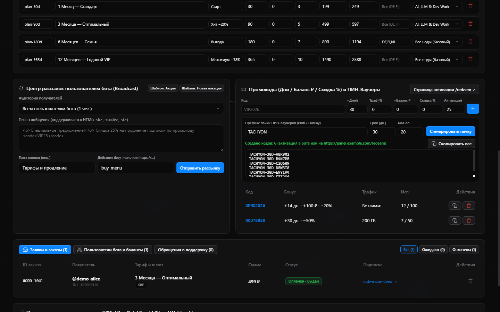

# 5. Protocols, Multi-Node Clusters, Cascades & Telegram Bot

[Русская версия](../ru/05-protocols-nodes-and-tgbot.md) | [Complete Guide](00-complete-guide.md) | [UI Tab & Button Reference](11-ui-every-tab-and-button-guide.md) | [Protocol Guides Catalog](protocols/README.md) | [Back to Index](../../README.md)

> [!TIP]
> Looking for per-field JSON mapping, firewall rules, and validation constraints for all 27 protocols? See the [Protocol Guides Catalog](protocols/README.md). For a complete inventory of every topbar, modal, and hotkey across all 9 tabs, see the [UI Every Tab & Button Guide](11-ui-every-tab-and-button-guide.md).

## Inbound Protocols & `TewFai Multi-Carrier` (`#inbounds`)

### `#inbounds` Tab & Modal Controls

| Control / Area | Label / Trigger | Method / Endpoint | Purpose & Behavior |
| :--- | :--- | :--- | :--- |
| **Node Context Switcher** | `Master (This Server)` / Child nodes (`managed_tachyon_node`) | `App.selectInboundsNode(nodeId)` | Switches `#inbounds` between the local server and any managed Child node (`/api/nodes/{id}/inbounds`). |
| **Child Sync Banner** | `Refresh from Node` / `Apply Node Core` | `GET /api/nodes/{id}/inbounds`, `POST /api/nodes/{id}/core/apply` | Pulls the live Child inbound list or triggers a `tachyon-core` reload exclusively on that Child. |
| **Search, Saved Views & Filters** | Search box, Saved Views, Protocol filter (`25` protocols), Country chips, `Clear Filters` | Client-side filter | Filters by `tag`, port, protocol, SNI, remark, or country; resets via `Clear Filters`. |
| **Layout Toggle & Selection** | `Tree / Grid / Table` + row checkboxes (`Shift+Click`) | `#gpui-fab-root` | Switches density and reveals the Floating Bulk Action Bar (`enable`, `disable`, `delete`, `set_country`). |
| **Batch Country** | `Batch Country` | `#tachyon-country-dialog` | Assigns a 2-letter ISO country code to multiple inbounds at once (zero core reload). |
| **Auto-Heal SNI** | `Auto-Heal SNI` | `POST /api/tools/auto-heal` | Probes active REALITY/TLS SNI targets and rotates degraded hosts automatically (`force_rotate: true` supported). |
| **Port Hop** | `Port Hop` | `POST /api/tools/port-hop` | Rotates UDP/listener ports on hop-enabled inbounds (subscriptions update on next fetch). |
| **1→N Clone** | `1→N Clone` | `#modal-multi-clone` / `POST /api/nodes/multi-clone` | Clones a reference inbound across `1..N` managed nodes or port series. |
| **Cascade / Resell** | `Cascade / Resell` | `#modal-cascade` / `POST /api/cascade` | Builds entry-to-exit relay chains with live preview (`POST /api/cascade/preview`). |
| **+ Add Inbound** | `+ Add Inbound` | `#modal-inbound` (4 tabs + presets) | Opens the 4-tab inbound builder (`Basic`, `TLS & REALITY`, `Transport & Network`, `Mux, Brutal & Limits`). |
| **Row / Card Actions** | Toggle, `+ Add Client`, `Share / QR`, `Edit`, `Clone`, `Delete` | `PUT/DELETE /api/inbounds/{id}`, `GET /api/share/{inbId}/{clientId}` | Manages per-inbound clients (`#modal-client`), URI/QR sharing (`#modal-share`), and status. |
| **Node Inspector Drawer** | Click row / sliders icon | `#node-drawer-overlay` / `POST /api/inbounds/traffic-policy` | Right-side drawer for quick remarks, per-node traffic quotas, and auto-disable policies. |

### SNI Scanner (`#modal-sni-scanner`)

Before creating **VLESS + REALITY**, **TewFai REALITY**, or **AnyTLS REALITY** inbounds, run the built-in **SNI Scanner** from `#inbounds` (TLS tab) or the Dashboard/Tools menu (`POST /api/tools/sni-scan`) to verify TLS 1.3 + ALPN `h2` compatibility, low handshake latency, and absence of redirects from your server's IP:

### Inbound Presets & Supported Transports

| Protocol | Capabilities in `tachyon-ui` | Detailed Guide |
| :--- | :--- | :--- |
| **`TewFai Multi-Carrier`** *(Flagship)* | Simultaneous multi-carrier transport combining `quic`, `tcp`, and `http` carriers under one session layer with traffic morphing (`browsing`, `webrtc`, `video`, `auto`, `adaptive`, `transformer`, `bulk`), shaper (`adaptive`/`fixed`/`off`), inner cipher (`aes-256-gcm`/`none`), MTU slider, XOR-FEC, Post-Quantum ML-KEM hybrid (`pqc`), adaptive TCP `desync`, QUIC obfuscation (`salamander` or `gecko`), HTTP carrier (`xhttp`, `ws`, `grpc`, `httpupgrade`, `http`), `alt_endpoints`, client `sni_pool`, `server_ports` hopping, `race_delay`, and `handover` timeouts. When `REALITY` + `quic` are combined, exported client profiles add `quic.tls` (`insecure: true`, `alpn: ["h3"]`). | [01-tewfai.md](protocols/01-tewfai.md) |
| **VLESS** (TCP / XHTTP / gRPC / WS) | Supports `xtls-rprx-vision` (TCP-only), XHTTP modes (`auto`, `packet-up`, `stream-up`, `stream-one`) with padding ranges, REALITY (`Self-Steal` + optional `reality_pq_key`), TLS, and built-in SNI scanner. | [02-vless.md](protocols/02-vless.md) |
| **Hysteria2** | QUIC transport with `up_mbps`/`down_mbps`, `salamander`/`gecko` obfuscation, BBR profiles (`standard`/`conservative`/`aggressive`), and `masquerade` (automatically `http://127.0.0.1:18080` under `Unified 443 Front`). | [03-hysteria2.md](protocols/03-hysteria2.md) |
| **TUIC v5** | Congestion control (`bbr`/`cubic`/`new_reno`), `zero_rtt`, and `heartbeat` interval. | [04-tuic.md](protocols/04-tuic.md) |
| **AnyTLS / ShadowTLS v3 / Naive / Mieru / Snell** | Padding schemes (`AnyTLS`), decoy TLS handshake server (`ShadowTLS v3`), HTTP/2 & HTTP/3 QUIC (`Naive` — strictly requires a valid CA domain cert; `insecure: true` is forbidden), TCP/UDP mux (`Mieru`), and `Snell` v5/v6 inbound (v4/v5/v6 outbound). | [08-anytls.md](protocols/08-anytls.md), [09-shadowtls.md](protocols/09-shadowtls.md), [10-naive.md](protocols/10-naive.md), [13-mieru.md](protocols/13-mieru.md), [14-snell.md](protocols/14-snell.md) |
| **FPTN / TrustTunnel / OpenConnect** | Native FPTN (`RealityMode2`, IPv4/DNS pools), TrustTunnel HTTP/2 & HTTP/3 QUIC, and OpenConnect (`anyconnect`, `gp`, `pulse`, `fortinet`). | [16-fptn.md](protocols/16-fptn.md), [12-trusttunnel.md](protocols/12-trusttunnel.md), [19-openconnect.md](protocols/19-openconnect.md) |
| **MASQUE** | HTTP/3 QUIC tunnel (`CONNECT-IP`) with valid CA domain cert (`keep_alive_period: "20s"`, `idle_timeout: "50s"`, `tls.alpn: ["h3"]`). | [11-masque.md](protocols/11-masque.md) |
| **WireGuard / AmneziaWG** | X25519 key generator, AmneziaWG junk/CPS parameters (`jc`, `jmin`, `jmax`, `s1..s4`, `h1..h4`, `i1..i5`), `.conf` export, automatic allocation of the lowest free `wg_client_ip`, and UDP **Port Hopping** in `endpoints[]`. | [21-wireguard.md](protocols/21-wireguard.md), [22-amneziawg.md](protocols/22-amneziawg.md) |
| **WDTT / Sudoku / Cloudflared** | WDTT (`wg`, `raw`, `csqtt`, `csqtt_v1`; RTP/DTLS), Sudoku (key, AEAD, tables, HTTP mask — schema/URI export), and Cloudflared zero-open-port connector. | [17-wdtt.md](protocols/17-wdtt.md), [18-sudoku.md](protocols/18-sudoku.md), [20-cloudflared.md](protocols/20-cloudflared.md) |
| **MTProto / Trojan / VMess / Shadowsocks / Mixed / SOCKS / HTTP** | Full set of classic proxies and Telegram MTProto relays (`telegram-ws`/`kws`, normalized 32-hex secret in `tachyon-core 0.6.9`, AEAD `alterId: 0` VMess, and SS-2022 `2022-blake3-*` keys). | [05-trojan.md](protocols/05-trojan.md), [06-vmess.md](protocols/06-vmess.md), [07-shadowsocks.md](protocols/07-shadowsocks.md), [15-mtproto.md](protocols/15-mtproto.md), [23-mixed-socks-http.md](protocols/23-mixed-socks-http.md) |

#### `TewFai Multi-Carrier` Inbound Editor

When configuring `TewFai Multi-Carrier` (`tewfai`), you can combine all three carrier layers (`quic`, `tcp`, `http`) on a single inbound and tune client resilience:
- **QUIC Carrier**: Enable `salamander` or `gecko` obfuscation (`obfs_pass`, `gecko` packet size range like `512-1200`), XOR-FEC for lossy links, and `quic_fallback` (e.g. `http://127.0.0.1:18080`).
- **TCP / HTTP Carrier**: Enable adaptive TCP `desync`, pick an HTTP carrier (`xhttp`, `ws`, `grpc`, `httpupgrade`, `http`) with `http_path`, `http_host`, `xhttp_mode`, and set `tcp/http fallback` (e.g. `127.0.0.1:8443`, omitted when REALITY is active).
- **Multi-Path & Seamless Handover**: Populate `sni_pool` (comma-separated SNIs), `alt_endpoints` (`front://`, `gateway://`, `quic://`, `tcp://`, `http://`), `server_ports` (`443, 20000:20020`), `race_delay` (ms), and `handover` timeouts (`stall_timeout_ms`, `ping_timeout_ms`).

#### Batch Country Tagging, Zero-Reload Metadata & External Front `:443`

- **Zero-Reload Metadata Edits**: Editing only `country`, `remark`, `external_port`, or `external_tls` saves immediately without triggering a `tachyon-core` reload or dropping active client sessions (coalesced disk writes eliminate write races).
- **Batch Country Assignment & Bulk Bar (`POST /api/inbounds/batch-action`)**: Using `Shift+Click` (Floating Bulk Action Bar), the group header country button, or the Node Inspector Drawer, operators can enable, disable, delete, or apply `set_country` across dozens of inbounds in one click—essential before exporting country `urltest` groups to Tachyon 2.0 routers.
- **External Front Overrides (`external_port` / `external_tls`)**: Under `Unified 443 Front`, local L7 inbounds bind `127.0.0.1` without TLS while displaying an `→ :443 TLS` badge and exporting `:443` + strict TLS to clients.

---

## Outbounds Pool, L7 Health Checks & `TewFai` Outbound Editor (`#outbounds`)

### `#outbounds` Tab & Live Proxy Controls

| Control / Area | Label / Trigger | Method / Endpoint | Purpose & Behavior |
| :--- | :--- | :--- | :--- |
| **Live Proxy Refresh** | `Refresh` | `GET /api/core/proxies` | Pulls the live `selector` / `urltest` group tree and current delays from `tachyon-core`. |
| **Live Group Switch & Delay** | Click member / Lightning probe | `POST /api/core/proxies/select`, `POST /api/core/proxies/delay` | Switches the active member inside a `selector` in memory or measures RTT against `https://www.gstatic.com/generate_204`. |
| **Failover & Circuit Breaker** | `Trigger / Restore Failover`, `Reset Circuit Breaker` | `POST /api/core/failover`, `.../restore`, `POST /api/core/outbound/reset` | Forces backup failover/failback or clears a tripped passive circuit breaker (`close_sessions: true`). |
| **Run Health Check / Failover** | `Run Health Check / Failover` | `POST /api/outbounds/health-check` (`{ apply_failover: true }`) | Probes all outbounds (L7 via `tachyon-core`, TCP fallback if stopped), fills the heat matrix, and triggers Smart Failover. |
| **From Managed Node** | `From Managed Node` | `#modal-managed-outbound` / `POST /api/nodes/{id}/export-outbound` | Exports an inbound from a connected Child node directly into `Master` `#outbounds` without manual key copying. |
| **Connect Cloudflare WARP** | `Connect Cloudflare WARP` | `POST /api/core/warp-register` (`{ tag: 'warp-out' }`) | Registers a Cloudflare WARP account, generates WireGuard keys, and creates `warp-out` in 1 click. |
| **+ Add Outbound & Pool Cards** | `+ Add Outbound`, `Delete Pool` | `#modal-outbound` (33 types), `DELETE /api/outbounds/{tag}` | Creates/edits any of the 33 outbound/balancer types (`direct`, `block`, `vless`, `tewfai`, `urltest`, `selector`, `chain`, etc.) or deletes a pool. |

In addition to `direct`, `block`, `vless`, `vmess`, `trojan`, `hysteria2`, `tuic`, `shadowsocks`, `anytls`, `shadowtls`, `wireguard`, `amneziawg`, `masque`, `socks`, and `http`, `tachyon-ui` supports:
- **`tewfai` Outbound Editor** (carrier selection, `salamander`/`gecko`, `xhttp`, `desync`, `sni_pool`, `server_ports`, `handover` stall/ping timeouts);
- **`hysteria` (v1)**, **`ssh`**, **`tor`**, **`bridge`** (`interface`, `bridge_name`, `iproute2` tables/rules), **`mtproto`** (`telegram-ws`/`kws`), **`sudoku`**, **`wdtt`**, and **`desync`** (malformed `masque` keys are safely skipped during config generation with dangling references pruned so the core starts cleanly);
- **1-Click Cloudflare WARP / MASQUE Registration** (`/api/core/warp-register`);
- **L7 Outbound Health Check + Smart Failover (`POST /api/outbounds/health-check`)**: Measures real L7 latency through the running `tachyon-core` runtime API (falling back to TCP probes if the core is stopped), populates the latency heat matrix, triggers Smart Failover/Failback events, and supports bulk delete (`/api/outbounds/batch-delete`).

---

## Multi-Node Clusters (`Master → Child`), NodeDrawer & Cascades (`#nodes`)

### `#nodes` Tab Controls & `+ Add Node` Modal (`#modal-node`)

| Control / Action | Label / Trigger | Method / Endpoint | Purpose & Behavior |
| :--- | :--- | :--- | :--- |
| **+ Add Node / Location** | `+ Add Node` | `#modal-node` / `POST /api/nodes` | Opens the node modal supporting 4 modes (`managed_tachyon_node`, `tachyon_node`, `sub_url`, `manual_uris`). |
| **Test Managed API** | `Test Connection (API)` | `POST /api/nodes/test-managed` | Verifies the Child panel URL and `node_api_token` (or credentials) before saving. |
| **Sync All Nodes** | `Sync All` | `POST /api/nodes/sync` (`{ id: 0 }`) | Refreshes node metadata, inbound lists, and external subscriptions across the entire cluster. |
| **Health Check (+ Auto-Clean)** | `Health Check` / `Auto-Clean` | `POST /api/nodes/health-check` (`{ id: 0, auto_clean }`) | Measures ping/reachability for all nodes; `auto_clean: true` prunes dead external entries. |
| **Node Card Actions** | `Sync`, `Inbounds`, `Sync Clients`, `Export Outbound`, `Bridge / Cascade`, `1→N Clone`, `Edit`, `Delete` | `/api/nodes/{id}/sync-clients`, `.../export-outbound`, `DELETE /api/nodes/{id}` | Manages Child synchronization, jumps straight to Child `#inbounds`, or creates relay outbounds/cascades. |

### Four Upstream Node Modes (`#nodes`)

1. **`managed_tachyon_node` (`Master → Child API`)** — connects your own `tachyon-ui` servers via each Child's Bearer Cluster API Token (`node_api_token` in **Settings**) with **no access grant required**:
   - **Roles**: `direct` (issued directly to clients in subscriptions + manageable in `#inbounds`), `hybrid` (direct client access + relay outbound export on `Master`), and `relay` (excluded from direct subscriptions, exported purely as `Master` outbounds).
   - **Full `#inbounds` Switching**: Switch the server selector at the top of `#inbounds` to create, edit, toggle, or delete inbounds on any Child directly from `Master` (only that Child reloads its core; unreachable Children fall back to cached inbound lists).
   - **`auto_export_outbounds` & `cluster-link-*`**: Enable `auto_export_outbounds` on `relay`/`hybrid` nodes (or click `⇄ Outbound` on any Child inbound) to provision a protected `cluster-link-<master_id>` service account on the Child (`Master → Child · ∞` badge, exempt from HWID/device limits) and keep `node-<id>-inb-<inb_id>` outbounds synchronized on `Master`.
   - **`sub_configs` & Traffic Sync (`v0.4.12`)**: `Master` pushes client credentials plus `sub_configs` metadata (`device_limit`, `strict_hwid`, `devices`, `start_on_first_use`, reset strategy) to linked Children, aggregates `up`/`down` traffic every 60 seconds, and propagates renames (`old_sub_id`), extensions, and deletions cluster-wide.
2. **`tachyon_node`** — read-only pull from a specific subscription on another `tachyon-ui` server (accepts base URL + `remote_sub_id` or a full `/sub/<id>` / `/cdn/v2/<id>` link; no access grant required for read-only node import).
3. **`sub_url`** — periodic import of third-party subscription URLs with custom emulation headers (`User-Agent`, `x-hwid`, `x-device-os`, `x-device-model`) *(requires a host-bound access grant; contact the developer directly)*.
4. **`manual_uris`** — batch-imports URI lists (`vless://`, `hy2://`, `tuic://`, etc.) and clones multi-node sets (`/api/nodes/multi-clone`) *(requires a host-bound access grant)*.

### Node Inspector Drawer & Cascade Builder

- **NodeDrawer**: Click any inbound row (or the sliders icon) to open the right-side Node Inspector Drawer for quick remark edits, per-node `.trs` traffic policies (`node_rules`), single-node link export, and multi-clone actions.
- **Cascade Builder (`/api/cascade/preview`, `/api/cascade`)**: Wires local inbounds to remote relays via `urltest` (12 modes), `selector`, or `chain` with live JSON preview.
- **Health Check & Smart Relay Failover (`POST /api/nodes/health-check`)**: Probes a single node or all nodes (with optional `auto_clean: true`), and enables `relay_auto_failover` to reroute rules to healthy backups in the same country.

### Built-In Network Tools & Crypto Generators

- **SNI Scanner (`POST /api/tools/sni-scan`)** & **Auto-Healer SNI (`auto_heal_enabled`, `POST /api/tools/auto-heal`)**.
- **Port Hopping (`POST /api/tools/port-hop`)**, **Unlock Probe (`POST /api/tools/unlock-probe`)**, **Cloudflare DNS Failover (`POST /api/tools/cloudflare-dns`)**, and **Zero-Traffic Watchdog**.
- **Generators (`GET /api/generate/*`)**: `uuid`, `reality-keys` (X25519 + `short_id`), `wg-keys`, `ss-key`, and `password`.

---

## Built-In Telegram Bot, Mini App, Billing & Live Simulator (`#tgbot`)

Includes an integrated long-polling Telegram bot with zero external Python/Node dependencies:

### `#tgbot` Controls, Plans, Vouchers, Broadcast & CRM

| Section / Control | Fields & Actions | Method / Endpoint | Purpose & Behavior |
| :--- | :--- | :--- | :--- |
| **KPI Row** | Active Bot Users, Pending Orders, Revenue, Open Tickets | Derived from `#tgbot` state | Live sales, balance, and support workload overview. |
| **Bot & Automation Settings** | `bot_token` + `Verify Token`, polling/webhook, `admin_tg_ids`, Trial (`days`, `GB`, `device_limit`), Referrals (bonus days + cashback %), Auto-Backup + `Backup Now`, Admin Alerts + `Test Alert` | `PUT /api/tg-bot`, `POST /api/tg-bot/verify`, `backup-now`, `test-alert` | Configures bot token, automated onboarding, referral payouts, and Telegram notifications. |
| **Mini App Settings** | Mini App URL/path, theme & WebApp display flags | `PUT /api/tg-bot` | Enables the in-Telegram client cabinet authenticated via `tgWebAppData` (requires HTTPS + TLS). |
| **Live Bot Simulator (`#bot-sim-*`)** | Interactive Telegram mockup (`/start`, `Buy`, `My Profile`, `Connect`, `Support`) | Client-side preview | Lets you test every menu button, price, and welcome text before going live. |
| **1-Click Issue Subscription** | Client name, days, traffic (GB), country filter + `Issue Subscription` | `POST /api/billing/issue-sub` | Generates a subscription from the billing template and returns the ready link immediately. |
| **Payment Gateways** | **SBP** (details / manual or API confirm), **CryptoBot** (token, currencies), **Telegram Stars** (RUB rate), **Custom Payment URL** | `PUT /api/tg-bot` | Connects automated and manual checkout flows inside the bot and Mini App. |
| **Plans Grid & Plan Modal** | Plan cards (title, days, GB, RUB/USD/Stars price, device limit, profile), `+ Add Plan`, `Edit`, `Delete`, `Fill Recommended Presets` | `PUT /api/tg-bot` | Builds the storefront tariff catalog (preset button seeds 1-month / 3-month / 1-year plans). |
| **Broadcast Center** | Message text, target segment (`all`, `active`, `no_sub`, `expired`), optional inline button (`btn_label`, `btn_url`), `Send Broadcast` | `POST /api/tg-bot/broadcast` | Sends targeted announcements or promotions across segmented bot subscribers. |
| **Promo Codes & Voucher Batch Generator** | Promo code (`code`, `duration_days`, `traffic_limit_gb`, `bonus_rub`, `discount_pct`, `max_uses`) + Voucher batch (`prefix`, `days`, `count`) | `POST /api/tg-bot/promo`, `DELETE .../promo/{code}`, `POST /api/vouchers/batch` | Creates reusable discount/bonus promo codes and single-use gift/partner vouchers redeemable in bot or `/redeem`. |
| **CRM Tabs (`#tg-crm-*`)** | **Orders** (`Approve`, `Reject`, `Delete`), **Users** (search by TG ID/username, `Adjust` balance/days/ban), **Tickets** (reply directly via `send-message`, `Close/Delete`) | `/api/tg-bot/orders/*`, `users/adjust`, `send-message`, `tickets/*` | Full billing & support desk inside the panel; approving an order auto-provisions or extends the user's sub. |

- **Bot Commands**:
  - User commands: `/start`, `/sub`, `/profile`, `/tariffs`, `/buy`, `/trial`, `/promo`, `/ref` (`/referral`), `/apps`, `/support`, `/help`.
  - Admin command (`admin_tg_ids`): `/admin`.
- **Self-Service Provisioning & Trials**: Configurable trial access (`trial_days`, `trial_traffic_gb`, `trial_device_limit`, `trial_template_sub_id`), optional channel subscription gate (`require_channel_sub`), and multi-tier referral rewards (bonus days + cashback %).
- **Web Admin & External Billing Webhook**: Bot token verification (`/api/tg-bot/verify`), broadcasts, direct messages, user adjustments (`/api/tg-bot/users/adjust`), promo codes, order moderation, support tickets, on-demand/scheduled Telegram DB backups, and `POST /api/billing/issue-sub` (constant-time `X-Webhook-Secret`).
- **Telegram Mini App & Admin Alerts**: Mini App authenticates automatically via `tgWebAppData` even when `sub_portal_guard = secret_key` is enabled; admin alerts cover core crashes/restarts, node failures, quota exhaustion, 24h expiry warnings (`notify_client_expiry_24h`), and Zero-Traffic Watchdog events.

---

[Previous: Chapter 4 — Balancers (12 `urltest` Modes), `chain` Outbounds & Routing](04-balancers-chain-and-routes.md) | [UI Tab & Button Reference](11-ui-every-tab-and-button-guide.md) | [Protocol Guides Catalog](protocols/README.md) | [Back to Index](../../README.md) | [Next: Chapter 6 — Core Diagnostics, Privacy Mask (`Alt+P`) & REST API Reference](06-diagnostics-privacy-and-api.md)
