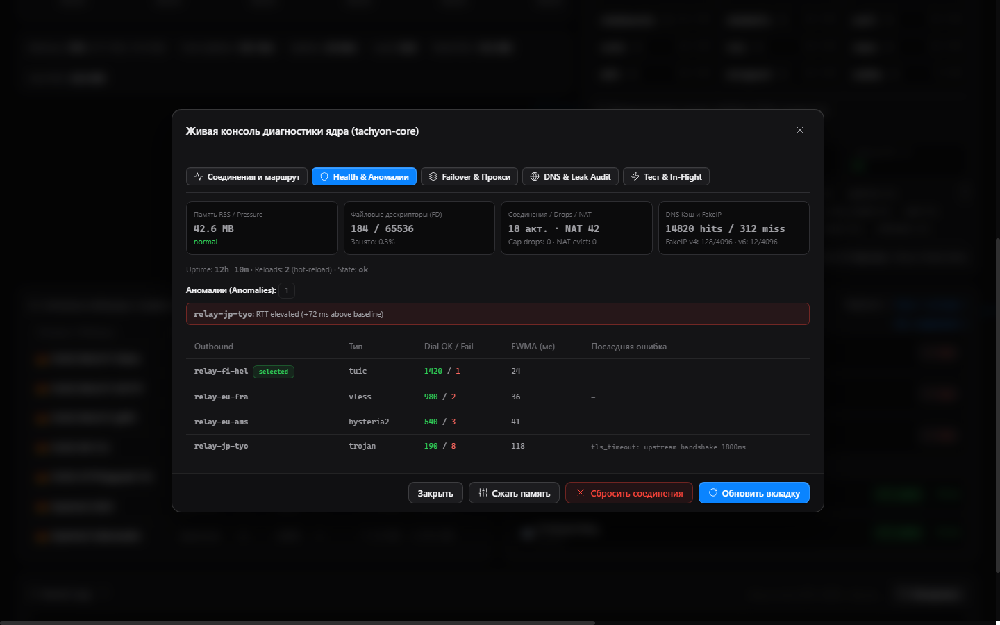
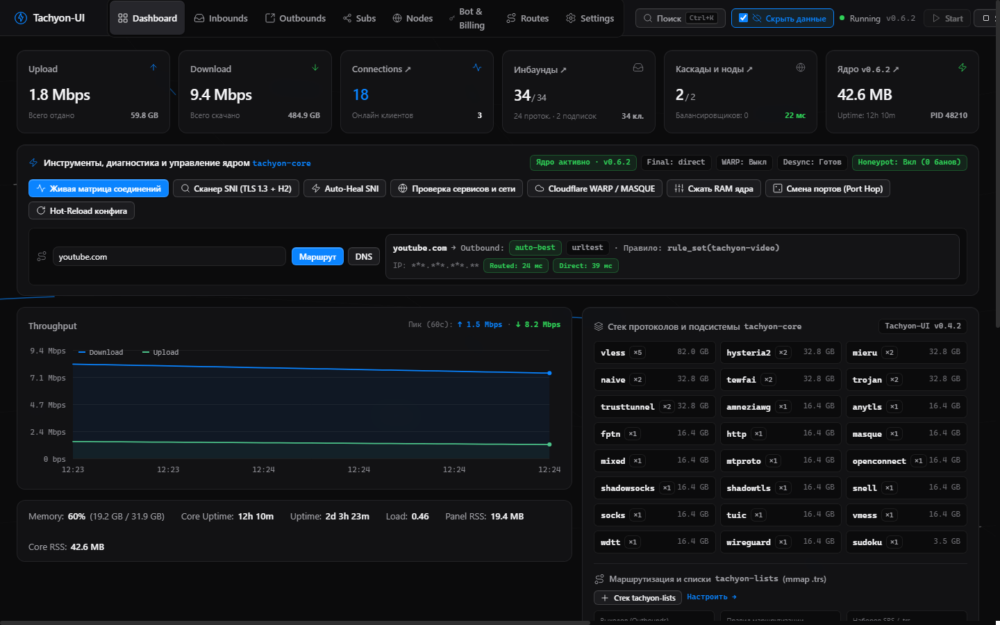

# 6. Core Diagnostics, Privacy Mask (`Alt+P`) & REST API Reference

[Русская версия](../ru/06-diagnostics-privacy-and-api.md) | [Back to Index](../../README.md)

## Live 5-Tab Core Diagnostics Console

Click **Connections** in the topbar or **Live Connection Matrix** on the dashboard to open the real-time diagnostic suite backed by `tachyon-core` Runtime APIs:

| Console Tab | Capabilities & Core Endpoints |
| :--- | :--- |
| **1. Connections & Route** | Live route tracer (`POST /api/core/route-check`), quick domain trace (`POST /api/core/route-domain`), active session filtering by user/domain/IP/protocol (`GET /api/core/connections`), single-connection kill or user kick (`POST /api/core/connections/close`, `POST /api/core/kick`), instant domain block (`POST /api/core/block-domain`), and core memory telemetry & trim (`GET /api/core/memory`, `POST /api/core/memory-trim`). |
| **2. Health & Anomalies** | Engine telemetry (`GET /api/core/health`: RSS memory, pressure level, file descriptors, NAT evictions, DNS cache hit/miss, FakeIP stats, per-outbound RTT and circuit-breaker states) and runtime anomaly feed (`GET /api/core/anomalies`). |
| **3. Failover & Proxies** | Failover group state (`GET /api/core/failover`, `POST /api/core/failover/restore`), live proxy groups (`GET /api/core/proxies`) with real-time `selector` switching, batch/group latency probes (`POST /api/core/proxies/delay`), and circuit-breaker resets (`POST /api/core/outbound/reset`). |
| **4. DNS & Leak Audit** | Side-by-side DNS check (`POST /api/core/dns-check`: engine resolver vs direct UDP:53 for spoofing/bogon checks), DNS cache flush (`POST /api/core/dns/flush`), and IPv4/IPv6/WebRTC/DNS leak audit (`GET / POST /api/core/leak`). |
| **5. Test & In-Flight** | 8-stage active connection test (DNS → Rule → Outbound → TCP → TLS → HTTP via `POST /api/core/connection-test`) and in-flight request ring inspector (`GET / DELETE /api/core/flight`). |

### Bottom Live Connections Dock (`` Ctrl+` ``)

For continuous traffic inspection without leaving your active workspace, press `` Ctrl+` `` (or open **Tools → Live Connections Dock** in the topbar). It streams live connections with instant client/domain filters, route tracing (`route-domain`), and one-click domain blocking (`block-domain`).

---

## Privacy Mask Mode (`Alt+P`)

The **Hide Data** toggle in the topbar (also mapped to `Alt+P`, Command Palette `Ctrl+K`, and Settings; persisted in `localStorage`) protects sensitive user data during screen sharing and screenshots.

**Masked automatically (`***`):**
- Private server IPv4/IPv6 addresses and non-standard ports (`198.51.100.21:443` → `***.***.***.**:****`).
- Private server and node hostnames.
- Subscription URLs and tokens (`/sub/...`, `/cdn/v2/...`, `?k=...`, `?v=...`, `If-None-Match` and `X-Client-Digest` headers).
- UUIDs, X25519/WireGuard/SS2022 keys, passwords, HWIDs, and Telegram bot tokens/handles.
- QR codes (blurred visually).
- Sensitive `<input>` / `<textarea>` elements are masked visually with an SVG overlay **without altering `.value`**, so form saves and clipboard copies remain intact.

**Kept readable:**
- Well-known public test/probe domains and URLs (`https://www.gstatic.com/generate_204`, `https://cp.cloudflare.com/generate_204`, `example.com`, `youtube.com`, `google.com`, `cloudflare.com`, `github.com`, `microsoft.com`, `telegram.org`, etc.).
- Public DNS resolvers (`1.1.1.1`, `1.0.0.1`, `8.8.8.8`, `8.8.4.4`, `9.9.9.9`) and `0.0.0.0`.
- Diagnostic, route tracer, route simulator, and `urltest` probe input boxes.

---

## Command Palette (`Ctrl+K`) & Shortcuts

| Shortcut | Action |
| :--- | :--- |
| **`Ctrl + K`** (or `Cmd + K`) | Global command palette & search across nodes, clients, subscriptions, themes, and instant actions (`Self-Audit`, `Hot-Reload`, 1-click invite, `tachyon-lists`). |
| **`` Ctrl + ` ``** (or `` Cmd + ` ``) | Toggle the bottom **Live Connections Dock** with 1-click domain blocking. |
| **`Alt + P`** | Toggle Privacy Mask Mode anywhere in the panel. |
| **`Alt + 1 … 8`** | Jump directly between the 8 main sections (`Dashboard`, `Inbounds`, `Outbounds`, `Subscriptions`, `Nodes`, `Bot`, `Routes`, `Settings`). |
| **`Shift + Click`** | Range-select checkboxes in Inbounds, Outbounds, or Subscriptions to reveal the Floating Bulk Action Bar. |
| **`?`** | Open the built-in keyboard shortcuts reference modal. |
| **`Esc`** | Close any open modal, side inspector drawer, or command palette. |

---

## Performance, HTTP Compression & Caching

- **Transparent `gzip` HTTP Compression**: `parse_accepts_gzip` evaluates `q`-weights in `Accept-Encoding` (including proper opt-out for `gzip;q=0`). For `200 OK` responses of `1024` bytes or larger (JSON APIs and subscriptions when `Content-Encoding` is not already set), `send_response` compresses the body with `GzEncoder` (`Compression::fast()`), sends the compressed payload when smaller than raw, and adds `Content-Encoding: gzip` and `Vary: Accept-Encoding`.
- **Pre-Compressed Embedded SPA `UI_HTML` Cache & Strict `ETag`**: `CachedUiAsset` (`UI_ASSET_CACHE`) holds both the `raw` and pre-compressed `gzip` variants of `src/ui.html` with `web_base_path` injected (~`225 KB` gzip vs ~`1.05 MB` raw, saving ~`78%` bandwidth). `ETag` (16-byte SHA-256) is matched against `If-None-Match` (including tag lists and weak `W/` tags) to return `304 Not Modified` with `Cache-Control: no-cache` and `Vary: Accept-Encoding`. `ETag` matching runs strictly **after** Covert Knock verification so subscription knocks carrying `If-None-Match` on the root path are not intercepted by the UI cache.
- **X.509 Certificate Caching**: `read_cert_info_cached` validates disk certificate metadata by `(mtime, size)`, while `read_cert_info_from_pem_cached` caches inline PEM parsing by SHA-256 digest (up to 64 entries, recalculating `days_left` on hit). During subscription export, `CertLookupCtx` resolves the default certificate path once per request instead of probing the filesystem per client/inbound.
- **Non-Blocking Read Endpoints**: `GET /api/status` avoids cloning `LiveTelemetry` as a whole by taking three short, non-overlapping lock reads (`live.read()` for counters and active connections, `data.read()` for aggregated summaries, and `live.read()` to serialize `&*live` directly). `GET /api/inbounds`, `/api/outbounds`, `/api/routes`, `/api/settings`, `/api/config-preview`, `/api/subs`, `/api/backup`, `/api/nodes`, `/api/tg-bot`, `/api/domain/proxy-snippet`, `/api/site/info` (`inspect_www_dir` runs outside the read lock), and `/api/sub-profiles` serialize payloads via `serde_json::to_vec` and release `RwLock` before socket writes via `send_json_bytes`.
- **Linear Client Resolution & SPA Optimizations**: `InboundUserNameResolver` disambiguates client identifiers in `O(C)` per inbound across config generation, subscription export, and telemetry matching, while `poll_stats` aggregates per-user deltas in a nested `user_deltas` map. In `src/ui.html`, tables use per-tick microtask `Map`/`Set` lookup caches (`_getInboundLookupMaps` cleared via `queueMicrotask`), `90 ms` search debouncing with instant `0 ms` reset on empty input, and `requestAnimationFrame` batching for the Privacy Mask `MutationObserver` with ancestor deduplication.

---

## REST API Summary

When `web_base_path` is set (e.g. `/p-8f3c21a9`), all panel and `/api/*` routes are strictly scoped under `<web_base_path>/api/...`.

### Authentication

| Method & Path | Description |
| :--- | :--- |
| `POST /api/login` | Authenticates `{ "username", "password" }`. Sets neutral `sid=...; HttpOnly; SameSite=Strict` cookie (`+ ; Secure` on TLS) and returns `{ "token", "expires" }` (accepted as `Authorization: Bearer <token>`). |
| `POST /api/logout` | Invalidates the active session token and clears `sid` and legacy `tachyon_session` cookies. |

### Endpoint Groups

| Group | Endpoints |
| :--- | :--- |
| **Status, Store & Snapshots** | `GET /api/status` (including `core.user_online_ips`, `core.sub_online_ips`, and `access_grant`), `GET /api/config-preview`, `GET/PUT /api/settings`, `GET/PUT /api/access-grant`, `GET /api/backup`, `POST /api/restore`, `GET/POST /api/snapshots`, `POST /api/snapshots/restore`, `GET /api/logs` |
| **Engine & Panel Lifecycle** | `POST /api/core/start \| stop \| restart \| apply`, `GET /api/core/releases`, `POST /api/core/update`, `GET /api/panel/releases`, `POST /api/panel/self-update` |
| **Public Site (`SiteEngine`)** | `GET /api/site/info`, `POST /api/site/upload-zip` (raw ZIP or JSON `zip_base64`), `GET/PUT /api/site/index`, `DELETE /api/site/custom`, `GET /api/site/preview?mode=&path=&title=` |
| **Domain & TLS** | `GET /api/tls/status`, `POST /api/tls/self-signed`, `POST /api/tls/issue-acme`, `POST /api/domain/apply-profile` (including `unified_443_front`), `GET /api/domain/proxy-snippet` |
| **Self-Audit & Security** | `POST /api/web/self-audit` (returns `score`, `grade`, 9 `checks`), `GET /api/security/honeypot`, `POST /api/security/clear-honeypot` |
| **Inbounds, Outbounds & Routes** | `GET/POST /api/inbounds`, `PUT/DELETE /api/inbounds/:id`, `POST /api/inbounds/:id/clients`, `POST /api/inbounds/batch-action` (`enable`, `disable`, `delete`, `set_country`), `POST /api/inbounds/traffic-policy`, `GET /api/share/:id`, `GET/POST /api/outbounds`, `PUT/DELETE /api/outbounds/:tag`, `POST /api/outbounds/health-check`, `POST /api/outbounds/batch-delete`, `GET/PUT /api/routes`, `POST /api/routes/tachyon-lists-pack`, `POST /api/routes/simulate` |
| **Generators & Network Tools** | `GET /api/generate/uuid \| reality-keys \| wg-keys \| ss-key \| password`, `POST /api/tools/sni-scan \| auto-heal \| port-hop \| unlock-probe \| cloudflare-dns` (plus regional reachability probe under `/api/tools/*`) |
| **Subscriptions, Covert Knock & Vouchers** | `GET/POST /api/subs` (supports `old_sub_id` for in-place rename with `409 Conflict` guard and `total_limit_bytes`), `DELETE /api/subs/:id`, `POST /api/subs/:id/reset-traffic \| rotate \| toggle \| extend \| covert-token \| rotate-secrets`, `DELETE /api/subs/:id/devices/:dev_id`, `POST /api/subs/rotate-token`, `POST /api/subs/clear-strikes`, `POST /api/subs/import-external`, `GET/POST /api/sub-profiles`, `DELETE /api/sub-profiles/:id`, `POST /api/subs/apply-profile`, `POST /api/subs/quick-invite`, `POST /api/subs/batch-action`, `POST /api/subs/inspect-headers`, `POST /api/vouchers/batch`, `POST /api/redeem` |
| **Nodes, Cascades & Telegram Bot** | `GET/POST /api/nodes`, `DELETE /api/nodes/:id`, `POST /api/nodes/sync \| health-check \| multi-clone`, `POST /api/cascade/preview \| /api/cascade`, `GET/PUT /api/tg-bot`, `POST /api/tg-bot/verify \| broadcast \| send-message \| users/adjust \| backup-now \| test-alert`, `POST /api/tg-bot/promo`, `DELETE /api/tg-bot/promo/:code`, `POST /api/tg-bot/orders/:id/approve \| reject`, `DELETE /api/tg-bot/orders/:id`, `DELETE /api/tg-bot/tickets/:id`, `POST /api/billing/issue-sub` |
| **`tachyon-core` Runtime Bridge** | `GET /api/core/connections`, `POST /api/core/connections/close \| kick \| block-domain \| route-domain`, `GET /api/core/proxies`, `POST /api/core/proxies/select \| delay`, `POST /api/core/outbound/reset`, `GET /api/core/health`, `GET /api/core/anomalies`, `GET/POST /api/core/failover`, `POST /api/core/failover/restore`, `POST /api/core/route-check`, `POST /api/core/connection-test`, `POST /api/core/dns-check \| dns/flush`, `GET/POST /api/core/leak`, `GET/DELETE /api/core/flight`, `GET /api/core/memory`, `POST /api/core/memory-trim`, `POST /api/core/warp/register` |

---

[Previous: Chapter 5 — Protocols, Multi-Node Clusters, Cascades & Telegram Bot](05-protocols-nodes-and-tgbot.md) | [Back to Index](../../README.md)
