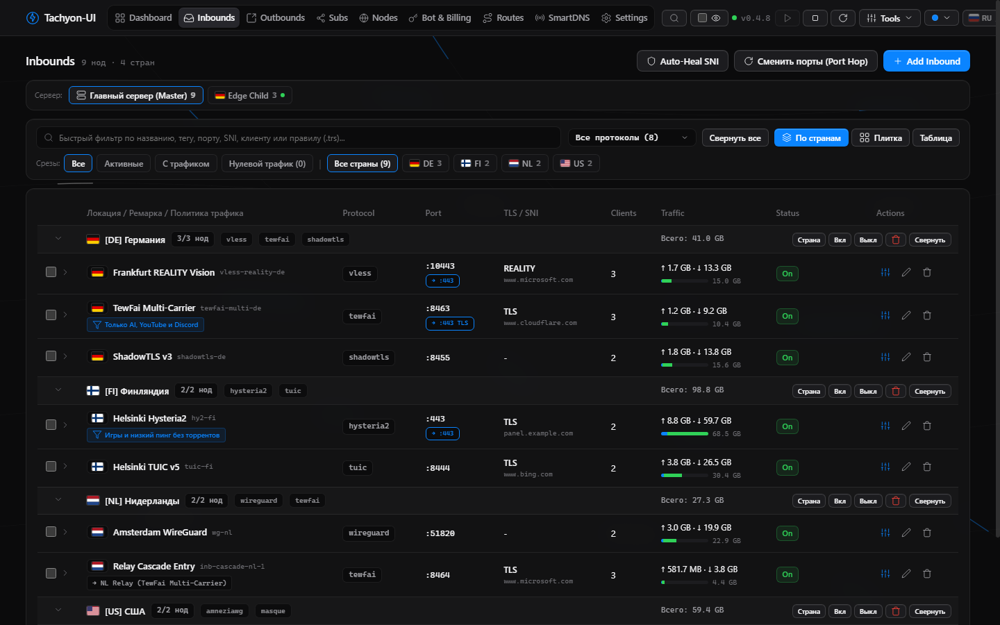
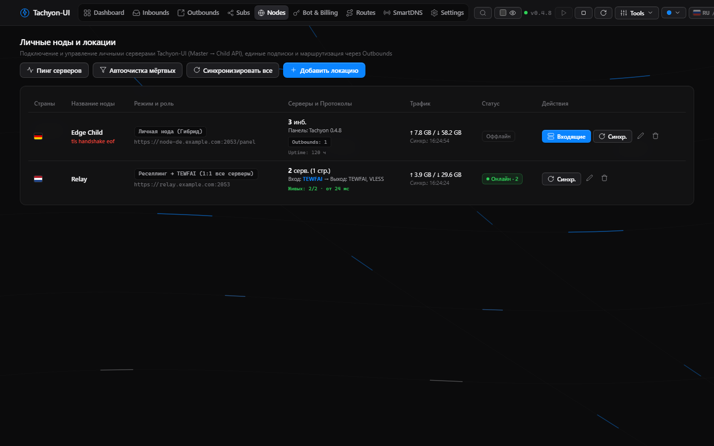
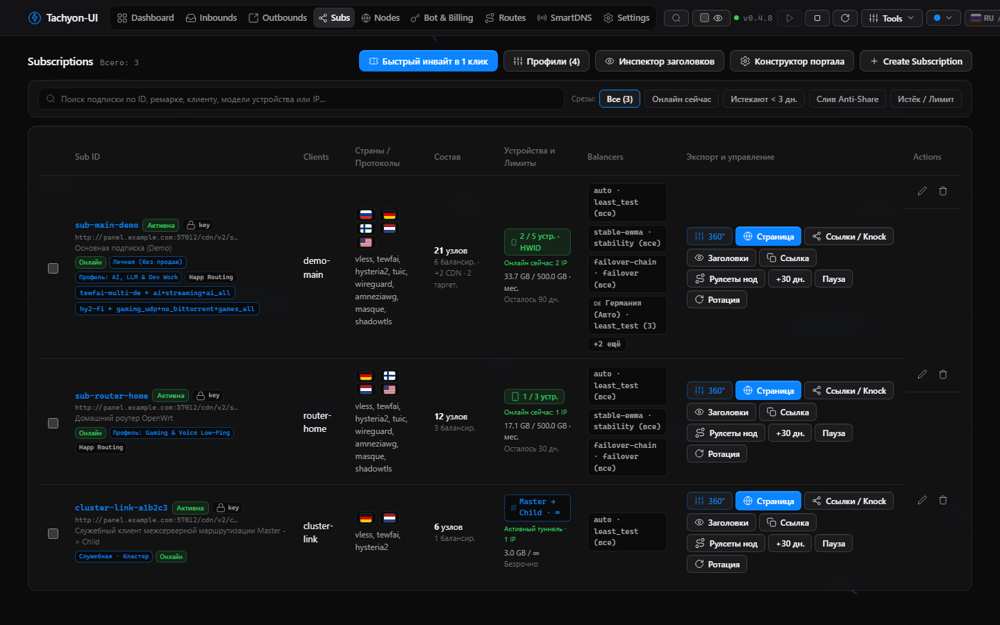
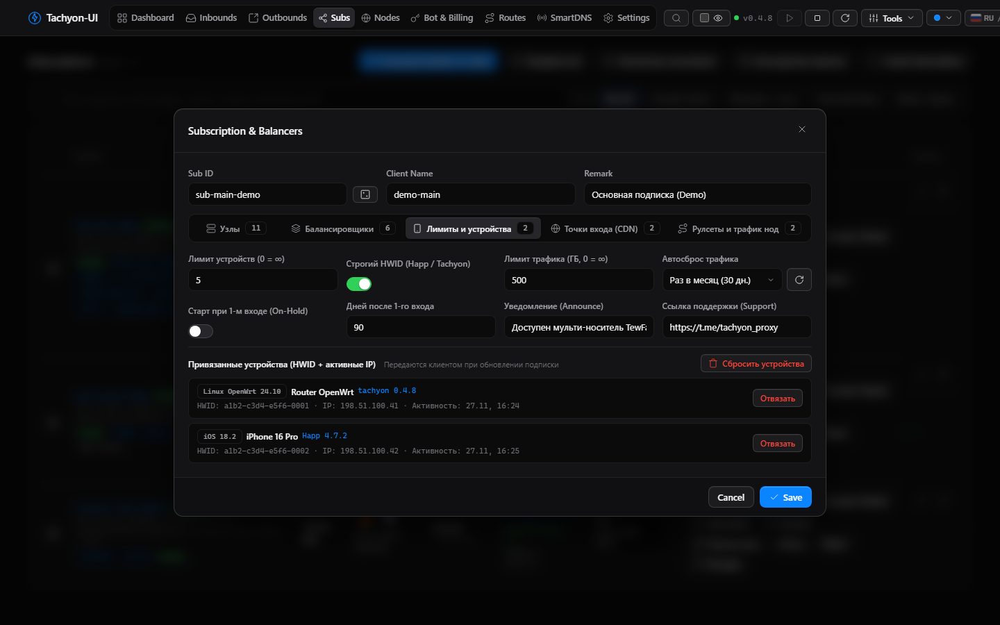
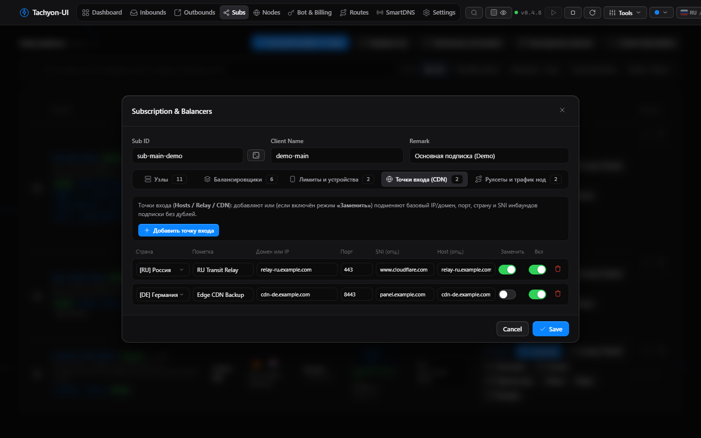
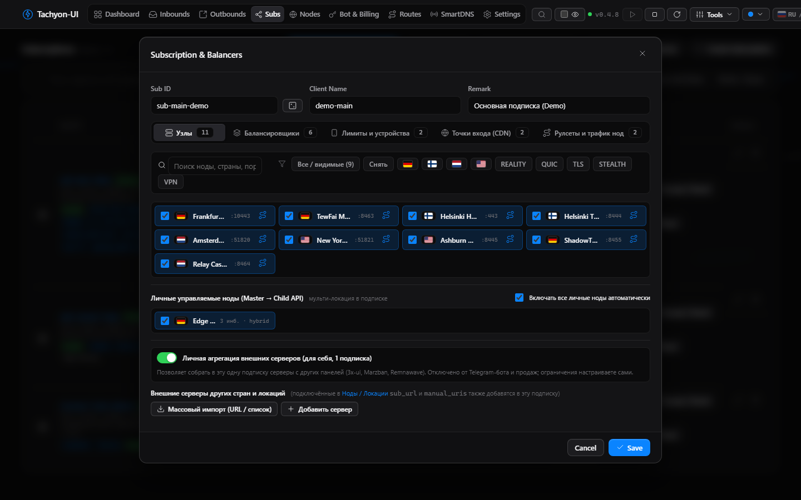
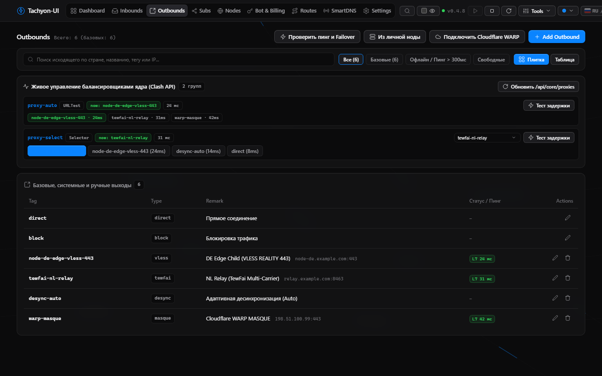
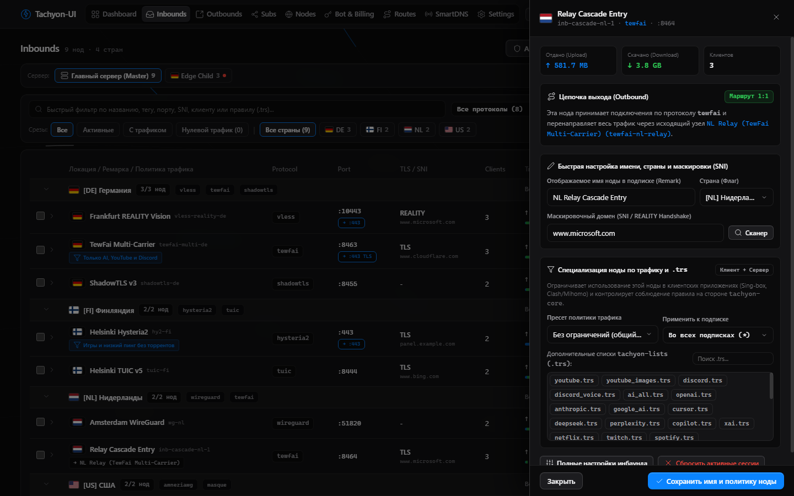
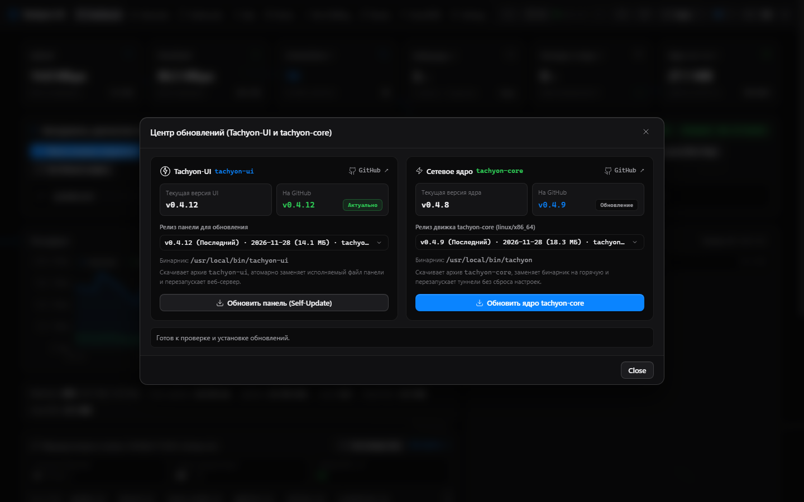

# 7. Full Step-by-Step Guide: From Fresh Server to Multi-Node Unified Subscription

[Back to Index](../../README.md) | [Chapter 6 — Diagnostics & API](06-diagnostics-privacy-and-api.md) | [UI Tab & Button Reference](11-ui-every-tab-and-button-guide.md) | [Protocol Guides Catalog](protocols/README.md) | [Русский](../ru/07-full-setup-and-cluster-guide.md) | [Next: Chapter 8 — SmartDNS / GeoHide](08-smartdns-geohide-guide.md)

This is a complete A-to-Z walkthrough for **`tachyon-ui v0.4.12`**: how to set up your primary server (`Master`), connect your own additional `tachyon-ui` servers (`Child`), manage all their inbounds from one panel, combine every location into **a single unified subscription**, configure cross-server relays via `Outbounds`, and avoid common pitfalls (such as `"Access key required"` prompts and `NaiveProxy` / `MASQUE` certificate errors).

---

## 1. Architecture & Operating Modes (What Works Without an Access Grant)

```text
                       ┌───────────────────────────────────────────┐
                       │         Client (Happ / v2RayTun /         │
                       │      Hiddify / Mihomo / OpenWrt etc.)     │
                       └─────────────────────┬─────────────────────┘
                                             │
            1) Fetches unified subscription  │  2) Connects directly to
               from Master                   │     Master and Child 1..N
                                             ▼
┌────────────────────────────────────┐               ┌───────────────────────────────────┐
│        Primary Server (Master)     │  Master→Child │     Personal Server 1 (Child DE)  │
│          tachyon-ui v0.4.12         ├──────────────►│         tachyon-ui v0.4.12         │
│                                    │  REST API     │                                   │
│ • Stores subscriptions (#subs)     │ (Bearer Token)│ • Managed from Master #inbounds   │
│ • Syncs clients, sub_configs & HWID│               │ • Syncs UUID/keys/quotas/devices  │
│ • Can build relays (Outbounds)     ├───────┐       │ • Reports traffic telemetry       │
└────────────────────────────────────┘       │       └───────────────────────────────────┘
                                             │
                                             │       ┌───────────────────────────────────┐
                                             └──────►│     Personal Server 2 (Child NL)  │
                                                     │         tachyon-ui v0.4.12         │
                                                     │ • Joins the same unified sub      │
                                                     │ • Or acts as relay / hybrid       │
                                                     └───────────────────────────────────┘
```

Before starting, distinguish between **two scenarios**:
1. **Managing your own `tachyon-ui` servers** — 100% available in **base mode without an access grant**.
2. **Importing and reselling third-party subscriptions** — requires a host-bound access grant configured under **Settings → Access Grant** (contact the developer directly to obtain one).

| UI Location | Mode / Action | Purpose | Access Grant Required? |
| :--- | :--- | :--- | :--- |
| **Nodes → Add Location** | `managed_tachyon_node` (**Personal Managed Node `Master → Child API`**) | Full control over your own `tachyon-ui` servers: edit child inbounds directly in Master's **Inbounds** tab, include/exclude servers per subscription, auto-sync clients/quotas/`sub_configs`/devices, export inbounds to **Outbounds** | **No** (always available) |
| **Nodes → Add Location** | `tachyon_node` (**Remote Tachyon-UI Subscription**) | Read-only import of nodes from a specific subscription on another `tachyon-ui` server (accepts base panel URL + `remote_sub_id`, or a full `/sub/<id>` URL) | **No** (for direct node import; reseller cascade disabled) |
| **Nodes → Add Location** | `sub_url` (**External Subscription URL**) | External provider subscription URL with client header emulation (`User-Agent`, `x-hwid`, OS, model) | **Yes** |
| **Nodes → Add Location** | `manual_uris` (**Batch URI List**) | Manual import of arbitrary `vless://`, `hy2://`, `tuic://` URI lists | **Yes** |
| **Nodes → Re-wrap Subscription (Reselling)** | Cascade Reseller Wizard (`#modal-cascade`) | Pulls a third-party subscription and re-wraps it behind your own inbound protocol | **Yes** |
| **Subscriptions → Import External** | Import external link / URI into a subscription | Aggregates third-party URIs directly inside a subscription | **Yes** |

---

## 2. Step 1 — Preparing the Primary Server (`Master`)

### 2.1. Installation & Initial Login

On a clean VPS (Ubuntu / Debian / RHEL / Alpine Linux), run the one-command installer:

```bash
bash <(curl -Ls https://raw.githubusercontent.com/Dushnilin/tachyon-ui/main/install.sh)
```

The script installs the static `/opt/tachyon-ui/tachyon-ui` (or `/usr/local/bin/tachyon-ui`) binary, `tachyon-ui` systemd service, and `tachyon-panel` CLI, opens the panel port in the firewall, and prints the login URL and temporary credentials.

Immediately after your first sign-in, open **Settings**:
1. Change the default admin password (and username if desired).
2. Set a hidden `web_base_path` (e.g., `/adm-9x4k/`) so the panel is not served on root `/`.
3. Verify that **Automated Firewall Management (`auto_firewall_enabled`)** is enabled — whenever you create or re-port inbounds, `tachyon-ui` safely reconciles `UFW` / `firewalld` / `iptables` without touching your manual rules or SSH.
4. On the **Dashboard**, confirm that `tachyon-core` status is **Running** (click **Apply / Start** if needed).

### 2.2. Base Inbounds on `Master` & the `NaiveProxy` / `MASQUE` TLS Rule

On initial startup, `tachyon-ui` seeds a starter set of inbounds (`#inbounds`):



> [!IMPORTANT]
> **TLS Certificate Rule for `NaiveProxy HTTP/3 QUIC`, `MASQUE HTTP/3`, and `Trojan TLS`:**
> These protocols require a **bound domain and trusted TLS certificate (Let's Encrypt)** matching the client's SNI.
> - On a **bare-IP server with no domain** (or before issuing a certificate), clients (especially routers and TLS-strict client apps) fail with certificate mismatch errors such as `certificate not valid for name "www.bing.com"` or `504` timeouts.
> - **Without a domain:** disable or delete `NaiveProxy HTTP/3 QUIC` and `MASQUE HTTP/3` (or issue a Let's Encrypt domain certificate via **Setup Wizard → Domain & TLS**). Use `VLESS + REALITY`, `TewfAI`, `Hysteria2`, `TUIC`, `ShadowTLS v3`, or `WireGuard / AmneziaWG` on bare-IP hosts.
> - `tachyon-ui v0.4.12` exports `keep_alive_period: "20s"` and `idle_timeout: "50s"` on `MASQUE` and `NaiveProxy` for stable router probes, and uses the bound certificate domain automatically — a valid domain certificate is still mandatory for those protocols.

Assign a 2-letter ISO country code (`DE`, `FI`, `NL`, etc.) to each inbound on `Master` (individually or via **Batch Set Country**) so nodes display country flags and join per-country balancers automatically.

### 2.3. Domain, TLS & `Unified 443 Front` (Recommended for Production)

If your `Master` has a domain whose DNS `A` record points to the VPS IP:
1. Open **Setup Wizard → Domain & TLS** (see [Chapter 2](02-stealth-web-domain-tls.md)).
2. Issue a Let's Encrypt certificate (`HTTP-01` or `Cloudflare DNS-01`).
3. Pick a binding profile:
   - **`dual_single_port`** — panel on its own port (e.g. `2053`), inbounds on separate ports.
   - **`unified_443_front`** — **NGINX + Core on a single port `443` TCP/UDP**: hidden `web_base_path` panel, L7 transports (WS/gRPC/XHTTP), `REALITY` via `ssl_preread`, and UDP protocols (`Hysteria2`/`TUIC`) sharing `:443` with an isolated loopback masquerade on `127.0.0.1:18080`.
4. Click **Apply to NGINX**: `tachyon-ui` detects the installed `nginx -v` (`listen ... ssl http2;` vs `http2 on;`), preserves system worker `user`, deduplicates `:18080` locations, backs up the config, validates with `nginx -t -e /dev/stderr`, and automatically rolls back on error.

---

## 3. Step 2 — Installing & Preparing Child Servers (`Child`)

Repeat these steps on each additional VPS you want to include in your unified panel and subscription:

1. Install `tachyon-ui v0.4.12` (or update an existing node via **Settings → Panel Update**):
   ```bash
   bash <(curl -Ls https://raw.githubusercontent.com/Dushnilin/tachyon-ui/main/install.sh)
   ```
2. Sign in to the Child panel, change the admin password, and verify `tachyon-core` is running.
3. Under **Inbounds (`#inbounds`)**, keep the transports you want (`VLESS + REALITY`, `TewfAI`, `Hysteria2`, `TUIC`, etc.) and set the Child server's ISO country code (`NL`, `US`, `FI`, etc.). Disable `NaiveProxy` / `MASQUE` if the Child has no domain certificate.
4. On the **Child** server, open **Settings**, locate **Cluster API Token (`node_api_token`)**, and copy the Bearer token (you can rotate it there anytime; remember to update it on `Master` if rotated).
5. Ensure the Child panel port (default `2053`, or `443` under `Unified 443 Front`) is reachable from `Master`'s IP in both OS firewall and cloud security group.

---

## 4. Step 3 — Connecting Your Servers to `Master` (No Access Grant Required)

Return to **`Master`**, open **Nodes (`#nodes`)**, and click **Add Location**.



> [!NOTE]
> Click **Add Location**, not **Re-wrap Subscription (Reselling)**. The reseller cascade wizard is exclusively for third-party subscriptions and always requires an access grant.

### Option A (Recommended): `Personal Managed Node (Master → Child API)` (`managed_tachyon_node`)

Turns `Master` into a single control plane for all your servers with zero access grant:

1. **Default Country:** select the Child VPS country (e.g. `NL`).
2. **Location Name:** enter a descriptive label (e.g. `Netherlands-1`).
3. **Connection Mode:** select **`Personal Managed Node (Master → Child API)`** (`managed_tachyon_node`).
4. **Node URL:** enter the **base panel URL** (never `/sub/...`):
   - Standard root panel: `https://198.51.100.20:2053` or `http://198.51.100.20:2053`
   - With hidden `web_base_path`: `https://nl.example.com:2053/adm-9x4k` (or `https://nl.example.com/adm-9x4k` behind NGINX)
   - *Note:* if the Child uses a self-signed TLS certificate, use `https://...` — `Master`'s cluster client trusts self-signed certs on personal managed nodes.
5. **Cluster Bearer API Token:** paste the Child's `node_api_token`. (Fallback username/password fields can stay blank when a Bearer token is set.)
6. **Node Role:**
   - **`direct` (default)** — issues Child endpoints directly to users in subscriptions and manages its `#inbounds`. Pick `direct` (or `hybrid`) for unified multi-location subscriptions.
   - **`hybrid`** — issues endpoints directly to users **and** allows exporting Child inbounds into `Master` `#outbounds` for relays.
   - **`relay`** — hidden from direct client subscriptions; used strictly as an outbound relay hop from `Master`.
7. Click **Test Connection (API)**: verify the green status `Connected (v0.4.12 · inbounds: N · id: ...)`.
8. Click **Save & Sync**. The node appears in `#nodes` as **Online**.

Repeat steps 1–8 for `Child 2`, `Child 3`, etc.

### Option B (Read-Only): `Remote Tachyon-UI Subscription` (`tachyon_node`)

Use this only if you do not need centralized inbound management or unified quota/device synchronization and simply want to pull an existing subscription from another `tachyon-ui` host:
1. In **Nodes → Add Location**, select `Remote Tachyon-UI Subscription` (`tachyon_node`).
2. Enter the base panel URL + `remote_sub_id` (default `tachyon-all`), **or** paste a full `/sub/<id>` URL — `tachyon-ui` automatically extracts the base URL and `remote_sub_id`, strips client-spoofing headers, and saves without requiring an access grant.

---

## 5. Step 4 — Managing Child Inbounds Directly from `Master`

Once nodes are connected in `managed_tachyon_node` mode, you no longer need to log in to each Child panel separately:

1. Open **Inbounds (`#inbounds`)** on `Master`.
2. Use the server switcher bar at the top: **Current Server (Master)** plus a button for every connected Child node.
3. Click any Child node — `Master` loads its live inbound list via the Child API.
4. You can **create**, **edit**, **enable/disable**, and **delete** Child inbounds identically to local ones (reloading `tachyon-core` only on the target Child).
5. If a Child is temporarily unreachable, `Master` gracefully shows its cached inbound list with a cache badge without disrupting the rest of the panel.

---

## 6. Step 5 — Combining All Servers into ONE Unified Subscription (`#subs`)

Now bundle `Master` and all connected Child servers (`direct` or `hybrid`) into **one unified subscription link**:



1. Open **Subscriptions (`#subs`)** on `Master`.
2. Click **Create Subscription** (or **Edit** an existing one like `tachyon-all` / `main`).
3. Configure identity, quotas, and limits:
   - **ID (`sub_id`):** unique Latin identifier (e.g. `vip-all` or `my-vpn`).
   - **Traffic Quota (GB), Reset Strategy (`none` / `daily` / `weekly` / `monthly`), Expiry Days,** and **Start on First Use**.
   - **Device Limit (`device_limit`)** and optional **Strict HWID** enforcement (Tab: **Devices & Limits**):

   

   - **Hosts & CDN Overrides** (optional custom SNI/CDN domains per subscription):

   

4. Under **Nodes & Locations**:
   - Select the desired **local inbounds** on `Master` (`VLESS + REALITY`, `TewfAI`, `Hysteria2`, etc.).
   - Under **Personal Cluster Nodes**, check the Child servers (`DE`, `NL`, `FI`, ...) you want included.
   - *Note:* nodes with role **`relay`** are intentionally excluded from direct user delivery; set role to **`direct`** or **`hybrid`** to include them in unified subscriptions.

   

5. Click **Save**.

### What Happens Under the Hood in `v0.4.12`
- **Full `clients` + `sub_configs` Master → Child Synchronization (`POST /api/inbounds/sync-clients`):**
  For every selected Child node, `Master` pushes both the `clients` list and the full **`sub_configs`** metadata (`remark`, `device_limit`, `strict_hwid`, bound **`devices`**, `traffic_reset_strategy`, `start_on_first_use`, `expire_duration_days`, `activated_at`), plus `delete_sub_ids` when nodes are unselected or deleted. The Child returns `{ ok, added, updated, deleted, sub_configs_synced }` so device limits, HWID bindings, and on-hold activation behave identically whether a user connects to `Master` or `Child`.
- **Service Tunnel `cluster-link-*` (`Master → Child · ∞`):**
  Whenever you export a Child inbound as an outbound on `Master`, a protected service client named `cluster-link-<master_short>` is created on the Child. In `#subs`, it displays the **`Master → Child · ∞`** badge (`device_limit = 0`, unlimited devices, HWID enforcement disabled) and is never overwritten by normal subscription syncs.
- **Live Online Counter (`Online now: N IP`):**
  In `#subs` (and the 360° drawer), each subscription aggregates live active client IPs across `core.sub_online_ips` and `core.user_online_ips`, showing **`Online now: N IP`** in real time (or **`Active tunnel · N IP`** for `cluster-link-*` service tunnels).
- **Unified Quota & Lifecycle Aggregation:**
  Every 60 seconds `Master` polls `up`/`down` byte counters from every Child and adds them to the subscription's shared quota. When a subscription expires, hits its traffic cap, or is paused/renamed (`old_sub_id`), `Master` propagates the change across all linked nodes automatically.

### Delivering the Unified Subscription Link
Click **Links / Knock** or **Copy Link** on the subscription row:
- **Standard subscription URL** (Happ, v2RayTun, Hiddify, v2rayN, Shadowrocket, Streisand):
  `https://<your-domain-or-IP>:<port>/sub/<sub_id>`
- Opening it in a browser (or `?format=html`) launches the **User Web Portal** with 1-click import buttons, QR code, and device management.
- Supported URL parameters:
  - `?format=clash` / `?format=mihomo` — Clash Meta / Mihomo / FlClash YAML with all locations and country/strategy balancers;
  - `?format=singbox` / `?format=tachyon` — native JSON for `tachyon-core` / Tachyon 2.0 router and compatible clients;
  - `?format=openwrt` & `?format=openwrt-install` — OpenWrt config and 1-click install script;
  - `?country=DE,NL` — filter by country codes;
  - `?mode=ru-direct` (or `antiblock`, `gaming`, `full`) — apply client routing preset.

---

## 7. Step 6 — Relays, Cascades & Cross-Node Routing (`Outbounds`)

If you want user traffic to enter **`Master`** and exit through **`Child`** (`Client → Master → Child → Internet`), or route specific domains/services through a chosen country, this works out of the box **without an access grant**.



### 7.1. Exporting a Child Inbound to `Master` `#outbounds`

Choose any of **three** workflows:

1. **Directly from Inbounds (`#inbounds`):**
   - Switch to the desired Child node in the top server bar.
   - Click **`⇄ Outbound`** on the target inbound row (e.g. `VLESS + REALITY` on `NL`).
   - `Master` automatically provisions the `cluster-link-<master_id>` service client on the Child and registers `node-<id>-inb-<inb_id>` in `Master` **Outbounds (`#outbounds`)**.
2. **From Outbounds (`#outbounds`):**
   - Click **From Personal Node**, pick the Child node and inbound, and confirm.
3. **Automatically via Node Role (`#nodes`):**
   - Open the node drawer/editor for a `managed_tachyon_node`, set role to **`relay`** or **`hybrid`**, and enable **Auto-create Outbounds on Master for active inbounds** (`auto_export_outbounds`).

   

### 7.2. Auto-Sync, Health Checks & Routing
- **Parameter Auto-Sync:** Changing port, SNI, domain, or public key on a Child inbound updates the linked `OutboundRecord` on `Master` automatically on save or on the next 60-second sync tick.
- **Latency Heat Matrix:** Click **Health Check** in `#outbounds` to measure RTT from `Master` to every Child relay.
- **Balancers & Chains:** Combine exported Child outbounds into `urltest`, `selector`, or `chain` outbounds (see [Chapter 4](04-balancers-chain-and-routes.md)).
- **Routing Rules (`#routes`):**
  - Match domains / `.trs` rule-sets → route via a Child outbound or country balancer;
  - Match `inbound` tags → bridge all traffic entering a specific `Master` inbound straight through a Child exit.

---

## 8. Node Maintenance, `tachyon-core` Update Center & Troubleshooting

### Node Maintenance & `tachyon-core` Update Center (`#modal-core-update`)

Keep both `Master` and every `Child` node synchronized and up to date directly from the UI:

| Control / Action | Location / Trigger | Endpoint | Purpose & Behavior |
| :--- | :--- | :--- | :--- |
| **`Core: ...` / Tools → Update Center** | Topbar core status pill or Tools menu (`#modal-core-update`) | `GET /api/core/releases`, `POST /api/core/update` | Lists available `tachyon-core` releases (`0.6.9+`) and updates the engine binary in place. |
| **Update Panel (`Self-Update`)** | Inside `#modal-core-update` | `GET /api/panel/releases`, `POST /api/panel/self-update` | Fetches `tachyon-ui` releases (`v0.4.12+`) and performs an atomic binary self-update. |
| **Sync All / Sync Clients** | `#nodes` toolbar & card actions | `POST /api/nodes/sync`, `POST /api/nodes/{id}/sync-clients` | Pushes `clients`, `sub_configs` (HWID, device limits), and deletions across linked Children. |
| **Health Check (+ Auto-Clean)** | `#nodes` toolbar | `POST /api/nodes/health-check` | Probes node APIs/RTT and optionally cleans unreachable external entries (`auto_clean: true`). |
| **Rotate Cluster API Token** | **Settings → Cluster API (`Node API Token`)** | `POST /api/settings/rotate-node-token` | Reissues the Child's Bearer token (remember to update it on `Master`). |
| **Snapshots & Rollback** | **Tools → Snapshots** (`#modal-snapshots`) | `GET/POST /api/snapshots`, `POST /api/snapshots/restore` | Creates checkpoints before cluster upgrades and rolls back atomically on error. |



### Why Does Adding a Server Prompt for an Access Grant?

In practice this occurs for **four** reasons:

1. **Outdated panel (`< v0.4.4`) or stale browser cache:**
   - **Fix:** Upgrade `Master` (and `Child`) to **`v0.4.12`** and hard-refresh the browser (**`Ctrl+F5`**). Check that the Dashboard displays `Tachyon-UI v0.4.12`.
2. **Clicked "Re-wrap Subscription (Reselling)" or "Subscriptions → Import External":**
   - Those two buttons are strictly for third-party subscription reselling and always require an access grant.
   - **Fix:** For your own `tachyon-ui` servers, always use **Nodes → Add Location**.
3. **Connection Mode set to `sub_url` or `manual_uris`:**
   - **Fix:** Select **`Personal Managed Node (Master → Child API)`** (`managed_tachyon_node`, recommended) or **`Remote Tachyon-UI Subscription`** (`tachyon_node`).
4. **Entered a `/sub/...` URL inside `managed_tachyon_node`:**
   - `managed_tachyon_node` expects the **base panel URL** (e.g. `https://198.51.100.20:2053` or `https://de.example.com/adm-path`), never `/sub/tachyon-all`.

### Other Common Errors & `v0.4.12` + `tachyon-core 0.6.9` Fixes

| Symptom / Error | Cause | Fix |
| :--- | :--- | :--- |
| `Cannot add node to itself (matching instance_id)` | Attempting to add `Master` as its own Child, or cloning panel state with identical `instance_id` | Local `Master` inbounds do not belong in `#nodes` — they are already in `#inbounds` and `#subs`. If panel JSON was cloned across VPSs, remove `instance_id` on the Child and restart `tachyon-ui` to regenerate a unique ID. |
| `HTTP 401` / `HTTP 403` during API test | Wrong `node_api_token` or missing `web_base_path` in Node URL | Re-copy `node_api_token` from **Settings → Cluster API Token** on the Child. If the Child uses `web_base_path`, append it to the Node URL (e.g. `https://198.51.100.20:2053/adm-9x4k`). |
| Connection timeout / `Offline` | Child panel port blocked by cloud or OS firewall | Allow the Child panel TCP port (`2053` or `443`) from `Master` and verify with `curl -kI https://198.51.100.20:2053/api/status`. |
| `NaiveProxy` / `MASQUE`: `insecure is not supported` or cert mismatch | `NaiveProxy` strictly forbids `insecure: true` in `tachyon-core 0.6.9`, and `MASQUE` standard profile requires matching SAN/CA certs | Disable `NaiveProxy` / `MASQUE` on bare-IP servers, or bind a domain and issue a Let's Encrypt cert via **Setup Wizard → Domain & TLS** (see [10-naive.md](protocols/10-naive.md), [11-masque.md](protocols/11-masque.md)). |
| `TewfAI` REALITY + QUIC fails on client | Client lacks `quic.tls` when connecting via QUIC to a REALITY inbound | Ensure `Master` and clients run `v0.4.12`+ (`sub_gen` auto-exports `quic.tls: { enabled: true, insecure: true, alpn: ["h3"] }`; see [01-tewfai.md](protocols/01-tewfai.md)). |
| `MTProto`: `secret must be 32 hex characters` | Raw `ee...` / `dd...` prefixed secret passed manually to `tachyon-core 0.6.9` | Save via `tachyon-ui v0.4.12` (auto-normalizes secrets to 32 hex chars; see [15-mtproto.md](protocols/15-mtproto.md)). |
| `Desync`: unknown field `udp_fake_packets` | Legacy field removed in `tachyon-core 0.6.9` strict schema | Re-save the outbound in `v0.4.12` (`udp_fake` + `quic_desync` + `udp_repeats`; see [24-desync.md](protocols/24-desync.md)). |
| Child node is `Online`, but missing from subscription | Node checkbox unchecked in subscription, or node role is `relay` | Open **Subscriptions → Edit**, check the Child node under **Personal Cluster Nodes**, and verify the node role in `#nodes` is `direct` or `hybrid`. |

---

## 9. Final Readiness Checklist

1. `Master` and all `Child` nodes run `tachyon-ui v0.4.12`, `tachyon-core` is **Running**, and firewall ports are open.
2. On bare-IP servers without a CA domain certificate, `NaiveProxy` and `MASQUE` are disabled (`VLESS + REALITY`, `TewfAI`, `Hysteria2`, `TUIC`, etc. are active).
3. All personal Child servers are added in **Nodes** as **`managed_tachyon_node`** with role `direct` or `hybrid` and show **Online**.
4. In **Subscriptions**, your subscription includes the local `Master` inbounds and checked Child nodes, and `clients` + `sub_configs` sync cleanly.
5. Any cross-server gateway relays are exported via `⇄ Outbound` (`cluster-link-*` showing `Master → Child · ∞`) and wired in **Routes**.
6. Opening the unified subscription link in a client lists all selected countries and updates traffic quotas and `Online now: N IP` counters across the entire cluster.

---

[Previous: Chapter 6 — Core Diagnostics, Privacy Mask (`Alt+P`) & REST API Reference](06-diagnostics-privacy-and-api.md) | [UI Tab & Button Reference](11-ui-every-tab-and-button-guide.md) | [Protocol Guides Catalog](protocols/README.md) | [Back to Index](../../README.md) | [Next: Chapter 8 — SmartDNS / GeoHide](08-smartdns-geohide-guide.md)
