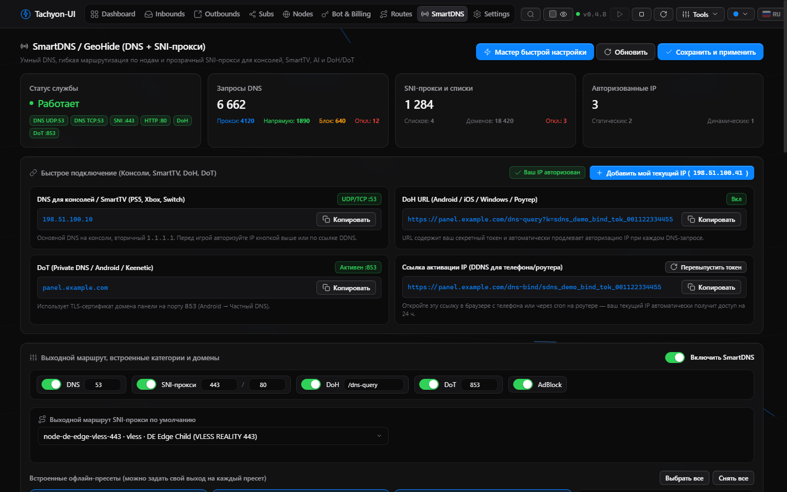
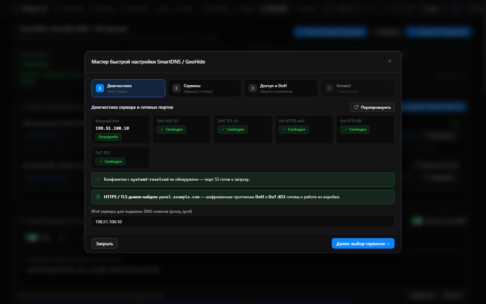

# 8. Self-Hosted SmartDNS / GeoHide, SNI Proxy, DoH/DoT & Setup Wizard

[Back to Index](../../README.md) | [Chapter 7 — Full Setup & Cluster Guide](07-full-setup-and-cluster-guide.md) | [UI Tab & Button Reference](11-ui-every-tab-and-button-guide.md) | [Русский](../ru/08-smartdns-geohide-guide.md) | [Next: Chapter 9 — Protocol Encyclopedia](09-protocols-encyclopedia.md)

Introduced in `v0.4.5` and expanded into **SmartDNS v2** in **`tachyon-ui v0.4.12`**, the panel includes a built-in **SmartDNS (GeoHide-style selective DNS) + transparent SNI proxy** written in pure Rust (zero external daemons such as `dnsmasq`, `nginx`, or `sniproxy`, and zero extra runtime dependencies). In under a minute you can deploy your own **UDP/TCP `:53`**, **DNS-over-HTTPS (DoH RFC 8484)**, and **DNS-over-TLS (DoT `:853`)** server for devices that cannot run a VPN app: **PS5, Xbox, Nintendo Switch, SmartTVs (LG, Samsung, Apple TV)**, desktops, phones, and routers.



### `#smartdns` UI Control Reference

| Control / Section | Label / Action | Method / Endpoint | Purpose & Notes |
| :--- | :--- | :--- | :--- |
| **Diagnostics & Conflict Banner** | Top contextual alert | `GET /api/smart-dns` | Alerts on occupied `:53` (`systemd-resolved`), missing TLS cert for DoH/DoT, or missing egress gateway. |
| **4 Listener KPI Cards** | `DNS :53`, `DoT :853`, `DoH :443/:80`, `Egress / Domains` | `GET /api/smart-dns/probe` | Confirms live bound sockets and active rule/domain counts. |
| **Bind My IP** | `Authorize My IP` (`permanent` toggle) | `POST /api/smart-dns/bind-my-ip`, `DELETE /api/smart-dns/dynamic-ip/{ip}` | Adds your current browser public IP to the allowlist immediately without manual typing. |
| **Quick Connect & `Without https://`** | DNS IP, DoT host, DoH URL, DDNS Bind URL, `Rotate Token`, **`Without https://`** | `POST /api/smart-dns/rotate-token` | **`Without https://`** copies `domain.tld/dns-query?...` without the `https://` scheme—specifically for **Keenetic / OpenWrt** router DoH fields that prepend `https://` automatically. |
| **Services & Ports** | Enable toggles, `dns_port`, `dot_port`, `sni_https_port`, `sni_http_port`, DoH path, `upstream_dns` | `PUT /api/smart-dns` | Configures listening ports and upstream resolver (`1.1.1.1` / `9.9.9.9`) for direct domains. |
| **Global Egress & Export Node** | Global egress selector + `Export Node as Egress` | `PUT /api/smart-dns`, `POST /api/smart-dns/export-node-egress` | Selects default SNI egress (`direct`, `outbound:<tag>`, `socks5`) or promotes a Child node to a SOCKS5 bridge in 1 click. |
| **6 Built-in Presets (per-preset Egress)** | Toggle + per-category egress dropdown | `PUT /api/smart-dns` | Routes each service group independently (e.g., AI via US, Streaming via NL, rest direct). |
| **`tachyon-lists` Catalog & Custom Lists** | Filter, `Sync Lists`, AdBlock/Hosts inputs | `GET /api/smart-dns/lists`, `POST /api/smart-dns/lists/sync` | Imports curated `.lst` domain packs (`PROXY` / `DIRECT` / `BLOCK`) and custom overrides. |
| **Access Control & Live DNS/SNI Log** | Static `allowed_ips`, dynamic IPs, `allow_public` toggle, live query table | `PUT /api/smart-dns` | Keeps `allow_public = false` against DNS amplification and displays live domain decisions. |
| **4-Step SmartDNS Wizard** | `Quick Setup Wizard` (`#modal-smartdns-wizard`) | `POST /api/smart-dns/wizard-apply` | Guided 4-step deployment (Diagnostics → Scenario & Egress → Access & Protocols → Ready cards with **`Without https://`**). |

---

## 1. How It Works: SmartDNS + Transparent SNI Proxy

Unlike a full-tunnel VPN, **SmartDNS** requires no client software and leaves regular traffic direct:

```text
┌─────────────────────────────┐
│ Console / SmartTV / PC /    │   1. DNS query (:53 / DoH / DoT)
│ Phone / Router              ├───────────────────────────────────────────┐
│ DNS = Your VPS IP           │                                           ▼
└──────────────┬──────────────┘                              ┌──────────────────────────┐
               │                                             │   tachyon-ui SmartDNS    │
               │                                             │  Client IP allowlist     │
               │                                             └───┬──────────────────┬───┘
               │                                                 │                  │
               │  2a. Non-matched domain (e.g. local/bank)       │ DIRECT           │ PROXY (matched rule)
               │      Returns real upstream IP ◄─────────────────┤                  │ Returns VPS IPv4
               │      → traffic goes DIRECTLY to origin          │                  ▼ (proxy_ipv4)
               │                                                 │         + NOERROR NODATA for AAAA/HTTPS
               │  2b. Target service (PSN, YouTube, ChatGPT)     │
               │      Connects to VPS (:443 TLS / :80 HTTP) ◄────┴───────────────────────────────────────┘
               ▼
┌─────────────────────────────┐   3. Peeks ClientHello SNI (:443) or HTTP Host (:80) — NO TLS MITM!
│   Built-in SNI Proxy        │      Checks client IP authorization AND rule match before dialing
│   tachyon-ui (:443 / :80)   ├───────► direct (VPS egress)
└─────────────────────────────┘   or    outbound:<tag> (tachyon-core Child / balancer SOCKS5 bridge)
                                  or    socks5 (custom external/local SOCKS5 address)
```

### Key Design Properties
- **End-to-End TLS Preserved:** The SNI proxy only inspects the cleartext TLS `ClientHello` SNI extension on `:443` (or the HTTP `Host:` header on `:80`) and splices TCP streams verbatim. Clients validate the origin's genuine X.509 certificate.
- **Anti-Bypass for IPv6 & QUIC (`AAAA` / `HTTPS` / `SVCB`):** When `proxy_ipv6` is empty, proxied domains answer `NOERROR NODATA` for `AAAA`, `HTTPS`, and `SVCB` queries so consoles and browsers stay on the IPv4 SNI proxy instead of leaking over IPv6 or HTTP/3 Alt-Svc.
- **Zero DNS Loop:** The SNI proxy resolves real origin IPs directly over UDP against `upstream_dns` (default `1.1.1.1:53`, `8.8.8.8:53`), never via local `:53`, and rejects loopback or self `proxy_ipv4` destinations.
- **Flexible Egress (`direct`, `outbound:<tag>` Child SOCKS5 Bridge, or `socks5`):**
  - **`direct`** exits straight from the local VPS.
  - **`outbound:<tag>` (Child / Balancer SOCKS5 Bridge)** routes SmartDNS SNI traffic through any `tachyon-core` outbound or balancer — including exported personal **Child** cluster nodes (`managed_tachyon_node`). Under the hood, `tachyon-ui` deterministically allocates loopback-only (`127.0.0.1`) SOCKS5 bridge listeners in port range `10890..=10989` inside `tachyon-core` (`smart_dns_bridge_ports`) and displays active bridge pills in `#smartdns`. You can even promote an unexported Child node to an outbound in 1 click directly from SmartDNS (`POST /api/smart-dns/export-node-egress`).
  - **`socks5`** forwards to any manual SOCKS5 endpoint (e.g., `127.0.0.1:10808`).
  - Both **built-in presets (`preset_egress`)** and **`tachyon-lists` rules** can override the global default egress independently per category or domain list.

---

## 2. Server Requirements, Ports & TLS Certificates

### Network Ports
| Protocol | Default Port | Purpose | Firewall Requirement |
| :--- | :--- | :--- | :--- |
| **DNS (UDP + TCP)** | `53` | Plain DNS for PS5, Xbox, Switch, SmartTV, Windows, routers | Allow `53/udp` & `53/tcp` |
| **SNI Proxy HTTPS** | `443` | Transparent TLS SNI forwarding | Allow `443/tcp` |
| **SNI Proxy HTTP** | `80` | Transparent HTTP `Host` forwarding | Allow `80/tcp` |
| **DNS-over-TLS (DoT)** | `853` | Encrypted DNS for Android Private DNS and routers | Allow `853/tcp` |
| **DNS-over-HTTPS (DoH)** | Panel port (e.g. `2053`) | RFC 8484 endpoints (`/dns-query` & `/dns-query/<token>`) | Panel port already open |

> [!NOTE]
> When **Automated Firewall Management** (`auto_firewall_enabled`) is enabled in **Settings**, `tachyon-ui` reconciles `UFW` / `firewalld` / `iptables` rules automatically for active SmartDNS ports (`dns_port`, `sni_https_port`, `sni_http_port`, `dot_port`). If your VPS provider enforces an external cloud security group / firewall (AWS, Oracle Cloud, Hetzner Cloud Firewall, etc.), allow those ports there as well.

### Automatic `systemd-resolved` Coexistence (Ubuntu / Debian)
On Ubuntu and Debian servers, `systemd-resolved` typically binds `127.0.0.53:53`, causing `0.0.0.0:53` to fail with `EADDRINUSE`. When `bind_addr` is empty (`auto` mode) and binding `0.0.0.0:53` hits `EADDRINUSE`, `tachyon-ui` automatically falls back to the host's external non-loopback IPv4 interface (e.g. `198.51.100.21:53`) without breaking system DNS resolution, and surfaces an informational banner in the UI.

### Bare IP, Domain + Let's Encrypt & `Unified 443 Front` Notes
- **Bare IP server (no domain):**
  - Classic **DNS `:53` + SNI Proxy `:443/:80`** works out of the box for consoles (PS5, Xbox, Switch), SmartTVs, desktops, and routers.
  - System **Android Private DNS (DoT)**, browsers, and **iOS** require a trusted CA certificate matching a hostname.
- **Domain + Let's Encrypt (recommended for DoH/DoT):**
  - Bind a domain under **Settings → Domain & TLS** (ACME HTTP-01 / DNS-01) — see [Chapter 2](02-stealth-web-domain-tls.md).
  - Check port `:443` ownership before enabling SNI `:443`: if `tachyon-core` (e.g. `VLESS REALITY`), **`Unified 443 Front`**, or a web site already binds `443`, move that inbound (for example to `8443`) or run SmartDNS on a dedicated node. Step 1 of the Setup Wizard probes all ports automatically.
- **`Unified 443 Front` Client IP Note:**
  - If your panel sits behind **`Unified 443 Front`** (especially with REALITY stream multiplexing without `proxy_protocol`), the panel observes `127.0.0.1` or `::1` as `client_ip`.
  - Binding loopback `127.0.0.1` into `allowed_ips` / `dynamic_ips` is intentionally blocked so SmartDNS does not mistake localhost for your home IP. In that setup, open the `/dns-bind/<token>` link directly against the panel's direct port (e.g. `:2053`), use the **DoH token URL** (`/dns-query/<token>`), or authorize your public IP explicitly in `allowed_ips`.

---

## 3. One-Minute Deployment via the 4-Step Setup Wizard (`#smartdns`)

Open **SmartDNS / GeoHide** (`#smartdns`) in the sidebar and click **Quick Setup Wizard** (`openSmartDnsWizard()`):



1. **Step 1 — Diagnostics (`GET /api/smart-dns/probe`):**
   - Detects the server's public IPv4, your client IP, listener availability on ports `53`, `443`, `80`, and `853`, `systemd-resolved` state, valid TLS certificate status, `outbound` egress options, and local `socks_candidates`.
2. **Step 2 — Services, Egress & Lists:**
   - Choose one of 4 scenarios (and fine-tune individual built-in categories or popular `tachyon-lists` entries):
     - **`console_tv`** (*Consoles & SmartTV*) — enables `consoles`, `streaming`, `smarttv` + DNS `:53` + SNI `:443/:80` + DoH.
     - **`ai_work`** (*AI & Productivity*) — enables `ai`, `social` + DNS `:53` + SNI `:443/:80` + DoH.
     - **`full_geohide`** (*Full GeoHide*) — enables all 6 presets + AdBlock + DNS `:53` + SNI `:443/:80` + DoH.
     - **`adblock_only`** (*Clean DNS + AdBlock*) — disables SNI proxy (`sni_proxy_enabled = false`), acting purely as a fast ad-blocking resolver.
   - Select the default egress route: **`direct`**, any **`outbound:<tag>`** (including Child node bridges / balancers), or **`socks5`** (e.g. `127.0.0.1:10808`).
3. **Step 3 — Access Control & Protocols:**
   - Keep **Authorize my current IP immediately** checked and optionally add extra IPs or CIDRs (`203.0.113.10`, `198.51.100.0/24`).
   - Toggle desired protocols (`DNS :53`, `SNI Proxy :443/:80`, `DoH`, `DoT :853`).
4. **Step 4 — Ready (`POST /api/smart-dns/wizard-apply`):**
   - Saves config, updates firewall rules and `tachyon-core` SOCKS5 bridges, starts listeners, and displays copy-ready cards:
     - **Primary DNS IPv4 for Consoles / SmartTV** (`effective_proxy_ipv4`),
     - **DoH URL** (`https://<host>:<port>/dns-query/<token>`) plus the **`Without https://`** button (`<host>:<port>/dns-query/<token>` for **Keenetic / OpenWrt** DoH inputs),
     - **DoT Host** (`<domain>`),
     - **1-Click IP Activation (DDNS) Link** (`/dns-bind/<token>`).

---

## 4. Built-In Presets, `tachyon-lists` `.lst` Catalog, Custom Rules & AdBlock

### Built-In Categories (`enabled_presets` + per-preset `preset_egress`)
| Preset ID | Category | Sample Domains (including all subdomains) |
| :--- | :--- | :--- |
| `consoles` | **Consoles (PlayStation, Xbox, Nintendo)** | `playstation.com`, `playstation.net`, `sonyentertainmentnetwork.com`, `psn.com`, `xbox.com`, `xboxlive.com`, `xboxservices.com`, `gamepass.com`, `nintendo.com`, `nintendo.net`, `nintendowifi.net` |
| `ai` | **AI & Assistants** | `openai.com`, `chatgpt.com`, `oaistatic.com`, `oaiusercontent.com`, `sora.com`, `anthropic.com`, `claude.ai`, `claude.com`, `gemini.google.com`, `aistudio.google.com`, `perplexity.ai`, `copilot.microsoft.com`, `cursor.com`, `midjourney.com`, `grok.com`, `x.ai` |
| `streaming` | **Streaming & Music** | `youtube.com`, `googlevideo.com`, `ytimg.com`, `youtu.be`, `netflix.com`, `nflxvideo.net`, `spotify.com`, `scdn.co`, `twitch.tv`, `ttvnw.net`, `disneyplus.com`, `soundcloud.com` |
| `games` | **PC Game Platforms** | `steampowered.com`, `steamcommunity.com`, `steamstatic.com`, `ea.com`, `origin.com`, `epicgames.com`, `ubisoft.com`, `riotgames.com`, `valorant.com`, `roblox.com`, `battle.net`, `blizzard.com`, `supercell.com` |
| `social` | **Social & Messaging** | `discord.com`, `discord.gg`, `discordapp.com`, `discord.media`, `instagram.com`, `cdninstagram.com`, `facebook.com`, `fbcdn.net`, `threads.net`, `x.com`, `twitter.com`, `tiktok.com`, `linkedin.com`, `patreon.com` |
| `smarttv` | **SmartTV & Cinema Apps** | `lgappstv.com`, `lgtvcommon.com`, `samsungcloud.com`, `samsungqbe.com`, `tv.apple.com`, `itunes.apple.com`, `roku.com`, `plex.tv`, `kinopub.net` |

### Curated `tachyon-lists` `.lst` Catalog (`GET /api/smart-dns/lists`)
SmartDNS v2 integrates the full [`tachyon-lists`](https://github.com/Dushnilin/tachyon-lists) `.lst` domain catalog right inside `#smartdns`:
- Browse by group tabs (**All**, **Selected**, and category filters) or live search by list ID, title, or description.
- Click **Refresh catalog & lists** (`POST /api/smart-dns/lists/sync`) to fetch the latest `catalog.json` and cache `.lst` domain files in memory.
- For each enabled `.lst` list, choose its action (**`PROXY`**, **`DIRECT`**, or **`BLOCK`**) and optionally assign a **per-list outbound egress** (such as routing streaming lists through a specific Child node while keeping AI services on another).

### Rule Evaluation Order
1. **`bypass_domains` (`DIRECT`):** Highest priority (useful to keep bulk CDN downloads direct while proxying store/auth domains).
2. **AdBlock (`adblock_enabled` + `custom_block_domains` + `BLOCK` `.lst` rules → `BLOCK`):** Returns `0.0.0.0` (`A`) / `::` (`AAAA`) for 16 built-in tracker/ad domains plus custom entries and blocked `.lst` lists.
3. **`enabled_presets` + `custom_proxy_domains` + `PROXY` `.lst` rules (`PROXY`):** Answers `proxy_ipv4` for `A`, `NOERROR NODATA` for `AAAA`/`HTTPS`/`SVCB`, and permits SNI proxy connections on `:443/:80` routed via the matched egress target.
4. **Everything else (`DIRECT`):** Forwarded to `upstream_dns` and cached in memory.

---

## 5. Security: No Open Resolver / No Open Proxy

- **`allow_public = false` by default:** Unauthorized clients receive DNS `REFUSED` (`RCODE 5`) on `:53`/`:853`, `HTTP 403` on tokenless `/dns-query`, and immediate connection drop on SNI `:443/:80`.
- **Strict domain allowlisting on SNI proxy:** Even authorized IPs can only tunnel hostnames that match an active `PROXY` rule (`RuleDecision::Proxy`) — `:443/:80` never acts as an open proxy.
- **Three ways to authorize your devices:**
  1. **Static `allowed_ips`:** Single IPs (`203.0.113.10`) or IPv4/IPv6 CIDRs (`198.51.100.0/24`, `2001:db8::/32`).
  2. **Dynamic Activation Link (`/dns-bind/<token>`):** Open in a browser or trigger from a router cron job to authorize the caller's IP for `dynamic_ip_ttl_hours` (default `24` hours).
  3. **Auto-bind via DoH token (`/dns-query/<token>`):** A valid DoH request automatically authorizes the caller's IP on the fly, unlocking `:53` and `:443/:80` for other devices behind the same home NAT (consoles, SmartTVs).
- **Constant-time verification:** `bind_token` is verified with `constant_time_eq`; invalid tokens return decoy `SiteEngine` 404. Rotate tokens anytime via **Rotate Token** (`POST /api/smart-dns/rotate-token`).

---

## 6. Device Setup & Testing

### Consoles & SmartTVs
- **PS5 / PS4:** Network → Settings → Set Up Internet Connection → Advanced Settings → DNS Settings = **Manual** → Primary DNS `<VPS_IP>`, Secondary DNS `1.1.1.1`.
- **Xbox Series X|S / One:** Settings → General → Network settings → Advanced settings → DNS settings = **Manual** → Primary IPv4 DNS `<VPS_IP>`, Secondary `1.1.1.1`.
- **Nintendo Switch:** Internet Settings → Change Settings → DNS Settings = **Manual** → Primary DNS `<VPS_IP>`, Secondary `1.1.1.1`.
- **SmartTV (LG webOS / Samsung Tizen / Apple TV):** Switch network IP/DNS to Manual and set DNS to `<VPS_IP>`.

### Command-Line Verification
```bash
# 1. Proxied domain should return your VPS IP:
nslookup chatgpt.com <VPS_IP>
dig +short @<VPS_IP> playstation.com A

# 2. AAAA should return empty NOERROR NODATA (prevents IPv6 bypass):
dig @<VPS_IP> chatgpt.com AAAA

# 3. Non-matched domain should return its genuine upstream IP (DIRECT):
nslookup example.com <VPS_IP>

# 4. Transparent SNI proxy check from an authorized IP:
curl -I --resolve chatgpt.com:443:<VPS_IP> https://chatgpt.com/   # Expected: HTTP 200/301
curl -I --resolve example.com:443:<VPS_IP> https://example.com/   # Expected: connection reset/closed (not an open proxy)
```

> [!TIP]
> If `nslookup` returns `198.18.x.x` (`FakeIP`), your **router or local PC VPN/TUN client** is transparently intercepting port `53`. Temporarily disable DNS interception/FakeIP or exempt the test device to verify SmartDNS directly.

---

## 7. SmartDNS REST API & Public Endpoints

| Endpoint | Access | Description |
| :--- | :--- | :--- |
| `GET /api/smart-dns` | Admin | Returns `smart_dns` config, `presets`, `egress_options` (`unexported_managed_nodes`, `outbounds`), `bridge_ports`, live `status` (`stats`, `dynamic_ips`, `active_bridges`, `loaded_list_domains`, `recent_logs`), and ready `doh_url` / `dot_host` / `bind_url` |
| `PUT /api/smart-dns` | Admin | Saves `SmartDnsConfig`, runs `reconcile_firewall`, updates `tachyon-core` SOCKS5 bridge listeners if changed, and reloads SmartDNS listeners |
| `GET /api/smart-dns/probe` | Admin | Probes host IPv4, ports `53/443/80/853`, `systemd-resolved`, TLS cert validity, `egress_options`, and `socks_candidates` |
| `GET /api/smart-dns/lists` | Admin | Returns cached `tachyon-lists` `.lst` catalog (`?fetch=1` fetches if missing) |
| `POST /api/smart-dns/lists/sync` | Admin | Refreshes `catalog.json` and syncs `.lst` domain files (`{ "refresh_catalog": true, "list_ids": [...] }`) |
| `POST /api/smart-dns/export-node-egress` | Admin | Exports a `managed_tachyon_node` (`{ "node_id": N }`) into `tachyon-core` outbounds so SmartDNS can route through it via SOCKS5 bridge |
| `POST /api/smart-dns/wizard-apply` | Admin | Applies scenario presets, egress mode, `tachyon-lists` selections, protocols, and optional client IP authorization |
| `POST /api/smart-dns/bind-my-ip` | Admin | Adds/removes current client IP |
| `DELETE /api/smart-dns/dynamic-ip/:ip` | Admin | Removes a dynamic client IP |
| `POST /api/smart-dns/rotate-token` | Admin | Rotates `bind_token` immediately |
| `GET /dns-bind/<token>` | Public (token) | Binds caller IP for `dynamic_ip_ttl_hours`; supports `?format=json` or HTML confirmation |
| `GET/POST /dns-query` | Public (authorized IP) | RFC 8484 DoH (`application/dns-message`); returns `403` if unauthorized |
| `GET/POST /dns-query/<token>` | Public (token) | RFC 8484 DoH with automatic caller IP authorization (decoy 404 on bad token) |

---

[Previous: Chapter 7 — Full Setup & Cluster Guide](07-full-setup-and-cluster-guide.md) | [UI Tab & Button Reference](11-ui-every-tab-and-button-guide.md) | [Back to Index](../../README.md) | [Next: Chapter 9 — Protocol Encyclopedia](09-protocols-encyclopedia.md)
