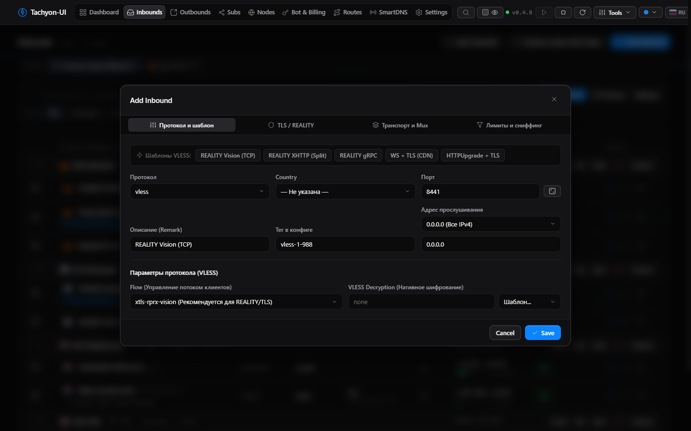
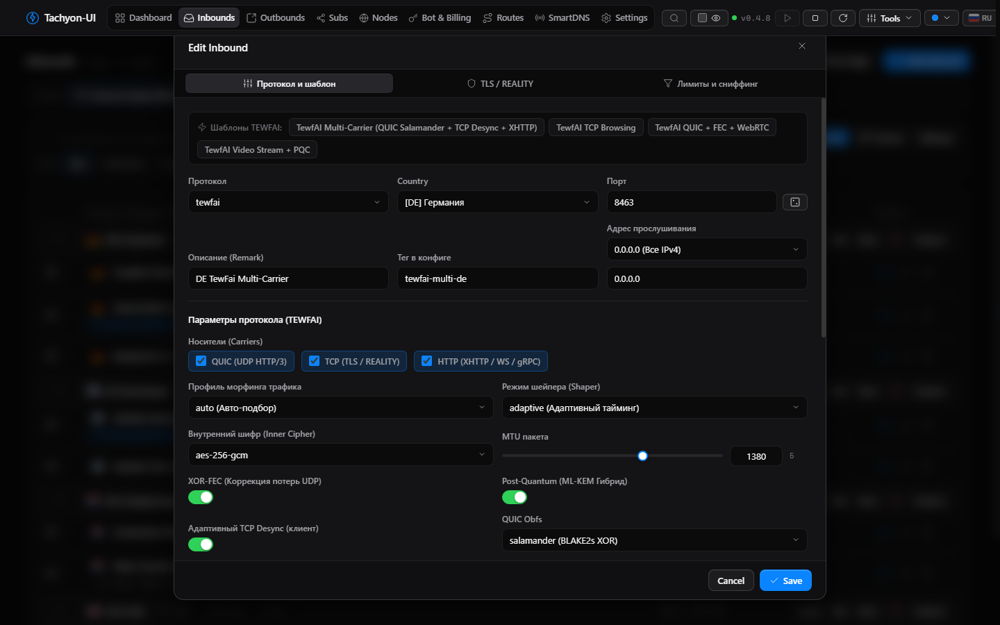
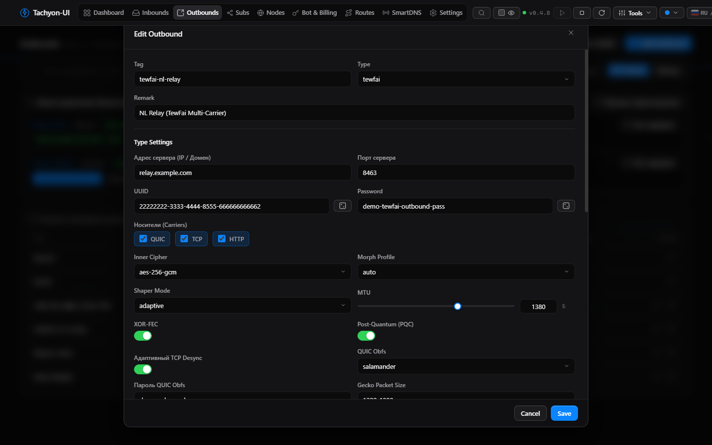

# 9. Tachyon Protocol Encyclopedia: Every Supported Protocol in Plain Language

[Back to Index](../../README.md) | [Chapter 8 — SmartDNS / GeoHide](08-smartdns-geohide-guide.md) | [UI Tab & Button Reference](11-ui-every-tab-and-button-guide.md) | [Protocol Guides Catalog](protocols/README.md) | [Русский](../ru/09-protocols-encyclopedia.md) | [Next: Chapter 10 — Tachyon 2.0 Router Guide](10-tachyon-router-subscription-guide.md)

This chapter is a practical, human-friendly reference covering **every single protocol** supported by `tachyon-ui` and the `tachyon-core` engine — starting with our flagship native transport **TewFai**. For every protocol you will find a plain real-world analogy, a step-by-step breakdown of how it works on the wire, pros and cons, domain/certificate requirements, and clear guidance on when to pick it.

> [!TIP]
> For per-field UI-to-JSON mappings, exact validation rules, firewall ports, presets, and subscription export formats (`v0.4.12` + `tachyon-core 0.6.9`), jump straight to the **[Protocol Guides Catalog (`./protocols/README.md`)](protocols/README.md)** or click any individual protocol guide below.



---

## Complete Index of All 27 Detailed Protocol Guides

| # | Protocol / Group | Guide | # | Protocol / Group | Guide |
| :---: | :--- | :--- | :---: | :--- | :--- |
| `01` | **TewFai** | [01-tewfai.md](protocols/01-tewfai.md) | `15` | **MTProto** | [15-mtproto.md](protocols/15-mtproto.md) |
| `02` | **VLESS** | [02-vless.md](protocols/02-vless.md) | `16` | **FPTN** | [16-fptn.md](protocols/16-fptn.md) |
| `03` | **Hysteria2** | [03-hysteria2.md](protocols/03-hysteria2.md) | `17` | **WDTT** | [17-wdtt.md](protocols/17-wdtt.md) |
| `04` | **TUIC v5** | [04-tuic.md](protocols/04-tuic.md) | `18` | **Sudoku** | [18-sudoku.md](protocols/18-sudoku.md) |
| `05` | **Trojan** | [05-trojan.md](protocols/05-trojan.md) | `19` | **OpenConnect** | [19-openconnect.md](protocols/19-openconnect.md) |
| `06` | **VMess** | [06-vmess.md](protocols/06-vmess.md) | `20` | **Cloudflared** | [20-cloudflared.md](protocols/20-cloudflared.md) |
| `07` | **Shadowsocks** | [07-shadowsocks.md](protocols/07-shadowsocks.md) | `21` | **WireGuard** | [21-wireguard.md](protocols/21-wireguard.md) |
| `08` | **AnyTLS** | [08-anytls.md](protocols/08-anytls.md) | `22` | **AmneziaWG** | [22-amneziawg.md](protocols/22-amneziawg.md) |
| `09` | **ShadowTLS v3** | [09-shadowtls.md](protocols/09-shadowtls.md) | `23` | **Mixed / SOCKS / HTTP** | [23-mixed-socks-http.md](protocols/23-mixed-socks-http.md) |
| `10` | **NaiveProxy** | [10-naive.md](protocols/10-naive.md) | `24` | **Desync** | [24-desync.md](protocols/24-desync.md) |
| `11` | **MASQUE** | [11-masque.md](protocols/11-masque.md) | `25` | **Hysteria v1** | [25-hysteria1.md](protocols/25-hysteria1.md) |
| `12` | **TrustTunnel** | [12-trusttunnel.md](protocols/12-trusttunnel.md) | `26` | **SSH / Tor / Bridge** | [26-ssh-tor-bridge.md](protocols/26-ssh-tor-bridge.md) |
| `13` | **Mieru** | [13-mieru.md](protocols/13-mieru.md) | `27` | **Balancers & Chain** | [27-balancers-and-chain.md](protocols/27-balancers-and-chain.md) |
| `14` | **Snell** | [14-snell.md](protocols/14-snell.md) | — | **Full Catalog Index** | [protocols/README.md](protocols/README.md) |

---

## Table of Contents

1. [Quick Comparison & Selection Matrix](#1-quick-comparison--selection-matrix)
2. [Flagship Tachyon Ecosystem Protocol: TewFai (TCP / QUIC + Morphing + FEC + PQC)](#2-flagship-tachyon-ecosystem-protocol-tewfai)
3. [Modern TLS, HTTP & Traffic-Shaping Protocols](#3-modern-tls-http--traffic-shaping-protocols)
   - [VLESS (REALITY / Vision / XHTTP / gRPC / WS / HTTPUpgrade)](#31-vless-reality--vision--xhttp--grpc--ws--httpupgrade)
   - [AnyTLS](#32-anytls)
   - [ShadowTLS v3](#33-shadowtls-v3)
   - [NaiveProxy (HTTP/2 & HTTP/3 QUIC)](#34-naiveproxy-http2--http3-quic)
   - [MASQUE (HTTP/3 CONNECT-IP)](#35-masque-http3-connect-ip)
   - [TrustTunnel](#36-trusttunnel)
   - [Mieru](#37-mieru)
   - [Snell (v4 / v5 / v6)](#38-snell-v4--v5--v6)
   - [FPTN](#39-fptn)
   - [WDTT (WG / Raw / CSQTT)](#310-wdtt-wg--raw--csqtt)
   - [Sudoku](#311-sudoku)
4. [High-Speed UDP / QUIC Protocols](#4-high-speed-udp--quic-protocols)
   - [Hysteria2](#41-hysteria2)
   - [Hysteria (v1)](#42-hysteria-v1)
   - [TUIC (v5)](#43-tuic-v5)
5. [Classic Proxy Protocols](#5-classic-proxy-protocols)
   - [Trojan](#51-trojan)
   - [VMess](#52-vmess)
   - [Shadowsocks (AEAD & Shadowsocks-2022)](#53-shadowsocks-aead--shadowsocks-2022)
   - [MTProto (FakeTLS / Padded DD / telegram-ws / kws)](#54-mtproto-faketls--padded-dd--telegram-ws--kws)
6. [L3 VPN Tunnels & Enterprise Protocols](#6-l3-vpn-tunnels--enterprise-protocols)
   - [WireGuard](#61-wireguard)
   - [AmneziaWG (AWG 1.0 / 2.0 + Port Hopping)](#62-amneziawg-awg-10--20--port-hopping)
   - [OpenConnect / AnyConnect](#63-openconnect--anyconnect)
7. [Specialized, Utility Transports & Routing Meta-Outbounds](#7-specialized-utility-transports--routing-meta-outbounds)
   - [Cloudflared](#71-cloudflared)
   - [SSH](#72-ssh)
   - [Tor](#73-tor)
   - [Bridge](#74-bridge)
   - [Desync](#75-desync)
   - [SOCKS / HTTP / Mixed](#76-socks--http--mixed)
   - [Routing Meta-Outbounds: direct, block, urltest, selector, chain](#77-routing-meta-outbounds-direct-block-urltest-selector-chain)

---

## 1. Quick Comparison & Selection Matrix

### Pick by Scenario

| Your Scenario | Recommended Protocol | Why It Fits Best |
| :--- | :--- | :--- |
| **Primary all-round transport across Tachyon nodes & clients** | **TewFai** (TCP + QUIC + Morphing + FEC + PQC) | Single session layer across interchangeable TCP and QUIC carriers, traffic-profile normalization, UDP XOR-FEC recovery, and post-quantum KEX. |
| **Zero-domain quick deployment (raw IP VPS, no Let's Encrypt)** | **VLESS + REALITY (Vision / XHTTP)** or **ShadowTLS v3** | Uses a genuine TLS 1.3 handshake against a live public host or `Self-Steal` without owning a domain. |
| **Lossy mobile networks, public Wi-Fi, 5–15% packet loss** | **TewFai (QUIC + FEC)**, **Hysteria2**, or **TUIC v5** | QUIC eliminates TCP head-of-line stalls; XOR-FEC / BBR / Brutal sustain throughput across noisy links. |
| **Strict enterprise gateways (only standard HTTPS 443 allowed)** | **NaiveProxy**, **TrustTunnel**, **MASQUE**, **VLESS WS/XHTTP + CDN** | Standard HTTP/2 or HTTP/3 (`CONNECT` / `CONNECT-IP`) with clean RFC-compliant framing. |
| **Home router (OpenWrt / Keenetic / MikroTik) at Layer 3** | **AmneziaWG (with Port Hopping)**, **WireGuard**, or **MASQUE** | Low CPU overhead on router SoCs, clean L3 IP tunnel, and automatic NAT keepalives. |
| **Server behind NAT with zero open inbound ports** | **Cloudflared** | Outbound tunnel initiated from your host to Cloudflare Edge — no public IP or firewall port required. |
| **Lightweight standalone proxy dedicated to Telegram** | **MTProto** (`FakeTLS` / `telegram-ws` / `kws`) | Native Telegram protocol configured directly inside the messenger via a single link. |
| **Local TCP/UDP packet segmentation without a remote VPN server** | **Desync** | Direct egress processor adapting initial TCP/UDP framing locally with zero VPS cost. |

### Master Protocol Matrix

| Protocol | Transport | Domain & TLS Cert Required? | Speed on Lossy Networks | Role in `tachyon-ui` | Primary Use Case |
| :--- | :--- | :--- | :--- | :--- | :--- |
| **TewFai** | TCP (TLS/REALITY) &/or QUIC (UDP) | Optional (REALITY or cert; QUIC auto-generates self-signed) | Very High (QUIC + XOR-FEC) | Inbound + Outbound | Flagship adaptive, resilient Tachyon transport |
| **VLESS** | TCP / WS / gRPC / XHTTP / HTTPUpgrade | No with REALITY; Yes for standard TLS/CDN | Medium (TCP) | Inbound + Outbound | Broadest client compatibility across all platforms |
| **AnyTLS** | TCP + TLS 1.3 / REALITY | Yes for TLS; No with REALITY | Medium (TCP + session pool) | Inbound + Outbound | Packet-length normalization and TLS session pooling |
| **ShadowTLS v3** | TCP (delegated live TLS) | No (uses live decoy server) | Medium (TCP) | Inbound + Outbound | Wraps TCP proxy streams in a genuine external TLS handshake |
| **NaiveProxy** | TCP (HTTP/2) / QUIC (HTTP/3) | Yes (real domain + cert) | Medium (H2) / High (H3) | Inbound + Outbound | Chromium-grade standard HTTPS proxy with padded framing |
| **MASQUE** | QUIC / UDP (HTTP/3 `CONNECT-IP`) | Yes (real domain + cert) | High (HTTP/3 Datagrams) | Inbound + Outbound | IETF RFC 9484 standard L3 IP tunnel (and Cloudflare WARP) |
| **TrustTunnel** | TCP (HTTP/2) / QUIC (HTTP/3) | Yes (real domain + cert) | Medium (H2) / High (H3) | Inbound + Outbound | Clean HTTP/2 & HTTP/3 tunnel with multiplexed UDP |
| **Mieru** | TCP or UDP | No | Medium (TCP) / High (UDP) | Inbound + Outbound | Standalone encrypted proxy with tunable multiplexing |
| **Snell (v4–v6)** | TCP (+ UDP relay) | No | Medium (TCP) | Inbound + Outbound | Ultra-lightweight PSK proxy for Surge/Clash ecosystems |
| **FPTN** | TCP + TLS / REALITY (REST + WS) | Yes for TLS; No with REALITY | Medium (TCP) | Inbound + Outbound | L3 IP tunnel over HTTPS/WebSocket with browser mimicry |
| **WDTT** | UDP (RTP + DTLS 1.2 + WG/Raw/CSQTT) | No | High (UDP) | Inbound + Outbound | L3 UDP tunnel shaped like RTP/DTLS media streams |
| **Sudoku** | TCP (+ optional TLS / HTTP mask) | Optional | Medium (TCP) | Inbound + Outbound | Entropy-controlled encoding via ASCII/custom tables |
| **Hysteria2** | QUIC (UDP) | Recommended (or self-signed + `insecure`) | Maximum (BBR/Brutal) | Inbound + Outbound | Peak throughput on congested or packet-lossy links |
| **Hysteria v1** | QUIC (UDP) | Yes (remote server cert) | High | Outbound | Compatibility with legacy Hysteria v1 servers |
| **TUIC v5** | QUIC (UDP) | Recommended (or self-signed) | High (BBR + 0-RTT) | Inbound + Outbound | Low-latency gaming, voice/video calls, native UDP |
| **Trojan** | TCP / WS / gRPC + TLS / REALITY | Yes for classic TLS | Medium (TCP) | Inbound + Outbound | Simple, battle-tested HTTPS proxy with web fallback |
| **VMess** | TCP / WS / gRPC (+ TLS) | Optional (recommended for WS/CDN) | Medium (TCP) | Inbound + Outbound | Classic V2Ray protocol for backward compatibility |
| **Shadowsocks** | TCP + UDP | No | Medium / High (2022 + UDP) | Inbound + Outbound | Fast, low-CPU AEAD stream/datagram tunnel |
| **MTProto** | TCP (FakeTLS/DD) / TLS WebSocket (`kws`) | No | Medium | Inbound + Outbound | Native Telegram messenger relay |
| **WireGuard** | UDP (L3 IP) | No | High (UDP, tiny overhead) | Inbound + Outbound | Fast, minimal, modern L3 VPN |
| **AmneziaWG** | UDP (L3 IP + Junk/Headers + Port Hopping) | No | High (UDP) | Inbound + Outbound | WireGuard with customizable headers, preambles & port rotation |
| **OpenConnect** | TCP (SSL/TLS) + UDP (DTLS/ESP) | Yes (TLS certificate) | Medium / High (DTLS) | Inbound + Outbound | Enterprise SSL VPN (AnyConnect, GlobalProtect, FortiGate) |
| **Cloudflared** | QUIC / HTTP/2 (outbound to Edge) | Domain on Cloudflare Zero Trust | High (Cloudflare Anycast) | Inbound | Zero-open-port inbound tunnel behind NAT |
| **SSH** | TCP | No | Medium (TCP) | Outbound | Instant tunnel through any existing SSH server |
| **Tor** | TCP (onion routing) | No | Low (3-hop circuit) | Outbound | Selective anonymity and `.onion` routing |
| **Bridge** | Linux L2/L3 bridge / `iproute2` | No | Maximum (native OS stack) | Outbound | Route egress through a local OS interface or routing table |
| **Desync** | TCP / UDP (direct egress) | No | Native direct-link speed | Outbound | Local adaptive TCP/UDP framing without an intermediate VPS |
| **SOCKS / HTTP / Mixed** | TCP (+ UDP for SOCKS5) | Optional (for HTTP/Mixed) | Native network speed | Inbound + Outbound | Local application gateways and internal service chaining |

---

## 2. Flagship Tachyon Ecosystem Protocol: TewFai

**TewFai** is the flagship next-generation transport protocol designed natively for `tachyon-core` and configured first-class in `tachyon-ui`. It unifies a single multiplexed session layer over interchangeable **TCP (`TLS 1.3` / `uTLS` / `REALITY`)**, **QUIC v1 (`ALPN h3`, optional `Salamander` / `Gecko` obfuscation)**, and **HTTP carriers (`xhttp`, `ws`, `grpc`, `httpupgrade`)** alongside **adaptive TCP packet desync**, **SNI pool & port rotation**, **staggered carrier racing (`race_delay_ms`)**, **live TCP/QUIC fallbacks**, **histogram-driven traffic morphing**, **XOR Forward Error Correction (FEC)** for UDP flows, and **hybrid post-quantum key exchange (`X25519 + ML-KEM-768`)**.

### Simple Analogy
Think of a dual-mode high-speed express train that switches gauges automatically. When the express highway (**QUIC/UDP**) is clear, it glides across with minimal latency; if UDP is unavailable on a restrictive Wi-Fi network, the exact same session smoothly rolls onto the railway (**TCP + TLS 1.3 / REALITY**). From the outside, its carriages match the size and pacing patterns of ordinary web browsing, video streaming, or WebRTC calls (**morphing profiles**), and every batch of 4 fragile UDP parcels travels with 1 parity parcel (**FEC**) so a dropped packet is reconstructed instantly on arrival without waiting for a retransmission round-trip.

### TewFai Protocol Architecture

```text
+-----------------------------------------------------------------------------+
|                       CLIENT APPLICATIONS (TCP + UDP)                       |
+--------------------------------------+--------------------------------------+
                                       |
                                       v
+-----------------------------------------------------------------------------+
|                    TEWFAI SESSION LAYER (Pure Rust)                         |
|  1. Multiplexing: TCP streams (DATA 0x02) + UDP flows (UDP_DGRAM 0x04)      |
|  2. Mutual Auth: HELLO / HELLO_OK (constant-time HMAC-SHA256 over PSK)      |
|  3. Key Schedule: X25519 [+ ML-KEM-768 PQC] -> HKDF-SHA256 -> AES-256-GCM   |
|     (implicit nonce, 1024-bit anti-replay, auto-rekey every 1 GiB / 1 hour) |
|  4. Bounded LRU Session Resume (up to 1024 sessions, 60s grace handover)    |
+-------------------+----------------------------------+----------------------+
                    |                                  |
                    v                                  v
+-----------------------------------+  +--------------------------------------+
|    TRAFFIC MORPHING & SHAPER      |  |       XOR-FEC FOR UDP DATAGRAMS      |
|  - Profiles: auto, browsing,      |  |  - (k, k+1) parity code, default k=4 |
|    video, webrtc, bulk            |  |  - 4 data shards + 1 XOR parity      |
|  - Empirical chunk-size buckets   |  |    (+25% bandwidth overhead)         |
|    over first 30 chunks + PAD 0x0A|  |  - Recovers any 1 lost datagram per  |
|  - Token-bucket pacing:           |  |    group immediately (0 extra RTT)   |
|    adaptive / fixed / off         |  |                                      |
|    (10-20 ms quantum, <=256 KiB)  |  |                                      |
+-------------------+---------------+  +------------------+-------------------+
                    |                                     |
                    +------------------+------------------+
                                       |
               +-----------------------+-----------------------+
               |                       |                       |
               v                       v                       v
+-----------------------+ +-----------------------+ +-----------------------+
| T1: TCP CARRIER       | | T2: QUIC v1 CARRIER   | | T3: HTTP CARRIER      |
| - TLS 1.3/uTLS/REALITY| | - QUIC v1 ALPN h3     | | - xhttp/ws/grpc/      |
| - Adaptive TCP Desync | | - Obfs: Salamander /  | |   httpupgrade         |
| - SNI Pool + Fallback | |   Gecko + Port Hop    | | - CDN front:// /      |
|   (or Zero-Oracle)    | | - Live H3 Fallback    | |   gateway:// routes   |
+-----------------------+ +-----------------------+ +-----------------------+
```

### How It Works Step by Step

1. **Interchangeable Carriers & Racing (T1 TCP / T2 QUIC / T3 HTTP):** TewFai runs over **TCP** (`TLS 1.3` / `uTLS` / `REALITY` + 28 adaptive `desync` profiles), **QUIC v1** (with `Salamander` or `Gecko` datagram obfuscation and `server_ports` hopping), and **HTTP** (`xhttp`, `ws`, `grpc`, `httpupgrade`) or `alt_endpoints` (`quic://`, `tcp://`, `http://`, `front://sni:port` for TLS SNI fronting, `gateway://`). When `race_delay_ms` is set, the client staggers parallel carrier attempts and remembers the healthy carrier.
2. **Stall Watchdog & 16 KiB Cutoff Recovery:** The handover subsystem monitors stream stalls (`stall_timeout_ms`, `ping_timeout_ms`) and early per-connection byte caps around `16 KiB`, dynamically tightening leg rotation and switching carriers without dropping active user streams.
3. **Live TCP & HTTP/3 Fallback:** Inbounds can transparently proxy unauthenticated TCP/HTTP probes to a local web server (`fallback`) and HTTP/3 QUIC probes to an HTTP/1.1 upstream (`quic.fallback`), or fall back to strict Zero-Oracle silence / HTTP/3 `404`.
4. **Mutual `HELLO` / `HELLO_OK` Authentication:** Both ends derive a 32-byte pre-shared key `PSK = SHA256(uuid | password)`.
   - The client sends `HELLO` containing an ephemeral `X25519` public key (plus an `ML-KEM-768` encapsulation key when `pqc` is enabled), a 32-byte `client_nonce`, the outer carrier ID (`0` = QUIC, `1` = TCP, `2` = HTTP), greeting padding, and a constant-time `HMAC-SHA256` tag.
   - The server validates the tag and checks `client_nonce` against an anti-replay cache (`4096` entries, `120s` TTL).
   - Authenticated clients receive `HELLO_OK` signed with `HMAC-SHA256` bound to `client_nonce` plus advertised `alt_endpoints`.
5. **Hybrid Post-Quantum Key Schedule & Inner AEAD:** Using `HKDF-SHA256` over salt `client_nonce || server_nonce` and key material `X25519 [|| ML-KEM-768] || PSK`, separate directional secrets (`tewfai c2s` / `tewfai s2c`) are derived.
   - `inner_cipher: "aes-256-gcm"` encrypts inner frames with an implicit strictly increasing nonce counter, a 1024-bit anti-replay window, and an automatic **rekey ratchet** every **1 GiB** transferred or **1 hour** elapsed.
   - `inner_cipher: "none"` disables redundant inner encryption when the outer TLS 1.3 / QUIC layer alone is preferred to save CPU cycles.
6. **Multiplexing & Seamless Mobility Resume:** Up to `256` concurrent TCP streams and UDP flows share one session. If a mobile client roams from Wi-Fi to 5G, the server retains session state in an LRU cache (up to `1024` sessions, `60s` grace window), masking `session_id` with a per-nonce stream mask so resumed handshakes share zero repeating bytes on the wire.
7. **Traffic Morphing (`morph_profile`) & Token-Bucket Shaper (`shaper`):**
   - Across the first `30` chunks of a session (and on every fresh interactive burst after a `200 ms` idle gap in `auto` mode), TewFai appends `PAD` frames (`0x0A`) so chunk lengths match empirical histograms of real traffic classes:
     * **`auto` (`transformer`)** — dynamically classifies live flows, resets burst windows on idle gaps, pads control frames, and smooths nested TLS handshakes.
     * **`browsing`** — web browsing distribution (small 192–512 B HTTP/2 frames + medium 1.4–4 KiB assets).
     * **`webrtc`** — voice/video conferencing distribution (180–360 B audio frames + 720–1400 B video RTP).
     * **`video`** — adaptive bitrate video streaming (8–16 KiB segments + periodic small acknowledgements).
     * **`bulk`** — high-throughput file transfer (large chunks up to 16 KiB).
   - **Shaper (`shaper.mode`):** `adaptive` (smooth pacing over 10–20 ms slots with a hard 256 KiB per-session queue cap), `fixed` (constant-rate pacing), or `off`.
8. **Zero-RTT UDP Recovery via XOR-FEC (`fec: true`):** Encodes UDP datagrams in `(k, k+1)` XOR parity groups (default `k = 4`, adding 1 parity packet per 4 data packets = +25% overhead) while preserving exact variable datagram lengths via `xor_len`. Any single lost packet in a group is reconstructed immediately without waiting for retransmission.

### Built-in TewFai Presets in `tachyon-ui`



Four ready-to-use profiles are available directly in the `tachyon-ui` inbound builder:
1. **`TewfAI Multi-Carrier (QUIC Salamander + TCP Desync + XHTTP)`** — all three carriers `["quic", "tcp", "http"]`, QUIC `Salamander` obfuscation, `xhttp` carrier, adaptive `desync`, `race_delay_ms: 250`, `fec: true`, `pqc: true`, `auto`/`adaptive`, `MTU 1380`.
2. **`TewfAI TCP Browsing`** — TCP + TLS/REALITY + adaptive `desync`, `morph: browsing`, `shaper: adaptive`, `aes-256-gcm`, `MTU 1400`. Reliable daily driver where UDP is restricted.
3. **`TewfAI QUIC + FEC + WebRTC`** — QUIC v1 + TCP fallback, `fec: true`, `morph: webrtc`, `shaper: adaptive`, `pqc: true` (`ML-KEM-768`), `MTU 1380`. Ideal for mobile networks, calls, and lossy Wi-Fi.
4. **`TewfAI Video Stream + PQC`** — QUIC v1 + TCP fallback, `fec: true`, `morph: video`, `shaper: fixed`, `pqc: true`, `MTU 1400`. Built for 4K streaming and sustained high bandwidth.

When connecting nodes in a cascade or configuring custom outbound relays, the **TewFai Outbound Editor** mirrors every carrier, racing, morphing, FEC, and PQC setting:



### Pros & Cons

- **Pros:**
  - 100% pure-Rust native implementation inside `tachyon-core` with zero C dependencies.
  - Interchangeable TCP and QUIC carriers with seamless failover and mobility session resumption.
  - Built-in traffic-profile normalization (histogram morphing + shaper) and active-probe resistance (TCP Zero-Oracle silence / QUIC HTTP/3 404).
  - Built-in XOR-FEC prevents UDP stutter on packet-lossy networks.
  - Hybrid post-quantum `X25519 + ML-KEM-768` protects recorded traffic against future quantum decryption.
- **Cons:**
  - Native to the Tachyon ecosystem: clients must run `tachyon-core` or a Tachyon-compatible app (not supported in generic legacy third-party clients).
  - Enabling `FEC` (+25% on UDP) and heavy morphing adds modest bandwidth overhead.

### Domain & Let's Encrypt Requirement
- **TCP + REALITY:** **Not required** (uses live SNI or `Self-Steal`).
- **TCP + TLS:** Recommended real domain + certificate (1-click ACME in `tachyon-ui`).
- **QUIC:** Real certificate recommended; if omitted, `tachyon-core` automatically generates a self-signed certificate on startup.

### When to Choose TewFai
Choose **TewFai** as your primary transport for Tachyon multi-node cascades (Master-Child links), `tachyon-core` routers, and Tachyon client apps whenever you want top-tier mobility stability, post-quantum security, and resilience on lossy networks.

---

## 3. Modern TLS, HTTP & Traffic-Shaping Protocols

These protocols align tunnel traffic closely with standard encrypted web traffic (`HTTPS`, `HTTP/2`, `HTTP/3`) or real-time media profiles.

### 3.1. VLESS (REALITY / Vision / XHTTP / gRPC / WS / HTTPUpgrade)

- **Simple Analogy:** A featherweight envelope that skips redundant inner locks and relies entirely on an armored outer vault (`TLS 1.3` or `REALITY`).
- **How It Works Step by Step:**
  1. Establishes an outer transport: **REALITY** (borrows the authentic TLS 1.3 certificate and responses of a live public site or `Self-Steal` using an `X25519` keypair and optional post-quantum `reality_pq_key`) or standard **TLS**.
  2. Authenticates via a 16-byte `UUID` and forwards the target address.
  3. Supports multiple transport layers:
     - **TCP + `xtls-rprx-vision`:** avoids redundant inner encryption and pads initial handshake packets.
     - **XHTTP (`auto`, `packet-up`, `stream-up`, `stream-one`):** splits upload/download across standard HTTP requests with configurable padding (`100-1000` B), CDN-friendly.
     - **WebSocket (`ws`) / `HTTPUpgrade` / `gRPC`:** ideal behind reverse proxies, CDNs, and `Unified 443 Front`.
- **Pros:** Universal client ecosystem (iOS, Android, Windows, macOS, Linux, routers); tiny overhead; unmatched transport versatility.
- **Cons:** TCP-only (susceptible to TCP head-of-line stalls on heavily congested mobile links).
- **Domain / Cert Required?** **No** with REALITY; **Yes** for TLS / WS / gRPC / CDN setups.
- **When to Choose:** As your go-to baseline inbound for broad multi-user subscriptions so every user can connect with any mainstream client app.

### 3.2. AnyTLS

- **Simple Analogy:** Instead of knocking on a fresh door for every browser tab, AnyTLS maintains a warm pool of open TLS corridors and shapes initial packet sizes according to a server-defined schedule.
- **How It Works Step by Step:**
  1. Opens a TLS 1.3 (or REALITY) connection and sends `[SHA256(password)][padding_len][padding]` plus a settings frame.
  2. Applies the configured `padding_scheme` (`default`, `aggressive`, or `lowlatency` presets in `tachyon-ui`) to normalize packet-size profiles across nested TLS traffic.
  3. Multiplexes TCP streams (`CMD_SYN`, `CMD_PSH`, `CMD_FIN`) and UDP (`UoT`) over a bounded pool of live TLS sessions.
- **Pros:** Eliminates classic nested-TLS length signatures; reduces handshake latency on web pages with dozens of parallel requests.
- **Cons:** Newer specification — supported by modern cores such as `tachyon-core` rather than legacy clients.
- **Domain / Cert Required?** **Yes** for TLS mode; **No** for REALITY mode.
- **When to Choose:** When you want a snappy modern TCP protocol with controllable packet-size padding and efficient session reuse.

### 3.3. ShadowTLS v3

- **Simple Analogy:** A concierge holding a genuine corporate badge from a major site (such as `www.microsoft.com`). Everyday visitors are greeted normally by the real site; authorized guests embed a hidden HMAC mark in their TLS `Session ID` and step straight into the tunnel.
- **How It Works Step by Step:**
  1. Client initiates a TLS ClientHello targeting a real public `handshake.server` while embedding an `HMAC-SHA1(password)` tag in `Session ID`.
  2. The ShadowTLS v3 server relays the handshake to the live decoy server and returns its genuine `ServerHello` and X.509 certificate.
  3. Authenticated flows switch seamlessly to payload forwarding; unauthenticated scanners are transparently proxied to the decoy (or rejected in `strict_mode`).
- **Pros:** Requires no domain or certificate of your own; exhibits a 100% genuine third-party TLS 1.3 handshake.
- **Cons:** Adds one handshake round-trip to the decoy host during initial connection setup; typically paired with an inner proxy protocol.
- **Domain / Cert Required?** **No.**
- **When to Choose:** When deploying on a bare-IP VPS without a domain, especially as a clean TLS wrapper in front of Shadowsocks.

### 3.4. NaiveProxy (HTTP/2 & HTTP/3 QUIC)

- **Simple Analogy:** Instead of imitating a browser, NaiveProxy speaks the exact standard HTTPS proxy dialect (`HTTP/2` or `HTTP/3 CONNECT`) with padded initial frames matching Chromium's networking behavior.
- **How It Works Step by Step:**
  1. Connects over standard `HTTP/2` (TCP) or `HTTP/3` (QUIC, `network: "udp"`) using a real TLS certificate.
  2. Authenticates via `Proxy-Authorization: Basic` on a `CONNECT` request accompanied by the `Padding` header.
  3. Wraps the first 8 data blocks in each direction with explicit padding frames (`[len][pad][data][zeros]`); supports UDP over `uot`.
- **Pros:** Standard RFC HTTP/2 & HTTP/3 wire profile; works cleanly through strict HTTP-aware transit gateways; supports both TCP and QUIC.
- **Cons:** Requires a real domain and valid TLS certificate; slightly higher HTTP header overhead than raw VLESS.
- **Domain / Cert Required?** **Yes** (easily automated with built-in ACME + `SiteEngine`).
- **When to Choose:** When you already have a domain hosting a decoy site and want a strictly standards-compliant HTTPS tunnel.

### 3.5. MASQUE (HTTP/3 CONNECT-IP)

- **Simple Analogy:** The official IETF internet standard (RFC 9484) — used by Apple iCloud Private Relay and Cloudflare WARP — that carries full Layer 3 IP packets right inside a standard HTTP/3 QUIC connection.
- **How It Works Step by Step:**
  1. Establishes an HTTP/3 QUIC (`ALPN: h3`) connection and negotiates `Extended CONNECT` + HTTP/3 Datagrams.
  2. Server answers `200 OK` (`capsule-protocol: ?1`) with a `ROUTE_ADVERTISEMENT` capsule (`0.0.0.0/0`, `::/0`) and assigns an address from `ipv4_pool` (e.g. `10.10.1.0/24`).
  3. IP packets (TCP, UDP, ICMP) travel natively in HTTP/3 Datagrams and terminate inside `tachyon-core`'s userspace `smoltcp` stack and `UdpHub`.
  4. `tachyon-ui` automatically exports `keep_alive_period: "20s"` and `idle_timeout: "50s"` (below server `60s`) so router tunnels never stall on NAT timeouts.
- **Pros:** Open IETF standard; fast HTTP/3 UDP delivery; 1-click Cloudflare WARP/MASQUE outbound registration in `tachyon-ui`.
- **Cons:** Requires UDP availability (pair with a TCP fallback on UDP-restricted networks).
- **Domain / Cert Required?** **Yes** for self-hosted inbound (not needed when connecting outbound to Cloudflare WARP).
- **When to Choose:** For rock-solid router L3 tunnels, Cloudflare WARP egress, and networks where HTTP/3 performs freely.

### 3.6. TrustTunnel

- **Simple Analogy:** A clean HTTP/2 and HTTP/3 forward tunnel modeled closely on standard HTTPS `CONNECT`, enhanced with a dedicated multiplexed lane for UDP traffic.
- **How It Works Step by Step:**
  1. Opens an authenticated HTTP/2 over TLS (or HTTP/3 over QUIC with `quic: true`) session.
  2. Each TCP destination maps to a standard `CONNECT` stream.
  3. All UDP packets multiplex over a single `CONNECT` stream to the `_udp2` pseudo-authority (each packet carrying its four-tuple), while `_check` handles health probes.
- **Pros:** Pure HTTP/2 and HTTP/3 wire framing; clean native UDP multiplexing; straightforward username/password credentials.
- **Cons:** Smaller third-party client catalog compared to VLESS or Hysteria2.
- **Domain / Cert Required?** **Yes.**
- **When to Choose:** When you want a clean HTTP/2 or HTTP/3 tunnel with native UDP support and simple credential management.

### 3.7. Mieru

- **Simple Analogy:** A self-contained armored courier that avoids impersonating web protocols altogether, instead encrypting every segment end-to-end with zero plaintext metadata.
- **How It Works Step by Step:**
  1. Runs directly over **TCP** or **UDP** without an external TLS wrapper.
  2. Identifies the user (`name` + `password`) directly from the first encrypted segment and processes an inner SOCKS5 `CONNECT` target header.
  3. Tunes connection concurrency via `multiplexing` (`MULTIPLEXING_LOW`, `MIDDLE`, or `HIGH`).
- **Pros:** Zero domain or TLS certificate needed; supports both TCP and UDP; no cleartext SNI or certificate metadata on the wire.
- **Cons:** Fully random high-entropy byte streams can be deprioritized by strict transit filters that only allow recognized TLS/HTTP.
- **Domain / Cert Required?** **No.**
- **When to Choose:** For bare-IP servers, server-to-server links, and networks where raw TCP/UDP passes unrestricted.

### 3.8. Snell (v4 / v5 / v6)

- **Simple Analogy:** A stripped-down track car built by the Surge team for ultra-low handshake latency and minimal mobile battery drain.
- **How It Works Step by Step:**
  1. Client and server share a single Pre-Shared Key (`PSK`) and protocol version (`5` or `6` in `tachyon-ui` presets).
  2. Uses a compact binary TCP framing without TLS overhead, reusing connections via `CMD_CONNECT_V2`, handling UDP via `CMD_UDP`, and checking liveness via `CMD_PING`.
- **Pros:** Instant connection setup; ultra-low CPU and battery footprint; native support in Surge, Clash/Mihomo, and `tachyon-core`.
- **Cons:** Single shared `PSK` per inbound; no built-in TLS facade (often combined with ShadowTLS v3).
- **Domain / Cert Required?** **No.**
- **When to Choose:** For Surge / Clash power users on macOS/iOS, or as a fast inner payload behind ShadowTLS v3.

### 3.9. FPTN

- **Simple Analogy:** A full Layer 3 VPN disguised as a modern web application: the client logs in via REST API to get a JWT token, then streams batched IP packets over a standard WebSocket while mimicking a real browser's TLS profile.
- **How It Works Step by Step:**
  1. Outer layer uses TLS or REALITY with browser mimicry presets (`reality_chrome149`, `reality_yandex26_4`, or `tls`).
  2. Client authenticates via `POST /api/v1/login` (receives JWT), optionally fetches DNS (`GET /api/v1/dns`) and runs speed probes (`GET /api/v1/test/file.bin`).
  3. Upgrades to WebSocket at `/api/v1/fptn` (`yaff`/`protobuf` serializer, `RollingTunnel` session pooling), receives an IPv4 lease (e.g. `10.10.3.0/24`), and exchanges `MSG_BATCH_IP_PACKET` frames (TCP, UDP, ICMP).
- **Pros:** Full L3 VPN over standard HTTPS/WebSocket; built-in browser mimicry profiles; compatible with official FPTN apps.
- **Cons:** Tunneling IP over TCP WebSocket can experience TCP-over-TCP slowdowns on very lossy links.
- **Domain / Cert Required?** **Yes** for plain `tls`; **No** for `reality_*` mimicry modes.
- **When to Choose:** When you need an L3 VPN traveling strictly over HTTPS/WebSocket port 443 or interoperability with FPTN clients.

### 3.10. WDTT (WG / Raw / CSQTT)

- **Simple Analogy:** A fast UDP L3 VPN that dresses its packets as ordinary voice/video call media streams (`RTP` + `DTLS 1.2`) while crossing the network.
- **How It Works Step by Step:**
  1. Runs entirely in userspace over UDP (`listen_port` and optional `raw_port`).
  2. Wraps datagrams using RTP media profiles (`video`, `audio` Opus `PT=111`, or `unified` via `WDTT-WRAP-v1` / `CSQTT-WRAP-v1`) and/or `DTLS 1.2` with RFC 9146 Connection ID.
  3. Supports three tunnel modes:
     - **`wg` (`all`):** automated config exchange (`GETCONF`/`READY`) + full WireGuard (`Noise_IKpsk2`) L3 tunnel (e.g. `10.66.0.1/16`).
     - **`raw`:** lightweight binary L3 channel with frame reordering (`RA` frames).
     - **`csqtt` / `csqtt_v1`:** native UDP tunnel with compact `GETCONF`/`TUNCONF` setup.
- **Pros:** High UDP speed; no domain or certificate required; blends naturally with VoIP/video media traffic; full L3 IP support.
- **Cons:** Requires a WDTT-capable client (`tachyon-core` / WDTT apps); depends on UDP reachability.
- **Domain / Cert Required?** **No.**
- **When to Choose:** For high-speed UDP L3 tunnels in networks where RTP/DTLS media traffic is more reliable than plain WireGuard.

### 3.11. Sudoku

- **Simple Analogy:** While typical encrypted streams look like high-entropy random noise, Sudoku remaps ciphertext bytes through lookup tables (like a structured puzzle grid) so the wire stream looks like low-entropy ASCII text or ordinary HTTP traffic.
- **How It Works Step by Step:**
  1. Encrypts payload using AEAD (`chacha20-poly1305` and others) under `key`.
  2. Transforms encrypted bytes through a chosen table (`prefer_ascii`, `custom_table`, or rotating `custom_tables`) and applies random padding (`padding_min`..`padding_max`).
  3. Optionally wraps traffic in a configurable `http_mask` (`mode`, `host`, `path_root`, `multiplex`) and supports `enable_pure_downlink` to keep download throughput high with minimal expansion.
- **Pros:** Fine-grained control over wire entropy; customizable substitution tables and HTTP mask; fast download mode via Pure Downlink.
- **Cons:** ASCII encoding increases byte overhead (especially upstream unless Pure Downlink is used); specialized client support (`tachyon-core` / Sudoku clients).
- **Domain / Cert Required?** **No** (TLS optional).
- **When to Choose:** On networks where heuristic middleboxes throttle or flag raw high-entropy byte streams lacking standard TLS framing.

---

## 4. High-Speed UDP / QUIC Protocols

Built on top of **QUIC (UDP)** to maximize throughput and keep latency low even on congested or packet-lossy networks where TCP slows to a crawl.

### 4.1. Hysteria2

- **Simple Analogy:** Standard TCP politely halves its speed whenever a single packet drops. Hysteria2 acts like a rally car with cruise control set to your real link capacity (`up_mbps` / `down_mbps`), keeping bandwidth steady right through noisy Wi-Fi or 4G links.
- **How It Works Step by Step:**
  1. Opens a QUIC (UDP) session and authenticates over HTTP/3 (returning status `233` on success).
  2. Unauthenticated HTTPS/HTTP3 visitors are served a genuine web masquerade (`masquerade`, e.g. `https://www.bing.com` or local loopback `:18080` under `Unified 443 Front`).
  3. TCP travels over independent QUIC streams (`FRAME_TCP_REQUEST 0x401`); UDP travels over native QUIC datagrams with fragmentation.
  4. Configurable congestion profiles (`bbr_profile`: `standard`, `conservative`, `aggressive`) and optional `salamander` / `gecko` UDP obfuscation.
- **Pros:** Unmatched speed on high-latency or 3–15% packet-loss networks; built-in web masquerade; supported by virtually all modern client apps.
- **Cons:** UDP-only (needs a TCP companion protocol if a network drops UDP); enabling `salamander` disables standard HTTP/3 masquerade on that port.
- **Domain / Cert Required?** **Recommended** (for clean TLS verification and `Unified 443 Front`), though self-signed + `insecure` also works.
- **When to Choose:** For 4K video streaming, large downloads, and smooth browsing over mobile data or crowded public Wi-Fi.

### 4.2. Hysteria (v1)

- **Simple Analogy:** The first generation of Hysteria — superseded by Hysteria2 for new servers, retained in `tachyon-ui` as an outbound driver for backward compatibility.
- **How It Works Step by Step:**
  1. Dials legacy Hysteria v1 servers over QUIC using `auth_str` and configured bandwidth limits, forwarding TCP and UDP streams.
- **Pros:** Lets you integrate existing external Hysteria v1 nodes into `tachyon-core` balancers and cascades without reconfiguring remote servers.
- **Cons:** Legacy protocol; outbound-only (always use Hysteria2 or TewFai QUIC for new servers).
- **Domain / Cert Required?** Uses the remote server's TLS certificate.
- **When to Choose:** Only when connecting outbound to a pre-existing Hysteria v1 endpoint.

### 4.3. TUIC (v5)

- **Simple Analogy:** If Hysteria2 is a high-torque rally truck, TUIC v5 is a lightweight track coupe on pure QUIC — focused on ultra-low latency, polite congestion control, and instant `0-RTT` reconnects.
- **How It Works Step by Step:**
  1. Connects over QUIC (`ALPN: h3`); with `zero_rtt_handshake`, initial application data can ride in the very first flight.
  2. Authenticates (`UUID` + `password`) via TLS Exported Keying Material (**EKM**) on a unidirectional stream.
  3. Relays TCP over bidirectional QUIC streams (`CONNECT`) and UDP over either native QUIC datagrams (lowest ping) or uni-streams (reliable delivery), kept alive by periodic `heartbeat` frames (e.g. `10s`) with `bbr`, `cubic`, or `new_reno` congestion control.
- **Pros:** Ultra-low latency with `0-RTT`; top-notch native UDP handling (ideal for online gaming, Discord, VoIP); network-friendly congestion control.
- **Cons:** UDP-only; under extreme packet loss (>15%), Hysteria2 Brutal or TewFai with FEC can recover faster.
- **Domain / Cert Required?** **Recommended** (or self-signed certificate).
- **When to Choose:** For real-time gaming, voice/video calls, and interactive workloads where low jitter and clean UDP matter most.

---

## 5. Classic Proxy Protocols

Time-tested protocols supported across an enormous range of legacy and modern apps, phones, and routers.

### 5.1. Trojan

- **Simple Analogy:** A regular web server with a hidden side door. Ordinary browsers receive a real website; clients whispering `SHA224(password)` right after TLS setup step straight into the proxy.
- **How It Works Step by Step:**
  1. Establishes a standard TLS (or REALITY / WebSocket) connection.
  2. Sends a 56-byte hex `SHA224(password)` followed by command (TCP/UDP) and target address.
  3. Valid clients are proxied; invalid requests fall back transparently to a normal web server.
- **Pros:** Extremely simple and fast; low CPU overhead; huge client support; supports **TLS**, **WS + CDN**, and **REALITY** presets in `tachyon-ui`.
- **Cons:** Plain Trojan TCP+TLS lacks modern nested-TLS length padding compared to VLESS Vision, AnyTLS, or TewFai.
- **Domain / Cert Required?** **Yes** for classic TLS/WS; **No** for Trojan REALITY.
- **When to Choose:** For legacy Trojan-compatible clients or as a clean secondary HTTPS channel on an existing domain.

### 5.2. VMess

- **Simple Analogy:** The original workhorse of the V2Ray ecosystem — still handy when connecting older client apps that predate VLESS.
- **How It Works Step by Step:**
  1. Uses a shared `UUID` and synchronized system clocks for AEAD header and payload encryption (`AES-128-GCM` / `ChaCha20-Poly1305`).
  2. Runs over `TCP`, `WebSocket + TLS`, or `gRPC + TLS`.
- **Pros:** Broad backward compatibility with older V2Ray/Clash setups.
- **Cons:** Fails if client/server clocks drift by more than 90 seconds; double-encrypts traffic when layered over TLS.
- **Domain / Cert Required?** Optional, **Yes** for WS/gRPC + TLS.
- **When to Choose:** Primarily for legacy client compatibility; prefer **VLESS** or **TewFai** for new deployments.

### 5.3. Shadowsocks (AEAD & Shadowsocks-2022)

- **Simple Analogy:** A bare-metal encrypted mail chute with zero ceremony. **Shadowsocks-2022** (powered by `BLAKE3`) modernized the protocol with strict anti-replay protection, timestamps, and resistance to active probing.
- **How It Works Step by Step:**
  1. Both sides share a binary key (16 or 32 bytes base64 in SS-2022) and an AEAD cipher (`2022-blake3-aes-128-gcm`, `2022-blake3-aes-256-gcm`, `2022-blake3-chacha20-poly1305`, or classic GCM/ChaCha20).
  2. Each session derives an ephemeral key via `BLAKE3` and authenticates every chunk with an AEAD tag; `tachyon-ui` also supports **Multiplex + Brutal**.
- **Pros:** Blazing fast with minimal CPU usage (great on routers and older phones); solid UDP support; zero domain needed.
- **Cons:** Raw high-entropy stream without a TLS shell — on strict transit networks, pair it with **ShadowTLS v3** or use it for node-to-node links.
- **Domain / Cert Required?** **No.**
- **When to Choose:** For high-speed node-to-node links, low-power routers, or layered inside ShadowTLS v3.

### 5.4. MTProto (FakeTLS / Padded DD / telegram-ws / kws)

- **Simple Analogy:** A dedicated express door built directly into Telegram — users tap a single `tg://proxy` link inside the messenger without installing any external VPN app.
- **How It Works Step by Step:**
  1. **Inbound server:** accepts Telegram clients using an `ee...` secret (**FakeTLS** over `padded_intermediate` mimicking a chosen domain such as `www.google.com` or `1c.ru`) or `dd...` (**Padded DD**, `abridged`).
  2. **Outbound driver:** supports classic `mtproto`, fast `mtproxy`, and native **`telegram-ws` (`kws`)**, which inspects the 64-byte `obfuscated2` client header, identifies the target Telegram datacenter (`DC1..DC5`), and bridges traffic through `wss://kws{dc}.web.telegram.org/apiws` with automatic direct-TCP fallback.
- **Pros:** Zero extra apps required on the user's phone; very light on server resources; affects only Telegram traffic.
- **Cons:** Works exclusively for Telegram — browsers and other apps do not use it.
- **Domain / Cert Required?** **No** (FakeTLS only references a domain name to generate the `ee...` secret).
- **When to Choose:** When sharing a zero-friction Telegram-only relay with friends, family, or team members.

---

## 6. L3 VPN Tunnels & Enterprise Protocols

Unlike L4/L7 proxies, these protocols build a full virtual IP network interface (Layer 3), transparently carrying TCP, UDP, ICMP (`ping`), and LAN/corporate routing.

### 6.1. WireGuard

- **Simple Analogy:** A virtual Ethernet cable spanning thousands of kilometers — minimalist, audited, and extraordinarily fast with just a pair of cryptographic keys per peer.
- **How It Works Step by Step:**
  1. Peers exchange `X25519` public keys (`tachyon-ui` generates keys automatically and allocates the lowest free `wg_client_ip` such as `10.10.0.2/32`).
  2. Performs a 1-RTT `Noise_IKpsk2` handshake over UDP on first packet, then encrypts IP packets with `ChaCha20-Poly1305`.
  3. Completely silent when idle (except optional keepalives), preserving mobile battery life. Supports **Port Hopping** (`wg_server_ports`, `wg_hop_interval`, `wg_hop_interval_max`) and 1-click `.conf` / QR export.
- **Pros:** Extreme speed and ultra-low latency; native support in Linux/OpenWrt/Keenetic/MikroTik and every OS; tiny battery footprint.
- **Cons:** Fixed standard WireGuard packet headers are easily fingerprinted by restrictive network filters.
- **Domain / Cert Required?** **No.**
- **When to Choose:** For home routers, site-to-site links, and any network where standard UDP WireGuard passes freely.

### 6.2. AmneziaWG (AWG 1.0 / 2.0 + Port Hopping)

- **Simple Analogy:** The exact same high-speed WireGuard engine, upgraded with randomized warm-up packets and custom packet header IDs so no two deployments share a static signature.
- **How It Works Step by Step:**
  1. Preserves WireGuard's `Noise_IKpsk2` / `ChaCha20-Poly1305` data plane and L3 simplicity.
  2. Sends `Jc` random junk packets (`Jmin..Jmax` bytes) ahead of handshake initiation, prepends random prefixes (`S1`, `S2`), and remaps standard packet types (`1..4`) to custom `H1..H4` values (including AWG 2.0 options).
  3. Combines cleanly with **Port Hopping** across a UDP port range; `tachyon-ui` ships three curated presets: Standard (`MTU 1380`), Enhanced Junk (`MTU 1360`), and Mobile Lite (`MTU 1280`).
- **Pros:** Retains nearly 100% of WireGuard's speed and battery efficiency while removing static UDP signatures; supported by AmneziaWG apps, OpenWrt/Keenetic routers, and `tachyon-core`.
- **Cons:** Requires an AWG-aware client (plain WireGuard apps cannot parse custom `Jc/S1/H1` parameters); relies on UDP.
- **Domain / Cert Required?** **No.**
- **When to Choose:** Top choice for home routers and mobile devices whenever you want WireGuard speed across networks that filter standard WireGuard headers.

### 6.3. OpenConnect / AnyConnect

- **Simple Analogy:** The classic corporate business suit — the exact SSL/DTLS VPN standard used by banks, enterprises, and universities (Cisco AnyConnect, Palo Alto GlobalProtect, Fortinet FortiGate, Juniper Pulse).
- **How It Works Step by Step:**
  1. Authenticates over standard HTTPS (`TLS`) using the selected enterprise dialect (`flavor`: `anyconnect`, `gp`, `pulse`, `fortinet`) and issues L3 interface settings (`MTU 1400`).
  2. Carries IP packets inside TLS (TCP) and optionally upgrades the data plane to UDP (**DTLS** or **ESP**).
- **Pros:** Blends in as a standard corporate SSL VPN; works with official Cisco/OpenConnect clients across Linux, macOS, Windows, mobile, and OpenWrt.
- **Cons:** Higher overhead than WireGuard or TewFai; requires a TLS certificate.
- **Domain / Cert Required?** **Yes.**
- **When to Choose:** When integrating with devices already running OpenConnect/AnyConnect or operating in enterprise environments permitting SSL VPN traffic.

---

## 7. Specialized, Utility Transports & Routing Meta-Outbounds

Specialized building blocks for NAT traversal, SSH/Tor routing, Linux kernel integration, direct-link packet adaptation, and resilient multi-node orchestration.

### 7.1. Cloudflared

- **Simple Analogy:** Instead of opening a front door on your VPS and waiting for connections, your server runs a protected cable outward to the nearest Cloudflare datacenter, and users arrive through Cloudflare's edge.
- **How It Works Step by Step:**
  1. Paste your Cloudflare Zero Trust `cloudflared_token` into a `cloudflared` inbound in `tachyon-ui`.
  2. `tachyon-core` establishes multiple outbound `ha_connections` over `QUIC` or `HTTP/2` (supporting `post_quantum`, `edge_ip_version`, and `region`).
  3. Every inbound firewall port on your host can remain closed — your origin IP stays completely hidden.
- **Pros:** Works behind carrier-grade NAT (home mini-PCs, Raspberry Pi, private networks without public IPv4); hides your origin IP behind Cloudflare Anycast.
- **Cons:** Performance depends on the route to Cloudflare's edge; requires a Cloudflare account and domain.
- **Domain / Cert Required?** Domain managed in Cloudflare (Edge TLS is handled automatically by Cloudflare).
- **When to Choose:** For home servers behind NAT or deployments where concealing the origin IP is mandatory.

### 7.2. SSH

- **Simple Analogy:** The sysadmin's universal multi-tool — turns any existing Linux server with SSH access into an instant outbound proxy without installing a single extra daemon.
- **How It Works Step by Step:**
  1. Connects to a remote SSH server via password or private key and opens `direct-tcpip` channels for each routed TCP connection.
- **Pros:** Zero remote setup; works with any Linux VPS out of the box.
- **Cons:** TCP-only (no native UDP); slower under heavy concurrent load due to TCP-over-TCP flow control.
- **Domain / Cert Required?** **No.**
- **When to Choose:** As an emergency backup egress or quick hop through a server where you cannot install `tachyon-core`.

### 7.3. Tor

- **Simple Analogy:** A letter sealed inside three nested envelopes and handed across three independent couriers — no single relay knows both who sent it and where it is going.
- **How It Works Step by Step:**
  1. Configure a `tor` outbound in `tachyon-ui` and bind specific routing rules (such as `.onion` addresses or selected domains).
  2. `tachyon-core` routes only matching TCP flows through a 3-hop onion circuit while keeping the rest of your traffic fast and direct.
- **Pros:** High network anonymity and `.onion` access selectively per domain without slowing down normal browsing.
- **Cons:** High latency and lower bandwidth due to 3-hop relaying; TCP-only.
- **Domain / Cert Required?** **No.**
- **When to Choose:** Selectively via routing rules for `.onion` sites or high-anonymity destinations.

### 7.4. Bridge

- **Simple Analogy:** A local railway switch inside Linux that sends matched traffic out through a specific OS network interface, bridge (`bridge_name`), or custom `iproute2` routing table instead of a remote proxy server.
- **How It Works Step by Step:**
  1. Specify `interface`, `bridge_name`, and optional `iproute2_table_index` / `iproute2_rule_index` on the `bridge` outbound.
  2. Matched traffic exits directly through that Linux interface/table (such as a second ISP uplink, corporate VLAN, or host-level VPN interface).
- **Pros:** Zero extra encryption overhead; integrates `tachyon-core` cleanly into multi-WAN Linux gateways and routers.
- **Cons:** Linux-specific (requires configured host interfaces / `iproute2` tables).
- **Domain / Cert Required?** **No.**
- **When to Choose:** On multi-WAN Linux routers, gateways, or servers bridging into host-managed VLANs and tunnels.

### 7.5. Desync

- **Simple Analogy:** When an intermediate network filter mishandles long initial connection headers, Desync neatly splits or reorders the opening TCP segments (or adapts initial UDP payloads) within valid TCP/IP standards — **with no remote VPN server at all**.
- **How It Works Step by Step:**
  1. Dials destinations directly (`direct`), applying an adaptive TCP/UDP framing recipe (`DesyncMode`, `SplitPos`, `DesyncFooling`) to initial `ClientHello` or QUIC packets.
  2. `tachyon-core`'s built-in adaptive engine monitors transfer success (including 32 KiB throughput verification), automatically learns the best recipe per domain, and caches it.
- **Pros:** Zero server cost (no VPS needed); retains full native ISP bandwidth and ping; self-learning per-domain recipes.
- **Cons:** Does not change your external IP address (destination-side geo-restrictions remain); effectiveness depends on local transit equipment.
- **Domain / Cert Required?** **No.**
- **When to Choose:** For direct-link TCP/UDP normalization when you want full native ISP speed without changing your IP address.

### 7.6. SOCKS / HTTP / Mixed

- **Simple Analogy:** Universal wall outlets that virtually every program understands — from web browsers and `curl` to local daemons and internal server integrations.
- **How It Works Step by Step:**
  - **`socks` (SOCKS5):** Proxies TCP and UDP (`UDP ASSOCIATE`) with optional username/password authentication.
  - **`http` (HTTP CONNECT):** Handles HTTP and HTTPS `CONNECT` tunneling (plain or TLS).
  - **`mixed`:** Serves both SOCKS5 and HTTP CONNECT on a **single port** (e.g. `1080`) via automatic first-byte protocol detection.
- **Pros:** 100% universal compatibility; essential for local chaining (for example, pointing the built-in SmartDNS SNI proxy to a local `tachyon-core` SOCKS5 listener on `127.0.0.1:10808`).
- **Cons:** Plaintext when `tls: none` — never expose unauthenticated plaintext SOCKS/HTTP ports to the public internet.
- **Domain / Cert Required?** **No** for localhost (`127.0.0.1`); **Yes** for public HTTPS proxies.
- **When to Choose:** For local app integration, router/SmartDNS chaining, and bridging into existing local or corporate proxies.

### 7.7. Routing Meta-Outbounds: `direct`, `block`, `urltest`, `selector`, `chain`

Alongside transport protocols, `tachyon-ui` provides five routing meta-outbounds used to assemble resilient multi-node topologies (see [Chapter 4](04-balancers-chain-and-routes.md) for full balancer and chain guides):

- **`direct`** — Sends traffic straight to the internet from the current host (for local services, banking, and trusted domains).
- **`block`** — Drops matched connections immediately (for ad blocking, telemetry filtering, and policy rules).
- **`urltest`** — Automated health-checked balancer supporting **12 modes** (`lowest`, `least_load`, `ewma`, `p95`, `sticky_hash`, `quota_mib`, priority `tiers`, etc.).
- **`selector`** — Manual live-switchable node group with optional `auto_failover` on node degradation.
- **`chain`** — Multi-hop cascade forwarding traffic sequentially across two or more servers (for example, `Client -> TewFai (entry node) -> MASQUE / VLESS (exit node)`).

---

[Previous: Chapter 8 — SmartDNS / GeoHide](08-smartdns-geohide-guide.md) | [Protocol Guides Catalog](protocols/README.md) | [UI Tab & Button Reference](11-ui-every-tab-and-button-guide.md) | [Index](../../README.md) | [Next: Chapter 10 — Tachyon 2.0 Router Guide](10-tachyon-router-subscription-guide.md) | [Русский](../ru/09-protocols-encyclopedia.md)
