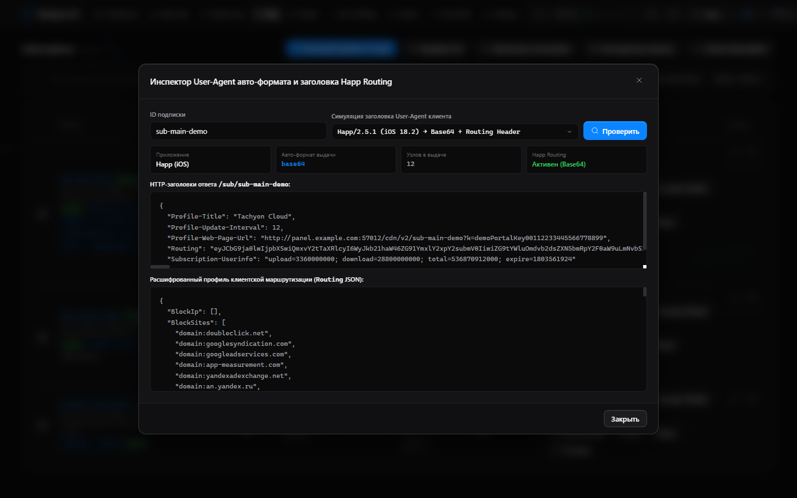
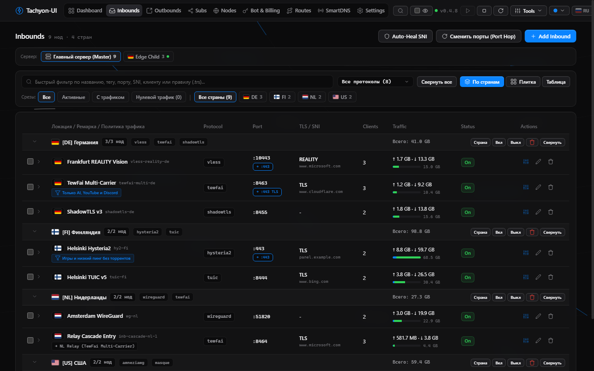
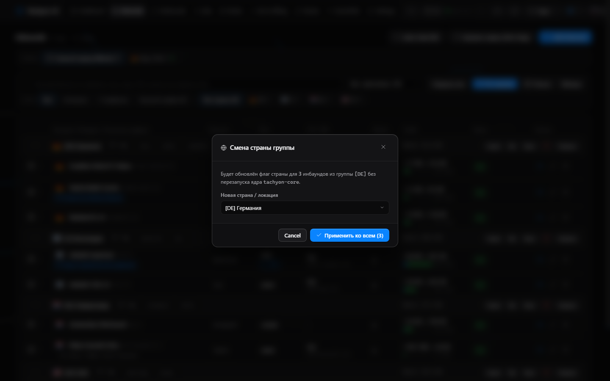
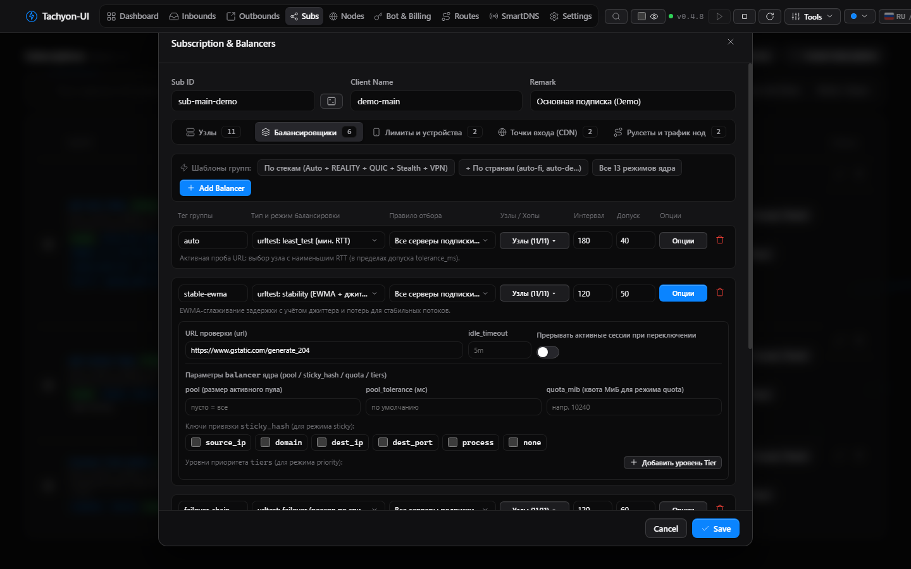
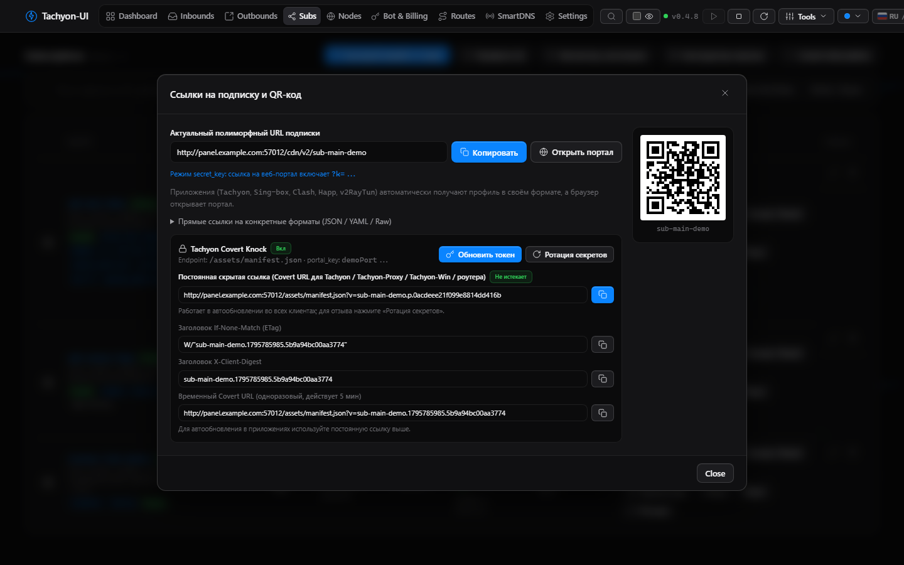

# 10. Setting Up a Unified `tachyon-ui` Subscription for Tachyon 2.0 Router (OpenWrt / Entware)

**Applies to:** `tachyon-ui v0.4.12` and `Tachyon 2.0` (`tachyon-core 0.6.9`)  
[Back to Index](../../README.md) | [Chapter 9 — Protocol Encyclopedia](09-protocols-encyclopedia.md) | [Protocol Guides Catalog](protocols/README.md) | [UI Tab & Button Reference](11-ui-every-tab-and-button-guide.md) | [Русский](../ru/10-tachyon-router-subscription-guide.md)

---

## 1. Why the Native JSON Profile (`tachyon_json_profile`) Works Best with Tachyon 2.0

When serving a subscription, `tachyon-ui` inspects the client's `User-Agent` (which you can preview anytime via the **Headers Inspector**):



| Client / `User-Agent` | Payload Returned by `tachyon-ui` | Router Behavior |
| :--- | :--- | :--- |
| `Happ/*`, `v2rayNG/*`, empty UA | Base64 list of share URIs (`vless://`, `hy2://`, `ss://`, etc.) | Custom/router-only transports (**TewFai**, **TrustTunnel**, **OpenConnect**, **MTProto**) and `urltest` groups cannot be represented as generic URIs; only URI-compatible nodes import |
| `tachyon-core/2.0 (compatible; sing-box 1.14.3)` | **Flat JSON profile (`tachyon_json_profile`)**: all leaf `outbounds` + `endpoints` (WireGuard/AmneziaWG) + country and mode `urltest` balancers (no synthetic `selector` / `direct` / `block`) | The router imports **100% of nodes** (including `TewFai`, `MASQUE HTTP/3`, `TrustTunnel`, `Snell`, `FPTN`, `MTProto`, `WireGuard/AWG`), country flags/metadata, and ready-to-use `urltest` balancers without colliding with section-level `selector`/`direct` outbounds |

> [!TIP]
> Always use a `User-Agent` containing `tachyon` on a Tachyon 2.0 router (`tachyon-core/2.0 (compatible; sing-box 1.14.3)` is recommended).

---

## 2. Server-Side Setup in `tachyon-ui` (VPS)

### Step 2.1. Assign Country Codes to Base Inbounds
For base protocols (`VLESS REALITY`, `Hysteria2`, `TUIC`, `MASQUE`, `TewFai`, `WireGuard`, etc.) to receive country flags and join per-country balancers:
1. Open the **Inbounds (`#inbounds`)** tab (see [Chapter 5](05-protocols-nodes-and-tgbot.md) and [Chapter 7](07-full-setup-and-cluster-guide.md)).



2. Use **Batch Set Country** (or edit individual base inbounds) to assign the server's 2-letter ISO code (e.g., `FI` for Helsinki or `DE` for Frankfurt).



3. Changing `country` metadata applies immediately to subscriptions without restarting `tachyon-core`.

### Step 2.2. Verify Cascade & Cluster Nodes
- Cascade inbounds (`inb-cascade-*`, e.g. `TewfAI` cascades) and cluster child nodes (`managed_tachyon_node`) inherit their country from each upstream node's `country` field.
- Make sure every node intended for country grouping displays its flag prefix (`🇩🇪`, `🇳🇱`, `🇫🇮`, `🇵🇱`, etc.).

### Step 2.3. Configure Country & Mode Balancers on the Subscription
1. Open **Subscriptions (`#subs`) → Subscription Settings → Balancers** (see [Chapter 3](03-subscriptions-and-covert-knock.md) and [Chapter 4](04-balancers-chain-and-routes.md)).



2. Keep or configure global `urltest` balancers as needed:
   - `auto` (`least_test`) — lowest-latency node;
   - `stable-ewma` (`stability`) — jitter-resistant EWMA selection;
   - `reality-fast` — `VLESS REALITY` nodes only;
   - `quic-h3` — fast UDP/QUIC transports (`hysteria2`, `tuic`, `masque`, `naive`);
   - `failover-chain` (`failover`) — ordered backup chain.
3. Add country `urltest` balancers tagged `country-<cc>` (e.g., `country-fi`, `country-de`, `country-nl`, `country-pl`, `country-us`, `country-se`) together with a `selector` tagged `proxy` (for standard JSON/Clash clients).
4. In `tachyon_json_profile`, `tachyon-ui` automatically exports readable country `urltest` groups (`🇩🇪 Германия (Авто)`, `🇳🇱 Нидерланды (Авто)`, `🇫🇮 Финляндия (Авто)`, etc.) containing only verified leaf outbound/endpoint tags.

### Step 2.4. Copy the Permanent Covert Knock URL
1. Open **Links / Knock** on the subscription card and copy the **Permanent URL** (`Non-expiring` badge):
   `https://<HOST_OR_IP>:<PORT>/<base_or_polymorph_path>?v=<sub_id>.p.<hmac24>`



2. Avoid pasting 5-minute ephemeral browser tokens into the router — background refreshes will fail once the short window expires.

---

## 3. Router-Side Setup in `Tachyon 2.0`

### Step 3.1. Add the Subscription Source (**Servers / Sources**)
Open your router web interface (e.g., `https://<router LAN IP, e.g. 192.0.2.1>`) and configure the source with:
- **`source_type`:** `subscription`
- **URL:** the permanent Covert Knock URL from `tachyon-ui`
- **Allow insecure TLS (`subscription_insecure`):** `true` when connecting by raw IP / self-signed certificate
- **Auto User-Agent (`auto_user_agent`):** **`false`**
- **Explicit `User-Agent` (`user_agent`):**
  ```text
  tachyon-core/2.0 (compatible; sing-box 1.14.3)
  ```
- **Include upstream `urltest` groups (`include_urltest_groups`):** **`true`**
- **Hide individual nodes inside `urltest` groups (`hide_urltest_group_outbounds`):** **`false`** — this ensures both the per-country/mode balancers and every individual server remain visible and selectable in the router UI.

### Step 3.2. Attach the Source to a Section (`Main`) & Check Filters
1. Open **Sections → `Main` → Sources (`outbound_source_refs`)** and include your source.
2. Check section-level filters, which control how many imported nodes appear inside `Main`:
   - `exclude_countries` (commonly `["RU", "BY"]`) hides `RU`/`BY` nodes;
   - `node_filter_deny` (e.g., `"Без рекламы|LTE|Белые списки|Обход глушилок"`) hides nodes whose tags match those keywords;
   - Adjust filters or create a dedicated section if you want specialized nodes visible separately.
3. Save and click **Refresh subscription** — the router fetches `Tachyon-tachyon.json`, populates metadata (`Profile-Title`, `Subscription-Userinfo`, `Support-Url`, `Profile-Web-Page-Url`), rebuilds `/etc/tachyon-core/config.json`, and runs latency probes.

---

## 4. Expected Result in Tachyon 2.0

After refreshing:
- **Balancers / Auto-select:** Section balancers plus imported country and strategy `urltest` groups (`🇩🇪 Германия (Авто)`, `🇳🇱 Нидерланды (Авто)`, `auto`, `stable-ewma`, `reality-fast`, `quic-h3`, `failover-chain`).
- **Servers Table:** All individual servers grouped with their country flags, protocols (`TewfAI`, `VLESS`, `Hysteria2`, `TUIC`, `MASQUE`, `TrustTunnel`, `WireGuard`, `FPTN`, `Snell`, `MTProto`), source column, and live ping.

---

## 5. Troubleshooting (`v0.4.12` + `tachyon-core 0.6.9`)

| Symptom | Cause | Fix |
| :--- | :--- | :--- |
| **0 servers** or `HTTP 404` | Expired 5-minute token or self-signed TLS rejected | Use the permanent Covert Knock URL (`?v=<sub_id>.p.<hmac24>`) and set `subscription_insecure: true` for IP endpoints. |
| Only partial nodes shown; `TewFai` / `TrustTunnel` / `OpenConnect` missing | `auto_user_agent` cached a legacy URI-only app (`Base64` URI mode) | Disable `auto_user_agent` and set a `tachyon`-identifying `User-Agent` (or `?format=tachyon`); verify with **Headers Inspector** in `tachyon-ui`. |
| No country balancer groups shown | `include_urltest_groups` is `false` on router, or `country` is empty on `tachyon-ui` inbounds | Set ISO `country` codes on `tachyon-ui` (`v0.4.6+`), enable `include_urltest_groups: true` and `hide_urltest_group_outbounds: false`. |
| Country groups visible, individual servers missing | `hide_urltest_group_outbounds: true` on router | Set `hide_urltest_group_outbounds: false` and refresh the source. |
| **TewFai** REALITY + QUIC fails on router/client | QUIC carrier lacks `quic.tls` when TCP uses REALITY | Upgrade to `tachyon-ui v0.4.12` (`sub_gen` auto-exports `quic.tls: { enabled: true, insecure: true, alpn: ["h3"] }`; see [01-tewfai.md](protocols/01-tewfai.md)). |
| **MTProto** rejected (`secret must be 32 hex characters`) | Legacy `ee...` or `dd...` FakeTLS secret passed raw into `tachyon-core 0.6.9` | Re-save via `tachyon-ui v0.4.12`, which normalizes secrets to 32 hex chars (see [15-mtproto.md](protocols/15-mtproto.md)). |
| **Desync** fails `tachyon-core check` (`unknown field udp_fake_packets`) | Legacy `udp_fake_packets` field rejected by strict schema in `tachyon-core 0.6.9` | Update to `v0.4.12` and re-save the Desync outbound (`udp_fake`, `quic_desync`, `udp_repeats`; see [24-desync.md](protocols/24-desync.md)). |
| **NaiveProxy / MASQUE** fails (`insecure is not supported` or cert error) | `NaiveProxy` forbids `insecure: true`; `MASQUE` standard profile checks CA SAN | Bind a real domain + Let's Encrypt cert matching SNI, or disable Naive/MASQUE on bare-IP servers (see [10-naive.md](protocols/10-naive.md), [11-masque.md](protocols/11-masque.md)). |
| Core config check fails with noisy lines | `tachyon-core check` prints `ERROR`/`FATAL` lines amid info logs | `tachyon-ui v0.4.12` prioritizes actual `ERROR` / `FATAL` / `unknown field` lines at the top of the error toast for quick diagnosis. |
| Some countries/nodes missing in `Main` only | Excluded by `Main` section `exclude_countries` or `node_filter_deny` | Review `Main` section filters or create a secondary section without those exclusions. |

---

[Previous: Chapter 9 — Protocol Encyclopedia](09-protocols-encyclopedia.md) | [Protocol Guides Catalog](protocols/README.md) | [Desync Guide](protocols/24-desync.md) | [UI Tab & Button Reference](11-ui-every-tab-and-button-guide.md) | [Back to Index](../../README.md) | [Русский](../ru/10-tachyon-router-subscription-guide.md)
