# 11. Complete UI Reference: Every Tab, Menu, Button, Toggle, Modal & Shortcut (`v0.4.12`)

[Русская версия](../ru/11-ui-every-tab-and-button-guide.md) | [Complete Guide](00-complete-guide.md) | [Protocols Catalog](protocols/README.md) | [Back to Index](../../README.md)

This exhaustive reference documents **every single control** in the **Tachyon-UI `v0.4.12`** web interface—covering the sign-in gate, topbar, Tools menu, global hotkeys, 16 themes and live theme studio, floating bulk bar, all 9 navigation tabs in exact menu order, every modal, drawer, wizard, and diagnostic console. Every entry follows the **What · Where · How · Why · Pitfalls** pattern so operators know exactly what happens before clicking.

---

## 1. Documentation Navigation & Table of Contents

### Chapter & Protocol Index

| Guide | Topic | Link |
| :--- | :--- | :--- |
| **Chapter 00** | Complete End-to-End Playbooks & 34-Screen Index | [00-complete-guide.md](00-complete-guide.md) |
| **Chapter 01** | Installation, Docker, Source Build & CLI (`tachyon-panel`) | [01-installation-and-cli.md](01-installation-and-cli.md) |
| **Chapter 02** | Public Website, Dual HTTP+HTTPS, Domain Profiles, ACME & Self-Audit | [02-stealth-web-domain-tls.md](02-stealth-web-domain-tls.md) |
| **Chapter 03** | Subscriptions, Web Portal, Vouchers & Covert Knock | [03-subscriptions-and-covert-knock.md](03-subscriptions-and-covert-knock.md) |
| **Chapter 04** | Balancers (12 `urltest` Modes), `chain` Outbounds & Routing | [04-balancers-chain-and-routes.md](04-balancers-chain-and-routes.md) |
| **Chapter 05** | Protocols, Multi-Node Clusters, Cascades & Telegram Bot | [05-protocols-nodes-and-tgbot.md](05-protocols-nodes-and-tgbot.md) |
| **Chapter 06** | Core Diagnostics, Privacy Mask (`Alt+P`) & REST API | [06-diagnostics-privacy-and-api.md](06-diagnostics-privacy-and-api.md) |
| **Chapter 07** | Full Production Setup & `Master → Child` Cluster Guide | [07-full-setup-and-cluster-guide.md](07-full-setup-and-cluster-guide.md) |
| **Chapter 08** | SmartDNS v2 / GeoHide & SNI Proxy Guide | [08-smartdns-geohide-guide.md](08-smartdns-geohide-guide.md) |
| **Chapter 09** | Protocols Encyclopedia in Plain English | [09-protocols-encyclopedia.md](09-protocols-encyclopedia.md) |
| **Chapter 10** | Tachyon 2.0 Router Subscription Guide (`OpenWrt` / `Entware`) | [10-tachyon-router-subscription-guide.md](10-tachyon-router-subscription-guide.md) |
| **Protocols Catalog** | Full 27-Protocol Technical Reference (`01..27`) | [protocols/README.md](protocols/README.md) |

### Sections in This Guide

1. [Documentation Navigation & Table of Contents](#1-documentation-navigation--table-of-contents)
2. [Sign-In Screen, First-Run Credentials & Stealth Gate](#2-sign-in-screen-first-run-credentials--stealth-gate)
3. [Topbar, `tachyon-core` Controls, Tools Menu & Global Hotkeys](#3-topbar-tachyon-core-controls-tools-menu--global-hotkeys)
4. [16 Built-In Themes & Live Theme Builder](#4-16-built-in-themes--live-theme-builder)
5. [All 9 Panel Tabs (Exact `#main-nav` Order)](#5-all-9-panel-tabs-exact-main-nav-order)
   - [Tab 1 (`Alt+1`): Dashboard (`#dashboard`)](#tab-1-alt1-dashboard-dashboard)
   - [Tab 2 (`Alt+2`): Inbounds (`#inbounds`)](#tab-2-alt2-inbounds-inbounds)
   - [Tab 3 (`Alt+3`): Outbounds (`#outbounds`)](#tab-3-alt3-outbounds-outbounds)
   - [Tab 4 (`Alt+4`): Subscriptions (`#subs`)](#tab-4-alt4-subscriptions-subs)
   - [Tab 5 (`Alt+5`): Nodes (`#nodes`)](#tab-5-alt5-nodes-nodes)
   - [Tab 6 (`Alt+6`): Bot & Billing (`#tgbot`)](#tab-6-alt6-bot--billing-tgbot)
   - [Tab 7 (`Alt+7`): Routes (`#routes`)](#tab-7-alt7-routes-routes)
   - [Tab 8 (`Alt+8`): SmartDNS (`#smartdns`)](#tab-8-alt8-smartdns-smartdns)
   - [Tab 9 (`Alt+9`): Settings (`#settings`)](#tab-9-alt9-settings-settings)
6. [Service Modals: Telemetry, Core Diagnostics, Unlock & Speedtest, Snapshots & Updates](#6-service-modals-telemetry-core-diagnostics-unlock--speedtest-snapshots--updates)

---

## 2. Sign-In Screen, First-Run Credentials & Stealth Gate

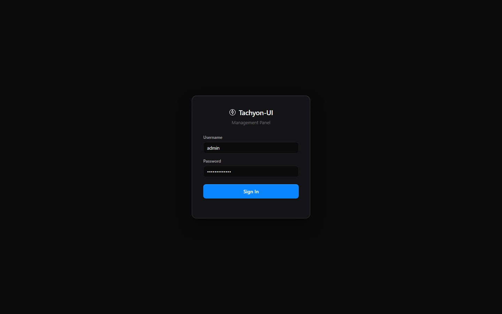

When you open `http://198.51.100.10:2053` (or `https://panel.example.com/<web_base_path>`), `tachyon-ui` renders the minimal sign-in card inside the configured stealth scope.

| UI Control | Location | What & How | Why It Exists | Pitfalls & Notes |
| :--- | :--- | :--- | :--- | :--- |
| **Username (`#login-user`)** | Sign-In card | Text input with `autocomplete="username"` for the panel administrator username. | Authenticates the operator against constant-time credential verification. | First-run credentials are generated by the installer; change them immediately under **Settings → Admin Credentials**. |
| **Password (`#login-pass`)** | Sign-In card | Masked password input with `autocomplete="current-password"`. Pressing `Enter` triggers `Sign In`. | Prevents shoulder-surfing and allows single-keystroke login submission. | Never reuse server SSH passwords here. |
| **Sign In button** | Sign-In card footer | Sends `POST /api/login`, receives an `HttpOnly; SameSite=Strict` `sid` session cookie (plus `sessionStorage` bearer fallback), and routes to `#dashboard`. | Establishes an authenticated session (up to 64 concurrent active sessions with automatic pruning of expired entries). | On HTTPS, the `sid` cookie automatically includes the `Secure` attribute. |
| **Error banner (`#login-error`)** | Below Sign In button | Displays `Invalid credentials` (`401`) or payload errors on failed attempts. | Gives operator feedback without leaking whether the username or password failed. | **Lockout & Honeypot protection:** Every failed `/api/login` attempt is recorded in the **Honeypot** security log with the source IP; if Honeypot auto-ban triggers, that IP is blocked. |
| **Stealth Entry Gate (`web_base_path`)** | URL prefix | When `web_base_path` is set (e.g., `/p-8f3c21a9`), `/`, `/login`, and `/api/*` outside that prefix return the decoy `SiteEngine` website or `404`. | Hides the sign-in screen from internet scanners and active probing. | **Recovery:** If you forget `web_base_path`, SSH into the VPS and run `tachyon-panel reset-path` to reset it safely to `/`. |

> **Session & Perimeter Model (`v0.4.12`):** Session lifetime is governed server-side by the `sid` cookie TTL (up to 64 active sessions), while perimeter protection relies on `web_base_path` isolation, TLS/ACME, and Honeypot IP logging on failed sign-in attempts.

---

## 3. Topbar, `tachyon-core` Controls, Tools Menu & Global Hotkeys

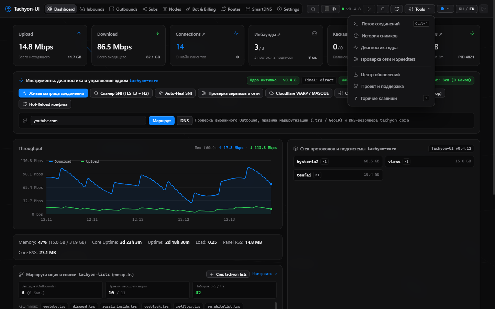

### 3.1. Topbar Controls (`#topbar`)

| UI Control | Location | What & How | Why It Exists | Pitfalls & Notes |
| :--- | :--- | :--- | :--- | :--- |
| **Menu button** *(mobile)* | Topbar far left (`< 1024px` viewports) | Opens `#mobile-nav-overlay` slide-out drawer containing all 9 tabs, `tachyon-core` Start/Stop/Restart buttons, Tools links, Theme & Layout switchers, `RU / EN` toggle, and Sign Out. | Full panel control on phones and narrow windows. | Tap outside the drawer or press `Esc` to close. |
| **Tachyon-UI brand & 9 Tab Links** | Topbar left/center | Navigates between `#dashboard` .. `#settings` (`Alt+1` .. `Alt+9`). Active tab is highlighted. | Single-click switching across all 9 panel modules. | Unapplied config edits remain saved in panel storage until **Apply Changes** is pressed. |
| **Search… `Ctrl+K`** | Topbar right | Opens the **Global Command Palette** (`#modal-cmdk`). | Instant fuzzy search across all 9 tabs, quick tools, inbounds, outbounds, subscriptions, and nodes. | Works globally via `Ctrl+K` (or `Cmd+K` on macOS). |
| **Hide data (`Alt+P`)** | Topbar right checkbox | Toggles **Privacy Mask Mode** (`localStorage`: `tachyon_privacy_mask`). Uses a live `MutationObserver` to mask sensitive DOM values and `<input>` fields with `***` (without changing `.value`) and blurs QR codes. | Safe screen sharing, screenshots, and remote troubleshooting without leaking IPs, hostnames, UUIDs, keys, or tokens. | Well-known probe domains (`gstatic.com/generate_204`, `google.com`, `example.com`) and public DNS (`1.1.1.1`, `8.8.8.8`) stay readable. |
| **`tachyon-core` Status Pill** | Topbar right (`Running` / `Stopped` + version) | Green/red dot + live `tachyon-core` version (`vX.Y.Z`). Clicking opens the **Update Center** modal (`#modal-core-update`). | At-a-glance engine health and version check. | Red/Stopped means client proxy traffic is halted even if the web panel itself is reachable. |
| **Core Start / Stop / Restart buttons** | Topbar right button group | `▶` (`POST /api/core/start`), `■` (`POST /api/core/stop`), `↻` (`POST /api/core/restart`). | Immediate `tachyon-core` process lifecycle control from any tab. | **Stop** and **Restart** immediately terminate active client tunnels; **Start** is disabled while already running. |
| **Tools dropdown** | Topbar right (`Sliders` icon + `Tools`) | Opens `#topbar-tools-popover` with quick links to diagnostics, snapshots, speedtest, updates, support, and shortcuts. | Jump into live tools without leaving your current tab. | Closes on outside click or `Esc`. |
| **Theme trigger** | Topbar right (accent dot + active theme name) | Opens `#topbar-theme-popover` showing 16 built-in themes (3 light, 13 dark), saved custom themes, and `+ Create custom theme...`. | Instant palette switching with zero reload. | Saved per-browser in `localStorage`. |
| **`RU / EN` toggle** | Topbar right | Switches the UI dictionary (`RU` / `EN`) immediately and persists choice in `localStorage`. | Bilingual administration for multi-language teams. | Re-renders the active view immediately. |
| **Sign Out button** | Topbar far right (`Logout` icon) | Calls `POST /api/logout`, clears `sid` cookie and session token, and returns to `#login-screen`. | Terminates your admin session cleanly. | Always sign out on shared workstations. |

### 3.2. Tools Dropdown Menu (`#topbar-tools-popover`)

| Menu Item | Hotkey | Opens / Runs | What & How | Why It Exists | Pitfalls & Notes |
| :--- | :--- | :--- | :--- | :--- | :--- |
| **Live Connections** | `` Ctrl+` `` | `#gpui-conn-dock` | Toggles the bottom slide-up **Live Connections Dock** polling `GET /api/core/connections`. | Real-time inspection of active client domains, matched rules, and outbound tags without leaving your table. | Includes pause/resume, search filter, 1-click **Block Domain**, **Route Domain**, and **Close Session**. |
| **Snapshots** | — | `#modal-snapshots` | Opens the **10-Revision Snapshot Ring** (`GET /api/snapshots`). | Create manual checkpoints or atomically roll back broken routing/inbound edits. | Restoring reloads `tachyon-core`, firewall rules, and TLS listeners automatically. |
| **Core Diagnostics** | — | `#modal-core-diag` | Opens the **5-Tab Live Core Diagnostics Console**. | Deep inspection of connections, memory/anomalies, failover/proxies, DNS leaks, and 8-stage connection tests. | Requires `tachyon-core` to be running for live metrics. |
| **Network Check & Speedtest** | — | `#modal-unlock-probe` | Opens **Unlock Probe, RKN Reachability & Speedtest**. | Checks streaming/AI unblocking, global/RU reachability, and server throughput. | Running Speedtest temporarily consumes VPS bandwidth. |
| **Update Center** | — | `#modal-core-update` | Opens **Update Center (Tachyon-UI & `tachyon-core`)**. | Lists GitHub releases for both `tachyon-core` and `tachyon-ui` with 1-click update buttons. | Updating `tachyon-core` briefly restarts active proxy tunnels; self-updating `tachyon-ui` restarts the panel daemon. |
| **Project & Support** | — | `#modal-support` | Displays version details, community links (`@tachyon_proxy`), and support QR modal. | Quick access to documentation, community channels, and project support. | — |
| **Keyboard Shortcuts** | `?` | `#modal-shortcuts` | Displays the complete shortcut cheatsheet modal. | Fast onboarding for keyboard-driven workflows. | Works anywhere outside `<input>`, `<textarea>`, and `<select>`. |

### 3.3. Global Hotkeys, Command Palette, Live Dock & Floating Bulk Bar

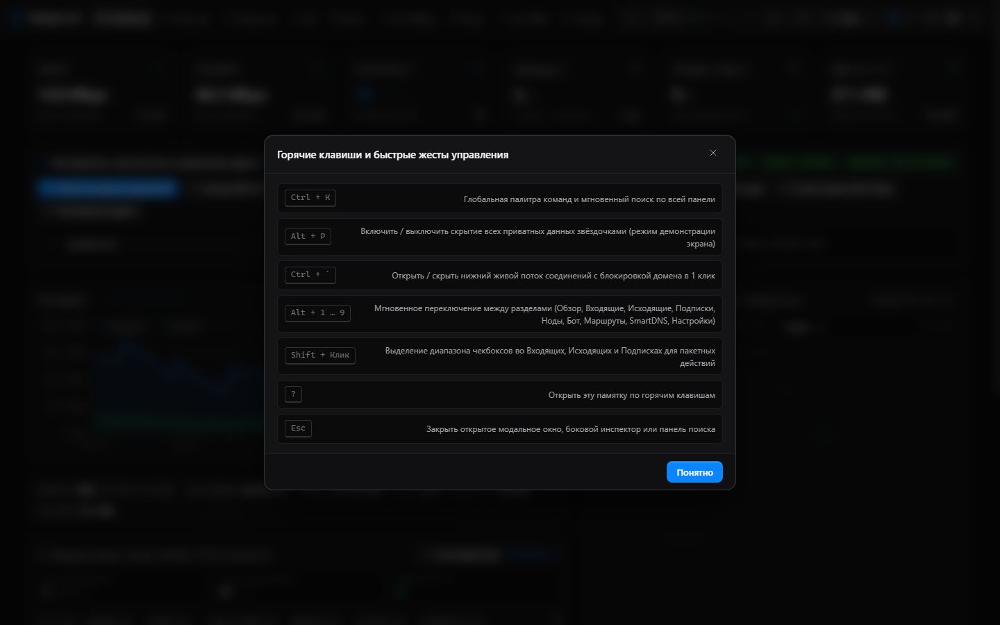

| Control / Shortcut | Where It Works | What & How | Why It Exists | Pitfalls & Notes |
| :--- | :--- | :--- | :--- | :--- |
| **`Ctrl+K` / `Cmd+K`** | Global (authenticated) | Opens/closes `#modal-cmdk` **Command Palette** (`↑`/`↓` to navigate, `Enter` to jump/run). | Fastest way to jump to any tab, inbound, outbound, subscription, node, or diagnostic modal. | Indexes live state—if you just added an inbound on a Child node, switch to that node first to index it. |
| **`Alt+P`** | Global (authenticated) | Toggles **Privacy Mask Mode** (`***` masking on IPs, domains, UUIDs, keys, tokens, blurred QRs). | Instant redaction before taking screenshots or sharing your screen. | Verify masking is active before capturing modals opened right afterward. |
| **`` Ctrl+` ``** | Global (authenticated) | Toggles bottom **Live Connections Dock** (`#gpui-conn-dock`) with search, Pause, `Close`, `Block Domain`, and `Route Domain` actions. | Live traffic debugging while editing rules or subscriptions. | Closing all connections inside the dock sends `{ id: "" }` and drops every active tunnel immediately. |
| **`Alt+1` … `Alt+9`** | Global (authenticated) | Switches directly to tabs 1–9 (`dashboard`, `inbounds`, `outbounds`, `subs`, `nodes`, `tgbot`, `routes`, `smartdns`, `settings`). | Zero-mouse tab navigation. | Uses exact `#main-nav` order (`Alt+4` is Subs, `Alt+7` is Routes). |
| **`Shift+Click`** | Inbounds, Outbounds, Subs | Selects a contiguous range of checkboxes and reveals the **Floating Bulk Action Bar** (`#gpui-fab-root`). | Batch enable/disable, delete, extend `+30d`, assign country, or apply subscription profiles in one click. | Clear selection before switching views if you do not want accidental bulk actions. |
| **`?`** | Outside text fields | Opens `#modal-shortcuts` **Keyboard Shortcuts Cheatsheet**. | Quick hotkey lookup without opening Tools. | Ignored while typing inside inputs, textareas, or selects. |
| **`Esc`** | Global | Closes overlays in strict priority: Mobile Nav → Tools Popover → Subscription 360° Drawer → Node Inspector Drawer → Open Modals → Live Connections Dock. | Predictable single-key dismissal of any open overlay. | Press twice if both a modal and the bottom dock are open. |

| Additional Shared Overlays | Screenshot Reference |
| :--- | :--- |
| **Live Connections Dock (`` Ctrl+` ``)** | 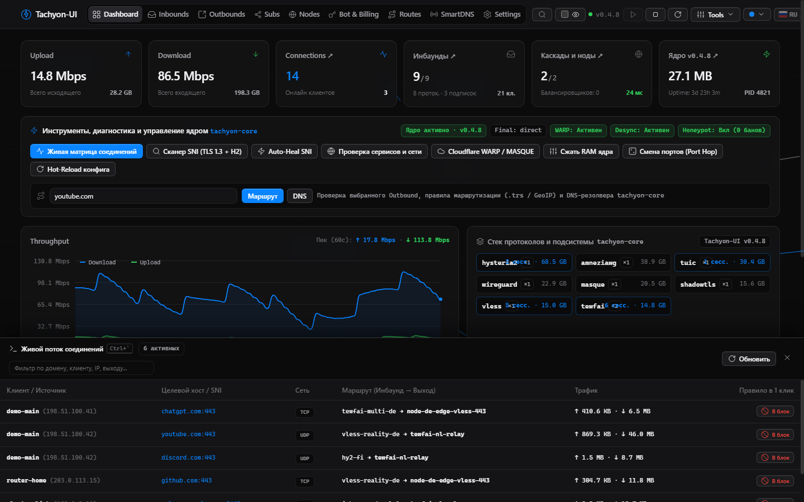 |
| **Privacy Mask Mode (`Alt+P`)** | 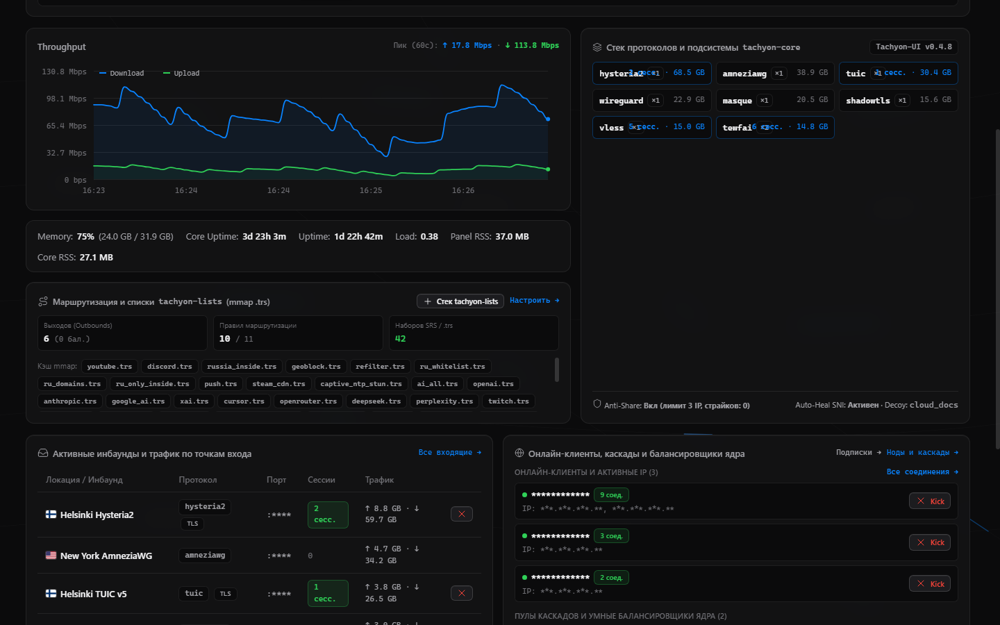 |
| **Global Command Palette (`Ctrl+K`)** | 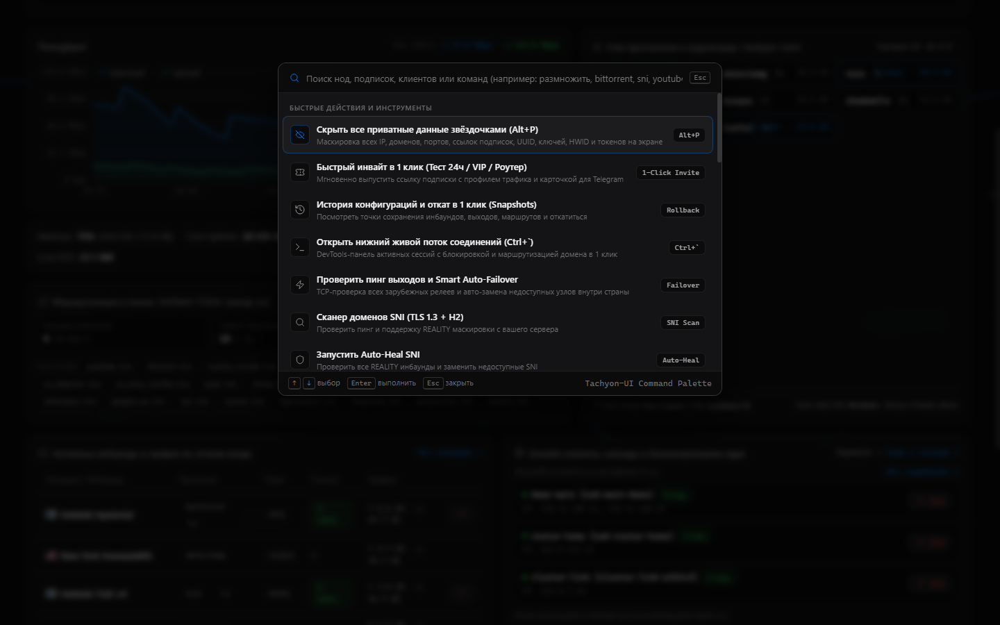 |

---

## 4. 16 Built-In Themes & Live Theme Builder

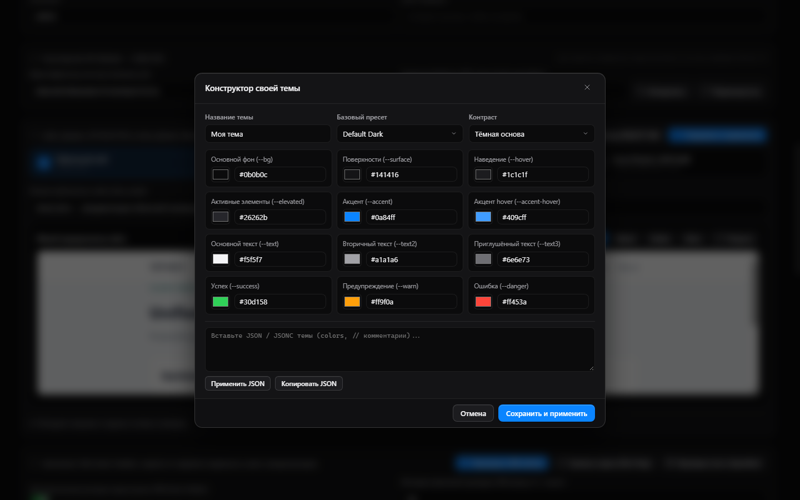

Tachyon-UI includes **16 built-in themes** (**13 dark** and **3 light**) plus a full **Custom Theme Studio** (`#theme-builder-overlay`) accessible from both the Topbar theme menu and **Settings**.

### All 16 Built-In Themes

| Scheme | Built-In Theme Names |
| :--- | :--- |
| **13 Dark Themes** | `Default Dark`, `Legacy Dark`, `Catppuccin`, `Dracula`, `Everforest`, `Gruvbox Material`, `Monokai`, `Nord`, `One Dark Pro`, `Tokyo Night`, `Solarized Dark`, `Vesper`, `Material Dark` |
| **3 Light Themes** | `Material Light`, `Apple Light`, `Gruvbox Light` |

### Theme Popover & Theme Builder Controls (`#theme-builder-overlay`)

| UI Control | Location | What & How | Why It Exists | Pitfalls & Notes |
| :--- | :--- | :--- | :--- | :--- |
| **Built-in & Custom Theme Cards / List** | Topbar popover & Settings theme card | Click any theme to apply its 12 CSS variables immediately (`data-tachyon-theme`, persisted in `localStorage`). | Match ambient lighting or VS Code / terminal palettes. | Built-in themes cannot be deleted; custom themes show **Edit** and **× (Delete)** buttons. |
| **Import JSON** | Settings theme card | File input accepting `.json` or `.jsonc` (supports VS Code theme keys and `//` or `/* */` comments). | Reuse existing editor themes without picking 12 colors manually. | Invalid JSON triggers an alert and leaves the active theme untouched. |
| **`+ Custom Theme` button** | Topbar popover & Settings | Opens `#theme-builder-overlay` with live preview applied immediately to the background UI. | Design custom operator themes with real-time visual feedback. | Pressing `Cancel` or `Esc` reverts the live preview back to your previous theme. |
| **Theme Name (`#tb-name`)** | Theme Builder top row | Sets the display name and generates a `custom-<slug>` ID in `localStorage`. | Identify multiple custom presets cleanly. | Avoid naming collisions if editing multiple variants. |
| **Base Preset (`#tb-base`)** | Theme Builder top row | Dropdown of all 16 built-in themes; loads its 12 colors and scheme as a starting point. | Quickly tweak an existing palette (e.g., Nord with a different accent). | Changing Base Preset overwrites unsaved color edits in the current draft. |
| **Contrast Scheme (`#tb-scheme`)** | Theme Builder top row | `Dark` or `Light`; controls translucent borders, glass surfaces, and grid strokes. | Ensures legible borders and glass headers on bright vs. dark backgrounds. | Changing `--bg` auto-infers light/dark luminance, which you can override here. |
| **12 Semantic Color Pickers + Hex Inputs** | Theme Builder grid | Color swatch + hex input (`#rrggbb`) for `--bg`, `--surface`, `--hover`, `--elevated`, `--accent`, `--accent-hover`, `--text`, `--text2`, `--text3`, `--success`, `--warn`, `--danger`. | Pixel-accurate control of every UI surface and status badge. | Keep high contrast between `--bg`/`--surface` and `--text`/`--text2`. |
| **JSON / JSONC Box (`#tb-json`) + `Apply JSON` / `Copy JSON`** | Theme Builder bottom | Paste JSON/JSONC and click **Apply JSON**, or click **Copy JSON** to export the current theme to the clipboard. | Share custom themes across workstations or browsers. | Remember themes are stored in browser `localStorage`, not on the VPS. |
| **Save & Apply (`#tb-save`)** | Theme Builder footer | Saves the custom theme to `localStorage` and activates it immediately. | Persists your theme across page reloads. | — |

---

## 5. All 9 Panel Tabs (Exact `#main-nav` Order)

### Tab 1 (`Alt+1`): Dashboard (`#dashboard`)

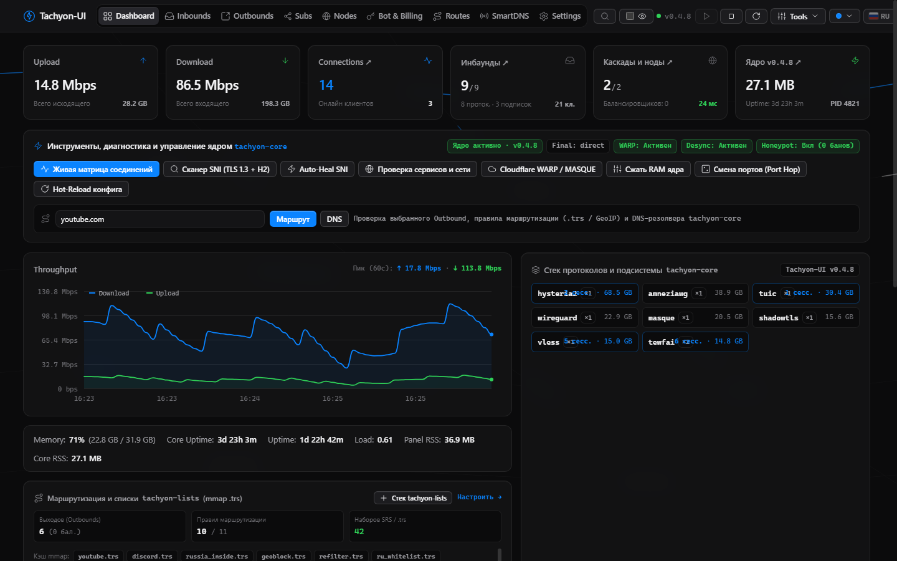

The **Dashboard** gives a single-screen real-time telemetry overview of `tachyon-core`, active tunnels, `tachyon-lists` routing databases, and recent logs.

| UI Control | Location | What & How | Why It Exists | Pitfalls & Notes |
| :--- | :--- | :--- | :--- | :--- |
| **6 KPI Cards (`#kpi-grid`)** | Top of Dashboard | Live cards for: 1) Core status & uptime; 2) Active inbounds & listeners; 3) Outbounds & healthy gateways; 4) Active subscriptions & limits; 5) Live RX/TX throughput & total traffic; 6) Core RSS memory & system load. | Instant health check upon sign-in. | Clicking the Connections / Core card opens **Core Diagnostics**. |
| **Engine Badges (`#dash-engine-badges`)** | Tools card header | Status badges for active subsystems (`Core`, `TLS/ACME`, `SmartDNS`, `TG Bot`, `Anti-Share`, `Auto-Healer`, `Failover`, `Watchdog`). | Verify which background protections are active at a glance. | Gray badges indicate disabled or unconfigured subsystems. |
| **Live Connection Matrix** | Quick-tools bar | Opens `#modal-core-diag` on the **Connections & Route** tab. | Jump straight into live sessions, domain blocking, and routing tests. | Requires `tachyon-core` to be running. |
| **SNI Scanner (TLS 1.3 + H2)** | Quick-tools bar | Opens `#modal-sni-scanner` to probe candidate REALITY SNI targets from this VPS. | Find low-latency, non-redirecting TLS 1.3 + `h2` hosts on the same ASN/region. | Always scan from the VPS itself—home PC latency does not match server handshake latency. |
| **Auto-Heal SNI** | Quick-tools bar | Runs `POST /api/tools/auto-heal` to probe active REALITY/TLS SNIs and rotate degraded ones automatically. | Self-heals blocked or degraded SNI targets without manual editing. | Triggers a `tachyon-core` reload only if an SNI actually rotates. |
| **Service & Network Check** | Quick-tools bar | Opens `#modal-unlock-probe` for streaming/AI unlock, RKN reachability, and Speedtest. | Audit IP reputation and bandwidth right after provisioning a VPS. | See [Section 6.3](#63-unlock-probe-rkn-reachability--speedtest-modal-unlock-probe). |
| **Cloudflare WARP / MASQUE** | Quick-tools bar | Calls `POST /api/core/warp-register` to auto-register a WARP/MASQUE account and create outbound `warp-out`. | Instant clean egress IP for AI/Google/Cloudflare-sensitive routes. | Remember to route target domains to `warp-out` in **Routes (`Alt+7`)**. |
| **Trim Core RAM** | Quick-tools bar | Calls `POST /api/core/memory-trim` to reclaim buffers and trigger GC inside `tachyon-core`. | Keeps RSS memory low on 512 MB–1 GB VPS nodes. | Safe to run while clients are connected. |
| **Port Hop** | Quick-tools bar | Calls `POST /api/tools/port-hop` to rotate configured inbound ports. | Evades ISP/DPI port throttling on UDP/QUIC or fixed TCP ports. | Clients refresh updated ports on next subscription pull. |
| **Hot-Reload Config** | Quick-tools bar | Calls `POST /api/core/apply` to regenerate `tachyon-core` JSON config and hot-apply changes. | Activates pending edits across inbounds, outbounds, and routes. | Check **Recent Logs** below if hot-reload reports a listener or port conflict. |
| **Target Input + `Route` / `DNS` Tracer (`#dash-trace-target`)** | Tools card bottom | Enter a domain or IP (default `youtube.com`) and click **Route** (`POST /api/core/route-check`) or **DNS** (`POST /api/core/dns-check`). | Simulates through live `tachyon-core` which outbound wins and how the domain resolves. | Confirms `.trs` rules and DNS behavior in 2 seconds without testing from a phone. |
| **Throughput Chart (`#chart-canvas`) & Sysinfo (`#sysinfo`)** | Left column | Live upload/download curve with CPU, RAM, OS, and Load Average strip. | Spot bandwidth drops, stalls, or CPU saturation immediately. | Sudden zero-drops with active users indicate upstream blocking or network loss. |
| **Routing & `tachyon-lists` Card (`#dash-routing-card`)** | Left column bottom | Displays installed binary `.trs` rule-sets, sizes, and quick navigation to `#routes`. | Confirms category rule-sets are loaded before relying on split tunneling. | Empty state means domain-category rules will not match until installed. |
| **Subsystems & Protocol Matrix (`#dash-subsystems-card`)** | Right column | Summarizes enabled security/automation modules and active listening protocols. | Confirms expected protocols (`tewfai`, `vless`, `hysteria2`, etc.) are active. | — |
| **Active Inbounds Table (`#dash-top-inbounds`)** | Lower left card | Lists top active inbounds and per-listener RX/TX counters, plus `All Inbounds →` link. | Identify which protocols carry the heaviest load. | — |
| **Online Clients, Cascades & Balancers (`#dash-online-and-nodes`)** | Lower right card | Shows online users/IPs with 1-click **Kick** (`POST /api/core/kick`), active balancers, and cascades. | Evict a misbehaving or stuck session without deleting the subscription. | Kicking drops active connections immediately; the client can reconnect if still enabled. |
| **Recent Logs (`#logs-box`) + Filter + `Copy`** | Bottom card | Live `tachyon-core` stdout/stderr viewer with substring/level filter (`#dash-log-filter`) and **Copy** button. | Primary troubleshooting surface for startup failures, TLS errors, and failover events. | Always inspect here first if **Apply Changes** fails. |

---

### Tab 2 (`Alt+2`): Inbounds (`#inbounds`)

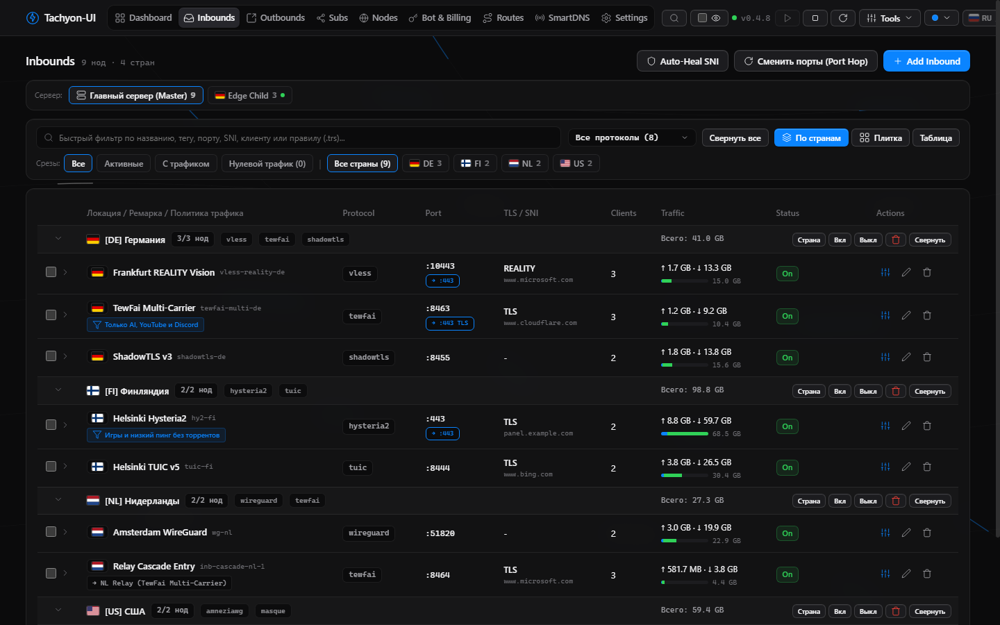

Manages all entry listeners on `Master` and any connected `managed_tachyon_node` Child servers, across **25 supported protocols**. For deep per-protocol field tables, see [Protocols Catalog](protocols/README.md) ([01. TewFai](protocols/01-tewfai.md) through [23. Mixed / SOCKS / HTTP](protocols/23-mixed-socks-http.md)).

#### Toolbar, Cluster Switcher & Bulk Actions

| UI Control | Location | What & How | Why It Exists | Pitfalls & Notes |
| :--- | :--- | :--- | :--- | :--- |
| **Node Switcher (`Master` / Managed Children)** | Top of `#inbounds` | Selects whether the tab operates on local `Master` or a remote `managed_tachyon_node`. | Manage inbounds across your entire cluster from a single screen without logging into each VPS. | When a Child is selected, edits go directly to that Child's API (`/api/nodes/{id}/inbounds`). |
| **Child Sync / Offline Banner** | Above table (when Child selected) | Shows reachability status plus **Refresh from Node** and **Apply Node Core** buttons. | Re-sync cached Child inbounds or apply pending core changes on that specific Child. | If offline, verify `node_api_token` and connectivity in **Nodes (`Alt+5`)**. |
| **Search input** | Filter bar | Filters inbounds live by `tag`, `listen_port`, protocol, SNI, or `remark`. | Locate specific listeners in large multi-protocol setups. | Use **Clear Filters** if expected inbounds seem hidden. |
| **Saved Views chips** | Filter bar | One-click presets (`All`, `REALITY`, `No TLS`, `Issues`, etc.). | Quickly audit security posture or protocol stacks. | — |
| **Protocol filter** | Filter bar | Filters by any of the 25 protocols (`tewfai`, `vless`, `hysteria2`, `tuic`, `trojan`, `anytls`, `shadowtls`, `naive`, `masque`, `wireguard`, `amneziawg`, etc.). | Focus on a single protocol family. | — |
| **Country chips & `Batch Country`** | Filter bar + `#tachyon-country-dialog` | Filters by 2-letter ISO country code or opens the batch country dialog to tag multiple selected inbounds at once. | Ensures accurate country grouping in subscriptions and `auto-<cc>` router balancers. | Metadata-only (`country`, `remark`) saves with **zero `tachyon-core` reload**! |
| **Clear Filters** | Filter bar | Resets search text, protocol, country, and saved view. | Restores the full inbound list in one click. | — |
| **Layout Switcher (`Tree / Grid / Table`)** | Toolbar right | Switches between country-grouped Tree, Card Grid, and compact Table views. | Adapt density to your screen size and task. | Supports `Shift+Click` checkbox ranges for the Floating Bulk Bar. |
| **`Auto-Heal SNI` / `Port Hop`** | Toolbar actions | Runs SNI health check/rotation or port-hopping rotation directly from `#inbounds`. | Fast resilience recovery without switching tabs. | Refresh client subscriptions after port-hop changes. |
| **`1→N Clone`** | Toolbar / card action | Opens `#modal-multi-clone` (`POST /api/nodes/multi-clone`) to replicate an inbound across `1..N` target nodes or port series. | Deploy identical VLESS+REALITY or TewFai stacks across a fleet in seconds. | Commercial/cluster multi-clone options depend on cluster/access-grant mode. |
| **`Cascade / Resell`** | Toolbar action | Opens `#modal-cascade` (`POST /api/cascade/preview`, `POST /api/cascade`) to wire a local entry inbound to a remote outbound/relay. | Build two-hop bridge chains with automated 1:1 route bindings. | Always click **Preview** first to verify ports and generated tags. |
| **`+ Add Inbound`** | Toolbar primary button | Opens the 4-tab Inbound Wizard (`#modal-inbound`). | Create a new listener on the currently selected node. | Click **Apply Changes** afterward to activate the listener in `tachyon-core`. |

#### Inbound Row / Card Actions & Node Inspector Drawer (`NodeDrawer`)

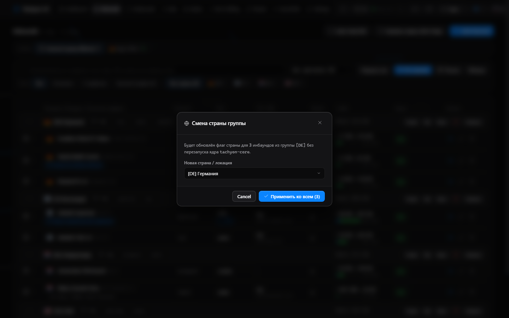

| UI Control | Location | What & How | Why It Exists | Pitfalls & Notes |
| :--- | :--- | :--- | :--- | :--- |
| **Selection Checkbox (`Shift+Click`)** | Left of each row/card | Selects inbounds for the **Floating Bulk Action Bar** (`Enable`, `Disable`, `Delete`, `Batch Country`, traffic policies). | Bulk fleet management without repetitive clicking. | Deleting inbounds removes their listeners and client entries permanently. |
| **Enable / Disable Toggle** | Row/card status | Toggles inbound active state (`PUT /api/inbounds/{id}`). | Temporarily take a port offline without losing its keys or client list. | Still requires **Apply Changes** to stop/start listening in `tachyon-core`. |
| **`+ Add Client`** | Row/card action | Opens `#modal-client` (`POST /api/inbounds/{id}/clients`) to add UUID/password, name, `sub_id`, traffic limit, and expiry. | Add standalone or subscription-linked users directly to an inbound. | For multi-protocol users, managing via **Subscriptions (`Alt+4`)** is faster. |
| **Client Actions (`Edit`, `Delete`, `Share`)** | Expanded client list | Edits credentials, deletes client, or opens `#modal-share` (`GET /api/share/{inbId}/{clientId}`) with single-node URI + QR. | Quick single-protocol testing or sharing one endpoint. | Prefer full subscription links over raw single-node URIs for automatic failover and updates. |
| **Edit / Clone / Delete / `⇄ Outbound`** | Row/card actions | Opens `#modal-inbound`, duplicates an inbound, deletes it, or (when inspecting a Child node) exports it as a `node-<id>-inb-<inb_id>` outbound on `Master` with a `cluster-link-*` service account. | Rapid templating and 1-click `Master → Child` relay wiring. | Never manually delete `cluster-link-*` accounts while an exported Child outbound is active. |
| **Node Inspector Drawer (`NodeDrawer`)** | Click row / Sliders icon | Opens right-hand `#node-drawer-overlay` for quick `remark` edits, per-inbound `.trs` traffic policies (`POST /api/inbounds/traffic-policy`), and multi-clone actions. | Edit metadata and `.trs` restrictions without opening the full modal. | `only_this` traffic policies restrict what traffic the inbound accepts on `tachyon-core`. |

#### 4-Tab Inbound Modal (`#modal-inbound`) & SNI Scanner (`#modal-sni-scanner`)

| Inbound Modal & SNI Scanner Screenshots | |
| :--- | :--- |
| 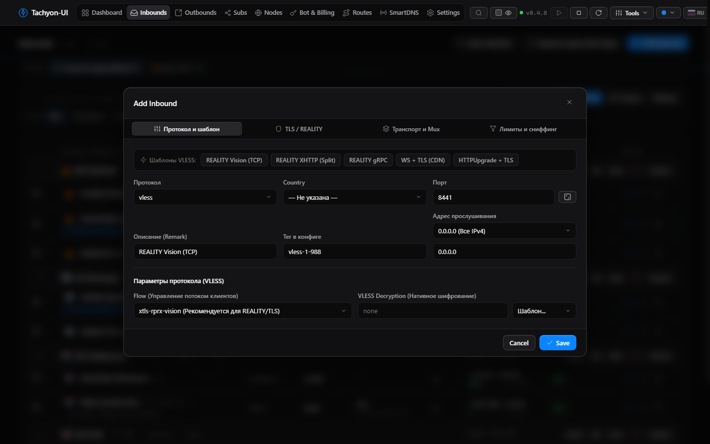 | 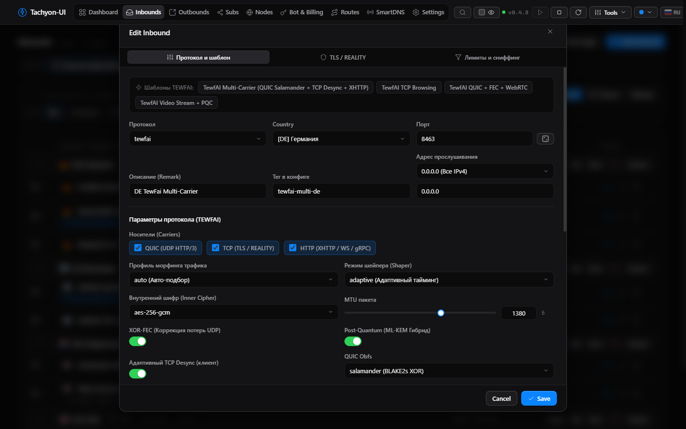 |
| 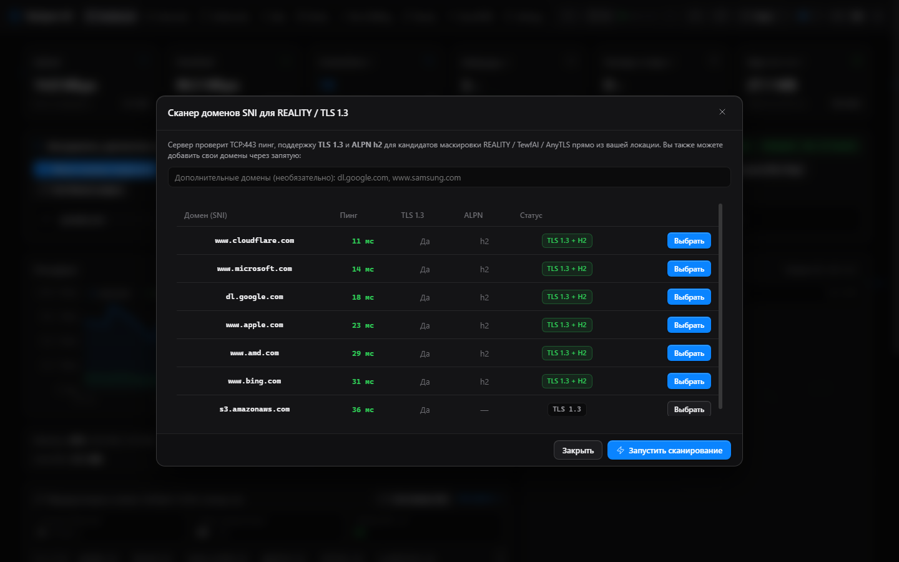 | *(SNI Scanner probes TLS 1.3 + ALPN `h2` latency directly from the VPS)* |

| Modal Tab / Control | Location | What & How | Why It Exists | Pitfalls & Notes |
| :--- | :--- | :--- | :--- | :--- |
| **Protocol Presets bar** | Top of `#modal-inbound` | 1-click preset chips (e.g., `TewFai Multi-Carrier`, `VLESS+REALITY Vision`, `Hysteria2`, `AnyTLS`, `Trojan+WS+CDN`, `ShadowTLS v3`, `TUIC v5`, `NaiveProxy`, `AmneziaWG`). | Populates safe defaults for protocol, TLS/REALITY, transport, and flags in one click. | Presets overwrite current draft fields—pick a preset before customizing ports/SNI. |
| **Tab 0: Main (`#inb-tab-main`)** | Modal tab 0 | Fields: `tag`, `country`, `listen` (`::` or `0.0.0.0`), `listen_port` (+ random free port button), `protocol` (25 protocols), `external_port` / `external_tls`, and protocol-specific fields (UUID/password, `method` for Shadowsocks, `up_mbps`/`down_mbps` for Hysteria2, WireGuard/AmneziaWG keys + `Generate WG Keys`, `TewFai` carriers/FEC/PQC/morphing, etc.). | Configures core listener identity and protocol parameters. | Selecting a protocol dynamically hides incompatible TLS/Transport/Mux tabs automatically. |
| **Tab 1: TLS & REALITY** | Modal tab 1 | TLS Mode (`None` / `TLS` / `REALITY`), `server_name` (SNI) + `SNI_TEMPLATES` + **SNI Scanner** button (`#modal-sni-scanner`), ALPN, min/max TLS version, **REALITY block** (`handshake.server`, `handshake.server_port`, `private_key`/`public_key` + **Generate Keys**, `short_id` + **Generate**, `max_time_difference`, `uTLS` fingerprint, optional `reality_pq_key`). | Configures encryption, domain certificates, or REALITY camouflage. | Under `Unified 443 Front`, REALITY sits behind NGINX `stream` on local port; on `REALITY Self-Steal`, point `handshake.server` to `127.0.0.1:8443`. |
| **SNI Scanner Modal (`#modal-sni-scanner`)** | Launched from TLS tab / Dashboard / Settings | Enter optional custom domains and click **Start Scan** (`POST /api/tools/sni-scan`). Lists TLS 1.3 support, ALPN `h2`, HTTP redirects, and RTT; click a result to apply it directly as `SNI`. | Avoids broken REALITY handshakes caused by TLS 1.2-only or geo-blocked decoy domains. | Never pick an SNI domain that redirects (`301`/`302`) or requires TLS 1.2. |
| **Tab 2: Transport & Mux (`#inb-tab-trans`)** | Modal tab 2 | `transport.type` (`tcp`, `ws`, `grpc`, `httpupgrade`, `xhttp`, `http`), `path`, `host`, `service_name`, `xhttp_mode` (`auto`, `stream-one`, `stream-up`, `packet-up`), `early_data`, **Desync / Fragment presets**, TCP Fast Open, MPTCP, **Multiplex** (`h2mux` + `padding` + `TCP Brutal`). | Configures L7 framing for CDN fronting, DPI evasion, or multiplexed streams. | For `VLESS` with `xtls-rprx-vision`, Mux is automatically disabled by `tachyon-core`. |
| **Tab 3: Limits & Sniffing (`#inb-tab-limits`)** | Modal tab 3 | `sniff` (protocol/domain sniffing), `sniff_override_destination`, `domain_strategy`, connection/rate limits, timeouts, and **Raw JSON merge**. | Enables domain-based routing and protects against connection floods. | Disabling `sniff` breaks domain rules in **Routes** for clients that send raw IP packets. |

**Protocol Reference Cross-Links:**
[01. TewFai](protocols/01-tewfai.md) · [02. VLESS](protocols/02-vless.md) · [03. Hysteria2](protocols/03-hysteria2.md) · [04. TUIC v5](protocols/04-tuic.md) · [05. Trojan](protocols/05-trojan.md) · [06. VMess](protocols/06-vmess.md) · [07. Shadowsocks](protocols/07-shadowsocks.md) · [08. AnyTLS](protocols/08-anytls.md) · [09. ShadowTLS v3](protocols/09-shadowtls.md) · [10. NaiveProxy](protocols/10-naive.md) · [11. MASQUE](protocols/11-masque.md) · [12. TrustTunnel](protocols/12-trusttunnel.md) · [13. Mieru](protocols/13-mieru.md) · [14. Snell](protocols/14-snell.md) · [15. MTProto](protocols/15-mtproto.md) · [16. FPTN](protocols/16-fptn.md) · [17. WDTT](protocols/17-wdtt.md) · [18. Sudoku](protocols/18-sudoku.md) · [19. OpenConnect](protocols/19-openconnect.md) · [20. Cloudflared](protocols/20-cloudflared.md) · [21. WireGuard](protocols/21-wireguard.md) · [22. AmneziaWG](protocols/22-amneziawg.md) · [23. Mixed / SOCKS / HTTP](protocols/23-mixed-socks-http.md).

---

### Tab 3 (`Alt+3`): Outbounds (`#outbounds`)

| Outbounds Pool & TewFai Outbound Screenshots | |
| :--- | :--- |
| 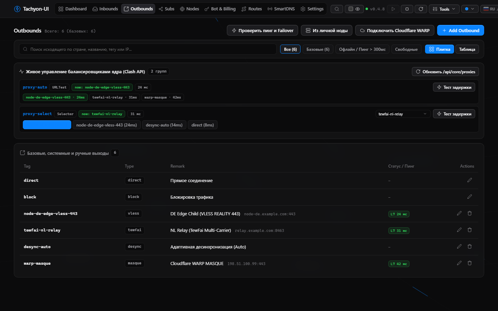 | 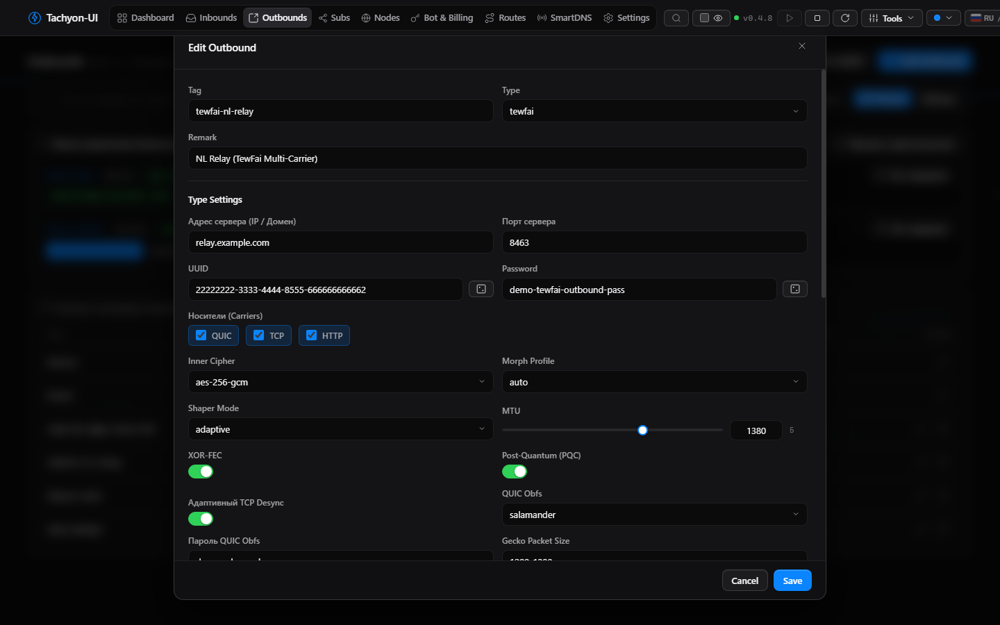 |

Configures all **33 outbound & balancer types** (`direct`, `block`, `dns`, `tewfai`, `vless`, `vmess`, `trojan`, `hysteria2`, `tuic`, `anytls`, `shadowtls`, `shadowsocks`, `wireguard`, `amneziawg`, `masque`, `desync`, `selector`, `urltest`, `fallback`, `loadbalance`, `chain`, `socks`, `http`, `ssh`, `tor`, `bridge`, etc.) plus live Clash API switching.

| UI Control | Location | What & How | Why It Exists | Pitfalls & Notes |
| :--- | :--- | :--- | :--- | :--- |
| **Live Proxies & Latency Panel** | Top of `#outbounds` | Calls `GET /api/core/proxies` to render live `selector` / `urltest` groups with real-time RTT badges (`ms`). | View live gateway health directly from `tachyon-core`. | Only populates while `tachyon-core` is running. |
| **Group Member Click (`Select`)** | Inside live `selector` card | Calls `POST /api/core/proxies/select` to switch the active node inside a `selector` group in memory. | Instant zero-reload egress switching. | Temporary in-memory switch; update the outbound `default` field if you want it persisted across restarts. |
| **Group Delay Probe (`⚡`)** | Live proxy group header | Calls `POST /api/core/proxies/delay` against `https://www.gstatic.com/generate_204` (`5000 ms` timeout). | Measures true L7 proxy latency from the VPS through every pool member. | Red `timeout` entries indicate broken upstream credentials, firewall blocks, or dead relays. |
| **Search, Category Filter, Saved Views & Grid/Table** | Outbounds toolbar | Filters by tag/type/category (`direct`, `proxy`, `balancer`, `wireguard`, etc.) and switches between Pool Card Grid and compact Table. | Navigate large multi-region outbound pools easily. | Supports `Shift+Click` bulk selection for batch delete (`POST /api/outbounds/batch-delete`). |
| **`Run Health Check / Failover`** | Toolbar action | Calls `POST /api/outbounds/health-check` (`{ apply_failover: true }`). | Probes all outbounds (L7 via Clash API, TCP fallback when stopped) and activates failover on dead routes. | Ideal after a regional VPS outage. |
| **`From Managed Node`** | Toolbar action | Opens `#modal-managed-outbound` (`POST /api/nodes/{id}/export-outbound`) to pick a Child node + inbound and auto-create a ready outbound on `Master`. | Eliminates manual copying of UUIDs, REALITY public keys, and ports. | Automatically provisions a `cluster-link-*` service account on the Child node. |
| **`Multi-Clone 1→N`** | Toolbar action | Opens `#modal-multi-clone` to replicate configurations across multiple targets. | Rapid fleet expansion. | Availability of commercial multi-clone modes depends on cluster/grant configuration. |
| **`Connect Cloudflare WARP`** | Toolbar action | Calls `POST /api/core/warp-register` to create `warp-out` automatically. | Instant clean Cloudflare egress for AI/streaming splits. | Does not change global routing until referenced by a rule in **Routes (`Alt+7`)**. |
| **`+ Add Outbound` (`#modal-outbound`)** | Toolbar primary button | Opens the dynamic 33-type Outbound Editor (`onOutTypeChange()`), with preset chips (`TewFai`, `Desync`, `urltest`, `chain`), TLS, Transport, and **Dialer (`detour`, `bind_interface`, `routing_mark`, `tcp_fast_open`, `udp_fragment`)**. | Add upstream proxies, `desync` DPI-bypass exits, `urltest` (12 modes), or multi-hop `chain` outbounds. | Setting `detour` chains traffic through another outbound tag—avoid circular `detour` loops. |
| **Pool / Balancer Cards** | Main content grid | Shows member tags, balancer strategy (`least_test`, `stability`, `failover`, `sticky`, `least_load`, `weighted`, `round_robin`, `passive`, `priority`, `hedged`, `throughput`, `quota`), heat matrix, and Circuit Breaker status. | Visual oversight of failover tiers and traffic distribution. | See [27. Balancers and Chain](protocols/27-balancers-and-chain.md) for all 12 `urltest` strategies. |
| **`Reset Circuit Breaker`** | Pool / Outbound row | Calls `POST /api/core/outbound/reset` (`{ tag, close_sessions: true }`). | Clears a tripped passive circuit breaker and resets stuck sessions after an upstream recovers. | — |
| **`Delete Pool`** | Pool card action | Deletes the balancer (and optionally cleans up linked outbounds via `cleanup_linked: true`). | Clean up retired cascades safely. | Read the confirmation prompt carefully before enabling linked outbound cleanup. |

**Outbound & Balancer Cross-Links:**
[01. TewFai](protocols/01-tewfai.md) · [24. Desync](protocols/24-desync.md) · [25. Hysteria v1](protocols/25-hysteria1.md) · [26. SSH / Tor / Bridge](protocols/26-ssh-tor-bridge.md) · [27. Balancers and Chain](protocols/27-balancers-and-chain.md).

---

### Tab 4 (`Alt+4`): Subscriptions (`#subs`)

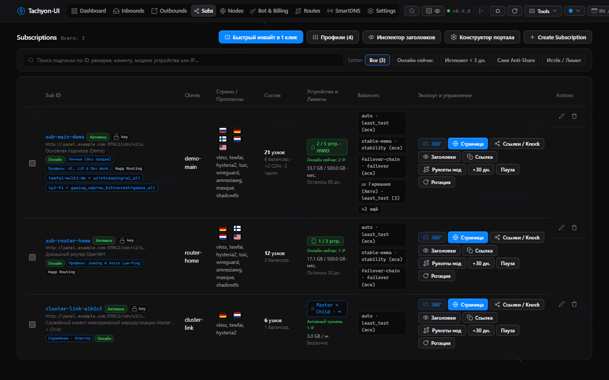

Consolidates local listeners, `Master → Child` cluster nodes, custom CDN entry hosts, balancers, HWID/IP caps, and per-node `.trs` policies into unified client subscriptions and branded portals.

#### Toolbar, Modals & Table Actions

| Screenshot: 1-Click Quick Invite Modal | Screenshot: Links, Covert Knock & QR |
| :--- | :--- |
| 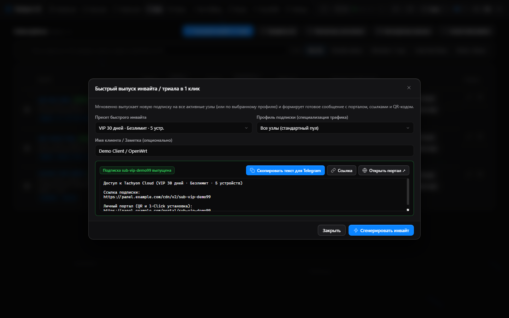 | 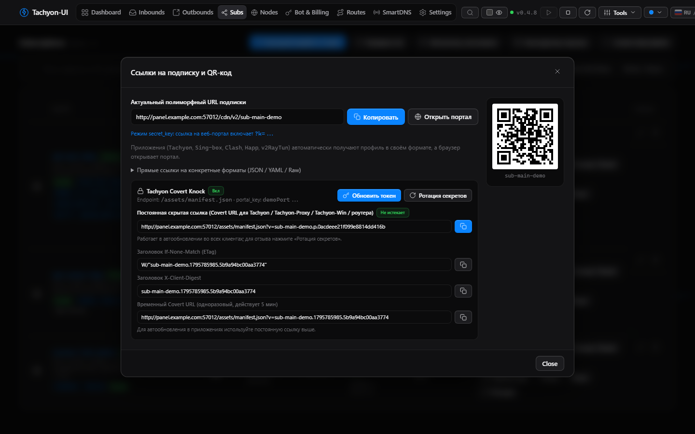 |

| UI Control | Location | What & How | Why It Exists | Pitfalls & Notes |
| :--- | :--- | :--- | :--- | :--- |
| **Search & Saved Views** | Top of `#subs` | Filter by `All`, `Online now`, `Expiring < 3d`, `Anti-Share`, or `Overquota`, or search `sub_id`, remark, client, device, or IP. | Rapid triage of expiring users, quota hits, or sharing abuse. | — |
| **`+ Create Subscription`** | Toolbar primary button | Opens the 5-tab `#modal-sub` editor. | Issue bespoke personal or multi-node commercial subscriptions. | In base mode without an access grant, personal single-subscription aggregation applies. |
| **`+ 1-Click Quick Invite`** | Toolbar action | Opens `#modal-quick-invite` (`POST /api/subs/quick-invite`): pick preset (`24h · 15GB · 2 dev`, `7d · 100GB · 3 dev`, `VIP 30d · Unlim · 5 dev`, `Router/Family 30d · 10 dev`), optional **Subscription Profile**, and **Client/Remark**, then click **Generate Invite**. | Issues a ready-to-paste Telegram share message, direct URL, and portal link in 3 seconds. | Uses all active pool nodes (or the selected profile's node/rule template). |
| **Subscription Profiles (`#modal-sub-profiles`)** | Toolbar button | Manages reusable templates (`Gaming Low-Ping`, `AI & Dev`, `Streaming 4K`, etc.) combining limits, balancers, Happ Routing, and announcements. | Standardizes plans across Quick Invite, Bulk Bar, and Telegram Bot tariffs. | See screenshot 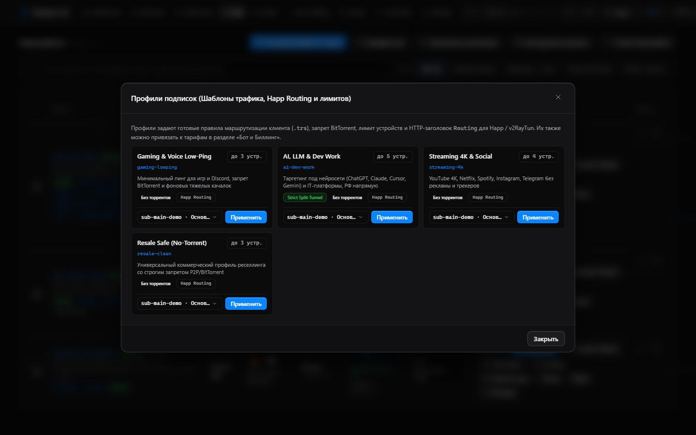. |
| **Header Inspector (`#modal-sub-headers`)** | Toolbar button | Emulates client `User-Agent` strings (`Tachyon`, `Happ`, `Hiddify`, `Shadowrocket`, `Clash`, etc.) via `POST /api/subs/inspect-headers` and displays exact HTTP headers (`Subscription-Userinfo`, `Profile-Update-Interval`, `Routing`) and body. | Debug why a client app hides remaining GB/days or picks the wrong format. | See screenshot 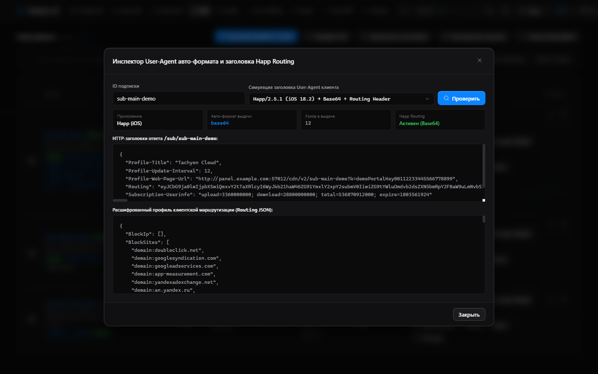. |
| **Portal Builder shortcut** | Toolbar button | Jumps to **Settings → Subscription Page Portal Builder**. | Customize portal layout, logo, accent color, and `sub_portal_guard`. | — |
| **Import External Sub** | Toolbar action | Calls `POST /api/subs/import-external` (`url` / `text`, `country`, emulation `user_agent`, `hwid`). | Pull external configs into local management. | Commercial multi-sub aggregation of external URLs requires a `TACHYON-GRANT-V1` access grant. |
| **Row Checkbox (`Shift+Click`)** | Table left column | Activates the Floating Bulk Bar (`+30d`, Enable/Disable, Apply Profile, Delete via `POST /api/subs/batch-action`). | Bulk renewals and lifecycle management. | — |
| **Row Status, `Online now: N IP` & `cluster-link-*` Badges** | Table cells | Shows active/expired status, combined `↑/↓` traffic, live connected IP count, and `Master → Child · ∞` badge on service tunnels. | Real-time usage visibility without opening each record. | `cluster-link-*` accounts intentionally bypass HWID/device limits (`∞`) so relays never stall. |
| **Row Quick Actions** | Table right column | **Links / QR** (`#modal-sub-links`), **On/Off Toggle**, **`+30d`** (`POST /api/subs/{id}/extend`), **Rotate Link** (`POST /api/subs/{id}/rotate`), **Clear Strikes** (`POST /api/subs/clear-strikes`), **360° Drawer**, **Edit**, **Delete**. | Perform common admin tasks in one click. | **Rotate Link** invalidates leaked URLs immediately; users must re-import the new link. |

#### Links, Covert Knock & 360° Subscription Inspector Drawer

| Links / Covert Knock Modal Controls | What & How | Pitfalls & Notes |
| :--- | :--- | :--- |
| **Format URLs (`?format=...`)** | Copies standard adaptive URL, `?format=singbox` / `tachyon` (`tachyon_json_profile`), `?format=clash` / `mihomo`, `?format=raw`, `?format=sip008`, `?format=openwrt`, and **OpenWrt 1-Click (`?format=openwrt-install`)**. | Use `?format=singbox` or `?format=tachyon` for `tachyon-core` and OpenWrt routers—never raw URI lists if you need `urltest`, `chain`, or `TewFai` multi-carrier profiles. |
| **Covert Knock (`5m Ephemeral` vs `Permanent`)** | Generates HMAC-authenticated knock links (`?v=<sub_id>.p.<hmac24>` for **Permanent** or `If-None-Match` / `X-Client-Digest` `curl` snippets) and **Rotate Secrets** (`POST /api/subs/{id}/rotate-secrets`). | **Always use the Permanent URL** on routers (`OpenWrt` / `Entware`); 5-minute ephemeral tokens will expire on next router cron refresh. |
| **QR Code & Web Portal** | Scannable QR and direct portal link (automatically appends `?k=<portal_key>` when `sub_portal_guard = secret_key`). | With Privacy Mask (`Alt+P`) active, QR codes are blurred visually. |

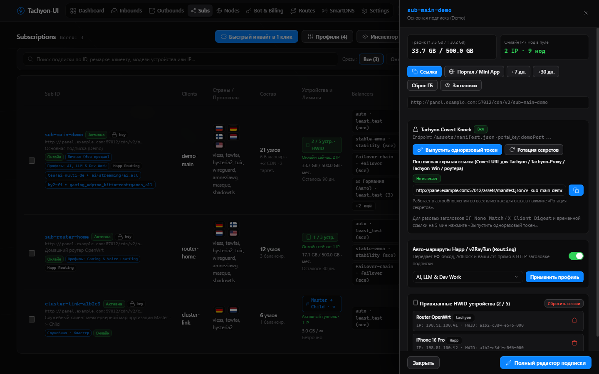

Click any `sub_id` to open the **480 px 360° Inspector Drawer** (`#gpui-sub-drawer-overlay`) showing live `↑/↓` quota bars, `Online now: N IP`, **Reset Sessions**, **Happ Routing** toggle, **Profile** switcher, embedded **Covert Knock** generator, and bound **HWID Device Cards** with 1-click **Unbind**.

#### The 5-Tab Subscription Editor (`#modal-sub`)

| Tab 1: Nodes | Tab 2: Balancers | Tab 3: Devices & Limits |
| :--- | :--- | :--- |
| 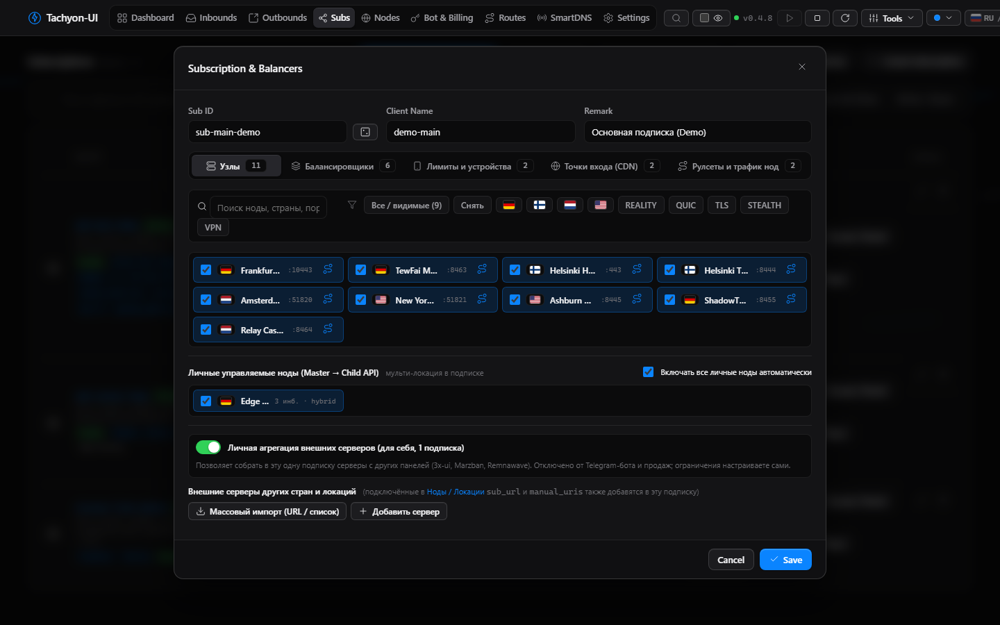 | 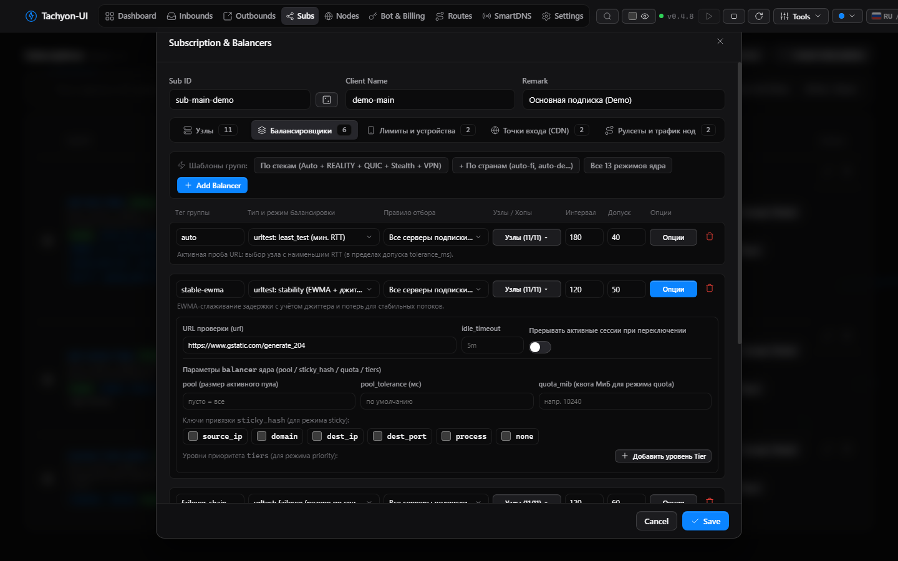 | 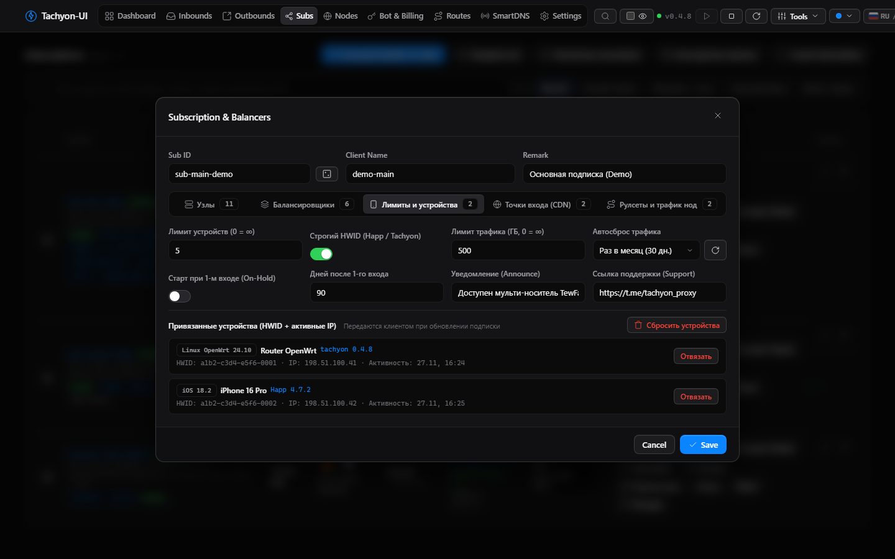 |
| **Tab 4: Entry Hosts / CDN** | **Tab 5: Node Rules & Strict Routing** | |
| 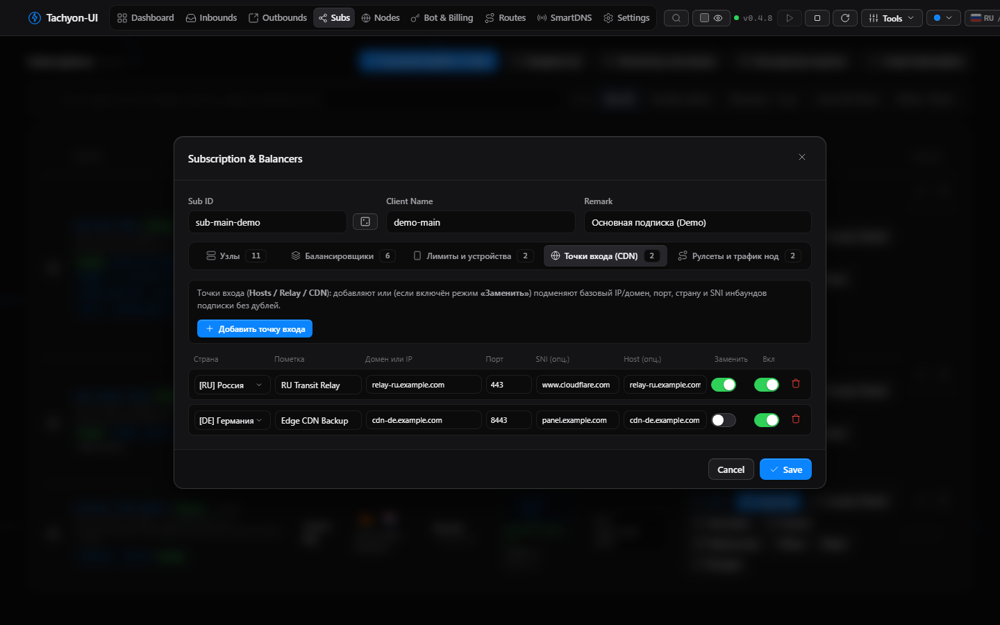 | 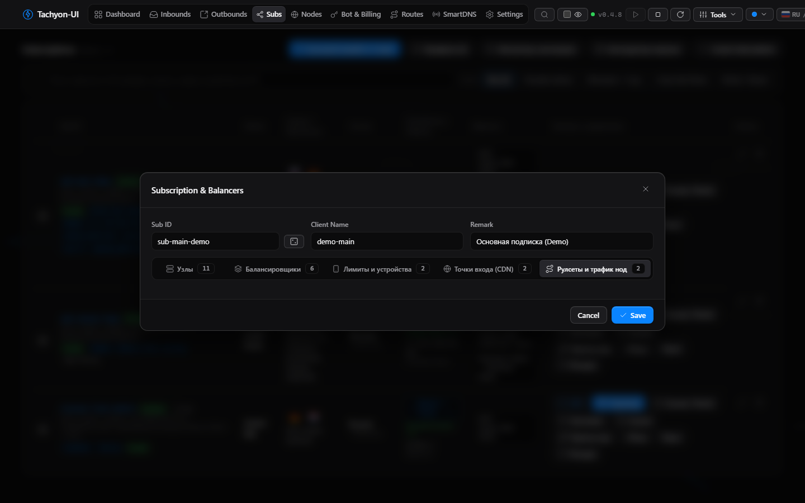 | |

| Modal Tab (`#sub-modal-pane-0..4`) | Controls & Fields | Why It Exists & Pitfalls |
| :--- | :--- | :--- |
| **0: Nodes (`#sub-modal-pane-0`)** | `sub_id` (supports atomic in-place rename via `old_sub_id`), `remark`, **Subscription Profile** selector, local inbound chips (filterable by country/stack + inline route icon), and **Managed Cluster Nodes** (`direct`/`hybrid`). | Renaming `sub_id` atomically updates clients, Telegram bot bindings, and clusters (`409` if target `sub_id` exists). `relay`-only nodes are intentionally hidden from direct client lists. |
| **1: Balancers (`#sub-modal-pane-1`)** | **+ Add Balancer**, 1-click **Stack / Country presets** (`auto`, `auto-fi`, `auto-de`, `auto-nl`), strategy (`urltest` 12 modes, `selector`, `fallback`, `loadbalance`, `chain`), member selector, country filter. | Generates native client auto-selection groups for `tachyon-core`, Clash/Mihomo, and Happ. |
| **2: Devices & Limits (`#sub-modal-pane-2`)** | Traffic limit (GB) + **Reset Traffic** (`POST /api/subs/{id}/reset-traffic`), expiry date / On-Hold (`start_on_first_use` + `expire_duration_days`), `traffic_reset_strategy` (`none`/`daily`/`weekly`/`monthly`), `device_limit`, `strict_hwid`, bound **HWID Devices List** (`Unbind` single / `Clear All`). | Enabling `strict_hwid` behind `Unified 443 Front` is strongly recommended since clients without `x-hwid` share reduced IP-level Anti-Share granularity behind local NGINX. |
| **3: Entry Hosts / CDN (`#sub-modal-pane-3`)** | **+ Add Host / CDN**: overrides public host, port, country, `SNI`, `Host` header, and **Replace (`replace_default`)** toggle. | Routes traffic through Cloudflare CDN domains, SNI mirrors, or transit relays. Leave **Replace** off to emit both direct and CDN entries. |
| **4: Node Rules (`#sub-modal-pane-4`)** | 1-click presets (`No BitTorrent`, `YouTube + Discord only`, `AI only`, etc.), **+ Add Node Rule**, **Happ Routing** toggle (`happ_routing_enabled`), and **`strict_routing_only`**. | `strict_routing_only` forces unmatched traffic to `direct` and enforces allowed `.trs`/port policies server-side even if a user extracts a raw URI. |

---

### Tab 5 (`Alt+5`): Nodes (`#nodes`)

| Cluster Overview & Cascade | Add Node Modal (`#modal-node`) |
| :--- | :--- |
| 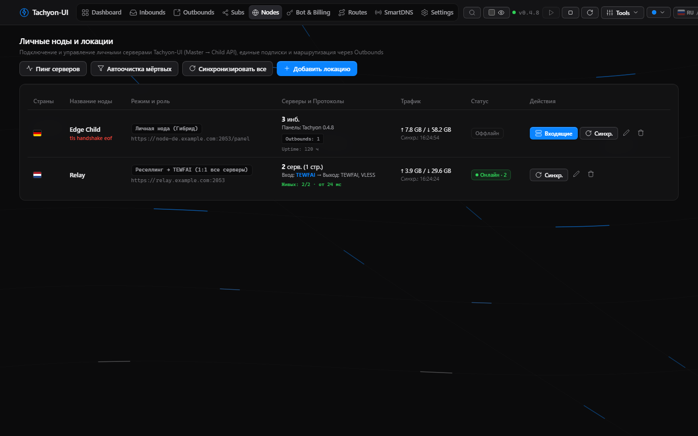 | 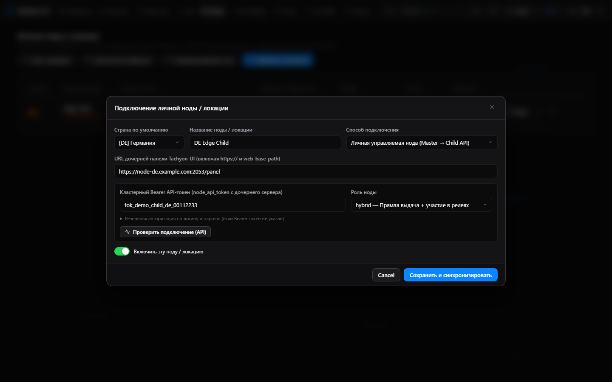 |
| 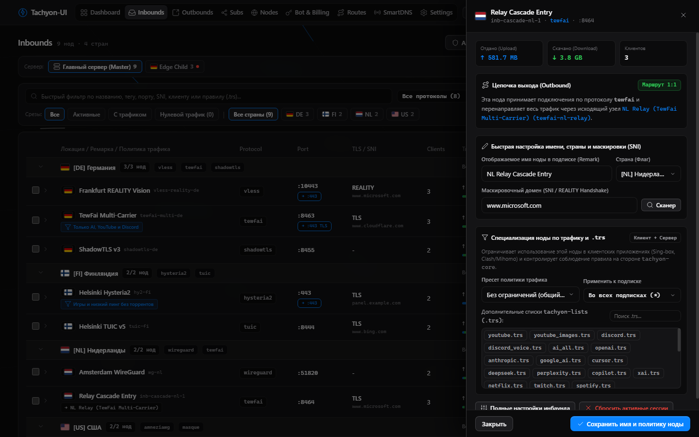 | |

Connects secondary VPS servers (`Master → Child`), read-only Tachyon peers, and external upstream subscriptions into a unified geo-distributed cluster.

| UI Control | Location | What & How | Why It Exists | Pitfalls & Notes |
| :--- | :--- | :--- | :--- | :--- |
| **Access Grant / Base Mode Banner** | Top of `#nodes` | Displays whether full commercial reselling / multi-node aggregation (`sub_url`, `manual_uris`, `1→N` clone) is active or in personal base mode. | Clarifies available cluster vs. third-party aggregation capabilities. | Own `Master → Child` clusters (`managed_tachyon_node`) and `tachyon_node` work out of the box with **no access grant required**. |
| **`Sync All`** | Toolbar | Calls `POST /api/nodes/sync` (`{ id: 0 }`) across all configured remote nodes. | Pulls updated inbound lists, keys, and ports cluster-wide. | Run after rotating ports or SNIs on remote servers. |
| **`Health Check All` / `Auto-Clean`** | Toolbar | Calls `POST /api/nodes/health-check` (`{ id: 0, auto_clean }`). | Tests node reachability and latency; `auto_clean: true` prunes dead external nodes. | Avoid `auto_clean` while a managed VPS is undergoing planned maintenance. |
| **`+ Add Node` (`#modal-node`)** | Toolbar primary button | Opens the 4-mode Node Modal (`onNodeModeChange()`). | Add a managed Child server, read-only Tachyon node, external sub URL, or raw URI list. | See the 4 modes table below. |
| **Node Card Actions** | Each node card | **Sync**, **Inspect / Inbounds** (switches `#inbounds` context to that Child), **Sync Clients**, **Export to Outbound**, **Bridge / Cascade** (`#modal-cascade`), **Multi-Clone 1→N**, **Edit**, **Delete**. | Complete remote lifecycle management from `Master`. | Deleting a node removes its exported outbounds and cluster bindings on `Master`. |
| **Cascade Builder (`#modal-cascade`)** | Node card / `#inbounds` | Pick **Entry Node/Inbound** (e.g., local bridge) + **Target Exit Outbound/Node**, configure reseller/tag options, click **Preview** (`POST /api/cascade/preview`), then **Create Cascade** (`POST /api/cascade`). | Atomically creates inbound, outbound, and 1:1 relay routing rules with port-conflict checking. | Always run **Preview** before saving so you can inspect the exact generated tags and ports. |

#### All 4 Node Modes in `#modal-node`

| Mode | Required Inputs | Key Buttons & Behavior | Notes & Permissions |
| :--- | :--- | :--- | :--- |
| **1. `managed_tachyon_node`** *(Master → Child API)* | Child URL (including `web_base_path`), `node_api_token` (or admin creds), Role (`direct`, `hybrid`, `relay`), `auto_export_outbounds`. | **Test API** (`POST /api/nodes/test-managed`), **Manage Inbounds**, **Sync Clients** (`sub_configs` + HWID + device limits). | **No access grant required.** `relay` hides nodes from direct client exports and uses them purely as `Master` relay outbounds. |
| **2. `tachyon_node`** *(Read-Only Pull)* | Base URL + `remote_sub_id` (or full `/sub/<id>` / `/cdn/v2/<id>` link). | Periodic read-only pull of endpoints from another `tachyon-ui` server. | **No access grant required** for personal/read-only node import. |
| **3. `sub_url`** *(External Subscription URL)* | External URL, country, emulation headers (`User-Agent`, `x-hwid`, `x-device-os`, `x-device-model`). | Imports and periodically refreshes third-party subscriptions (`Base64`, `Clash`, `URI`). | Commercial multi-sub aggregation/reselling requires a host-bound `TACHYON-GRANT-V1` access grant. |
| **4. `manual_uris`** *(Manual URI List)* | Multi-line paste of `vless://`, `vmess://`, `trojan://`, `hy2://`, `ss://`, etc. | Parses raw URIs directly into outbounds/locations. | Commercial aggregation/reselling requires a host-bound access grant. |

---

### Tab 6 (`Alt+6`): Bot & Billing (`#tgbot`)

| Bot, Billing & Live Simulator | Plans & Vouchers Modal |
| :--- | :--- |
| 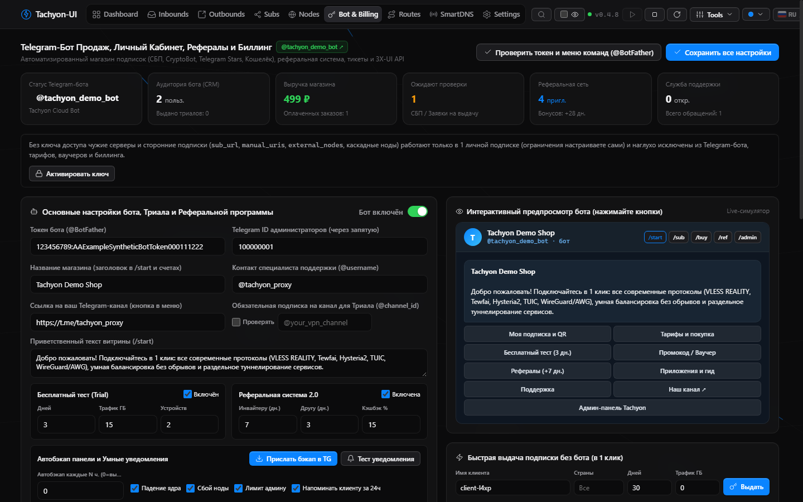 | 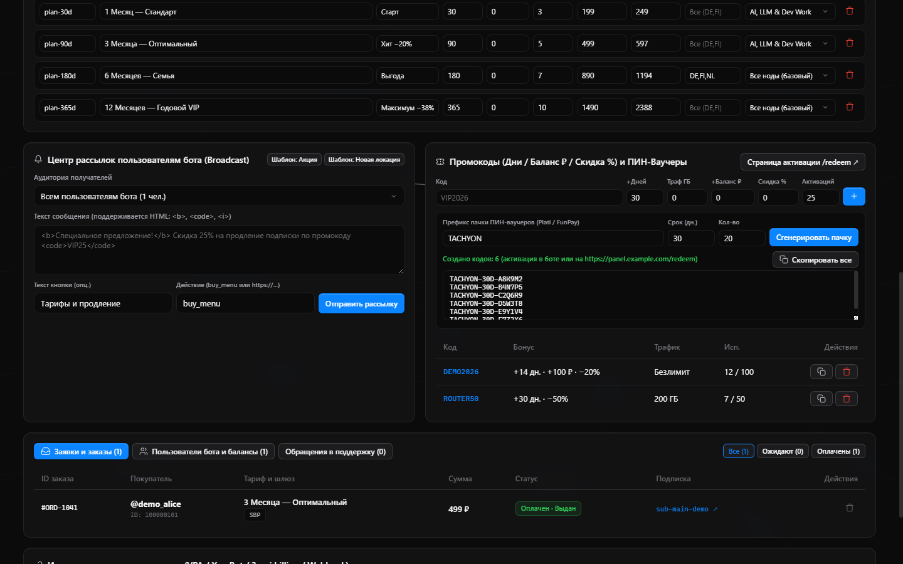 |

Built-in zero-dependency Telegram storefront, Mini App backend, automated trial/referral engine, voucher generator, broadcast center, and 3-tab CRM.

| UI Control | Location | What & How | Why It Exists | Pitfalls & Notes |
| :--- | :--- | :--- | :--- | :--- |
| **KPI Row** | Top of `#tgbot` | Live counters for **Active Bot Users**, **Pending Orders**, **Revenue**, and **Open Tickets**. | Monitor storefront performance and support queue at a glance. | — |
| **Bot Token + `Verify Token & Save`** | Bot Settings card | Paste `@BotFather` token and click **Verify** (`POST /api/tg-bot/verify`); configure `admin_tg_ids` and polling/webhook mode. | Validates Bot API credentials before going live. | Ensure `admin_tg_ids` contains your numeric Telegram User ID so `/admin` works. |
| **Trial & Referral Controls** | Bot Settings card | Set `trial_days`, `trial_traffic_gb`, `trial_device_limit`, `trial_template_sub_id`, optional channel subscription gate (`require_channel_sub`), and referral bonus days / cashback %. | Automates user acquisition and viral referrals. | Make the bot an admin in the required channel if `require_channel_sub` is enabled. |
| **Telegram Auto-Backup & Admin Alerts** | Bot Settings card | Toggle scheduled Telegram DB backups + **`Backup Now`** (`POST /api/tg-bot/backup-now`); toggle admin alerts (core crashes, dead nodes, quota hits, 24h expiry, Zero-Traffic Watchdog) + **`Test Alert`** (`POST /api/tg-bot/test-alert`). | Off-site backup delivery and instant outage alerts in Telegram. | Test alerts immediately after saving `admin_tg_ids`. |
| **Mini App Settings** | Bot Settings card | Configure Mini App URL/path and theme behavior inside Telegram WebApp. | Native in-Telegram client portal for renewals and key copying. | Requires valid HTTPS TLS; authenticates via signed `tgWebAppData` even when `sub_portal_guard = secret_key`. |
| **Live Bot Simulator (`#bot-sim-*`)** | Right column of `#tgbot` | Interactive clickable Telegram preview (`/start`, `Buy`, `My Profile`, `Connect`, `Support`) updating in real time as you edit `shop_title`, `welcome_text`, tariffs, and gateways. | Proofread flows, prices, and button layouts before customers see them. | Runs locally against your current draft before saving. |
| **1-Click Subscription Issue** | Billing quick card | Enter client name, days, traffic (GB), country filter, and click **Issue Subscription** (`POST /api/billing/issue-sub`). | Instant manual order fulfillment without bot checkout. | — |
| **Payment Gateways** | Billing Settings | Configure **SBP / Card** details, **CryptoBot** token/currencies, **Telegram Stars** (exchange rate + toggle), and **Custom Payment Link**. | Accept automated crypto/Stars or manual bank transfers. | Manual SBP orders land in **CRM → Orders** for 1-click admin approval. |
| **Tariff Grid & Plan Editor** | Plans section | Add/edit/delete plans (title, days, GB, RUB/USD/Stars price, max devices, linked **Subscription Profile**) or click **Fill Recommended Presets** (`1m / 3m / 1y`). | Controls bot storefront pricing and automated provisioning. | Bind plans to **Subscription Profiles** so buyers inherit balancers and `.trs` rules automatically. |
| **Broadcast Center** | Marketing section | Enter `message`, select target `segment` (`All`, `Active Sub`, `No Sub`, `Expired`), optional inline button (`btn_label`, `btn_url`), and click **Send Broadcast** (`POST /api/tg-bot/broadcast`). | Send announcements or promo campaigns directly via the bot. | Double-check `segment` before sending so active paying subscribers don't receive trial promos. |
| **Promo Codes & Batch Voucher Generator** | Vouchers section | Create discount/bonus promo codes (`POST /api/tg-bot/promo`) or batch-generate single-use gift/partner vouchers (`prefix`, `days`, `count` → `POST /api/vouchers/batch`). | Run promotions or distribute offline/reseller access codes. | Vouchers redeem via `/redeem` in the bot or the web `redeem_path`. |
| **3-Tab CRM (`#tg-crm-*`: Orders / Users / Tickets)** | Lower `#tgbot` | **Orders:** Approve (`POST /api/tg-bot/orders/{id}/approve`), Reject, Delete. **Users:** Search by TG ID/username, adjust balance/days/ban (`POST /api/tg-bot/users/adjust`), send DM. **Tickets:** Reply in-panel (`POST /api/tg-bot/send-message`) or close/delete ticket. | Complete customer support and order moderation inside `tachyon-ui`. | Approving a pending order automatically provisions or extends the user's subscription. |
| **External Webhook Card** | Bottom of `#tgbot` | Configures `X-Webhook-Secret` and external billing event integration. | Connect third-party storefronts or scripts to `POST /api/billing/issue-sub`. | Keep the webhook secret private. |

---

### Tab 7 (`Alt+7`): Routes (`#routes`)

| Flow Topology Map & Rules | 2-Tier Route Simulator | Add / Edit Route Rule Modal |
| :--- | :--- | :--- |
| 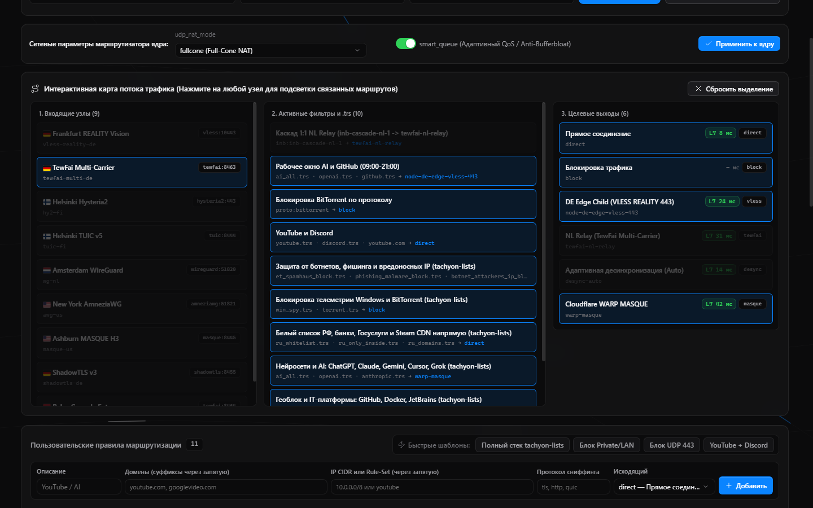 | 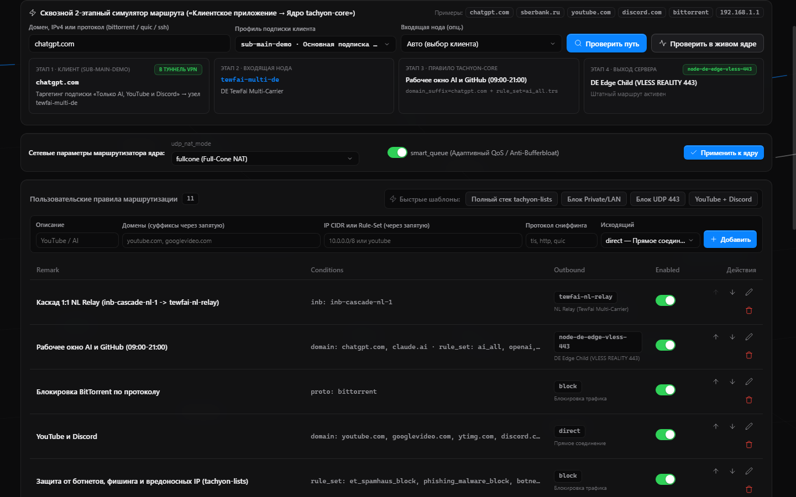 | 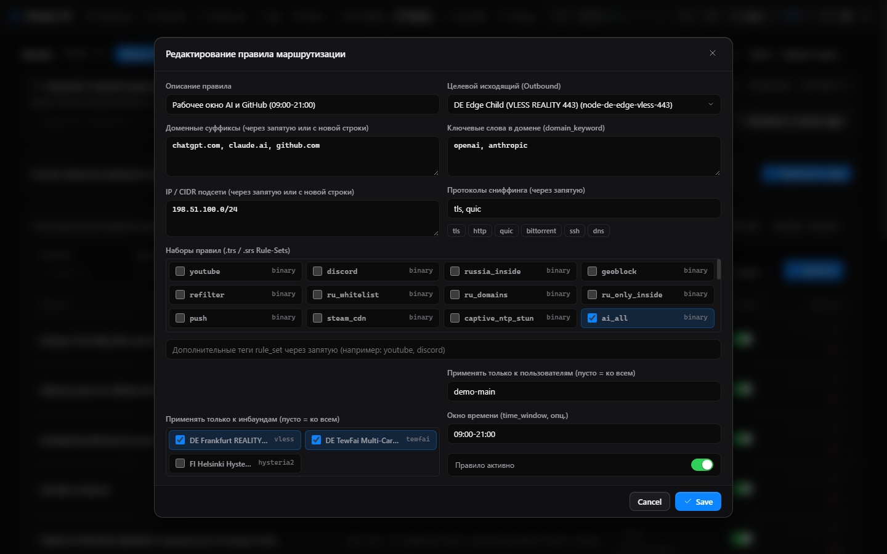 |

Controls `tachyon-core` server-side traffic routing, binary `.trs` rule-sets, traffic shaping flags, and two-tier path verification.

| UI Control | Location | What & How | Why It Exists | Pitfalls & Notes |
| :--- | :--- | :--- | :--- | :--- |
| **`Table / Flow Map` Switcher** | Top of `#routes` | Switches between ordered rule table and the interactive **3-Column Flow Topology Map** (`Inbound → Rule / Balancer → Outbound`). | Visually spot shadowed rules or accidental leaks at a glance. | Click nodes/edges in Flow Map to inspect paths or block domains. |
| **Global Core Flags (`udp_nat_mode`, `smart_queue`)** | Route header bar | Sets UDP NAT mode (`""`, `fullcone`, `eim_eif`, `symmetric`) and `smart_queue` interactive packet prioritization (`PUT /api/routes`). | Improves gaming/VoIP/QUIC NAT compatibility and reduces bufferbloat under load. | Requires **Apply Changes** to take effect in `tachyon-core`. |
| **Rule Search** | Filter bar | Filters rules by domain, `.trs` tag, inbound tag, or target outbound. | Locate rules quickly in complex splits. | — |
| **Final Outbound (`final`)** | Route header bar | Sets the default fallback outbound (`direct`, `block`, or any proxy/balancer) for unmatched traffic. | Defines allowlist vs. blocklist routing posture. | Setting `final: block` drops all unmatched traffic—test thoroughly with the Simulator before applying. |
| **1:1 Auto-Relay Bindings Spoiler** | Collapsible bar | Hides/reveals auto-generated 1:1 cascade/bridge routing bindings (`renderRoutesRelayGridHTML()`). | Keeps operator rules clean without losing visibility into bridge bindings. | Expand only when debugging a specific cascade bridge. |
| **`Install tachyon-lists Pack`** | Rule-sets toolbar | Calls `POST /api/routes/tachyon-lists-pack` to install curated `mmap`-backed binary `.trs` rule-sets (regional services, blocked domains, ads, AI, streaming). | Ready-made split tunneling in one click. | Requires **Apply Changes** to compile/load into `tachyon-core`. |
| **`+ Add Rule` (`#modal-route-rule`)** | Rules toolbar | Configures priority order, `inbound`, `auth_user`, `domain`, `domain_suffix`, `domain_keyword`, `ip_cidr`, `port`, `protocol`, `network` (`tcp`/`udp`), `rule_set` (`.trs`), `time_window` (e.g. `mon-fri 09:00-22:00`), and target `outbound`. | Fine-grained traffic steering and blocking. | **First match wins** top-to-bottom—put specific domain/block rules above broad GeoIP/country rules. |
| **`+ Add Rule Set` (`#modal-rule-set`)** | Rule Sets section | Registers local or remote `.srs`/`.trs`/`.json` rule-sets (`type: local | remote`, `format: binary | source`, `url`/path, `download_detour`, `update_interval`). | Attach external or custom compiled domain/IP lists. | If the remote list URL is blocked from the VPS directly, set `download_detour` to a working proxy outbound. |
| **Priority Arrows (`↑`/`↓`), Toggle, Edit, Delete** | Each rule row | Reorders evaluation precedence, temporarily disables, edits, or removes a rule. | Safe iterative rule tuning. | Always click **Save / Apply Changes** after reordering. |
| **2-Tier Route Simulator + `Test in Live Core`** | Top simulator bar | Enter `target` (domain/IP), optional `sub_id`, and optional `inbound_tag`: **Simulate** (`POST /api/routes/simulate`) evaluates offline panel rules; **Test in Live Core** (`POST /api/core/route-check`) traces inside running `tachyon-core`. | Compare intended panel rules against what `tachyon-core` actually compiled and executes. | If Tier 1 matches your rule but Tier 2 still uses `final`, you forgot to click **Apply Changes**. |

---

### Tab 8 (`Alt+8`): SmartDNS (`#smartdns`)

| SmartDNS Overview & Quick Connect | 4-Step SmartDNS Setup Wizard |
| :--- | :--- |
| 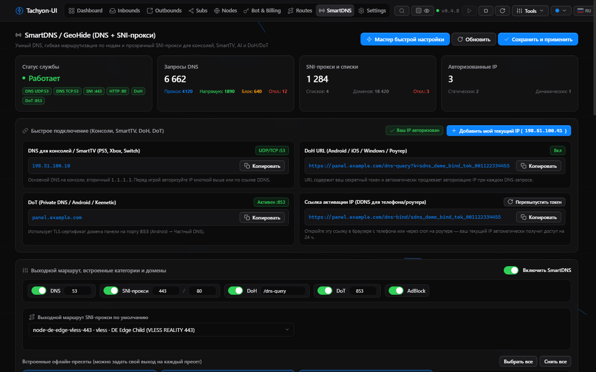 | 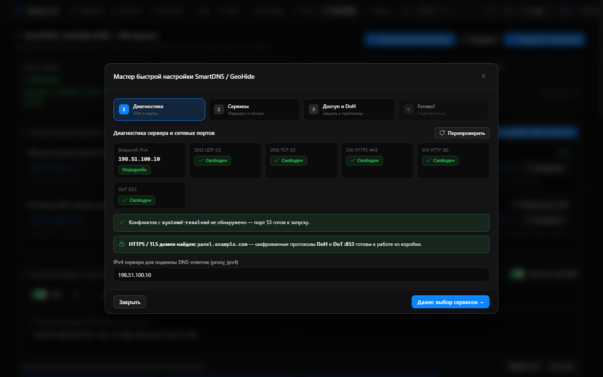 |

Zero-client-app **GeoHide** DNS (`:53`), DoT (`:853`), DoH (`/dns-query`), and SNI Proxy (`:443` / `:80`) for PlayStation, Xbox, Nintendo Switch, SmartTVs, and routers.

| UI Control | Location | What & How | Why It Exists | Pitfalls & Notes |
| :--- | :--- | :--- | :--- | :--- |
| **Port / Conflict Warning Banner** | Top of `#smartdns` | Alerts on port `:53` conflicts (`systemd-resolved`), missing TLS certs for DoH/DoT, or missing egress gateway. | Explains immediately why devices fail to connect. | On `Unified 443 Front`, `:443/tcp` is owned by NGINX—run SmartDNS SNI Proxy `:443/:80` on a dedicated VPS or rely on `:53` / DoT `:853` / panel-port DoH. |
| **4 Listener KPI Cards** | Top grid | Shows live bind status for **DNS `:53`**, **DoT `:853`**, **DoH**, and **SNI Proxy / Served Domains**. | Confirms every DNS/SNI listener is bound cleanly. | Green indicates active sockets without conflicts. |
| **`Bind My IP` (Temporary / Permanent)** | Quick Connect card | Calls `POST /api/smart-dns/bind-my-ip` (`{ permanent }`) to whitelist the admin's current public IP without typing. | Authorizes your home network immediately while keeping `allow_public = false`. | **Important:** When `Unified 443 Front` is active, open `/dns-bind/<token>` on the **direct panel port** (not `:443` NGINX) so the panel sees your real IP instead of `127.0.0.1`. |
| **Quick Connect Box & Token Rotation** | Quick Connect card | Displays `IP:53`, `DoT host:853`, full `DoH URL`, **DDNS Bind URL**, and **Rotate Token** (`POST /api/smart-dns/rotate-token`). | Copy-ready connection strings for consoles, TVs, phones, and routers. | Rotate the token immediately if a personal DoH or DDNS Bind URL leaks. |
| **`Without https://` Copy Button** | Quick Connect & Wizard Step 4 | Copies the DoH address **without** the `https://` scheme (`domain.tld/dns-query?...`). | **Keenetic**, **OpenWrt**, and several router firmwares prepend `https://` automatically or split host + path—pasting `https://...` breaks DoH on them. | Use **Without https://** specifically for router DoH fields. |
| **Service Toggles, Ports & `upstream_dns`** | Services card | Enables/disables SmartDNS, sets ports (`53`, `853`, `443`/`80`), DoH path, and fallback `upstream_dns` (e.g., `1.1.1.1` / `9.9.9.9`). | Controls listening sockets and non-proxied DNS resolution. | — |
| **Global Egress & Export Managed Node Egress** | Egress card | Picks default egress (`direct` or outbound) plus 1-click **Export Node to Egress** (`POST /api/smart-dns/export-node-egress`). | Routes SNI-proxied console/TV traffic through a Child VPS in another country. | — |
| **6 Built-In Presets (Per-Preset Egress)** | Presets grid | Toggle cards for AI/ChatGPT, Streaming, Social, Gaming, Dev/Cloud, Geo-Bypass—each with its own independent egress selector. | Route AI through one region and streaming through another simultaneously. | — |
| **`tachyon-lists` Catalog & Custom AdBlock / Hosts** | Catalog card | Syncs (`POST /api/smart-dns/lists/sync`), toggles `.trs`/AdBlock lists, and adds custom domain overrides or `/etc/hosts`-style mappings. | Network-wide DNS ad-blocking and bespoke domain routing. | — |
| **Access Control (`allow_public`, Static CIDR, Dynamic IPs)** | Security card | Manages static allowed IPs/CIDRs, removes dynamic IPs (`DELETE /api/smart-dns/dynamic-ip/{ip}`), and toggles `allow_public`. | Prevents unauthorized users from abusing your server. | **Never** enable `allow_public` on public `:53/udp` without firewall restrictions—it turns your VPS into an open DNS amplification reflector. |
| **Live DNS / SNI Log** | Bottom card | Searchable/filterable stream of recent DNS and SNI proxy requests with matched action. | Verify that your SmartTV or console is actually querying this SmartDNS server. | — |
| **4-Step SmartDNS Setup Wizard (`#modal-smartdns-wizard`)** | Top button | Guided 4-step setup (`console_tv` / `ai_work` / `full_geohide` / `adblock_only` → Egress → Presets & AdBlock → Copy Credentials + `Without https://`). | Zero-to-working SmartDNS configuration in under 60 seconds. | — |

---

### Tab 9 (`Alt+9`): Settings (`#settings`)

| Wizard Step 1: Public Site | Wizard Step 2: Domain & Unified 443 | Wizard Steps 3–4: Isolation & Self-Audit |
| :--- | :--- | :--- |
| 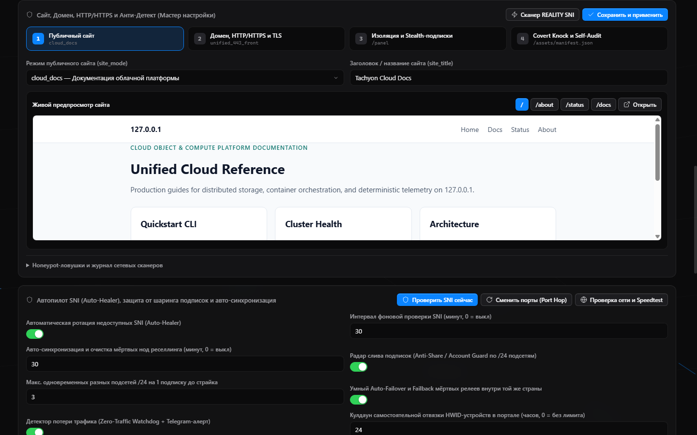 | 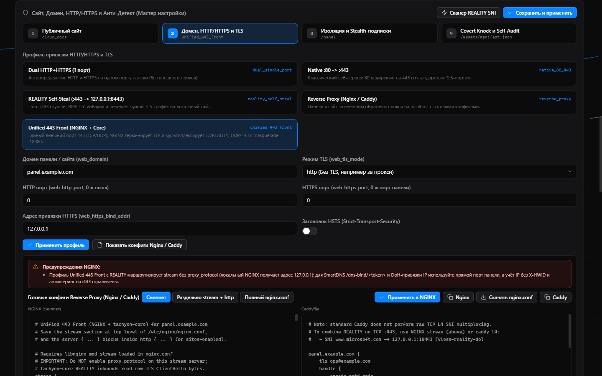 | 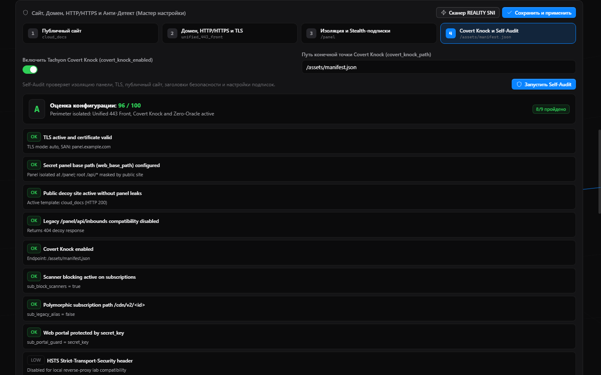 |
| **Firewall, 16 Themes & Updates** | | |
| 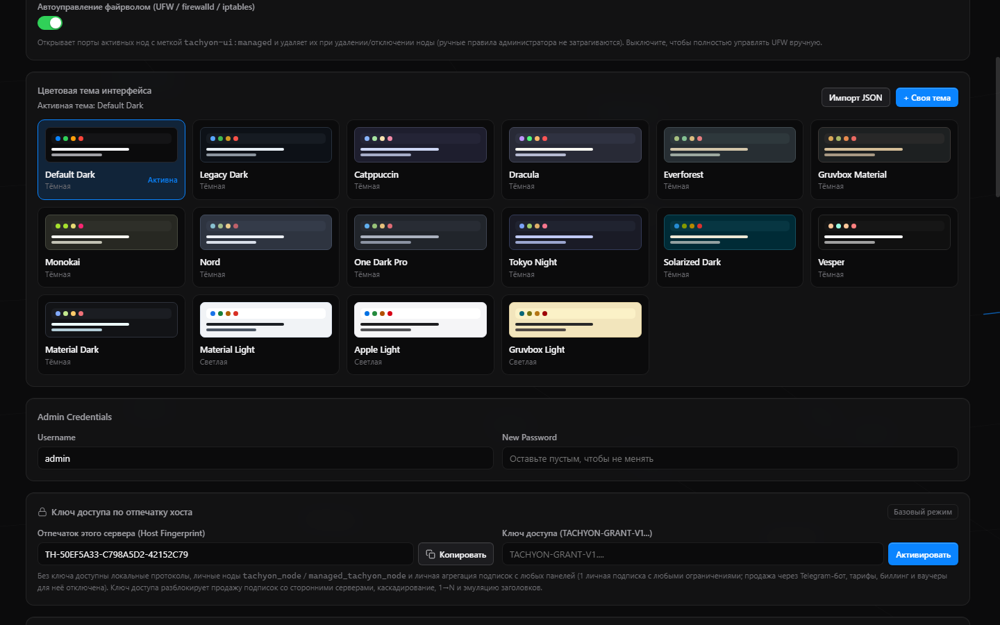 | | |

#### Top Action Bar, Panel, Security, Firewall & Access Grant Cards

| UI Control | Location | What & How | Why It Exists | Pitfalls & Notes |
| :--- | :--- | :--- | :--- | :--- |
| **Top Action Bar** | Header & footer of `#settings` | **Download Backup (.json)** (`GET /api/backup`), **Restore Backup** (`POST /api/restore`), **Config Preview** (`#modal-config`), and **Apply Changes** (`PUT /api/settings`). | Full JSON state export/import and configuration persistence. | Backups contain private keys and credentials—store encrypted off-server. |
| **Panel Settings & Auto-Firewall** | Panel card | `listen_port`, `core_bin_path` (+ **Update from GitHub** button), `public_host`, `log_level` (`info`/`debug`/`warn`/`error`), **UI Width** (`Compact 1360px` / `Full Width`), **Privacy Mask (`Alt+P`)** toggle, and **`auto_firewall_enabled`** (`UFW` / `firewalld` / `iptables` rule sync tagged `tachyon-ui:managed`). | Manages core panel bindings, layout width, and automatic port opening/closing. | Confirm SSH (`22` or custom port) is allowed before enabling strict host firewall rules. |
| **Interface Color Theme** | Themes card | 16 built-in themes + custom themes + **Import JSON** + **`+ Custom Theme`** (`#theme-builder-overlay`). | Mirrors the Topbar theme studio inside Settings. | See [Section 4](#4-16-built-in-themes--live-theme-builder). |
| **Admin Credentials** | Security card | Update `admin_user` and `new_password` (leave password blank to keep current). | Replace installer-generated credentials. | Changing credentials may require signing in again. |
| **Access Grant (`TACHYON-GRANT-V1`)** | Security card *(visible when enabled)* | Displays read-only **Host Fingerprint** (`--host-fp`) + copy button, `TACHYON-GRANT-V1...` token input, **Activate** (`PUT /api/access-grant`), and **Reset** (`token: ""`). | Unlocks commercial multi-sub reselling of external URLs, `1→N` fleet cloning, commercial TG bot sales with external nodes, and header emulation. | Bound strictly to the server's hardware/host fingerprint—contact the developer with your `--host-fp` to obtain one. |
| **Cluster API (`Master → Child API`)** | Cluster card | Displays `instance_id` and `node_api_token` (with **Copy** and **Rotate** `POST /api/settings/rotate-node-token`). | Authenticates `Master` servers connecting to this node as a managed Child. | After rotating `node_api_token`, update it on `Master` in **Nodes (`Alt+5`)**. |

#### 4-Step Stealth Web Masking Wizard (`#stealth-web-wizard`, `#sw-step-*`)

| Wizard Step | Controls & Actions | What & How | Pitfalls & Notes |
| :--- | :--- | :--- | :--- |
| **Step 1: Public Website (`SiteEngine`) & Honeypot** | `site_mode` (`blank_nginx`, `cloud_docs`, `status_page`, `devops_blog`, `corporate_it`, `maintenance`, `custom_static`), `site_title`, **Upload `.zip`** (`<= 15 MiB` compressed / `<= 50 MiB` uncompressed / `<= 500` files), inline `index.html` editor + **Load / Save / Delete Custom Site**, **Live Preview `<iframe>`** (`/`, `/about`, `/status`, `/docs`), and **Honeypot** toggle + **Honeypot Log** / **Clear**. | Serves a believable public site on `/` and traps vulnerability scanners hitting `/.env`, `/wp-admin`, or `/phpmyadmin`. | ZIP extractor blocks path traversal, symlinks, and executables. |
| **Step 2: Domain, HTTP/HTTPS & TLS/ACME** | 5 binding profiles (`dual_single_port`, `native_80_443`, `reality_self_steal`, `reverse_proxy`, `unified_443_front`), `web_domain`, `web_tls_mode`, `web_http_port`, `web_https_port`, `web_https_bind_addr`, `HSTS` toggle, **Apply Profile**, **Show Nginx / Caddy Configs** (`Snippet / Split / Full nginx.conf`, **Apply to NGINX**, `nginx_managed`, `nginx_reload_after_acme`), **TLS & ACME** (`tls_domain`, `tls_acme_email`, `http01` vs Cloudflare `dns01`, `acme_auto_renew`, **Issue SAN Self-Signed**, **Issue ACME Certificate**, **Check Certificate**). | Consolidates decoy site, panel, subscriptions, L7 transports, and REALITY onto `:443` with automated HTTPS certificates. | `Unified 443 Front` omits `proxy_protocol on;` in `stream { ... }` intentionally so `tachyon-core` receives raw REALITY `ClientHello` packets. |
| **Step 3: Panel Isolation & Stealth Subscriptions** | `web_base_path` + **Random `/p-...`** button, `sub_path_style` (`sub`, `static_feed`, `cdn_v2`, `rss_updates`), `sub_path`, `sub_portal_guard` (`open`, `secret_key`), `sub_legacy_alias`, `sub_block_scanners`, `enable_3xui_compat_api`, and `redeem_path`. | Removes admin endpoints from predictable paths (`/`, `/login`, `/api/*`) and blocks automated subscription scrapers. | Bookmark your new `web_base_path` before saving; keep `enable_3xui_compat_api` off unless needed. |
| **Step 4: Covert Knock & Web Self-Audit** | `covert_knock_enabled`, `covert_knock_path` (e.g., `/assets/manifest.json`), and **Run Self-Audit** (`POST /api/web/self-audit`). | Evaluates panel isolation, TLS headers, decoy responses, and subscription stealth externally, scoring `0–100` (`A+`). | Always run Self-Audit after modifying Steps 1–3. |

#### Automation, Cloudflare DNS, Portal Builder & Default Client Template Cards

| Card | Controls & Fields | Why It Exists & Pitfalls |
| :--- | :--- | :--- |
| **Auto-Healer, Anti-Share, Failover & Watchdog** | **Check SNI Now**, **Port Hop**, **Network Check & Speedtest** buttons; `auto_heal_enabled` + interval (`mins`); `reseller_auto_sync_mins`; `anti_share_enabled` + `anti_share_max_subnets` (`/24` subnets before strike); `relay_auto_failover`; `tspu_watchdog_enabled` (Zero-Traffic Watchdog + TG alert); `sub_unbind_cooldown_hours`. | Autonomous 24/7 self-healing and sharing radar. Setting `anti_share_max_subnets = 1` may trigger false strikes on mobile phones switching between Wi-Fi and LTE/5G. |
| **Cloudflare DNS API** | `cf_token` (`Zone.DNS Edit`), `cf_zone_id`, `cf_record_name`, `cf_backup_ips`, **Load Zone Records**, **Update A Record (DNS Only)**, **Enable Cloudflare Proxy (CDN)**. | Instant DNS failover across backup IPs and Cloudflare DNS-01 ACME support. |
| **Subscription Page Portal Builder** | **Open Portal Preview** button, `sub_page_layout` (`remna_stepper`, `cards`, `minimal`, `custom_html`), `sub_theme_accent` + color chips, `sub_profile_title`, `sub_logo_url`, `sub_buy_url`, `sub_buy_label`, `sub_tg_channel_url`, `sub_support_url`, `sub_announce`, toggles (`FAQ`, `Show Nodes/Keys`, `Show Support/Donate`), **Client App Checkboxes** (9 apps), and **Custom CSS / Full HTML Editor** (`{{TITLE}}`, `{{SUB_URL}}`, `{{TRAFFIC_PCT}}`, `{{DATA_JSON}}`, etc. + **Load Starter HTML Template**). | Turn raw subscription URLs into a branded self-service onboarding portal. |
| **Default Client Profile Template** | `sub_enable`, `sub_allow_client_unbind`, `sub_client_ru_bypass`, `sub_client_block_ads`, `sub_client_dns` (`https://1.1.1.1/dns-query`), `default_device_limit`, `sub_public_url`, `sub_update_interval_hours`. | Global defaults inherited by newly created subscriptions and generated client profiles. |

---

## 6. Service Modals: Telemetry, Core Diagnostics, Unlock & Speedtest, Snapshots & Updates

These telemetry and maintenance consoles are accessible from the **Tools** menu, **Dashboard**, **Inbounds**, and **Settings**:

| Core Diagnostics Console | Unlock Probe & Speedtest | Core & Panel Update Center | Snapshots & Rollback |
| :--- | :--- | :--- | :--- |
| 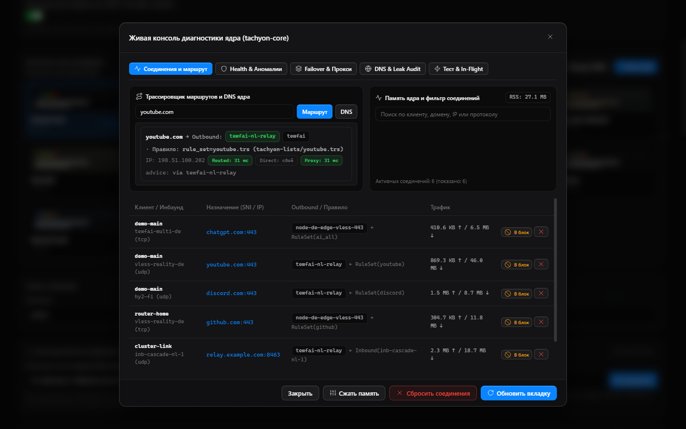 | 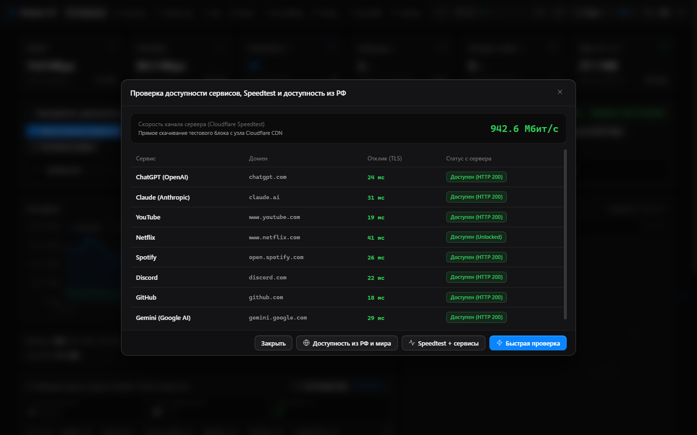 | 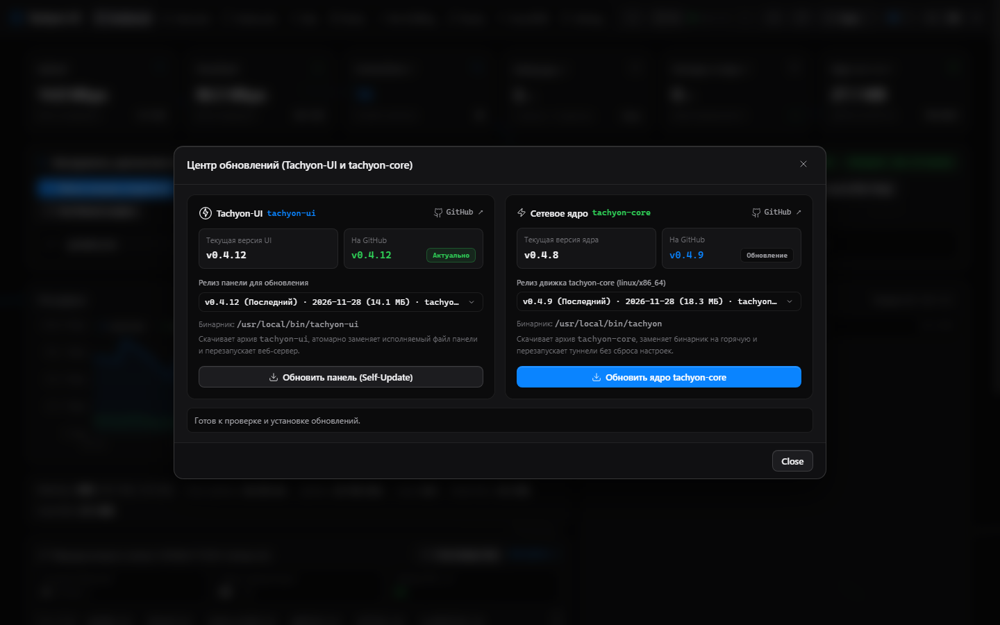 | 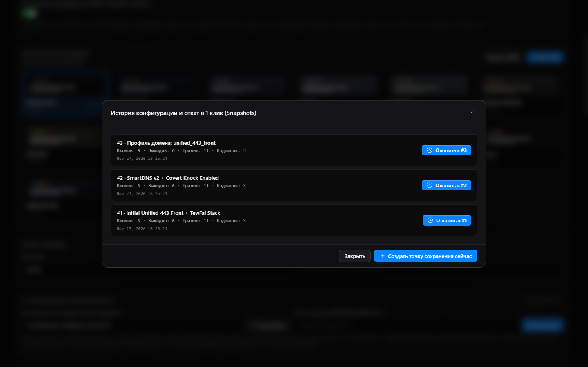 |

### 6.1. 5-Tab Live Core Diagnostics Console (`#modal-core-diag`)

| Tab / Footer Control | What & How | Why It Exists | Pitfalls & Notes |
| :--- | :--- | :--- | :--- |
| **Tab 1: `Connections & Route` (`conns`)** | Live `tachyon-core` Route/DNS tracer (`#diag-trace-target`), RSS Memory badge, Connection filter (`#diag-conn-filter`), active sessions table with **Close** / **Block Domain** / **Route Domain** actions. | Pinpoint live connection issues and kill individual stuck sockets. | — |
| **Tab 2: `Health & Anomalies` (`health`)** | Reads `GET /api/core/health` and `GET /api/core/anomalies`: RSS memory, pressure level, file descriptors, NAT evictions, DNS cache hit/miss, FakeIP stats, per-outbound RTT, and circuit-breaker states. | Deep engine telemetry beyond basic KPIs. | High NAT evictions or FD counts indicate kernel `ulimit` or heavy torrent/UDP load. |
| **Tab 3: `Failover & Proxies` (`failover`)** | Shows live failover group state (`GET /api/core/failover`), **Failover / Restore** buttons, and live proxy selector/delay matrix. | Inspect and manually override automated failover groups. | — |
| **Tab 4: `DNS & Leak Audit` (`dns_leak`)** | Compares engine DNS resolution vs. direct `1.1.1.1:53` (`POST /api/core/dns-check`), **Flush DNS Cache** (`POST /api/core/dns/flush`), and runs **IPv4 / IPv6 / WebRTC STUN / DNS Leak Test** (`POST /api/core/leak`). | Catch DNS poisoning, stale cache entries, or IPv6/WebRTC leaks. | Flush DNS cache right after editing SmartDNS or host overrides. |
| **Tab 5: `Test & In-Flight` (`test_flight`)** | **8-Stage Active Connection Test** (`DNS → Rule → Outbound → TCP → TLS → HTTP` via `POST /api/core/connection-test` with custom URL, port, timeout, TLS toggle) + **In-Flight / Flight Recorder** log (`Refresh` / `Clear`). | Isolate exactly which handshake stage failed for a target URL. | — |
| **Modal Footer Buttons** | **Trim Memory** (`POST /api/core/memory-trim`), **Reset All Connections** (`POST /api/core/connections/close` with `id: ""`), **Refresh Tab**. | Quick memory relief and emergency connection reset. | **Reset All Connections** immediately disconnects every active client. |

### 6.2. Configuration Snapshots & Rollback (`#modal-snapshots`)

Maintains an automatic and manual **10-revision ring buffer** of panel state:
- **Create Snapshot Now (`POST /api/snapshots`):** Captures current inbounds, outbounds, route rules, rule-sets, and subscriptions with a custom label.
- **Restore (`POST /api/snapshots/restore`):** Atomically restores the chosen revision (creating a safety backup of the current state first) and reloads `tachyon-core`, listeners, ACME config, and firewall rules.

### 6.3. Unlock Probe, RKN Reachability & Speedtest (`#modal-unlock-probe`)

| Button | What & How | Why It Exists | Pitfalls & Notes |
| :--- | :--- | :--- | :--- |
| **Quick Check (`POST /api/tools/unlock-probe`)** | Probes popular streaming, AI, and web services from the VPS egress IP without running a heavy download test. | Verify regional service access (ChatGPT, YouTube, Netflix, etc.) on a new IP. | — |
| **Speedtest + Services** | Runs the unlock probe with active bandwidth Speedtest enabled. | Measure real upstream/downstream VPS capacity. | Temporarily saturates the server's network interface during the test. |
| **RU & Global Reachability (`POST /api/tools/rkn-check`)** | Checks whether the server's IP/ports are reachable from Russian and global probe networks. | Detect regional IP blacklisting early before migrating subscribers. | — |

### 6.4. Update Center (`#modal-core-update`)

- **`tachyon-core` Releases (`GET /api/core/releases` → `POST /api/core/update`):** Lists official releases from GitHub and upgrades/downgrades the `tachyon-core` binary with a brief engine restart.
- **`Tachyon-UI` Panel Releases (`GET /api/panel/releases` → `POST /api/panel/self-update`):** Lists official `tachyon-ui` releases and performs an in-place panel self-update and daemon restart.
- **Pitfall:** Always create a **Snapshot** or download a `.json` **Backup** before upgrading major versions in production clusters.

---

[Previous: Chapter 10 — Tachyon 2.0 Router Subscription Guide](10-tachyon-router-subscription-guide.md) | [Protocols Catalog](protocols/README.md) | [Back to Index](../../README.md)
