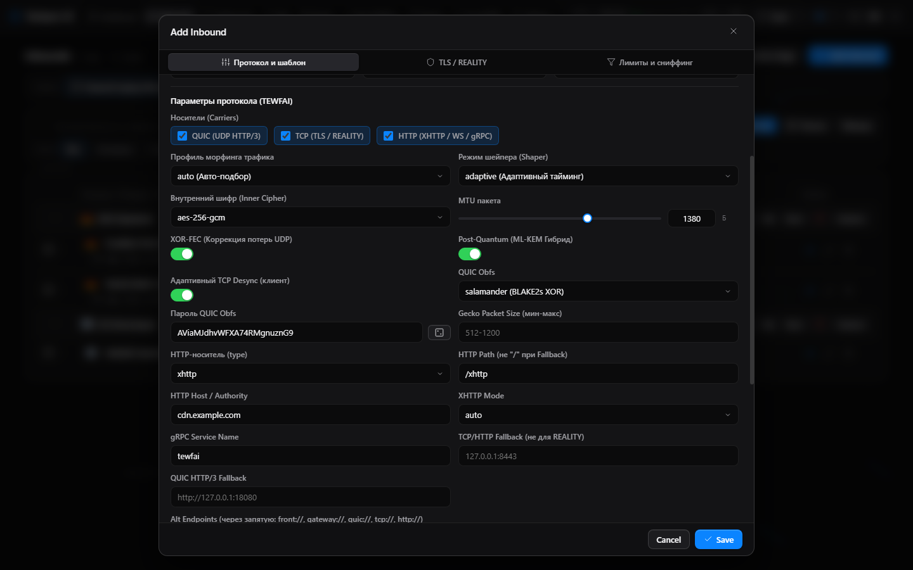
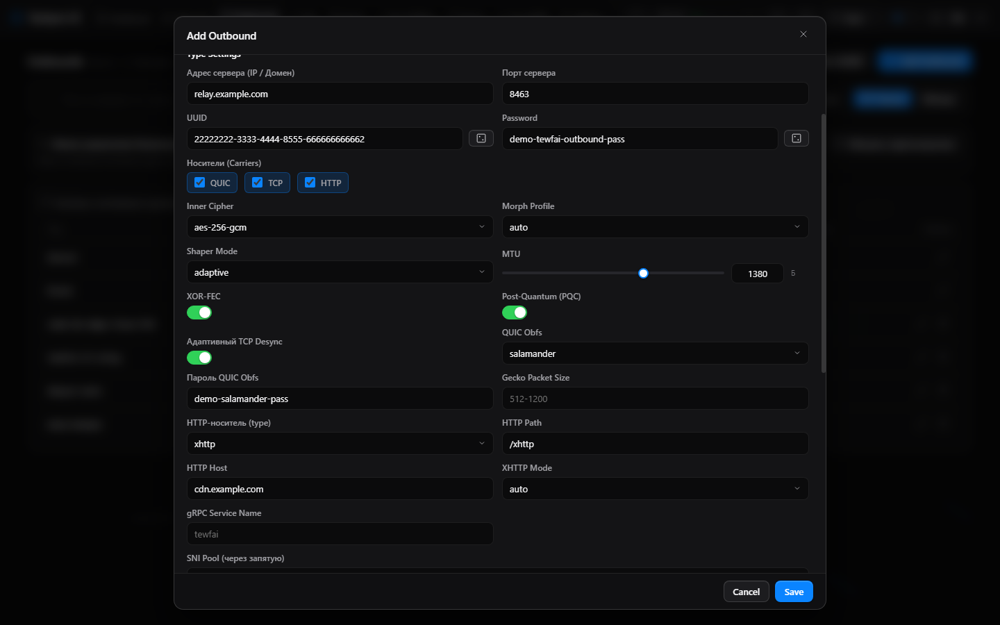

# 01. TewFai

| Parameter | Value |
| :--- | :--- |
| **Role in `tachyon-ui`** | `Inbound` + `Outbound` (native flagship protocol of `tachyon-core`) |
| **L4 Transport** | `TCP` (TLS 1.3 / REALITY / HTTP carriers `xhttp`, `ws`, `grpc`, `httpupgrade`, `http`) and/or `UDP` (QUIC v1 HTTP/3 ALPN `h3`) |
| **TLS / REALITY / ACME** | Supports `none`, `tls`, `reality`; default preset uses `REALITY` (for QUIC paired with REALITY, a self-signed `h3` cert is raised); ACME is managed by `tachyon-ui` |
| **Own Domain** | Not required with `REALITY`; required if using certificate `tls` without `insecure` |

---

## Purpose and Architecture in `tachyon-core`

Imagine a modular express train that can swap wheel gauges on the move: on open highway it glides along at full speed (QUIC/UDP); when UDP is throttled or blocked, it seamlessly transfers onto rails (TCP + REALITY or an HTTP carrier) without dropping active user connections; and every batch of four fragile UDP packets carries an XOR parity packet (XOR-FEC) to recover lost datagrams instantly without a retransmission round-trip.

Inside `tachyon-core 0.6.9`, **TewFai** decouples the **session layer** from **transport carriers**:
- **Unified session**: Multiplexes TCP streams and UDP datagrams, authenticates clients via PSK derived from `uuid`, and secures traffic with X25519 + optional hybrid post-quantum key exchange (**ML-KEM-768**).
- **Multi-carrier (`transport`)**: Runs `quic`, `tcp`, and `http` (`xhttp`, `ws`, `grpc`, `httpupgrade`, `http`) simultaneously or via staggered racing (`race_delay_ms`), with seamless `handover` driven by `stall_timeout_ms`, `ping_timeout_ms`, and `rotate_secs` / `rotate_mb`.
- **Traffic analysis resistance**: Histogram-based `morph_profile`, token-bucket `shaper.mode`, QUIC obfuscation (`salamander` / `gecko`), client-side TCP `desync`, `sni_pool`, and `server_ports` rotation.

---

## Panel Form Screenshots





---

## Step-by-Step Setup in `tachyon-ui`

### Built-in Panel Presets
In **Inbounds → + Add Inbound**, select type **`tewfai`** and pick one of the four built-in presets:

| Preset | Port | TLS Mode & SNI | Carriers & Key Options |
| :--- | :---: | :--- | :--- |
| **TewfAI REALITY Multi-Carrier (TCP REALITY + QUIC Salamander + XHTTP)** *(default)* | `8463` | `reality`, `www.microsoft.com` | `quic`, `tcp`, `http` (`xhttp` `/xhttp`, `auto`), `salamander`, `desync`, `raceDelay: 250`, `fec`, `pqc`, `morph: auto`, `shaper: adaptive`, `aes-256-gcm`, `mtu: 1380` |
| **TewfAI REALITY TCP Stealth (Browsing + Desync)** | `8462` | `reality`, `www.microsoft.com` | `tcp`, `desync`, `morph: browsing`, `pqc`, `mtu: 1400` |
| **TewfAI REALITY Video Stream + PQC** | `8463` | `reality`, `dl.google.com` | `quic`, `tcp`, `salamander`, `fec`, `morph: video`, `shaper: fixed`, `pqc`, `mtu: 1400` |
| **TewfAI TLS + Custom Domain (QUIC + FEC + WebRTC)** | `8463` | `tls`, `www.cloudflare.com` (replace with your domain) | `quic`, `tcp`, `fec`, `morph: webrtc`, `shaper: adaptive`, `pqc`, `mtu: 1380` |

### Configuration Steps
1. Open **Inbounds → + Add Inbound** and select **`tewfai`**.
2. Click a preset (**`TewfAI REALITY Multi-Carrier`** is ideal when starting without a domain).
3. On the **Basic / TewFai** tab, verify enabled carriers (`QUIC`, `TCP`, `HTTP`), morphing profile, `FEC`, `PQC`, and optional QUIC obfuscation (`salamander` or `gecko`).
4. On the **TLS / REALITY** tab: in `reality` mode, generate REALITY keys and verify the handshake `Server` / `SNI` (e.g., `www.microsoft.com:443`). In `tls` mode, enter your domain and certificate/key paths.
5. Save the Inbound, bind it to a subscription under **Subscriptions**, and click **Apply & Restart Core**.

---

## Complete Field, Switch, and Parameter Reference

### Inbound: TewFai Core Settings

| Panel Field (`tachyon-ui`) | `tachyon-core` JSON Key | Allowed Values & Default | Purpose & Tuning |
| :--- | :--- | :--- | :--- |
| **Carriers: QUIC / TCP / HTTP** | `transport` (+ `quic`) | Checkboxes `quic`, `tcp`, `http`; default `["quic","tcp","http"]` | Defines which transport carriers the server accepts on `listen_port`. |
| **Morph Profile** | `morph_profile` | `auto`, `adaptive`, `transformer`, `browsing`, `video`, `webrtc`, `bulk`; default `auto` | Shapes packet sizes and inter-packet timing distributions to match the selected traffic class. |
| **Shaper Mode** | `shaper.mode` | `adaptive`, `fixed`, `off`; UI default `adaptive` (core default `off`) | Smooths traffic bursts using token-bucket pacing. |
| **Inner Cipher** | `inner_cipher` | `aes-256-gcm`, `none`; UI default `aes-256-gcm` | Additional session-layer encryption. With TLS enabled, `none` saves CPU, while `aes-256-gcm` ensures end-to-end encryption across any carrier. |
| **MTU** | `mtu` | `1200–1480`, UI default `1380` (core `>= 256`) | Maximum payload unit size; lower to `1280–1360` on mobile LTE or PPPoE links. |
| **XOR-FEC (UDP Loss Correction)** | `fec` | `true` / `false` | Adds a parity packet to recover lost UDP datagrams without waiting for retransmission. |
| **Post-Quantum (ML-KEM-768 Hybrid)** | `pqc` | `true` / `false` | Enables hybrid post-quantum key exchange (`X25519 + ML-KEM-768`). |
| **Adaptive TCP Desync (Client)** | `desync` *(in export)* | `true` / `false` | Enables initial TCP ClientHello segmentation/desync on the client. Not present on the server inbound schema—passed into client profiles. |
| **QUIC Obfs: Type / Password / Packet Size** | `quic.obfs.{type, password, packet_size}` | `""`, `salamander`, `gecko`; size `512–1200` | Encrypts or pads QUIC UDP packet headers; automatically propagated to client subscriptions. |
| **HTTP Carrier: Type / Path / Host / XHTTP Mode / gRPC Service** | `http_transport.{type, path, host, mode, service_name}` | `xhttp`, `ws`, `grpc`, `httpupgrade`, `http`; XHTTP mode: `auto`, `packet-up`, `stream-up`, `stream-one` | Configures the HTTP carrier. Do not set `path: "/"` if `fallback` is also active on the same inbound. |
| **TCP/HTTP Fallback** | `fallback` | `host:port` string (e.g., `127.0.0.1:18080`) | Forwards unauthenticated TCP/HTTP probes to a decoy web server (automatically suppressed in `reality` mode). |
| **QUIC HTTP/3 Fallback** | `quic.fallback` | `host:port` string | Fallback address for unauthenticated HTTP/3 requests on the QUIC carrier. |
| **Alt Endpoints (CDN / Front)** | `alt_endpoints[]` | Strings like `front://...`, `gateway://...`, `quic://...`, `tcp://...`, `http://...` | Alternative entry endpoints exported to client subscriptions (e.g., CDN frontends). |
| **Client SNI Pool / Server Ports** | `sni_pool`, `server_ports` *(client)* | Comma-separated domains and ports/ranges (`8463,8500-8510`) | Passed to clients for SNI and port rotation; `server_ports` are also used for firewall rule generation. |
| **Race Delay & Handover Timings** | `race_delay_ms`, `handover.{stall_timeout_ms, ping_timeout_ms, rotate_secs, rotate_mb}` | Race delay (ms), stall/ping timeout (ms), rotation (sec / MB) | Controls how fast the client races backup carriers and schedules non-disruptive transport rotation. |
| **Clients** | `users[].uuid` | List of UUIDs (or password mapped to UUID) | User credentials from linked subscriptions. |

### Inbound: TLS / REALITY Tab

| Panel Field (`tachyon-ui`) | `tachyon-core` JSON Key | Allowed Values & Default | Purpose & Tuning |
| :--- | :--- | :--- | :--- |
| **TLS Protection Mode** | `tls.mode` | `none`, `tls`, `reality` | Use `reality` when operating without your own domain. |
| **Server Name (SNI)** | `tls.server_name` | Domain, e.g. `www.microsoft.com` or `panel.example.com` | Decoy SNI (under `reality`) or your certificate's domain (under `tls`). |
| **ALPN** | `tls.alpn` | String array (`h2,http/1.1` or `h3`) | Defaults to `["h3"]` on QUIC if not explicitly specified. |
| **Allow Insecure (Client)** | `tls.allow_insecure` *(export)* | Auto (`""`) / `false` / `true` | Reset to `null` for `reality`; controls client certificate verification under `tls`. |
| **Certificate / Private Key Path** | `tls.certificate_path`, `tls.key_path` | Defaults: `data/certs/server.crt`, `data/certs/server.key` | Paths to PEM certificate and private key in `tls` mode. |
| **REALITY Handshake Server / Port** | `tls.reality.handshake.{server, server_port}` | e.g., `www.microsoft.com`, port `443` | Target TLS 1.3 + H2 host used for REALITY handshake proxying. |
| **REALITY Private / Public Key, Short IDs, PQ Key** | `tls.reality.{private_key, short_id}` (+ `pq_key` / `pqv`) | X25519 keys and hex `short_id` (0–16 chars) | Server `private_key` stays in engine config; `public_key` and `pqv` are exported to clients. |
| **External Port / External TLS** | `external_port`, `external_tls` | Subscription export override | Used behind a reverse proxy (NGINX/Caddy on 443) so clients target the external port. |

### Outbound (`type: "tewfai"`)

| Panel Field (`tachyon-ui`) | `tachyon-core` JSON Key | Purpose |
| :--- | :--- | :--- |
| **Server / Port / UUID / Password** | `server`, `server_port`, `uuid`, `password` | Remote endpoint address and session credentials |
| **Carriers (`QUIC / TCP / HTTP`)** | `transport[]` | Allowed carriers (`["quic","tcp","http"]`) |
| **Cipher / Morph / Shaper / MTU / FEC / PQC / Desync** | `inner_cipher`, `morph_profile`, `shaper.mode`, `mtu`, `fec`, `pqc`, `desync` | Session encryption, traffic shaping, and loss resilience |
| **QUIC Obfs & HTTP Carrier** | `quic.obfs`, `quic.tls`, `http_transport` | QUIC obfuscation and HTTP carrier path/host settings |
| **SNI Pool / Ports / Race / Handover** | `sni_pool`, `server_ports`, `race_delay_ms`, `handover.{stall_timeout_ms, ping_timeout_ms, rotate_secs, rotate_mb}` | Multi-carrier racing and scheduled connection handover |
| **TLS / REALITY Block** | `tls` | Client TLS/uTLS or REALITY verification settings |

> In `tewfai` outbound configurations, `tachyon-core` rejects `congestion_control`, and a boolean `quic: true` is normalized to `transport: ["quic", "tcp"]`—`tachyon-ui` performs this sanitization automatically.

---

## Network, TLS, and Firewall Requirements

- **Firewall rules (`tachyon-ui`)**:
  - When `tcp` or `http` is enabled, **TCP** is opened on the Inbound port (e.g., `8463/tcp`).
  - When `quic` is enabled, **UDP** is opened on the Inbound port (e.g., `8463/udp`).
  - All ports and ranges listed in `server_ports` are also opened (ranges narrower than 32 ports are expanded automatically).
- **Key `tachyon-core 0.6.9` constraints**:
  1. **Never combine `tls` mode with a self-signed certificate and a foreign SNI** (such as `www.microsoft.com`): DPI detects the certificate/SNI mismatch and resets the flow. Use **`reality`** for foreign SNIs, or **`tls`** with your own domain and a valid certificate (issued via the `tachyon-ui` ACME manager, since built-in core runtime ACME is disabled).
  2. **REALITY + QUIC invariant**: REALITY operates **only** over the TCP carrier. When `quic` is also enabled without an explicit `quic.tls`, the server raises a self-signed `h3` certificate on the QUIC socket, and client subscriptions automatically include `quic.tls: { "enabled": true, "insecure": true, "alpn": ["h3"] }`.
  3. **Fallback under REALITY**: When `tls.mode: "reality"`, `tachyon-ui` omits `fallback` so it never conflicts with the REALITY handshake.
  4. **`handover` rotation**: `handover.rotate_secs` and `handover.rotate_mb` rotate the underlying carrier periodically without interrupting active user streams.

---

## Subscription Export, Clients, and Working `tachyon-core` JSON Example

- **URI**: `tewfai://<uuid>@<host>:<port>?transport=quic,tcp,http&obfs=salamander&http_type=xhttp&fec=1&pqc=1&desync=1&mtu=1380&security=reality#label`
- **Client profiles**: `?format=json`, `?format=tachyon`, `?format=outbounds` (and `?format=singbox`) export `type: "tewfai"` natively (including `quic.tls` with `insecure: true` when paired with `reality`). `tewfai` is **not exported** to Clash Meta YAML or SIP008.
- **Clients**: Native `tachyon-core`-based clients (including OpenWrt routers with Tachyon 2.0 subscriptions).

### `tachyon-core 0.6.9` Configuration Example (Inbound + Outbound)

```json
{
  "inbounds": [
    {
      "type": "tewfai",
      "tag": "tewfai-reality-in",
      "listen": "::",
      "listen_port": 8463,
      "transport": ["quic", "tcp", "http"],
      "morph_profile": "auto",
      "shaper": { "mode": "adaptive" },
      "inner_cipher": "aes-256-gcm",
      "mtu": 1380,
      "fec": true,
      "pqc": true,
      "quic": {
        "obfs": {
          "type": "salamander",
          "password": "demo-obfs-password",
          "packet_size": 1024
        }
      },
      "http_transport": {
        "type": "xhttp",
        "path": "/xhttp",
        "mode": "auto"
      },
      "users": [
        { "uuid": "11111111-2222-4333-8444-555555555555" }
      ],
      "tls": {
        "enabled": true,
        "server_name": "www.microsoft.com",
        "alpn": ["h2", "http/1.1"],
        "reality": {
          "enabled": true,
          "handshake": {
            "server": "www.microsoft.com",
            "server_port": 443
          },
          "private_key": "<REALITY_PRIVATE_KEY>",
          "short_id": ["0123abcd"]
        }
      }
    }
  ],
  "outbounds": [
    {
      "type": "tewfai",
      "tag": "tewfai-out",
      "server": "198.51.100.10",
      "server_port": 8463,
      "uuid": "11111111-2222-4333-8444-555555555555",
      "transport": ["quic", "tcp", "http"],
      "morph_profile": "auto",
      "shaper": { "mode": "adaptive" },
      "inner_cipher": "aes-256-gcm",
      "mtu": 1380,
      "fec": true,
      "pqc": true,
      "desync": true,
      "race_delay_ms": 250,
      "handover": {
        "stall_timeout_ms": 4000,
        "ping_timeout_ms": 2000,
        "rotate_secs": 1800,
        "rotate_mb": 512
      },
      "quic": {
        "obfs": {
          "type": "salamander",
          "password": "demo-obfs-password",
          "packet_size": 1024
        },
        "tls": {
          "enabled": true,
          "insecure": true,
          "alpn": ["h3"],
          "server_name": "www.microsoft.com"
        }
      },
      "http_transport": {
        "type": "xhttp",
        "path": "/xhttp",
        "mode": "auto"
      },
      "tls": {
        "enabled": true,
        "server_name": "www.microsoft.com",
        "utls": { "enabled": true, "fingerprint": "chrome" },
        "reality": {
          "enabled": true,
          "public_key": "<REALITY_PUBLIC_KEY>",
          "short_id": "0123abcd"
        }
      }
    }
  ]
}
```

---

## Diagnostics and Common Errors

| Symptom | Likely Cause | Resolution |
| :--- | :--- | :--- |
| Client connects over TCP but fails on QUIC in REALITY mode | Hand-crafted client JSON lacks `quic.tls` with `insecure: true`, or UDP port is blocked | Export the profile via `?format=json` / `?format=tachyon` from `tachyon-ui` and verify `UDP` firewall rules |
| Outbound validation error `unknown field congestion_control` | `congestion_control` present in manual outbound JSON | Remove `congestion_control` from `tewfai` outbound (`tachyon-ui` strips it automatically) |
| Connection reset by DPI in `tls` mode | `tls` selected with a self-signed cert and a foreign SNI (`www.microsoft.com`) | Switch to `reality` or bind your own domain with a valid certificate |
| `fallback` decoy server never triggers | `REALITY` is active (suppressing `fallback`) or `http_transport.path` is `"/"` | Use `tls` mode for web fallback and move `http_transport.path` to a dedicated path (e.g., `/xhttp`) |
| High packet loss or fragmentation on mobile LTE | `mtu` too high (`1400+`) or `fec` disabled | Lower `mtu` to `1280–1360` and enable `fec: true` |

---

## See Also
- [Protocol Catalog](./README.md)
- [Protocol Encyclopedia](../09-protocols-encyclopedia.md)
- [UI Reference](../11-ui-every-tab-and-button-guide.md)
- Next guide: [02. VLESS](./02-vless.md)
