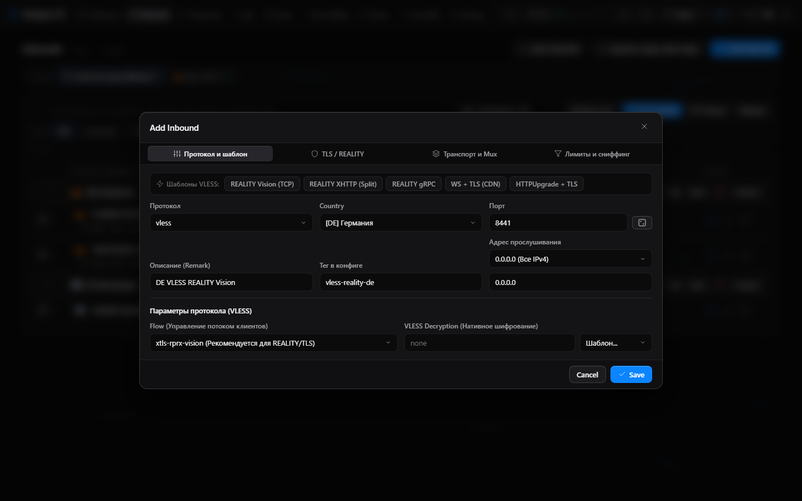

# 02. VLESS

| Parameter | Value |
| :--- | :--- |
| **Role in `tachyon-ui`** | `Inbound` + `Outbound` |
| **L4 Transport** | `TCP` (`tcp`, `ws`, `grpc`, `httpupgrade`, `xhttp`, `http`); `UDP` (`quic`) allowed only on Outbound with TLS |
| **TLS / REALITY / ACME** | Supports `none`, `tls`, `reality` (+ PQ `X25519MLKEM768` in REALITY); ACME is managed by `tachyon-ui` |
| **Own Domain** | Not needed for `REALITY`; required for standard `tls` or CDN proxying |

---

## Purpose and Architecture in `tachyon-core`

Think of **VLESS** as a lightweight courier envelope without redundant inner wax seals: authentication relies on a 16-byte UUID, while encryption and disguise are handled entirely by the outer security layer (**TLS 1.3**, **REALITY**) and the chosen transport (**TCP Vision**, **XHTTP**, **gRPC**, **WebSocket**, **HTTPUpgrade**).

Implementation highlights in `tachyon-core 0.6.9`:
- **`xtls-rprx-vision` flow control**: Eliminates the "TLS-inside-TLS" fingerprint by applying random padding to initial handshake packets. Works **strictly over `transport: "tcp"`**.
- **Post-quantum key exchange**: REALITY supports hybrid `X25519MLKEM768` (`pq_key` / `support_x25519mlkem768`), alongside native payload encryption (`decryption` / `encryption`) using `mlkem768x25519plus`.
- **UDP handling**: Encapsulates UDP inside the session via `xudp` (default), `packetaddr`, or raw framing.
- **Inbound anti-probing**: Supports `fallback`, `fallback_for_alpn`, and `tarpit` (capturing the first 4096 bytes).

---

## Panel Form Screenshot



---

## Step-by-Step Setup in `tachyon-ui`

### Built-in Panel Presets
| Preset | Port | TLS & SNI | Transport & Parameters |
| :--- | :---: | :--- | :--- |
| **REALITY Vision (TCP)** | `8441` | `reality`, `www.microsoft.com`, ALPN `h2,http/1.1` | `tcp`, `flow: xtls-rprx-vision` |
| **REALITY XHTTP (Split)** | `8448` | `reality`, `www.cloudflare.com`, ALPN `h2,http/1.1` | `xhttp`, path `/xhttp`, `mode: auto`, `x_padding_bytes: 100-1000` |
| **REALITY gRPC** | `8449` | `reality`, `dl.google.com`, ALPN `h2` | `grpc`, `service_name: grpc-vless` |
| **WS + TLS (CDN)** | `8452` | `tls`, `www.cloudflare.com`, ALPN `http/1.1` | `ws`, path `/vless-ws` |
| **HTTPUpgrade + TLS** | `8453` | `tls`, `www.microsoft.com`, ALPN `http/1.1` | `httpupgrade`, path `/upgrade` |

### Configuration Steps
1. Open **Inbounds → + Add Inbound** and select **`vless`**.
2. Click a matching preset—such as **`REALITY Vision (TCP)`** for direct TCP stealth or **`REALITY XHTTP (Split)`** for split HTTP/2 streams.
3. On the **Basic / VLESS** tab, choose `Flow` (`xtls-rprx-vision` is available only when transport is `tcp`).
4. On the **TLS / REALITY** tab, generate REALITY keys (including the optional PQ key) or specify a domain certificate for `tls` mode.
5. If using `ws`, `grpc`, `xhttp`, or `httpupgrade`, open **Transport & Mux** to configure `path` / `host` / `service_name`. Save, link to a subscription, and restart the core.

---

## Complete Field, Switch, and Parameter Reference

### Inbound: VLESS Settings & Clients

| Panel Field (`tachyon-ui`) | `tachyon-core` JSON Key | Allowed Values & Default | Purpose & Tuning |
| :--- | :--- | :--- | :--- |
| **Flow** | `users[].flow` | `""` or `xtls-rprx-vision` | Enables Vision flow control. The UI locks and clears this field if any transport other than `tcp` is chosen. |
| **Native Decryption (`Decryption`)** | `decryption` | `"none"` (default) or `mlkem768x25519plus.<native\|xorpub\|random>.<0rtt\|1rtt\|<N>s>...` | Optional post-quantum payload encryption on top of VLESS. |
| **Clients** | `users[].{name, uuid}` | Name and UUID | Each client in linked subscriptions receives its own UUID. |

### Inbound: "TLS / REALITY" and "Transport & Mux" Tabs

| Panel Field (`tachyon-ui`) | `tachyon-core` JSON Key | Allowed Values & Default | Purpose & Tuning |
| :--- | :--- | :--- | :--- |
| **TLS Protection Mode** | `tls.mode` | `none`, `tls`, `reality` | `reality` needs no domain; `tls` needs a certificate; `none` is only for use behind an external proxy. |
| **SNI / ALPN / Certificates** | `tls.server_name`, `tls.alpn`, `tls.certificate_path`, `tls.key_path` | Defaults: `data/certs/server.crt` / `.key` | Use ALPN `http/1.1` for `ws`/`httpupgrade`; use `h2` for `grpc` and `xhttp`. |
| **REALITY (`Server`, `Port`, `Keys`, `Short IDs`, `PQ Key`)** | `tls.reality.{handshake, private_key, short_id}` (+ `pq_key`) | `www.microsoft.com:443`, X25519 + opt. PQ | Decoy target and cryptographic keys. Setting a PQ key adds `support_x25519mlkem768: true` and `pqv` to exported subscriptions. |
| **External Port / External TLS** | `external_port`, `external_tls` | Client export override | Used when the inbound sits behind NGINX/Caddy on port `443`. |
| **Transport Type** | `transport.type` | `tcp`, `ws`, `grpc`, `httpupgrade`, `xhttp`, `http` | L7 transport wrapper over TCP. |
| **Path / Host / Service Name** | `transport.path`, `transport.headers.Host`, `transport.service_name` | Strings | URI path for `ws`/`httpupgrade`/`xhttp`/`http`, or gRPC service name. |
| **XHTTP Mode / X-Padding** | `transport.mode`, `transport.x_padding_bytes` | `auto`, `packet-up`, `stream-up`, `stream-one`; `100-1000` | Split upload/download mode for XHTTP and byte padding range. |
| **Multiplex (`h2mux` + `Brutal`)** | `multiplex.{enabled, padding, brutal.{enabled, up_mbps, down_mbps}}` | On / Off | Multiplexes multiple TCP connections over one stream. **Automatically disabled** by `tachyon-ui` if any client uses `xtls-rprx-vision`. |

### Outbound (`type: "vless"`)

| Panel Field (`tachyon-ui`) | `tachyon-core` JSON Key | Purpose |
| :--- | :--- | :--- |
| **Server / Port / UUID** | `server`, `server_port`, `uuid` | Remote node coordinates and user UUID |
| **Flow** | `flow` | `""` or `xtls-rprx-vision` (only with `tcp`) |
| **TLS / REALITY & Transport** | `tls`, `transport` | Supports `transport.type: "quic"` with `tls.enabled: true` (Outbound only) |
| **Extra JSON Settings (`out-settings`)** | `encryption`, `packet_encoding`, `network`, `multiplex` | `packet_encoding` (`xudp` / `packetaddr`), native encryption, `h2mux` options |

---

## Network, TLS, and Firewall Requirements

- **Firewall**: `tachyon-ui` opens **TCP** on `inb.port` (a `UDP` rule is only added for `transport_type == "quic"` scenarios; on server inbounds, `quic` transport is rejected by the `tachyon-core 0.6.9` validator).
- **Key `tachyon-core 0.6.9` constraints**:
  - `xtls-rprx-vision` is incompatible with `ws`, `grpc`, `xhttp`, `httpupgrade`, and `multiplex`.
  - For `ws` and `httpupgrade`, ALPN `h2` is invalid—when saving an outbound, the panel automatically filters `h2` down to `http/1.1`.
  - Built-in server runtime ACME is not supported: issue certificates through `tachyon-ui` (`certificate_path` / `key_path`).

---

## Subscription Export, Clients, and Working `tachyon-core` JSON Example

- **URI**: `vless://<uuid>@<host>:<port>?encryption=none&flow=xtls-rprx-vision&security=reality&sni=www.microsoft.com&fp=chrome&pbk=<PUBKEY>&sid=0123abcd&type=tcp#label`
- **JSON (`?format=json`, `?format=tachyon`, `?format=outbounds`)**: Full support for all transports (including `xhttp`, `httpupgrade`, `pqv`, `multiplex`).
- **Clash Meta YAML (`?format=clash`)**: Exports `type: vless` with `reality-opts`, `ws-opts`, `grpc-opts`, and `h2-opts`. Note: **`xhttp` and `httpupgrade` are not supported in Clash YAML** and are skipped during YAML export—use JSON or URI formats instead.
- **Clients**: `tachyon-core` and standard VLESS clients supporting REALITY / Vision / XHTTP.

### `tachyon-core 0.6.9` Configuration Example (REALITY Vision)

```json
{
  "inbounds": [
    {
      "type": "vless",
      "tag": "vless-reality-in",
      "listen": "::",
      "listen_port": 8441,
      "users": [
        {
          "name": "alice",
          "uuid": "11111111-2222-4333-8444-555555555555",
          "flow": "xtls-rprx-vision"
        }
      ],
      "tls": {
        "enabled": true,
        "server_name": "www.microsoft.com",
        "alpn": ["h2", "http/1.1"],
        "reality": {
          "enabled": true,
          "handshake": { "server": "www.microsoft.com", "server_port": 443 },
          "private_key": "<REALITY_PRIVATE_KEY>",
          "short_id": ["0123abcd"]
        }
      }
    }
  ],
  "outbounds": [
    {
      "type": "vless",
      "tag": "vless-reality-out",
      "server": "198.51.100.10",
      "server_port": 8441,
      "uuid": "11111111-2222-4333-8444-555555555555",
      "flow": "xtls-rprx-vision",
      "packet_encoding": "xudp",
      "tls": {
        "enabled": true,
        "server_name": "www.microsoft.com",
        "utls": { "enabled": true, "fingerprint": "chrome" },
        "reality": {
          "enabled": true,
          "public_key": "<REALITY_PUBLIC_KEY>",
          "short_id": "0123abcd"
        }
      }
    }
  ]
}
```

---

## Diagnostics and Common Errors

| Symptom | Likely Cause | Resolution |
| :--- | :--- | :--- |
| Validation or startup error with `Vision` enabled | Transport is `ws`/`xhttp`/`grpc`, or `multiplex` is active | Use `xtls-rprx-vision` only with `transport: "tcp"` and `multiplex` disabled |
| Clash Meta client misses `XHTTP` / `HTTPUpgrade` nodes | Clash YAML format omits these transports | Switch the client to `?format=json`, `?format=tachyon`, or URI subscription links |
| `WS` / `HTTPUpgrade` hangs during connection | ALPN set to `h2` instead of `http/1.1` | Set `ALPN: http/1.1` on both the inbound and client profile |
| REALITY handshake fails | Target `handshake.server` lacks TLS 1.3 + H2 or is blocked from the VPS | Test reachability of the decoy domain directly from the VPS and switch to `www.microsoft.com` or `dl.google.com` |

---

## See Also
- [Protocol Catalog](./README.md)
- [Protocol Encyclopedia](../09-protocols-encyclopedia.md)
- [UI Reference](../11-ui-every-tab-and-button-guide.md)
- Previous guide: [01. TewFai](./01-tewfai.md) | Next guide: [03. Hysteria2](./03-hysteria2.md)
