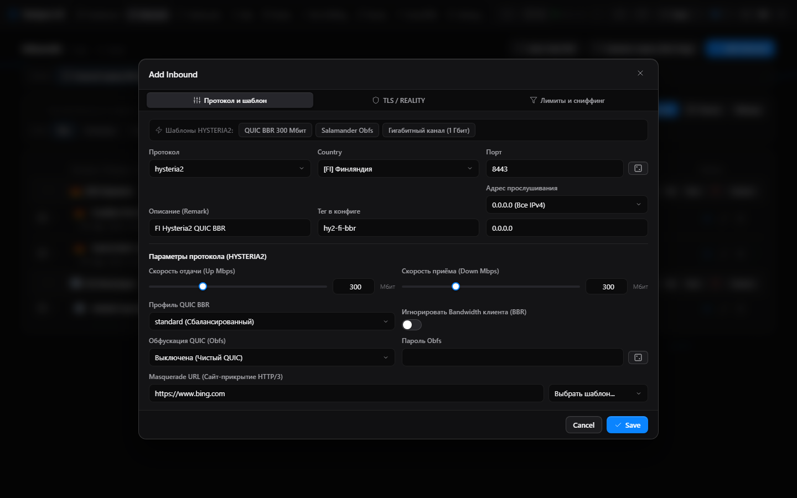

# 03. Hysteria2

| Parameter | Value |
| :--- | :--- |
| **Role in `tachyon-ui`** | `Inbound` + `Outbound` |
| **L4 Transport** | `UDP` (QUIC / HTTP/3 with mandatory ALPN `h3`) |
| **TLS / REALITY / ACME** | **Certificate TLS only** (`tls` is strictly mandatory; REALITY is unsupported; ACME is managed by `tachyon-ui`) |
| **Own Domain** | Recommended (with a panel-issued certificate); a self-signed certificate is allowed with `insecure: true` on the client |

---

## Purpose and Architecture in `tachyon-core`

Imagine a wide multi-lane expressway with zero traffic lights: instead of halting the entire convoy whenever one vehicle drops out (as TCP does), **Hysteria2** runs over UDP (QUIC HTTP/3) and drives throughput with aggressive **Brutal** congestion control (sustaining your target `up_mbps`/`down_mbps` even under 5–15% packet loss) or **BBR** (`standard`, `conservative`, `aggressive`).

How it works in `tachyon-core 0.6.9`:
- **Congestion control**: When `up_mbps > 0` and `ignore_client_bandwidth` is `false`, Brutal is active; when `up_mbps == 0` or `ignore_client_bandwidth: true`, the engine switches to BBR using the configured `bbr_profile`.
- **QUIC obfuscation (`obfs`)**: Supports `"salamander"` (fast BLAKE2b-based XOR masking that hides QUIC headers) and `"gecko"` (additionally normalizes packet lengths within `512..=1200` bytes).
- **HTTP/3 `masquerade`**: Unauthenticated probes receive a genuine HTTP/3 response (proxied URL, string, local file, or redirect), mimicking a standard web server.

---

## Panel Form Screenshot



---

## Step-by-Step Setup in `tachyon-ui`

### Built-in Panel Presets
| Preset | Port (UDP) | TLS & SNI | Bandwidth & Masquerade |
| :--- | :---: | :--- | :--- |
| **QUIC BBR 300 Mbps** | `8443` | `tls`, `www.bing.com`, ALPN `h3` | `300 / 300` Mbps, `bbr: standard`, `masquerade: https://www.bing.com` |
| **Salamander Obfs** | `8456` | `tls`, `www.cloudflare.com`, ALPN `h3` | `300 / 300` Mbps, `bbr: aggressive`, `obfs: salamander` |
| **Gigabit Link (1 Gbps)** | `8443` | `tls`, `www.apple.com`, ALPN `h3` | `1000 / 1000` Mbps, `bbr: aggressive` |

### Configuration Steps
1. Go to **Inbounds → + Add Inbound** and select **`hysteria2`**.
2. Choose a preset (e.g., **`Salamander Obfs`** on networks that filter QUIC).
3. On the **Basic / Hysteria2** tab, set your server's actual bandwidth (`Up/Down Mbps`), BBR profile, `ignore_client_bandwidth`, and optional obfuscation (`salamander` or `gecko` + password).
4. On the **TLS** tab, verify `ALPN: h3`, set your domain in `SNI` and certificate paths (`data/certs/server.crt` / `.key`), or enable `Allow Insecure` if using a self-signed certificate.
5. Ensure at least one client with a non-empty password is linked to a subscription, save the Inbound, and restart the core.

---

## Complete Field, Switch, and Parameter Reference

### Inbound: Hysteria2 Settings & TLS Tab

| Panel Field (`tachyon-ui`) | `tachyon-core` JSON Key | Allowed Values & Default | Purpose & Tuning |
| :--- | :--- | :--- | :--- |
| **Up / Down Mbps** | `up_mbps`, `down_mbps` | `10–1000` (default `300`) | Bandwidth cap in Mbps. Setting `0` or enabling `ignore_client_bandwidth` switches from Brutal to BBR. |
| **QUIC BBR Profile** | `bbr_profile` | `standard`, `conservative`, `aggressive` | Controls BBR pacing aggressiveness when Brutal is inactive. |
| **Ignore Client Bandwidth (BBR)** | `ignore_client_bandwidth` | `true` / `false` | Forces the server to use BBR regardless of client bandwidth announcements. |
| **QUIC Obfuscation: Type / Password** | `obfs.{type, password}` | `""`, `salamander`, `gecko` + password string | Scrambles QUIC Initial and packet headers. Enabling `obfs` on an inbound requires non-empty passwords in `users[]`. |
| **Masquerade** | `masquerade` | URL (e.g., `https://www.bing.com`) or `file`/`proxy`/`string` object | Response served to ordinary HTTP/3 traffic lacking Hysteria2 auth. |
| **Clients** | `users[].{name, password}` | Name and non-empty password | Client authentication credentials. |
| **TLS Tab (`SNI`, `ALPN`, `Cert`, `Key`, `Allow Insecure`)** | `tls.{enabled, server_name, alpn, certificate_path, key_path}` | `tls.enabled: true` always; ALPN `["h3"]` | REALITY is disabled in `hysteria2`; for self-signed certs, set `Allow Insecure: true` for client export. |
| **External Port / TLS** | `external_port`, `external_tls` | Subscription override | Used when forwarding UDP ports through an external gateway. |

### Outbound (`type: "hysteria2"`)

| Panel Field (`tachyon-ui`) | `tachyon-core` JSON Key | Purpose |
| :--- | :--- | :--- |
| **Server / Port / Password** | `server`, `server_port`, `password` | Remote node address and access password |
| **TLS Block** | `tls.{enabled, server_name, insecure, alpn}` | `tls.enabled: true` is mandatory; requires `server_name` or `server` unless `insecure` is `true` |
| **Extra JSON Fields (`out-settings`)** | `server_ports`, `hop_interval`, `hop_interval_max`, `up_mbps`, `down_mbps`, `obfs`, `bbr_profile` | UDP port hopping, Brutal limits, and `obfs` parameters |

---

## Network, TLS, and Firewall Requirements

- **Firewall**: Only **UDP** is opened on the Inbound port (e.g., `8443/udp` or `8456/udp`). When using client-side `server_ports` (port hopping), configure a server-side NAT redirect from the UDP port range to the main inbound port.
- **Key `tachyon-core 0.6.9` constraints**:
  - `tls.enabled: true` is strictly required on both ends (`REALITY` is unavailable).
  - When `obfs` is configured, `users[]` must contain at least one client with a non-empty `password`.
  - Built-in server runtime ACME is not supported: `tachyon-ui` provisions certificates and supplies `certificate_path`/`key_path`.

---

## Subscription Export, Clients, and Working `tachyon-core` JSON Example

- **URI**: `hy2://<password>@<host>:<port>?sni=www.bing.com&obfs=salamander&obfs-password=demo-obfs-pass&insecure=1#label`
- **JSON (`?format=json`, `?format=tachyon`, `?format=outbounds`)**: `type: "hysteria2"`.
- **Clash Meta YAML (`?format=clash`)**: `type: hysteria2`, `up`/`down` (`"300 Mbps"`), `obfs`, `obfs-password`, `skip-cert-verify`.
- **Clients**: `tachyon-core` and all standard Hysteria2 / HTTP/3 clients.

### `tachyon-core 0.6.9` Configuration Example

```json
{
  "inbounds": [
    {
      "type": "hysteria2",
      "tag": "hy2-in",
      "listen": "::",
      "listen_port": 8456,
      "up_mbps": 300,
      "down_mbps": 300,
      "bbr_profile": "aggressive",
      "ignore_client_bandwidth": false,
      "obfs": {
        "type": "salamander",
        "password": "demo-obfs-password"
      },
      "masquerade": "https://www.cloudflare.com",
      "users": [
        { "name": "alice", "password": "demo-user-password" }
      ],
      "tls": {
        "enabled": true,
        "server_name": "panel.example.com",
        "alpn": ["h3"],
        "certificate_path": "data/certs/server.crt",
        "key_path": "data/certs/server.key"
      }
    }
  ],
  "outbounds": [
    {
      "type": "hysteria2",
      "tag": "hy2-out",
      "server": "198.51.100.10",
      "server_port": 8456,
      "password": "demo-user-password",
      "up_mbps": 100,
      "down_mbps": 300,
      "obfs": {
        "type": "salamander",
        "password": "demo-obfs-password"
      },
      "tls": {
        "enabled": true,
        "server_name": "panel.example.com",
        "alpn": ["h3"],
        "insecure": false
      }
    }
  ]
}
```

---

## Diagnostics and Common Errors

| Symptom | Likely Cause | Resolution |
| :--- | :--- | :--- |
| Connection drops silently at QUIC Initial | `obfs.type` or `obfs.password` mismatch between client and server | Verify exact `obfs` type (`salamander` / `gecko`) and password match |
| Client times out, no UDP packets reach server | ISP throttles/blocks UDP on that port or firewall blocks UDP | Open `UDP` on the inbound port, enable `salamander`, or switch to `443/udp` |
| Client certificate verification error | Self-signed certificate without `insecure: true` or wrong SNI | Issue a domain certificate via `tachyon-ui` or set `Allow Insecure: true` |
| Validation error on startup with `obfs` | Client in `users[]` has an empty password | Link a subscription with a non-empty client password |

---

## See Also
- [Protocol Catalog](./README.md)
- [Protocol Encyclopedia](../09-protocols-encyclopedia.md)
- [UI Reference](../11-ui-every-tab-and-button-guide.md)
- Previous guide: [02. VLESS](./02-vless.md) | Next guide: [04. TUIC v5](./04-tuic.md)
