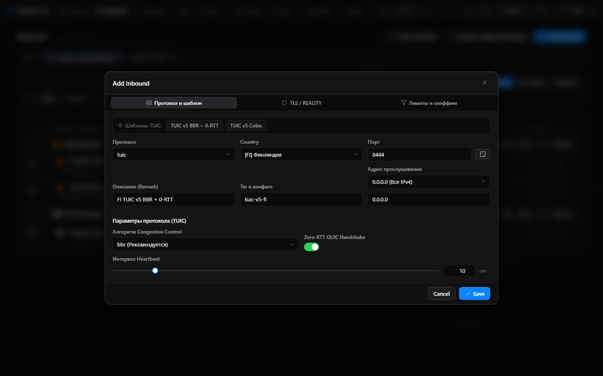

# 04. TUIC v5

| Parameter | Value |
| :--- | :--- |
| **Role in `tachyon-ui`** | `Inbound` + `Outbound` |
| **L4 Transport** | `UDP` (QUIC with ALPN `h3`; native QUIC Datagrams RFC 9221, QUIC uni-streams, or `udp_over_stream` on Outbound) |
| **TLS / REALITY / ACME** | **Certificate TLS only** (`tls` is strictly mandatory; REALITY is unsupported; ACME is managed by `tachyon-ui`) |
| **Own Domain** | Recommended (with a panel-issued certificate); a self-signed certificate is allowed with `insecure: true` on the client |

---

## Purpose and Architecture in `tachyon-core`

Whereas **Hysteria2** is built to push maximum bandwidth over congested links, **TUIC v5** is designed for **minimal latency** and native UDP datagram proxying—ideal for gaming, voice/video calls, WebRTC, and DNS over QUIC without TCP re-encapsulation overhead.

Mechanics in `tachyon-core 0.6.9`:
- **QUIC multiplexing + 0-RTT**: With `zero_rtt_handshake` enabled, resumed connections transmit application data alongside the first handshake packet, saving an entire RTT.
- **Two UDP relay modes (`native` and `quic`)**: `native` sends packets as QUIC Datagrams (RFC 9221) with zero retransmission stalls; `quic` (uni-streams) ensures reliable delivery when an ISP filters QUIC datagram frames.
- **Strict UUID authentication**: Every user requires a **strictly valid UUID** (8-4-4-4-12 format) and password; server-side `auth_timeout` defaults to `10s`.

---

## Panel Form Screenshot



---

## Step-by-Step Setup in `tachyon-ui`

### Built-in Panel Presets
| Preset | Port (UDP) | TLS & SNI | QUIC Parameters |
| :--- | :---: | :--- | :--- |
| **TUIC v5 BBR + 0-RTT** | `8444` | `tls`, `www.apple.com`, ALPN `h3` | `congestion_control: bbr`, `zero_rtt_handshake: true`, `heartbeat: 10s` |
| **TUIC v5 Cubic** | `8444` | `tls`, `www.cloudflare.com`, ALPN `h3` | `congestion_control: cubic`, `zero_rtt_handshake: false`, `heartbeat: 15s` |

### Configuration Steps
1. Open **Inbounds → + Add Inbound** and select **`tuic`**.
2. Choose **`TUIC v5 BBR + 0-RTT`** for best responsiveness or **`TUIC v5 Cubic`** for conservative network compatibility.
3. On the **Basic / TUIC** tab, select the congestion control algorithm (`bbr`, `cubic`, `new_reno`), toggle `Zero-RTT QUIC Handshake`, and set `Heartbeat` (default `10` seconds).
4. On the **TLS** tab, confirm `ALPN: h3`, specify your domain SNI and certificate/key (`data/certs/server.crt`, `data/certs/server.key`), or enable `Allow Insecure: true` for a self-signed certificate.
5. Verify that all linked clients have valid UUIDs and passwords, save the Inbound, and restart the core.

---

## Complete Field, Switch, and Parameter Reference

### Inbound: TUIC Settings & TLS Tab

| Panel Field (`tachyon-ui`) | `tachyon-core` JSON Key | Allowed Values & Default | Purpose & Tuning |
| :--- | :--- | :--- | :--- |
| **Congestion Control** | `congestion_control` | `bbr`, `cubic`, `new_reno`; default `bbr` | `bbr` handles packet loss and jitter better; `cubic` offers traditional predictable ramp-up. |
| **Zero-RTT QUIC Handshake** | `zero_rtt_handshake` | `true` / `false` | Allows sending payload data in the first packet of a resumed QUIC session. |
| **Heartbeat (sec)** | `heartbeat` | `3–60` sec, default `10` (`"10s"`) | Keepalive interval to prevent intermediate NATs from dropping idle UDP mappings. |
| **Clients** | `users[].{name, uuid, password}` | Strictly valid UUID + password | In `tachyon-core 0.6.9`, an invalid UUID on `tuic` is immediately rejected by the validator. |
| **TLS Tab (`SNI`, `ALPN`, `Cert`, `Key`, `Allow Insecure`)** | `tls.{enabled, server_name, alpn, certificate_path, key_path}` | `tls.enabled: true` always; ALPN `["h3"]` | REALITY is not supported; ACME certificates are managed by `tachyon-ui`. |
| **External Port / TLS** | `external_port`, `external_tls` | Subscription override | Used when forwarding UDP through an external gateway. |

### Outbound (`type: "tuic"`)

| Panel Field (`tachyon-ui`) | `tachyon-core` JSON Key | Purpose |
| :--- | :--- | :--- |
| **Server / Port** | `server`, `server_port` | Remote server address and UDP port |
| **UUID / Password** | `uuid`, `password` | Client credentials (strictly valid UUID) |
| **Congestion Control** | `congestion_control` | `bbr` / `cubic` / `new_reno` |
| **TLS Block** | `tls.{enabled, server_name, alpn, insecure}` | Mandatory TLS for QUIC (`alpn: ["h3"]`) |
| **Extra JSON Fields (`out-settings`)** | `udp_relay_mode` (`native` / `quic`), `udp_over_stream`, `zero_rtt_handshake`, `heartbeat` | UDP delivery mode (`udp_over_stream: true` cannot be combined with a non-empty `udp_relay_mode`) |

---

## Network, TLS, and Firewall Requirements

- **Firewall**: Opens **UDP** on `inb.port` (e.g., `8444/udp`).
- **Key `tachyon-core 0.6.9` constraints**:
  - The validator enforces strict **UUID** syntax on both inbound and outbound (unlike VLESS/VMess, arbitrary strings are not auto-converted via UUIDv5).
  - On outbound, `udp_over_stream: true` **conflicts** with a non-empty `udp_relay_mode`.
  - If UDP is blocked by an ISP, unauthenticated sessions expire after `auth_timeout` (`10s`).
  - Server TLS is strictly mandatory (`tls.enabled: true`), and ACME issuance is handled by `tachyon-ui`.

---

## Subscription Export, Clients, and Working `tachyon-core` JSON Example

- **URI**: `tuic://<uuid>:<password>@<host>:<port>?congestion_control=bbr&alpn=h3&sni=www.apple.com&insecure=1&allow_insecure=1#label`
- **JSON (`?format=json`, `?format=tachyon`, `?format=outbounds`)**: `type: "tuic"`.
- **Clash Meta YAML (`?format=clash`)**: `type: tuic`, `congestion-controller`, `alpn`, `skip-cert-verify`.
- **Clients**: `tachyon-core` and standard TUIC v5 clients.

### `tachyon-core 0.6.9` Configuration Example

```json
{
  "inbounds": [
    {
      "type": "tuic",
      "tag": "tuic-in",
      "listen": "::",
      "listen_port": 8444,
      "congestion_control": "bbr",
      "zero_rtt_handshake": true,
      "heartbeat": "10s",
      "users": [
        {
          "name": "alice",
          "uuid": "11111111-2222-4333-8444-555555555555",
          "password": "demo-user-password"
        }
      ],
      "tls": {
        "enabled": true,
        "server_name": "panel.example.com",
        "alpn": ["h3"],
        "certificate_path": "data/certs/server.crt",
        "key_path": "data/certs/server.key"
      }
    }
  ],
  "outbounds": [
    {
      "type": "tuic",
      "tag": "tuic-out",
      "server": "198.51.100.10",
      "server_port": 8444,
      "uuid": "11111111-2222-4333-8444-555555555555",
      "password": "demo-user-password",
      "congestion_control": "bbr",
      "udp_relay_mode": "native",
      "zero_rtt_handshake": true,
      "heartbeat": "10s",
      "tls": {
        "enabled": true,
        "server_name": "panel.example.com",
        "alpn": ["h3"],
        "insecure": false
      }
    }
  ]
}
```

---

## Diagnostics and Common Errors

| Symptom | Likely Cause | Resolution |
| :--- | :--- | :--- |
| Core fails to start / `tuic` decode error | Malformed `uuid` in `users[]` or outbound | Provide a valid 36-character UUIDv4 |
| Outbound validation error on `udp_over_stream` | Both `udp_over_stream: true` and `udp_relay_mode` are set | Keep only one of those two parameters |
| `auth_timeout` (10s) expires on connect | Inbound UDP port blocked or mismatched `uuid`/`password` | Verify `UDP` firewall rules and client credentials |
| Voice/gaming sessions drop while idle | Intermediate NAT expires UDP mapping faster than `heartbeat` | Lower `heartbeat` to `5s–8s` |

---

## See Also
- [Protocol Catalog](./README.md)
- [Protocol Encyclopedia](../09-protocols-encyclopedia.md)
- [UI Reference](../11-ui-every-tab-and-button-guide.md)
- Previous guide: [03. Hysteria2](./03-hysteria2.md) | Next guide: [05. Trojan](./05-trojan.md)
