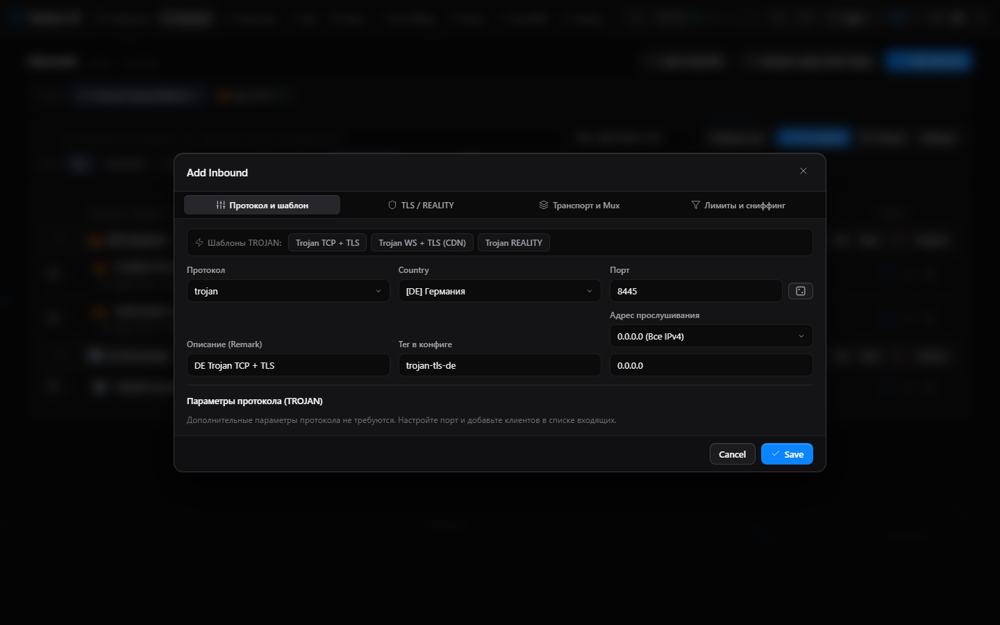

# 05. Trojan

| Parameter | Value |
| :--- | :--- |
| **Role in `tachyon-ui`** | `Inbound` + `Outbound` |
| **L4 Transport** | `TCP` (plus L7 transports `ws`, `grpc`, `httpupgrade`, `xhttp`, `http`; `quic` allowed only on Outbound with TLS; UDP relayed inside the session) |
| **TLS / REALITY / ACME** | Supports `none`, `tls`, `reality` (`tls` is the classic mode; `none` is only for external TLS termination or `detour`) |
| **Own Domain** | Required for classic `Trojan TCP + TLS` or `WS + TLS`; not needed for `Trojan REALITY` |

---

## Purpose and Architecture in `tachyon-core`

Picture a private members' club hidden behind an ordinary café storefront: every visitor enters via standard **HTTPS (TLS 1.3)** and sends the SHA-224 hash of their password in the very first frame. If the password matches, the proxy tunnel opens; if a random scanner or ordinary web browser connects without a valid hash, the server silently hands the connection off to a real website (`fallback`).

Implementation highlights in `tachyon-core 0.6.9`:
- **Unique password authentication**: Every client on a single Trojan Inbound must have a **unique password** (duplicates are rejected at startup).
- **Full UDP and Mux support**: Inside the session, the server handles UDP frames (`0x02`, `0x03`), `h2mux`, and UoT v1/v2.
- **Active probe defense**: Supports `fallback`, `fallback_for_alpn`, and `tarpit` on Inbound.
- **Transport & TLS flexibility**: Beyond classic `TCP + TLS`, supports `REALITY`, `WebSocket`, `gRPC`, `XHTTP`, and `HTTPUpgrade`.

---

## Panel Form Screenshot



---

## Step-by-Step Setup in `tachyon-ui`

### Built-in Panel Presets
| Preset | Port | TLS & SNI | Transport |
| :--- | :---: | :--- | :--- |
| **Trojan TCP + TLS** | `8445` | `tls`, `www.microsoft.com` (replace with your domain), ALPN `h2,http/1.1` | `tcp` |
| **Trojan WS + TLS (CDN)** | `8454` | `tls`, `www.cloudflare.com`, ALPN `http/1.1` | `ws`, path `/trojan-ws` |
| **Trojan REALITY** | `8445` | `reality`, `www.microsoft.com`, ALPN `h2,http/1.1` | `tcp` |

### Configuration Steps
1. Open **Inbounds → + Add Inbound** and select **`trojan`**.
2. Pick a preset: **`Trojan TCP + TLS`** (with your own domain) or **`Trojan REALITY`** (domainless).
3. Verify that linked subscriptions do not assign identical passwords to different clients.
4. On the **TLS / REALITY** tab, configure your certificate and domain (for `tls`) or generate REALITY keys (for `reality`).
5. For CDN setups, open **Transport & Mux** to verify `ws`, path (`/trojan-ws`), and ALPN `http/1.1`. Save and restart the core.

---

## Complete Field, Switch, and Parameter Reference

`trojan` has no protocol-specific extra fields—configuration relies on the client list plus the shared **TLS / REALITY** and **Transport & Mux** tabs.

### Inbound: Clients, TLS / REALITY, and Transport & Mux

| Panel Field (`tachyon-ui`) | `tachyon-core` JSON Key | Allowed Values & Default | Purpose & Tuning |
| :--- | :--- | :--- | :--- |
| **Clients** | `users[].{name, password}` | Unique passwords, no duplicates | Used to derive the SHA-224 session identifier. Duplicate passwords on the same inbound are forbidden. |
| **TLS Protection Mode** | `tls.mode` | `none`, `tls`, `reality` | `tls` for classic certificate mode; `reality` for domainless stealth; `none` only behind a terminating proxy (`NGINX`/`Caddy`/`detour`). |
| **SNI / ALPN / Cert & Key Path** | `tls.server_name`, `tls.alpn`, `tls.certificate_path`, `tls.key_path` | Defaults: `data/certs/server.crt` / `.key` | Use `http/1.1` for `ws`/`httpupgrade`; use `h2,http/1.1` for `tcp`/`grpc`. |
| **REALITY Settings** | `tls.reality.{handshake, private_key, short_id}` (+ `pq_key`) | `www.microsoft.com:443`, X25519 + opt. PQ | Active when `reality` mode is selected. |
| **External Port / External TLS** | `external_port`, `external_tls` | Client export override | Used when TLS terminates externally on port `443`. |
| **Transport Type & Options** | `transport.{type, path, headers, service_name, mode, x_padding_bytes}` | `tcp`, `ws`, `grpc`, `httpupgrade`, `xhttp`, `http` | Allows routing Trojan through CDNs (`ws`/`grpc`/`httpupgrade`). |
| **Multiplex (`h2mux` + `Brutal`)** | `multiplex.{enabled, padding, brutal.{enabled, up_mbps, down_mbps}}` | On / Off | Reduces handshake latency across many short requests. |

### Outbound (`type: "trojan"`)

| Panel Field (`tachyon-ui`) | `tachyon-core` JSON Key | Purpose |
| :--- | :--- | :--- |
| **Server / Port / Password** | `server`, `server_port`, `password` | Remote server coordinates and user password |
| **TLS / REALITY Block** | `tls` | Client TLS/uTLS or REALITY configuration |
| **Transport** | `transport` | `tcp`, `ws`, `grpc`, `httpupgrade`, `xhttp`, `http` (+ `quic` when `tls.enabled: true`) |
| **Multiplex (`out-settings`)** | `multiplex` | Client-side `h2mux` multiplexer |

---

## Network, TLS, and Firewall Requirements

- **Firewall**: `tachyon-ui` opens **TCP** on `inb.port` (a `UDP` rule is only added for outbound `transport == "quic"` scenarios).
- **Key `tachyon-core 0.6.9` constraints**:
  - Passwords in `users[]` must be strictly unique: if two clients share a password, startup fails.
  - For `ws` and `httpupgrade`, ALPN must use `http/1.1` (without `h2`).
  - Built-in server runtime ACME is not supported—`tachyon-ui` issues and supplies the certificate files.

---

## Subscription Export, Clients, and Working `tachyon-core` JSON Example

- **URI**: `trojan://<password>@<host>:<port>?security=tls&sni=panel.example.com&alpn=h2,http/1.1&type=tcp#label`
- **JSON (`?format=json`, `?format=tachyon`, `?format=outbounds`)**: `type: "trojan"`.
- **Clash Meta YAML (`?format=clash`)**: `type: trojan` (supports `ws-opts`, `grpc-opts`, `reality-opts`; `xhttp`/`httpupgrade` are skipped in YAML).
- **Clients**: `tachyon-core` and virtually all desktop, mobile, and router proxy clients.

### `tachyon-core 0.6.9` Configuration Example

```json
{
  "inbounds": [
    {
      "type": "trojan",
      "tag": "trojan-tls-in",
      "listen": "::",
      "listen_port": 8445,
      "users": [
        { "name": "alice", "password": "demo-unique-password-01" }
      ],
      "fallback": {
        "server": "127.0.0.1",
        "server_port": 18080
      },
      "tls": {
        "enabled": true,
        "server_name": "panel.example.com",
        "alpn": ["h2", "http/1.1"],
        "certificate_path": "data/certs/server.crt",
        "key_path": "data/certs/server.key"
      }
    }
  ],
  "outbounds": [
    {
      "type": "trojan",
      "tag": "trojan-tls-out",
      "server": "198.51.100.10",
      "server_port": 8445,
      "password": "demo-unique-password-01",
      "tls": {
        "enabled": true,
        "server_name": "panel.example.com",
        "alpn": ["h2", "http/1.1"],
        "utls": { "enabled": true, "fingerprint": "chrome" }
      }
    }
  ]
}
```

---

## Diagnostics and Common Errors

| Symptom | Likely Cause | Resolution |
| :--- | :--- | :--- |
| Core fails to start after adding a client | Duplicate passwords across users in `users[]` | Assign a unique password to every client |
| Requests return the fallback webpage instead of proxying | Wrong client password—server routes flow to `fallback` | Verify the password in both client and subscription |
| `Trojan WS + TLS` fails behind CDN | Mismatched `path` or `h2` specified in ALPN | Set `ALPN: http/1.1` and match `path` on both CDN and inbound |

---

## See Also
- [Protocol Catalog](./README.md)
- [Protocol Encyclopedia](../09-protocols-encyclopedia.md)
- [UI Reference](../11-ui-every-tab-and-button-guide.md)
- Previous guide: [04. TUIC v5](./04-tuic.md) | Next guide: [06. VMess](./06-vmess.md)
