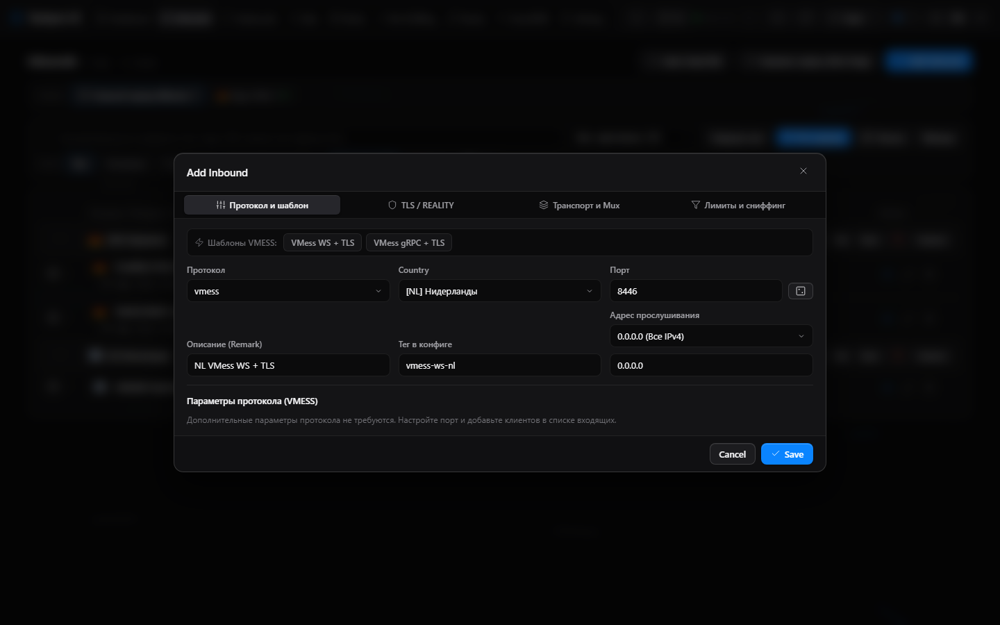

# 06. VMess

| Parameter | Value |
| :--- | :--- |
| **Role in `tachyon-ui`** | `Inbound` + `Outbound` |
| **L4 Transport** | `TCP` (plus L7 transports `ws`, `grpc`, `httpupgrade`, `xhttp`, `http`; `quic` only on Outbound with TLS; UDP and `h2mux`/UoT supported inside the session) |
| **TLS / REALITY / ACME** | Supports `none`, `tls`, `reality`; `tls` is recommended for WebSocket/gRPC behind CDN; ACME is managed by `tachyon-ui` |
| **Own Domain** | Needed when using `tls` (especially with CDN); not needed for `reality` or external TLS termination |

---

## Purpose and Architecture in `tachyon-core`

**VMess** is a classic, battle-tested protocol featuring UUID authentication and built-in AEAD encryption for headers and payloads. In modern deployments it is primarily used for compatibility with legacy clients or for tunneling through CDNs (`WebSocket + TLS`, `gRPC + TLS`).

Key characteristics in `tachyon-core 0.6.9`:
- **AEAD-only on Inbound (`alterId: 0`)**: Server-side VMess in `tachyon-core` accepts **exclusively AEAD mode** (`alterId: 0`). Inbound configs with `alterId > 0` are rejected during validation. Outbound supports both `alter_id: 0` (AEAD, recommended) and legacy `alter_id > 0` for connecting to older servers.
- **Strict time window (`±120` seconds)**: AEAD Auth ID depends on the system timestamp and enforces anti-replay protection, so server and client clocks must stay within 2 minutes of each other.
- **Full L7 transport and Mux compatibility**: Supports `ws`, `grpc`, `xhttp`, `httpupgrade`, `http`, plus `h2mux` / `UoT`.

---

## Panel Form Screenshot



---

## Step-by-Step Setup in `tachyon-ui`

### Built-in Panel Presets
| Preset | Port | TLS & SNI | Transport |
| :--- | :---: | :--- | :--- |
| **VMess WS + TLS** | `8446` | `tls`, `www.cloudflare.com` (replace with your domain), ALPN `http/1.1` | `ws`, path `/vmess-ws` |
| **VMess gRPC + TLS** | `8446` | `tls`, `dl.google.com` (replace with your domain), ALPN `h2` | `grpc`, `service_name: vmess-grpc` |

### Configuration Steps
1. Open **Inbounds → + Add Inbound** and select **`vmess`**.
2. Pick **`VMess WS + TLS`** (for CDN or reverse proxy setups) or **`VMess gRPC + TLS`**.
3. On the **TLS / REALITY** tab, set mode `tls` and your domain (or `none` if the inbound listens locally behind NGINX/Caddy on `127.0.0.1` using `external_port: 443` and `external_tls: tls`).
4. On **Transport & Mux**, customize `path` or `service_name` if needed and optionally enable `Multiplex`.
5. Save the Inbound, link it to a subscription, and apply changes.

---

## Complete Field, Switch, and Parameter Reference

Server-side `vmess` inbounds have no protocol-specific extra fields—they use the shared client list, **TLS / REALITY**, and **Transport & Mux** tabs. Outbounds add cipher selection.

### Inbound: Clients, TLS / REALITY, and Transport & Mux

| Panel Field (`tachyon-ui`) | `tachyon-core` JSON Key | Allowed Values & Default | Purpose & Tuning |
| :--- | :--- | :--- | :--- |
| **Clients** | `users[].{name, uuid}` | Name and UUID (`alterId` always `0` AEAD) | Client identification via UUID. |
| **TLS Protection Mode** | `tls.mode` | `none`, `tls`, `reality` | `tls` is required for direct domain exposure; `none` should only be used behind a reverse proxy or trusted tunnel. |
| **SNI / ALPN / Cert & Key Path** | `tls.server_name`, `tls.alpn`, `tls.certificate_path`, `tls.key_path` | Defaults: `data/certs/server.crt` / `.key` | Use `http/1.1` for `ws`/`httpupgrade`; use `h2` for `grpc`. |
| **REALITY Settings** | `tls.reality.{handshake, private_key, short_id}` (+ `pq_key`) | `www.microsoft.com:443`, X25519 + opt. PQ | Used when running VMess in `reality` mode. |
| **External Port / External TLS** | `external_port`, `external_tls` | Subscription export override | Useful when exposing WebSocket/gRPC behind Unified 443 Front. |
| **Transport (`Type`, `Path`, `Host`, `Service`, `XHTTP`)** | `transport.{type, path, headers, service_name, mode, x_padding_bytes}` | `tcp`, `ws`, `grpc`, `httpupgrade`, `xhttp`, `http` | L7 wrapper for traversing proxies and CDNs. |
| **Multiplex (`h2mux` + `Brutal`)** | `multiplex.{enabled, padding, brutal.{enabled, up_mbps, down_mbps}}` | On / Off | Multiplexes streams over a single underlying transport connection. |

### Outbound (`type: "vmess"`)

| Panel Field (`tachyon-ui`) | `tachyon-core` JSON Key | Allowed Values & Default | Purpose |
| :--- | :--- | :--- | :--- |
| **Server / Port / UUID** | `server`, `server_port`, `uuid` | Host, port, UUID | Remote endpoint and user identity |
| **Security Cipher** | `security` | `auto` (default), `chacha20-poly1305`, `aes-128-gcm`, `none` | Payload cipher; `auto` picks `aes-128-gcm` on x86_64/ARMv8 with AES-NI and `chacha20-poly1305` on other CPUs |
| **Alter ID** | `alter_id` *(via JSON)* | `0` (AEAD, recommended) or `> 0` (legacy) | Keep `0` for modern servers |
| **TLS & Transport** | `tls`, `transport` | Includes `quic` when `tls.enabled: true` | Client TLS/uTLS and L7 transport settings |

---

## Network, TLS, and Firewall Requirements

- **Firewall**: Opens **TCP** on `inb.port` (a `UDP` rule is only added for outbound `transport == "quic"` scenarios).
- **Key `tachyon-core 0.6.9` constraints**:
  - **Time synchronization (`NTP`)**: A clock skew exceeding `120` seconds between server and client causes AEAD Auth ID rejections.
  - Inbound `alterId > 0` is unsupported (only `alterId: 0` AEAD is accepted).
  - Built-in server runtime ACME is not supported—`tachyon-ui` manages certificate files.

---

## Subscription Export, Clients, and Working `tachyon-core` JSON Example

- **URI**: `vmess://<base64_json>` in standard base64-encoded JSON link format (`v: "2"`, `aid: "0"`, `scy: "auto"`, `net`, `host`, `path`, `tls`, `sni`).
- **JSON (`?format=json`, `?format=tachyon`, `?format=outbounds`)**: `type: "vmess"`.
- **Clash Meta YAML (`?format=clash`)**: `type: vmess`, `alterId: 0`, `cipher: auto` (for `xhttp`/`httpupgrade`, use JSON subscription formats).
- **Clients**: `tachyon-core` and virtually all VMess-compatible clients.

### `tachyon-core 0.6.9` Configuration Example

```json
{
  "inbounds": [
    {
      "type": "vmess",
      "tag": "vmess-ws-in",
      "listen": "::",
      "listen_port": 8446,
      "users": [
        {
          "name": "alice",
          "uuid": "11111111-2222-4333-8444-555555555555"
        }
      ],
      "transport": {
        "type": "ws",
        "path": "/vmess-ws"
      },
      "tls": {
        "enabled": true,
        "server_name": "panel.example.com",
        "alpn": ["http/1.1"],
        "certificate_path": "data/certs/server.crt",
        "key_path": "data/certs/server.key"
      }
    }
  ],
  "outbounds": [
    {
      "type": "vmess",
      "tag": "vmess-ws-out",
      "server": "198.51.100.10",
      "server_port": 8446,
      "uuid": "11111111-2222-4333-8444-555555555555",
      "security": "auto",
      "alter_id": 0,
      "transport": {
        "type": "ws",
        "path": "/vmess-ws",
        "headers": {
          "Host": "panel.example.com"
        }
      },
      "tls": {
        "enabled": true,
        "server_name": "panel.example.com",
        "alpn": ["http/1.1"],
        "utls": { "enabled": true, "fingerprint": "chrome" }
      }
    }
  ]
}
```

---

## Diagnostics and Common Errors

| Symptom | Likely Cause | Resolution |
| :--- | :--- | :--- |
| Connection fails with AEAD Auth ID / invalid user error | Server or client clock drift exceeds 120 seconds | Enable NTP sync (`chrony` / `systemd-timesyncd`) on both VPS and client device |
| Inbound fails to start with external JSON | `alterId > 0` specified in `users[]` | Remove `alterId` or set it to `0` |
| Client cannot connect over `WS + TLS` | ALPN set to `h2` or `path` / `Host` mismatch | Use `ALPN: http/1.1` and ensure `path` and `Host` match |

---

## See Also
- [Protocol Catalog](./README.md)
- [Protocol Encyclopedia](../09-protocols-encyclopedia.md)
- [UI Reference](../11-ui-every-tab-and-button-guide.md)
- Previous guide: [05. Trojan](./05-trojan.md) | Next guide: [07. Shadowsocks](./07-shadowsocks.md)
