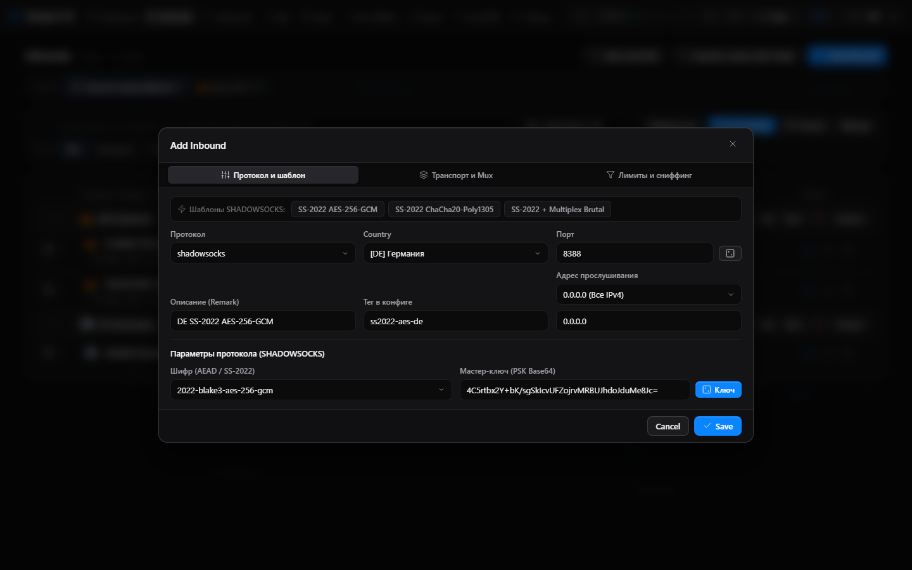

# 07. Shadowsocks (AEAD & Shadowsocks-2022)

> **Summary Card**
> - **Role in `tachyon-core`**: `Inbound` (server) and `Outbound` (client / cascade node)
> - **L4 Transport**: `TCP` and `UDP` (native UDP, UDP-over-TCP v1/v2, optional `h2mux` + `Brutal` multiplexing over TCP)
> - **TLS / REALITY / ACME**: the panel hides the TLS tab in the UI (`tlsModes: []`); at the `tachyon-core` schema level, optional `tls` over TCP is accepted (for classic obfuscation scenarios, pair it with `ShadowTLS v3` via `detour` or run standalone)
> - **Domain Required**: no — an IP address (`198.51.100.10`) is sufficient; a domain is optional for subscription convenience or when chaining behind `ShadowTLS`

---

## Purpose & How It Works in `tachyon-core`

**Simple Analogy.** While `VLESS + TLS` impersonates a standard HTTPS visitor presenting a recognizable TLS handshake, **Shadowsocks** (and its modern successor **Shadowsocks-2022**) behaves like a sealed diplomatic pouch with no outer cover: from the very first byte on the wire, the stream consists solely of a random salt followed by AEAD-encrypted payload, recognizable only to peers sharing the pre-shared key (PSK).

**Engine Mechanics in `tachyon-core`:**
- In classic AEAD ciphers (`aes-128-gcm`, `aes-256-gcm`, `chacha20-ietf-poly1305`), each TCP stream and UDP packet is encrypted using a random salt and a session subkey derived from the password.
- **Shadowsocks-2022** (`2022-blake3-aes-128-gcm`, `2022-blake3-aes-256-gcm`, `2022-blake3-chacha20-poly1305`) uses BLAKE3 key derivation, enforces strict decoded Base64 key lengths (16 bytes for 128-bit and 32 bytes for 256-bit / ChaCha20), and embeds an **authenticated timestamp check within a ±30-second window**, completely mitigating replay attacks and active probing weaknesses present in older AEAD implementations.
- `tachyon-core` supports 18 cipher variants internally (including legacy ciphers and `none` for debugging behind external encryption), while `tachyon-ui` exposes the 6 current AEAD and SS-2022 methods in the form dropdown.
- UDP datagrams operate natively over UDP sockets or encapsulated inside TCP via **UoT v1/v2** (`udp_over_tcp`), and TCP connections can optionally enable **`h2mux`** multiplexing (with `Brutal` congestion control).
- On `Inbound`, `tachyon-ui` generates a single-user entry point using a shared master key (`ss_method` + `ss_password`). If the master key field is left blank, the panel automatically falls back to the first active client's password — or a deterministic sentinel key of the exact required byte length for `2022-blake3-*` when zero active clients exist — keeping the generated `tachyon-core` config valid.
- External binary SIP003 plugins on `Outbound` are accepted by the `tachyon-core` validator for config-import compatibility, but are not spawned at runtime — for TLS masquerading in `tachyon-core`, chain with [09. ShadowTLS v3](./09-shadowtls.md).

---

## Panel Form Screenshot



---

## Step-by-Step Configuration in `tachyon-ui`

### Inbound Setup

1. Open **Inbounds** and click **Add Inbound**.
2. Select **Shadowsocks (`shadowsocks`)** as the protocol.
3. Optionally pick one of the built-in panel presets (`PROTOCOL_PRESETS.shadowsocks`):
   - **SS-2022 AES-256-GCM** — port `8388`, TLS `none`, method `2022-blake3-aes-256-gcm`.
   - **SS-2022 ChaCha20-Poly1305** — port `8388`, TLS `none`, method `2022-blake3-chacha20-poly1305`.
   - **SS-2022 + Multiplex Brutal** — port `8388`, TLS `none`, method `2022-blake3-aes-256-gcm`, `Mux` and `Brutal` enabled.
   Selecting any preset automatically calls `GET /api/generate/ss-key` and populates the master key field with a valid 256-bit Base64 PSK.
4. Choose a cipher in **Cipher (AEAD / SS-2022)** (`inb-ss-method`), and click the **Key** dice button (`/api/generate/ss-key`, which returns 32 random Base64-encoded bytes) if you want to rotate the PSK.
5. To multiplex TCP streams over a single tunnel, open the **Transport & Mux** tab and enable **Multiplex (`h2mux`)** (optionally configuring `padding` and `Brutal` with `up_mbps` / `down_mbps`).
6. Bind clients on the **Clients** tab (subscription exports use the inbound master key, or the first active client's password if the master key is empty).
7. Click **Save** and **Apply Changes** to reload the core.

### Outbound Setup

1. Open **Outbounds** and click **Add Outbound**.
2. Choose type **`shadowsocks`**.
3. Enter the server address (`198.51.100.10`), port (`8388`), select the **Encryption Method** (`out-ss-method`), and paste the PSK/password into `out-ss-pass` (a dice generator button is also provided for SS-2022 keys).
4. To enable `udp_over_tcp`, `multiplex`, or `detour` on the outbound node, add those keys in the **Advanced (raw JSON merge)** field (`out-settings`).

---

## Field, Toggle & Parameter Reference

### Inbound Node

| Panel Field (`ID`) | `tachyon-core` JSON Key | Allowed Values / Default | Purpose & Configuration Notes |
|---|---|---|---|
| **Listen** (`inb-listen`) | `listen` | `"::"` or `"0.0.0.0"` (panel default `"::"`) | Interface where `tachyon-core` accepts TCP and UDP packets. Keep `"::"` for public servers, or set `"127.0.0.1"` when running strictly behind a local `ShadowTLS` `detour`. |
| **Port** (`inb-port`) | `listen_port` | `1..65535` (preset default `8388`) | Listening port for both TCP and UDP. |
| **Cipher (AEAD / SS-2022)** (`inb-ss-method`) | `method` | `2022-blake3-aes-256-gcm` (default), `2022-blake3-aes-128-gcm`, `2022-blake3-chacha20-poly1305`, `aes-256-gcm`, `aes-128-gcm`, `chacha20-ietf-poly1305` | Choose `2022-blake3-aes-256-gcm` on modern x86_64 servers with AES-NI, or `2022-blake3-chacha20-poly1305` on ARM routers without hardware AES. Keep legacy AEAD ciphers only for older clients. |
| **Master Key (PSK Base64)** (`inb-ss-password`) | `password` | Base64 string (16 decoded bytes for `2022-*-128-*`, 32 decoded bytes for `2022-*-256-*` and `chacha20-poly1305`; arbitrary string for legacy AEAD) | SS-2022 enforces exact decoded Base64 key lengths. Use the **Key** button (`/api/generate/ss-key`) for 32-byte keys, or `openssl rand -base64 16` for `2022-blake3-aes-128-gcm`. |
| **Transport & Mux Tab** (`inb-mux-enabled`, `inb-mux-padding`, `inb-mux-brutal`, `inb-brutal-up`, `inb-brutal-down`) | `multiplex` (`enabled`, `protocol: "h2mux"`, `padding`, `brutal`) | `enabled: false` (except in *SS-2022 + Multiplex Brutal*) | Enables server-side `h2mux` stream multiplexing with optional padding and Brutal bandwidth pacing. |

### Outbound Node

| Panel Field (`ID`) | `tachyon-core` JSON Key | Allowed Values / Default | Purpose & Configuration Notes |
|---|---|---|---|
| **Server** (`out-server`) | `server` | IP or domain (`198.51.100.10`) | Remote Shadowsocks server address. |
| **Port** (`out-port`) | `server_port` | `1..65535` | Remote server port. |
| **Encryption Method** (`out-ss-method`) | `method` | Same 6 UI methods (default `2022-blake3-aes-256-gcm`) | Must match the server's `method` exactly. |
| **Password / Key** (`out-ss-pass`) | `password` | Key or password string | Must match the server's master key. |
| **Advanced JSON** (`out-settings`) | `udp_over_tcp`, `multiplex`, `network`, `detour` | Optional JSON fields | Enables `udp_over_tcp: true`, configures `multiplex`, or chains through a `ShadowTLS` outbound via `detour`. |

---

## Networking, TLS & Firewall

- **Firewall Ports (`inbound_firewall_rules`)**: `tachyon-ui` automatically opens **both `TCP` and `UDP`** on `inb.port`, because Shadowsocks and SS-2022 carry UDP datagrams natively over UDP (unless the client forces UoT).
- **TLS & Reverse Proxy**: standard HTTP reverse proxies (NGINX/Caddy L7) cannot proxy raw Shadowsocks binary streams. To wrap traffic in a genuine TLS handshake on port `443`, place [09. ShadowTLS v3](./09-shadowtls.md) in front of a local Shadowsocks inbound via `detour` (or use `inb-ext-port` when forwarding ports).
- **Mandatory Clock Synchronization**: `2022-blake3-*` ciphers reject packets whose timestamp differs by more than **±30 seconds** between client and server — ensure `chrony` or `systemd-timesyncd` (NTP) is active on servers, routers, and client devices.

---

## Subscription Export, Clients & `tachyon-core` JSON Example

- **SIP002 URI** (`?format=raw` or default Base64):
  `ss://<base64(method:password)>@198.51.100.10:8388#SS-2022`
- **SIP008 JSON** (`GET /sub/{sub_id}?format=sip008`): supported **exclusively** by Shadowsocks. Returns a standard `servers[]` list with `version: 1`, `server`, `server_port`, `password`, and `method`.
- **Client JSON** (`?format=singbox`, `?format=tachyon`, `?format=outbounds`): exported as `"type": "shadowsocks"` with `server`, `server_port`, `method`, `password` (plus `multiplex` when enabled on the inbound).
- **Clash Meta YAML** (`?format=clash` / `mihomo`): exported with `"type": ss`, `cipher`, `password`, `udp: true`.
- **Compatible Clients**: `tachyon-core` (including OpenWrt routers) and any modern client supporting Shadowsocks-2022 (`2022-blake3-*`) and SIP008/SIP002.

### Valid `tachyon-core` JSON Example

```json
{
  "inbounds": [
    {
      "type": "shadowsocks",
      "tag": "ss-in",
      "listen": "::",
      "listen_port": 8388,
      "method": "2022-blake3-aes-256-gcm",
      "password": "AAAAAAAAAAAAAAAAAAAAAAAAAAAAAAAAAAAAAAAAAAA=",
      "multiplex": {
        "enabled": true,
        "padding": true,
        "brutal": {
          "enabled": true,
          "up_mbps": 100,
          "down_mbps": 100
        }
      }
    }
  ],
  "outbounds": [
    {
      "type": "shadowsocks",
      "tag": "ss-out",
      "server": "198.51.100.10",
      "server_port": 8388,
      "method": "2022-blake3-aes-256-gcm",
      "password": "AAAAAAAAAAAAAAAAAAAAAAAAAAAAAAAAAAAAAAAAAAA="
    }
  ]
}
```
*(The key shown above is a placeholder for demonstration — always generate your own key via the **Key** button in the panel.)*

---

## Diagnostics & Troubleshooting

| Symptom | Root Cause | Resolution |
|---|---|---|
| Core fails to start or rejects config with `invalid psk length` | A plain text password or 16-byte key was entered for `2022-blake3-aes-256-gcm` or `2022-blake3-chacha20-poly1305` instead of a 32-byte Base64 PSK | Click the **Key** button in the Shadowsocks form (generates 32 Base64 bytes). For `2022-blake3-aes-128-gcm`, provide an exact 16-byte Base64 key (`openssl rand -base64 16`). |
| Connection opens, but packets are dropped or time out immediately | System clock skew between client and server exceeds the **±30-second** SS-2022 timestamp window | Run `date -u` on both server and client/router and enable NTP synchronization. |
| TCP websites load, but DNS, voice, or gaming UDP fails | Hosting firewall or upstream NAT blocks UDP on port `8388`, or UDP is missing in firewall rules | Allow UDP on the inbound port, or enable `udp_over_tcp: true` on the client outbound. |
| `plugin` / `plugin_opts` configured manually on outbound, but obfuscation does not run | External SIP003 plugin binaries are accepted by the parser for compatibility only and are not spawned by `tachyon-core` | Chain `ShadowTLS v3` + `Shadowsocks`, or switch to native TLS/REALITY protocols (`VLESS`, `AnyTLS`, `TewfAI`). |

---

## See Also

- [Protocol Catalog](./README.md)
- [Complete End-to-End Guide](../00-complete-guide.md)
- [Protocol Encyclopedia](../09-protocols-encyclopedia.md)
- [UI Every Tab & Button Guide](../11-ui-every-tab-and-button-guide.md)
- [06. VMess](./06-vmess.md)
- [08. AnyTLS](./08-anytls.md)
- [09. ShadowTLS v3](./09-shadowtls.md)
