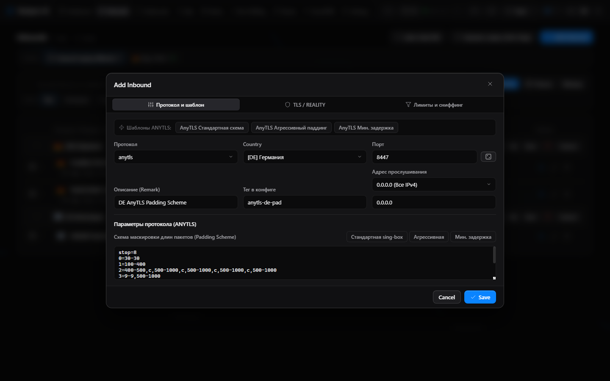

# 08. AnyTLS

> **Summary Card**
> - **Role in `tachyon-core`**: `Inbound` (server) and `Outbound` (client / load-balanced node)
> - **L4 Transport**: `TCP` (over TLS or REALITY; built-in stream multiplexing up to 1024 streams per session; UDP carried via built-in UoT v1/v2)
> - **TLS / REALITY / ACME**: `tls` or `reality` is required (`tlsModes: ['tls', 'reality']`; selecting `none` causes the panel to force `tls`). On `Outbound`, `tls.enabled: true` is strictly mandatory
> - **Domain Required**: for `tls` mode, a domain with a certificate (managed by `tachyon-ui` / ACME) or valid `server_name` is recommended; for `reality` mode, no server domain is required — a decoy host SNI is used instead

---

## Purpose & How It Works in `tachyon-core`

**Simple Analogy.** Standard TLS-wrapped proxies often leak a recognizable TLS-in-TLS fingerprint through the sizes and timing of the first records exchanged after the handshake — for example, a small client request followed by fixed-size blocks. **AnyTLS** behaves like a courier who packs both letters and parcels into variable, pre-agreed box sizes and cadences before stepping outside, so an external observer sees natural web-like record lengths instead of telltale proxy stair-steps.

**Engine Mechanics in `tachyon-core`:**
- **AnyTLS** runs over standard `TLS` or `REALITY` on `TCP`, combining lightweight internal stream multiplexing (up to 1024 logical streams per connection) with a **dynamic packet-length padding scheme (`padding_scheme`)**.
- After authenticating the client, the server transmits or applies the configured padding rules, shaping the initial records of the connection according to indexed rules `0=...`, `1=...`, ... up to `stop=N`. The `,c,` token inside a rule specifies a record-boundary check condition.
- Built-in **UDP-over-TCP (UoT v1/v2)** encapsulates client UDP datagrams inside the TCP session without requiring a separate UDP listener.
- **Critical Engine Constraint**: enabling `dialer.tcp_fast_open: true` on an `anytls` `Outbound` is **strictly forbidden** — both the `tachyon-core` validator and runtime reject it with an error.

---

## Panel Form Screenshot



---

## Step-by-Step Configuration in `tachyon-ui`

### Inbound Setup

1. Open **Inbounds** and click **Add Inbound**.
2. Select **AnyTLS (`anytls`)** as the protocol.
3. Choose one of the built-in panel presets (`PROTOCOL_PRESETS.anytls`):
   - **AnyTLS Standard Scheme** — port `8447`, TLS `tls`, SNI `www.microsoft.com`, ALPN `h2,http/1.1`, padding scheme `default`.
   - **AnyTLS Aggressive Padding** — port `8447`, TLS `tls`, SNI `www.apple.com`, ALPN `h2,http/1.1`, scheme `aggressive`.
   - **AnyTLS Low Latency** — port `8447`, TLS `tls`, SNI `www.cloudflare.com`, ALPN `h2,http/1.1`, scheme `lowlatency`.
4. In the **Packet Length Padding Scheme** (`inb-anytls-padding`) block, optionally click one of the three preset scheme buttons:
   - **Standard** (`default`): balanced profile (`stop=8`).
   - **Aggressive** (`aggressive`): larger padding ranges (`stop=10`, up to `700-1300` bytes) for strict traffic analyzers.
   - **Low Latency** (`lowlatency`): short burst (`stop=4`) tailored for gaming and interactive flows.
   You can also leave the textarea blank so `tachyon-core` uses its built-in default scheme.
5. Open the **TLS** tab:
   - Select `tls` (with a valid certificate in `data/certs/server.crt` / `server.key`) or `reality` (generate an X25519 keypair and `short_id` to masquerade behind a public site without owning a domain).
   - Mode `none` is disabled for `anytls`.
6. Add clients (`name` and `password`) on the **Clients** tab, click **Save**, and **Apply Changes**.

### Outbound Setup

1. Open **Outbounds** and click **Add Outbound**.
2. Choose type **`anytls`**.
3. Enter the server address (`198.51.100.10`), port (`8447`), and client password (`out-password`).
4. Under **TLS & Transport**, keep **Enable TLS** active (`out-tls` = `true`), set **Server Name (SNI)** and **ALPN** (`h2,http/1.1`), and if using REALITY, enable **REALITY** with `public_key` and `short_id`.
5. Make sure `tcp_fast_open: true` is not set in **Advanced (raw JSON merge)** (`out-settings`).

---

## Field, Toggle & Parameter Reference

### Built-In Padding Schemes (`ANYTLS_SCHEMES`)

| UI Preset (`applyAnytlsScheme`) | Rules (`padding_scheme`) | When to Use |
|---|---|---|
| `default` (Standard) | `stop=8`, `0=30-30`, `1=100-400`, `2=400-500,c,500-1000,c,500-1000,c,500-1000,c,500-1000`, `3=9-9,500-1000`, `4=500-1000`..`7=500-1000` | Recommended default for most networks: effectively masks TLS-in-TLS signatures with moderate overhead. |
| `aggressive` (Aggressive) | `stop=10`, `0=64-128`, `1=256-600`, `2=600-1200,c,600-1200,c,600-1200`, `3=300-900`, `4=700-1300`, `5=700-1300` | For aggressive inspection targeting initial TLS record sizes. Increases per-session handshake overhead. |
| `lowlatency` (Low Latency) | `stop=4`, `0=16-32`, `1=64-180`, `2=200-400`, `3=200-400` | Best for mobile networks, gaming, and VoIP where minimal startup overhead matters. |

### Form & JSON Parameters

| Panel Field (`ID`) | `tachyon-core` JSON Key | Allowed Values / Default | Purpose & Configuration Notes |
|---|---|---|---|
| **Padding Scheme** (`inb-anytls-padding`) | `padding_scheme` | String array (`Vec<String>`), e.g., `["stop=8", "0=30-30", ...]` | Entered line-by-line in the `<textarea>`; the panel trims lines and drops empty entries. If left empty, the field is omitted and the engine applies its built-in scheme. |
| **Clients** (Clients tab) | `users[].{name, password}` | Non-empty `name` and `password` | Authorized client credentials. When zero active clients exist, the panel inserts a `__disabled__` placeholder. |
| **TLS Mode** (`inb-tls-mode`) | `tls.mode` / `tls.enabled` | `tls` or `reality` | `none` is disallowed (`requires_tls = true`). For `tls`, use a trusted certificate (keep `allow_insecure` off outside test labs); for `reality`, `allow_insecure` is cleared to `null`. |
| **SNI / ALPN** (`inb-tls-sni`, `inb-tls-alpn`) | `tls.server_name`, `tls.alpn` | `www.microsoft.com`, `["h2", "http/1.1"]` | Must match the server certificate (`tls` mode) or the target `handshake.server` (`reality` mode). |
| **REALITY Fields** (`inb-reality-*`) | `tls.reality.{handshake, private_key, short_id}` | X25519 key, 1–16 hex chars `short_id` | Enables domainless deployment behind a live public TLS 1.3 decoy host. |
| **Outbound Fields** (`out-server`, `out-port`, `out-password`, `out-tls*`) | `server`, `server_port`, `password`, `tls` | `tls.enabled: true` strictly required | Optional `client_metadata` and session pool timers (`idle_session_check_interval`, `idle_session_timeout`, `min_idle_session`) can be supplied via `out-settings`. |

---

## Networking, TLS & Firewall

- **Firewall Ports (`inbound_firewall_rules`)**: opens **`TCP` only** on `inb.port` (preset default `8447`). No UDP port is needed because UDP travels inside the TLS tunnel via UoT.
- **Behind a Reverse Proxy**: `anytls` speaks its own binary framing immediately after the TLS handshake (not HTTP/2 or WebSocket), so a standard L7 HTTP proxy cannot terminate and forward it. Only an L4 SNI router (`stream` / `ssl_preread`) without TLS termination works; set `external_port: 443` in the inbound settings for accurate subscription exports.
- **ACME**: `tachyon-core` does not run an embedded ACME client at runtime; `tachyon-ui` handles ACME issuance/renewal and supplies `certificate_path` / `key_path` to the engine.

---

## Subscription Export, Clients & `tachyon-core` JSON Example

- **URI** (`?format=raw` or Base64):
  `anytls://<password>@panel.example.com:8447?security=tls&sni=panel.example.com&alpn=h2%2Chttp%2F1.1#AnyTLS`
  *(or with `security=reality&pbk=...&sid=...&fp=chrome` when REALITY is active).*
- **Client JSON** (`?format=singbox`, `?format=tachyon`, `?format=outbounds`): exported as `type: "anytls"`, `password`, `tls` (including `reality` and `utls` when configured).
- **Clash Meta YAML** (`?format=clash` / `mihomo`): exported as `type: anytls` with `password`, `sni`, `alpn`, `skip-cert-verify` (or `reality-opts`), and `client-fingerprint`.
- **SIP008**: not supported (Shadowsocks only).
- **Compatible Clients**: `tachyon-core` (including OpenWrt routers) and modern clients supporting `AnyTLS` or `Mihomo / Clash Meta`.

### Valid `tachyon-core` JSON Example

```json
{
  "inbounds": [
    {
      "type": "anytls",
      "tag": "anytls-in",
      "listen": "::",
      "listen_port": 8447,
      "users": [
        {
          "name": "alice",
          "password": "example-strong-password"
        }
      ],
      "padding_scheme": [
        "stop=8",
        "0=30-30",
        "1=100-400",
        "2=400-500,c,500-1000,c,500-1000,c,500-1000,c,500-1000",
        "3=9-9,500-1000",
        "4=500-1000",
        "5=500-1000",
        "6=500-1000",
        "7=500-1000"
      ],
      "tls": {
        "enabled": true,
        "server_name": "panel.example.com",
        "alpn": ["h2", "http/1.1"],
        "certificate_path": "data/certs/server.crt",
        "key_path": "data/certs/server.key"
      }
    }
  ],
  "outbounds": [
    {
      "type": "anytls",
      "tag": "anytls-out",
      "server": "198.51.100.10",
      "server_port": 8447,
      "password": "example-strong-password",
      "tls": {
        "enabled": true,
        "server_name": "panel.example.com",
        "alpn": ["h2", "http/1.1"]
      }
    }
  ]
}
```

---

## Diagnostics & Troubleshooting

| Symptom | Root Cause | Resolution |
|---|---|---|
| `tachyon-core` validation error on `Outbound`: TFO forbidden or TLS missing | `dialer.tcp_fast_open: true` is present, or `tls.enabled` is not `true` | Remove `tcp_fast_open` from `dialer` settings on that outbound and ensure `tls.enabled: true`. |
| Connection drops immediately after TLS handshake under REALITY | Mismatched `short_id` / `public_key`, or `handshake.server` is unreachable from the VPS | Verify `public_key` and `short_id` in the exported subscription and test TCP:443 reachability to the decoy SNI from the VPS. |
| Sluggish initial tab loading on mobile connections | `aggressive` scheme (`stop=10`, large initial padding blocks) over a constrained link | Switch `padding_scheme` to `default` or `lowlatency` (`stop=4`). |
| Client certificate verification error in `tls` mode | Self-signed certificate without `allow_insecure`, or SNI does not match certificate SAN | Issue a trusted ACME certificate for your domain in `tachyon-ui`, or switch `anytls` to `REALITY` mode. |

---

## See Also

- [Protocol Catalog](./README.md)
- [Complete End-to-End Guide](../00-complete-guide.md)
- [Protocol Encyclopedia](../09-protocols-encyclopedia.md)
- [UI Every Tab & Button Guide](../11-ui-every-tab-and-button-guide.md)
- [07. Shadowsocks](./07-shadowsocks.md)
- [09. ShadowTLS v3](./09-shadowtls.md)
