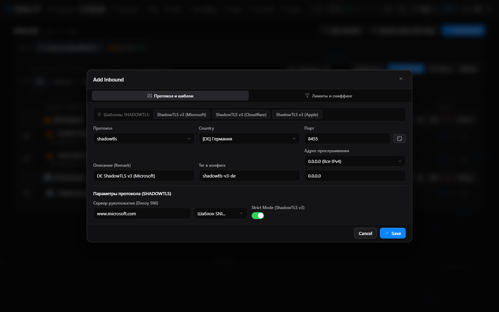

# 09. ShadowTLS v3

> **Summary Card**
> - **Role in `tachyon-core`**: `Inbound` (wrapper listener) and `Outbound` (client transport); typically deployed as a TLS masquerading layer in front of an inner proxy via `detour` (most commonly `Shadowsocks`)
> - **L4 Transport**: `TCP` only
> - **TLS / REALITY / ACME**: `tachyon-ui` hides the TLS tab for `Inbound` (`tlsModes: []`) because the server needs no certificate of its own — it relays a real handshake to `handshake.server`. On `Outbound`, the `tls` object (`tls.enabled: true`, `server_name`, optionally `utls`) is **mandatory**
> - **Domain Required**: no — you do not need your own domain or certificate; only an accessible external decoy TLS 1.3 host (`www.microsoft.com`, `www.cloudflare.com`, `www.apple.com`)

---

## Purpose & How It Works in `tachyon-core`

**Simple Analogy.** Imagine entering a private club through a bank's main lobby. The guard at the door only verifies that you completed a genuine check-in with the bank itself (a real TLS handshake with `www.microsoft.com`). Once that secure channel is established, authorized guests present a secret HMAC passphrase inside the encrypted stream and are quietly handed off to the inner operator (for example, a local `Shadowsocks` inbound). Any passive observer or active prober without the passphrase only sees a real TLS 1.3 session with the legitimate website — without your server ever needing a domain or certificate.

**Engine Mechanics in `tachyon-core`:**
- **ShadowTLS v3** does not terminate or forge the decoy site's certificate. During the TLS handshake, it forwards the client's `ClientHello` to `handshake.server:handshake.server_port` (or SNI-matched entries in `handshake_for_server_name`) and relays the authentic certificate chain back to the client.
- In **v3**, the client embeds an **HMAC-SHA1** authentication tag derived from the shared user password (`users[].password`) into the TLS `SessionID` and subsequent handshake records.
- If the HMAC validates, `tachyon-core` switches the connection after handshake completion to relay frames transparently to the inner inbound specified in `detour` (such as `shadowsocks` or `socks`), protected by TLS 1.3 session keys against tampering or truncation.
- Unauthenticated browsers or active DPI probes that lack a valid password are proxied straight through to `handshake.server`, revealing no proxy behavior.
- **`version: 1` is unsupported** in `tachyon-core` and rejected at runtime. `tachyon-ui` always generates **`version: 3`**.

---

## Panel Form Screenshot



---

## Step-by-Step Configuration in `tachyon-ui`

### Inbound Setup

1. Open **Inbounds** and create (or verify) your inner proxy inbound — typically **Shadowsocks** listening on `127.0.0.1` (or an internal port).
2. Click **Add Inbound** and select **ShadowTLS (`shadowtls`)**.
3. Choose one of the built-in presets (`PROTOCOL_PRESETS.shadowtls`):
   - **ShadowTLS v3 (Microsoft)** — port `8455`, `tls: none`, `handshake.server`: `www.microsoft.com`, `strict_mode: true`.
   - **ShadowTLS v3 (Cloudflare)** — port `8455`, `tls: none`, `handshake.server`: `www.cloudflare.com`, `strict_mode: true`.
   - **ShadowTLS v3 (Apple)** — port `8455`, `tls: none`, `handshake.server`: `www.apple.com`, `strict_mode: true`.
4. In **Handshake Server (Decoy SNI)** (`inb-stls-server`), keep the preset domain or select another from the `SNI Template...` dropdown (custom `host:port` notation such as `example.com:443` is supported).
5. Keep **Strict Mode (ShadowTLS v3)** (`inb-stls-strict`) **enabled** (`true`).
6. Add users (`name` and `password`) on the **Clients** tab.
7. Bind `detour` to the tag of your inner inbound (for example, `ss-inner`), click **Save**, and **Apply Changes**.

### Outbound Setup

1. Open **Outbounds** and select type **`shadowtls`**.
2. Enter the server IP/host (`198.51.100.10`), port (`8455`), and user password (`out-password`).
3. In **Advanced (raw JSON merge)** (`out-settings`), specify `"version": 3` and `"tls": { "enabled": true, "server_name": "www.microsoft.com", "utls": { "enabled": true, "fingerprint": "chrome" } }`.
4. On your inner proxy outbound (e.g., `shadowsocks`), set `"detour": "<tag_of_shadowtls_outbound>"` so its traffic rides inside the ShadowTLS tunnel.

---

## Field, Toggle & Parameter Reference

### Inbound Node

| Panel Field (`ID`) | `tachyon-core` JSON Key | Allowed Values / Default | Purpose & Configuration Notes |
|---|---|---|---|
| **Protocol Version** (fixed by panel) | `version` | `3` (panel always sets `3`; `1` is rejected by `tachyon-core`) | Enables ShadowTLS v3 with TLS 1.3 record framing and HMAC-SHA1 authentication. |
| **Handshake Server (Decoy SNI)** (`inb-stls-server`) | `handshake.server`, `handshake.server_port` | Domain or `host:port` (default `www.microsoft.com`, port `443`) | External TLS 1.3 server used for the real handshake. Pick a nearby, unblocked host that supports TLS 1.3. |
| **Strict Mode (ShadowTLS v3)** (`inb-stls-strict`) | `strict_mode` | `true` (default) / `false` | Enforces strict TLS 1.3 record sequencing and prevents downgrade behavior against active probing or spoofing. Disable only for compatibility with unusual clients. |
| **Clients** (Clients tab) | `users[].{name, password}` | Array of `{ name, password }` | Passwords used to compute the v3 HMAC-SHA1 tag. When zero active clients exist, `tachyon-ui` emits a `__disabled__` placeholder. |
| **Inner Target (`detour`)** | `detour` | Tag of a local inbound (`shadowsocks`, `socks`, etc.) | Tag of the inner inbound that receives the authenticated stream after handshake completion. |

### Outbound Node

| Panel Field (`ID`) | `tachyon-core` JSON Key | Allowed Values / Default | Purpose & Configuration Notes |
|---|---|---|---|
| **Server / Port / Password** (`out-server`, `out-port`, `out-password`) | `server`, `server_port`, `password` | Host, port, user password | Must match the ShadowTLS inbound address and one of the passwords in `users[]`. |
| **Version & TLS** (`out-settings`) | `version`, `tls` (`enabled: true`, `server_name`, `utls`) | `version: 3`, `tls.enabled: true` | **Mandatory** on outbound: `server_name` must match the server's `handshake.server`; enabling `utls` (`chrome` / `firefox`) is recommended for realistic ClientHello fingerprints. |

---

## Networking, TLS & Firewall

- **Firewall Ports (`inbound_firewall_rules`)**: opens **`TCP` only** on `inb.port` (preset `8455`, or `443` in common production deployments).
- **Outbound Reachability from Server**: the VPS must have unrestricted outbound TCP access to `handshake.server:443`. If the decoy host is unreachable from the VPS or lacks TLS 1.3, every client handshake will fail.
- **Behind a Reverse Proxy**: `ShadowTLS` cannot sit behind an HTTP-terminating NGINX/Caddy proxy because it requires the raw `ClientHello`. Only transparent L4 TCP forwarding (such as NGINX `stream` SNI routing) works; set `external_port` for accurate subscription links.

---

## Subscription Export, Clients & `tachyon-core` JSON Example

- **URI** (`?format=raw` or Base64):
  `shadowtls://<password>@198.51.100.10:8455?version=3&sni=www.microsoft.com#ShadowTLS`
  *(When paired with `Shadowsocks`, clients typically import the combined `detour` chain from JSON profiles.)*
- **Client JSON** (`?format=singbox`, `?format=tachyon`, `?format=outbounds`): exported as `"type": "shadowtls"`, `"version": 3`, `"password"`, `"tls": { "enabled": true, "server_name": "www.microsoft.com" }`.
- **Clash Meta YAML** (`?format=clash` / `mihomo`): standalone `shadowtls` nodes are **not exported** (Clash embeds ShadowTLS inside `ss` via `shadow-tls-opts`); use `?format=singbox` or `?format=tachyon` for full `detour` chains.
- **SIP008**: not supported.
- **Compatible Clients**: `tachyon-core` (including OpenWrt) and clients supporting `ShadowTLS v3` + `detour` (e.g., `Shadowsocks` over `ShadowTLS v3`).

### Valid `tachyon-core` JSON Example (ShadowTLS v3 + Shadowsocks Chain)

```json
{
  "inbounds": [
    {
      "type": "shadowtls",
      "tag": "stls-in",
      "listen": "::",
      "listen_port": 8455,
      "version": 3,
      "users": [
        {
          "name": "alice",
          "password": "example-stls-password"
        }
      ],
      "handshake": {
        "server": "www.microsoft.com",
        "server_port": 443
      },
      "strict_mode": true,
      "detour": "ss-inner"
    },
    {
      "type": "shadowsocks",
      "tag": "ss-inner",
      "listen": "127.0.0.1",
      "listen_port": 18388,
      "method": "2022-blake3-aes-256-gcm",
      "password": "AAAAAAAAAAAAAAAAAAAAAAAAAAAAAAAAAAAAAAAAAAA="
    }
  ],
  "outbounds": [
    {
      "type": "shadowsocks",
      "tag": "ss-via-stls",
      "method": "2022-blake3-aes-256-gcm",
      "password": "AAAAAAAAAAAAAAAAAAAAAAAAAAAAAAAAAAAAAAAAAAA=",
      "detour": "stls-out"
    },
    {
      "type": "shadowtls",
      "tag": "stls-out",
      "server": "198.51.100.10",
      "server_port": 8455,
      "version": 3,
      "password": "example-stls-password",
      "tls": {
        "enabled": true,
        "server_name": "www.microsoft.com",
        "utls": {
          "enabled": true,
          "fingerprint": "chrome"
        }
      }
    }
  ]
}
```

---

## Diagnostics & Troubleshooting

| Symptom | Root Cause | Resolution |
|---|---|---|
| Initialization error or client rejection with `version: 1` | Legacy version 1 specified in a manual config or client profile | `tachyon-core` supports **v3** (and `tachyon-ui` always outputs `version: 3`); update the client configuration to v3. |
| Handshake hangs or times out for all clients | `handshake.server` is unreachable on TCP:443 from the VPS, blocked, or lacks TLS 1.3 | Test from the VPS with `openssl s_client -connect www.microsoft.com:443 -tls1_3` or switch the Decoy SNI to `www.cloudflare.com` / `www.apple.com`. |
| Connection completes handshake, but inner traffic stalls or resets | Missing `detour` pointing to the inner proxy (`shadowsocks`), or the inner outbound does not reference the `shadowtls` tag in `detour` | Verify matching `detour` tags on both the server `Inbound` and client `Outbound`. |
| ShadowTLS node missing from Clash Meta subscription | Clash YAML export skips standalone `shadowtls` inbounds | Download the profile via `?format=singbox` or `?format=tachyon`. |

---

## See Also

- [Protocol Catalog](./README.md)
- [Complete End-to-End Guide](../00-complete-guide.md)
- [Protocol Encyclopedia](../09-protocols-encyclopedia.md)
- [UI Every Tab & Button Guide](../11-ui-every-tab-and-button-guide.md)
- [07. Shadowsocks](./07-shadowsocks.md)
- [08. AnyTLS](./08-anytls.md)
- [10. NaiveProxy](./10-naive.md)
