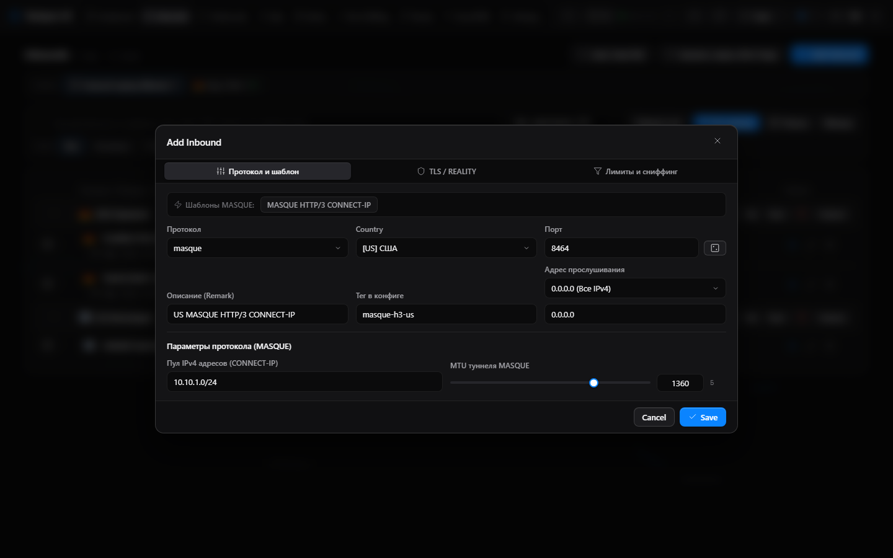

# 11. MASQUE (HTTP/3 CONNECT-IP / Cloudflare)

> **Summary Card**
> - **Role in `tachyon-core`**: `Inbound` (RFC 9484 CONNECT-IP server) and `Outbound` (`standard` client profile for your own server, plus `cloudflare` profile for WARP-compatible endpoints)
> - **L4 Transport**: `UDP` (HTTP/3 QUIC with ALPN `h3`); `Outbound` with `profile: "cloudflare"` and `vhttp: "auto"` or `"h2"` can also run over `TCP` HTTP/2. Encapsulates L3 IP packets (TCP/UDP/ICMP via a userspace `smoltcp` stack)
> - **TLS / REALITY / ACME**: certificate-backed `TLS` (`tls.enabled: true`) is **strictly mandatory** (`tlsModes: ['tls']`). The `standard` profile requires a valid trusted certificate whose SAN matches `sni`; the `cloudflare` profile authenticates via ECDSA P-256 key pinning
> - **Domain Required**: **yes, recommended** for your own `Inbound` (`profile: "standard"`) with a trusted CA certificate so clients pass SAN verification without disabling TLS checks

---

## Purpose & How It Works in `tachyon-core`

**Simple Analogy.** While classic proxies (`VLESS` or `SOCKS5`) forward individual application TCP and UDP streams, **MASQUE (RFC 9484 `CONNECT-IP`)** turns a standard HTTP/3 connection into a full **Layer-3 IP VPN tunnel** (similar to WireGuard, but disguised inside browser-grade HTTP/3 traffic to a web server). Deep Packet Inspection sees standard QUIC / HTTP/3 HTTP Datagrams and Capsules on the wire, while full IP packets — including ICMP (`ping`), DNS, and any transport protocol — flow inside.

**Engine Mechanics in `tachyon-core`:**
- **On `Inbound`**, `tachyon-core` runs an HTTP/3 QUIC listener serving `CONNECT-IP` requests at the standard well-known path `/.well-known/masque/ip/*/*/`. An embedded userspace `smoltcp` TCP/IP stack assigns client IPv4 addresses from `ipv4_pool` (default `10.10.1.0/24`) and translates L3 packets into core outbound connections respecting the configured `mtu`.
- **On `Outbound`**, two profiles are supported:
  1. **`standard`** — connects to your own MASQUE server (`tachyon-core` or any RFC 9484-compliant gateway). Uses standard TLS PKI verification: `tachyon-ui` subscription export automatically sets `sni` to a domain from the active trusted CA certificate's SAN and omits `insecure` when a valid certificate is present.
  2. **`cloudflare`** — connects to WARP-compatible endpoints authenticated via an **ECDSA P-256** keypair (`private_key` and `public_key` for server public-key pinning).
- **Strict ECDSA P-256 Key Validation in `tachyon-ui`**: when generating the core configuration, `tachyon-ui` validates `private_key` (strictly Base64 PKCS#8 DER or SEC1 DER with an explicit `prime256v1` curve OID) and `public_key` (Base64 SPKI DER wrapping a 65-byte uncompressed `0x04 || X || Y` key). Any outbound with malformed keys (or missing `private_key` when `profile != "standard"`) is filtered out with a warning log so the core never fails to boot.
- **Router-Friendly NAT Timers**: when exporting client JSON profiles (`?format=singbox` / `?format=tachyon`), `tachyon-ui` automatically injects **`keep_alive_period: "20s"`** and **`idle_timeout: "50s"`**, keeping UDP NAT mappings alive on home routers (OpenWrt) and cellular carriers during idle periods.

---

## Panel Form Screenshot



---

## Step-by-Step Configuration in `tachyon-ui`

### Inbound Setup

1. Ensure your server has a real domain (`panel.example.com`) and a trusted TLS certificate in `data/certs/server.crt` / `server.key`.
2. Open **Inbounds** and click **Add Inbound**.
3. Select **MASQUE (`masque`)** as the protocol.
4. Apply the built-in preset (`PROTOCOL_PRESETS.masque`):
   - **MASQUE HTTP/3 CONNECT-IP** — UDP port `8464`, TLS `tls`, SNI `www.cloudflare.com` (replaced with `web_domain` when configured), ALPN `h3`, `mtu: 1360`, `pool: 10.10.1.0/24`.
5. Check **IPv4 Address Pool (CONNECT-IP)** (`inb-masque-pool`, default `10.10.1.0/24`) — make sure it does not overlap with the VPS LAN or WireGuard/AmneziaWG/FPTN pools.
6. Adjust the **MASQUE Tunnel MTU** slider (`inb-masque-mtu`, `1200` to `1420` in steps of `10`, default `1360`). On LTE/5G or PPPoE links, lowering MTU to `1280`–`1320` prevents fragmentation.
7. On the **TLS** tab, verify **Server Name (SNI)** (must match the certificate SAN) and ALPN `h3`.
8. Add clients on the **Clients** tab (`tachyon-ui` deterministically assigns each client a unique IP from `masque_ipv4_pool` during subscription export), click **Save**, and **Apply Changes**.

### Outbound Setup

1. Open **Outbounds** and choose type **`masque`**.
2. Fill in the server, port, and **TLS** parameters (`tls.enabled: true`, `server_name`, `alpn: ["h3"]`).
3. Configure protocol-specific fields in **Advanced (raw JSON merge)** (`out-settings`):
   - For your own server: `"profile": "standard"`, `"uri": "https://panel.example.com:8464/.well-known/masque/ip/*/*/"`, `"ip": "10.10.1.2"`, `"mtu": 1360`, `"keep_alive_period": "20s"`, `"idle_timeout": "50s"`.
   - For the `cloudflare` profile: `"profile": "cloudflare"`, `"vhttp": "auto"` (`"h3"` or `"h2"`), `"private_key": "<Base64 PKCS#8 P-256>"`, `"public_key": "<Base64 SPKI P-256>"`, `"ip"`, `"ipv6"`, `"mtu"`.

### Generating Valid P-256 EC Keys for `MASQUE` (`cloudflare`)

To generate an ECDSA `prime256v1` keypair in the exact Base64 DER format required by `tachyon-ui` and `tachyon-core`:

```bash
# 1. P-256 private key in PKCS#8 DER -> single-line Base64
openssl genpkey -algorithm EC -pkeyopt ec_paramgen_curve:prime256v1 -outform DER | base64 -w0

# Or convert an existing ec_priv.pem to PKCS#8 DER Base64:
openssl pkcs8 -topk8 -nocrypt -in ec_priv.pem -outform DER | base64 -w0

# 2. P-256 public key in SPKI DER (65-byte uncompressed key) -> Base64
openssl pkey -in ec_priv.pem -pubout -outform DER | base64 -w0
```

---

## Field, Toggle & Parameter Reference

### Inbound Node

| Panel Field (`ID`) | `tachyon-core` JSON Key | Allowed Values / Default | Purpose & Configuration Notes |
|---|---|---|---|
| **IPv4 Address Pool (CONNECT-IP)** (`inb-masque-pool`) | `ipv4_pool` | CIDR subnet, default `"10.10.1.0/24"` | Virtual L3 tunnel subnet. `tachyon-ui` allocates unique client IPs from this CIDR when exporting subscriptions. |
| **MASQUE Tunnel MTU** (`inb-masque-mtu`) | `mtu` | `1200..1420` in UI (default `1360`; engine minimum `1200`, otherwise falls back to `1280`) | Maximum inner IP packet size carried inside HTTP/3 capsules. `1360` suits standard broadband; `1280` suits constrained mobile links. |
| **TLS Mode** (`inb-tls-mode`) | `tls.enabled: true` | `tls` only | Mandatory certificate-backed TLS 1.3 for HTTP/3 QUIC. |
| **SNI / ALPN** (`inb-tls-sni`, `inb-tls-alpn`) | `tls.server_name`, `tls.alpn` | Domain from SAN, `["h3"]` | For `profile: "standard"`, `server_name` must match the certificate SAN so clients accept the TLS handshake. |

### Outbound Node

| Parameter (`out-settings` / form) | `tachyon-core` JSON Key | Allowed Values / Default | Purpose & Configuration Notes |
|---|---|---|---|
| **Profile** | `profile` | `"standard"` \| `"cloudflare"` | Selects RFC 9484 CONNECT-IP mode or Cloudflare WARP-compatible mode with P-256 key pinning. |
| **HTTP Version** | `vhttp` | `"auto"` \| `"h3"` \| `"h2"` | Transport selector for the `cloudflare` profile (`auto` prefers H3 with H2 fallback). |
| **Endpoint URI** | `uri` | `"https://panel.example.com:8464/.well-known/masque/ip/*/*/"` | Target CONNECT-IP resource URI on the server. |
| **Client Tunnel IP** | `ip`, `ipv6` | `"10.10.1.2"`, optional IPv6 | Virtual tunnel interface address assigned to the client. |
| **P-256 Keys** | `private_key`, `public_key` | Base64 DER (PKCS#8 or SEC1 with `prime256v1` OID; SPKI 65-byte `0x04...`) | `private_key` is required when `profile != "standard"`; `public_key` pins the server key. Invalid keys are stripped by `tachyon-ui`. |
| **NAT Keepalive Timers** | `keep_alive_period`, `idle_timeout` | Subscriptions automatically emit `"20s"` and `"50s"` | Prevents OpenWrt routers and carrier NAT gateways from dropping idle UDP mappings. |
| **MTU** | `mtu` | `>= 1200` (typically `1360` or `1280`) | Should not exceed the server's MTU to avoid QUIC packet fragmentation. |

---

## Networking, TLS & Firewall

- **Firewall Ports (`inbound_firewall_rules`)**: opens **`UDP`** on `inb.port` (preset `8464`).
- **Trusted PKI Certificate**: for `standard` MASQUE deployments, a trusted CA certificate with a matching SAN is critical — when a valid certificate is active, `tachyon-ui` suppresses `insecure` and exports the certificate SAN as `sni`.
- **Reverse Proxy**: standard L7 HTTP/2 reverse proxies cannot forward `HTTP/3 CONNECT-IP` datagrams. Expose a direct UDP port (such as `443/udp` or `8464/udp`) or use L4 UDP forwarding (with `external_port` set for subscription exports).

---

## Subscription Export, Clients & `tachyon-core` JSON Example

- **URI** (`?format=raw` or Base64):
  `masque://panel.example.com:8464?profile=standard&uri=https%3A%2F%2Fpanel.example.com%3A8464%2F.well-known%2Fmasque%2Fip%2F*%2F*%2F&ip=10.10.1.2&mtu=1360&sni=panel.example.com#MASQUE`
- **Client JSON** (`?format=singbox`, `?format=tachyon`, `?format=outbounds`): exported with `"type": "masque"`, `"profile": "standard"`, `"uri"`, `"ip"`, `"keep_alive_period": "20s"`, `"idle_timeout": "50s"`, `"mtu"`, and `"tls"`.
- **Clash Meta YAML** and **SIP008**: **not exported** — use `?format=singbox`, `?format=tachyon`, or URIs.
- **Compatible Clients**: `tachyon-core` (including OpenWrt routers with `keep_alive_period` / `idle_timeout` support).

### Valid `tachyon-core` JSON Example

```json
{
  "inbounds": [
    {
      "type": "masque",
      "tag": "masque-in",
      "listen": "::",
      "listen_port": 8464,
      "mtu": 1360,
      "ipv4_pool": "10.10.1.0/24",
      "tls": {
        "enabled": true,
        "server_name": "panel.example.com",
        "alpn": ["h3"],
        "certificate_path": "data/certs/server.crt",
        "key_path": "data/certs/server.key"
      }
    }
  ],
  "outbounds": [
    {
      "type": "masque",
      "tag": "masque-out",
      "profile": "standard",
      "uri": "https://panel.example.com:8464/.well-known/masque/ip/*/*/",
      "ip": "10.10.1.2",
      "mtu": 1360,
      "keep_alive_period": "20s",
      "idle_timeout": "50s",
      "tls": {
        "enabled": true,
        "server_name": "panel.example.com",
        "alpn": ["h3"]
      }
    }
  ]
}
```

---

## Diagnostics & Troubleshooting

| Symptom | Root Cause | Resolution |
|---|---|---|
| `masque` outbound is omitted from the generated core config and balancer groups | Malformed P-256 `private_key` or `public_key` (e.g., PEM headers instead of raw Base64 DER, SEC1 without `prime256v1` OID, or missing `private_key` on `cloudflare` profile) | Regenerate keys as raw Base64 DER via `openssl` (PKCS#8 + SPKI without `-----BEGIN...-----` headers) and verify `out-settings`. |
| `standard` profile connection fails TLS certificate verification | `sni` does not match certificate SAN, or server uses a self-signed certificate | Issue a valid CA certificate via ACME in `tachyon-ui` and use that exact domain in `tls.server_name` and the `uri` host. |
| Tunnel on OpenWrt router stalls after 30–60 seconds of inactivity | ISP or gateway NAT drops idle UDP state | Verify `"keep_alive_period": "20s"` and `"idle_timeout": "50s"` are present in the client JSON (added automatically by `tachyon-ui` export). |
| Cannot connect to MASQUE over UDP/8464 | ISP blocks QUIC/UDP or UDP port is closed in firewall | Open UDP on the inbound port; if UDP is blocked, use `MASQUE` `cloudflare` profile with `vhttp: "h2"` or TCP/HTTP2 protocols (`TrustTunnel`, `NaiveProxy`, `AnyTLS`). |

---

## See Also

- [Protocol Catalog](./README.md)
- [Complete End-to-End Guide](../00-complete-guide.md)
- [Protocol Encyclopedia](../09-protocols-encyclopedia.md)
- [UI Every Tab & Button Guide](../11-ui-every-tab-and-button-guide.md)
- [10. NaiveProxy](./10-naive.md)
- [12. TrustTunnel](./12-trusttunnel.md)
