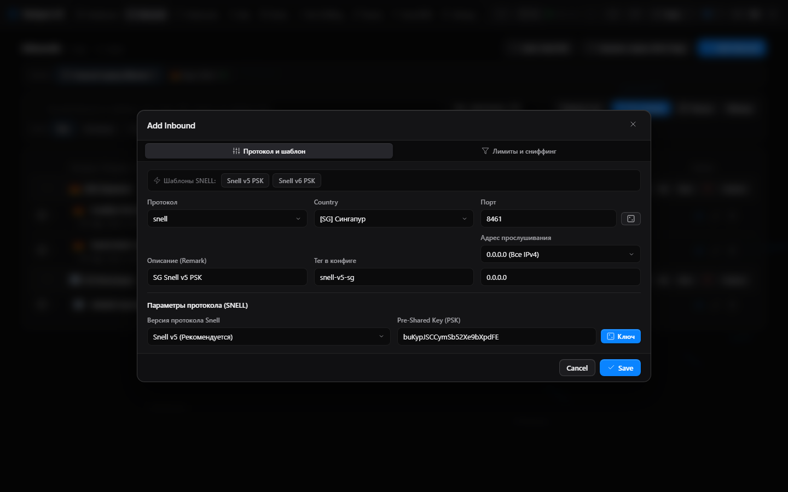

# 14. Snell (v4 / v5 / v6)

| Parameter | Value |
| :--- | :--- |
| **Role in `tachyon-ui`** | `Inbound` + `Outbound` |
| **L4 Transport** | `TCP` (carries TCP, native UDP, and `UDP-over-TCP` v1/v2) |
| **TLS / REALITY / ACME** | Not supported (`none`); the TLS tab is hidden in the panel. For TLS camouflage, wrap behind `ShadowTLS v3` |
| **Status in `tachyon-core 0.6.9`** | Full schema (`check`) and runtime (`run`) support within version constraints |

---

## Purpose and How It Works in `tachyon-core`

**Snell** is a lightweight binary proxy protocol authenticated via a Pre-Shared Key (**PSK**), originally created for the Surge ecosystem and engineered for minimal CPU, memory, and battery overhead.

How it operates in `tachyon-core 0.6.9`:

1. The client opens a TCP connection to the server and completes a fast binary handshake using the shared `psk` without the round-trip overhead of a full TLS handshake.
2. Over a single session, it supports TCP connection reuse (`CMD_CONNECT_V2`), UDP datagram forwarding (`CMD_UDP`, native UDP or `udp_over_tcp`), and channel liveness probes (`CMD_PING`).
3. **Important version differences in `tachyon-core 0.6.9`:**
   - **Inbound** accepts **only `version: 5` or `6`** (`version: 4` on an inbound is rejected by the validator).
   - **Outbound** supports `version: 4`, `5`, and `6`.
   - For **v6** on the server, the `psk` length must strictly be **12 to 255 bytes**, and legacy `obfs_mode` obfuscation is replaced by the `mode` parameter (`default`, `unshaped`, `unsafe-raw`).
   - For **v5** (and **v4** on outbound), `obfs_mode` / `obfs` (`none`, `http`, `tls`) is allowed, whereas `mode` is forbidden.

> [!TIP]
> Because Snell's native stream is encrypted without an external TLS handshake, deployments behind strict network filters often pair it with a `ShadowTLS v3` layer (via `detour` / cascade) to present a genuine third-party TLS 1.3 handshake.

---

## Panel Form Screenshot



---

## Step-by-Step Setup in `tachyon-ui`

### Configuring an Inbound

1. Go to the **Inbounds** tab and click **Add**.
2. Select the **`snell`** protocol. The TLS tab hides automatically because Snell does not use native TLS.
3. Optionally pick a built-in preset at the top of the form:
   - **`Snell v5 PSK`** — TCP port `8461`, `version: 5` (broadest compatibility with third-party v5 clients).
   - **`Snell v6 PSK`** — TCP port `8461`, `version: 6` (modern variant supporting `mode` profiles).
4. Set the **Port** (default `8461`), confirm version `5` or `6` (do not choose `4` for an inbound), and enter a strong **Pre-Shared Key (PSK)** (for `v6`, at least 12 characters; if left blank, the panel falls back to the first active client password, though an explicit PSK is recommended).
5. Save the rule and apply the configuration (**Apply** / restart `tachyon-core`).

### Configuring an Outbound

1. Open the **Outbounds** tab and select **`snell`**.
2. Fill in the remote **Server** (`198.51.100.10` or `panel.example.com`), **Port**, and shared key in the password (**PSK**) field.
3. If the remote server runs `v4`, `v6`, or uses HTTP/TLS header obfuscation (`obfs`), expand the additional outbound JSON settings (`out-settings`) and specify `version`, `obfs` / `obfs_host` (for v4/v5), or `mode` (for v6).

---

## Field, Toggle, and Parameter Reference

### Inbound

| Panel Field | `tachyon-core` JSON Key | Allowed Values / Default | Purpose |
| :--- | :--- | :--- | :--- |
| **Listen Address** (`inb-listen`) | `listen` | IPv4/IPv6; default `0.0.0.0` (or `::`) | Network interface on which the server accepts TCP connections |
| **Port** (`inb-port`) | `listen_port` | `1..65535`; preset `8461` | Inbound TCP port for Snell |
| **Snell Protocol Version** (`inb-snell-ver`) | `version` | `5`, `6` (`4` appears in UI, but core inbound validator allows only `5` or `6`) | Protocol version; use `5` for broad compatibility or `6` for the newest clients |
| **Pre-Shared Key (PSK)** (`inb-snell-psk`) | `psk` | String (`12..255` bytes strictly for `v6`) | Shared secret key; if empty, the panel substitutes the first active client's password (or a sentinel) |
| **Obfuscation Mode** *(JSON)* | `obfs_mode` | `none`, `http`, `tls` (`v5` only) | Lightweight header obfuscation; forbidden in `version: 6` |
| **Stream Mode** *(JSON)* | `mode` | `default`, `unshaped`, `unsafe-raw` (`v6` only) | Snell v6 stream processing profile; forbidden in `version: 5` |

### Outbound

| Panel Field | `tachyon-core` JSON Key | Allowed Values / Default | Purpose |
| :--- | :--- | :--- | :--- |
| **Server** (`out-server`) | `server` | IP or domain (`198.51.100.10`, `panel.example.com`) | Remote Snell server address |
| **Port** (`out-port`) | `server_port` | `1..65535` | Remote server port |
| **Password / PSK** (`out-password`) | `psk` | String (`12..255` bytes for `v6`) | Shared authentication key; can also be set inside `out-settings` |
| **Version** *(in `out-settings`)* | `version` | `4`, `5`, `6` | Remote server protocol version |
| **Obfuscation** *(in `out-settings`, v4/v5)* | `obfs` / `obfs_mode`, `obfs_host` | `none`, `http`, `tls`; domain for HTTP/TLS | Enables header obfuscation (forbidden for `v6`) |
| **UDP over TCP** *(in `out-settings`, v4/v5)* | `udp_over_tcp` | `true` / `false` (or version object) | Encapsulates UDP packets over TCP (forbidden for `v6`) |
| **v6 Mode** *(in `out-settings`, v6)* | `mode` | `default`, `unshaped`, `unsafe-raw` | Snell v6 specific mode (forbidden for `v4`/`v5`) |

---

## Networking, TLS, and Firewall

- **TLS / REALITY / ACME:** Snell does not use TLS certificates, an ACME domain, or REALITY. When external TLS camouflage is needed, wrap it with `ShadowTLS v3` (via `detour`).
- **Firewall Rules:** `tachyon-ui` automatically opens **`TCP`** on the configured `listen_port` (for example, `8461/tcp`). No separate UDP port is needed because client UDP traffic is carried inside the protocol.
- **NAT / Reverse Proxy Traversal:** Snell does not work behind standard L7 HTTP reverse proxies (such as NGINX/Caddy HTTP sites), as it uses a custom binary protocol over raw TCP (or L4 `stream` passthrough).

---

## Subscription Export, Compatible Clients, and Valid `tachyon-core` JSON

- **Subscription Export Formats (`GET /sub/{sub_id}?format=...`):**
  - **URI (`raw` / Base64):** `snell://<psk>@198.51.100.10:8461?version=5#Snell-v5`
  - **Client JSON (`?format=singbox` / `tachyon` / `outbounds`):** generates a full `type: "snell"` object.
  - **Clash Meta / Mihomo YAML (`clash` / `mihomo` / `yaml`):** supported (`type: snell`, `psk`, `version`).
  - **SIP008:** not supported (Shadowsocks only).
- **Compatible Clients:** `tachyon-core` (OpenWrt, Linux, Windows, macOS), Surge, Clash Meta / Mihomo.

### Valid `tachyon-core` JSON Example

#### Inbound (`inbounds[]`, version 5)

```json
{
  "type": "snell",
  "tag": "snell-in-8461",
  "listen": "::",
  "listen_port": 8461,
  "version": 5,
  "psk": "v5-example-secret-key-2026"
}
```

#### Outbound (`outbounds[]`, version 6)

```json
{
  "type": "snell",
  "tag": "snell-out-v6",
  "server": "198.51.100.10",
  "server_port": 8461,
  "version": 6,
  "psk": "v6-strong-secret-min12chars"
}
```

---

## Diagnostics and Common Errors

| Symptom / Error | Cause | Resolution |
| :--- | :--- | :--- |
| `tachyon-core check` fails on inbound startup | Version **`4`** was selected for an inbound | Switch the inbound version to **`5`** or **`6`** (`v4` is supported on `outbound` only) |
| `psk` length validation error in `version: 6` | Key is shorter than 12 bytes or longer than 255 bytes | Set a `psk` between `12..255` characters (for example, generate a random 24–32 character string) |
| Field conflict error between `mode` and `obfs_mode` | `obfs_mode`/`udp_over_tcp` passed in `v6`, or `mode` passed in `v5` | Keep `obfs_mode` strictly for `v4`/`v5`, and `mode` strictly for `v6` |
| Client fails to pass UDP or throughput drops | Port blocked or client expects a different version (`v5` vs `v6`) | Verify `version` and `psk` match across server and subscription, and check `TCP` port `8461` reachability |

---

## See Also

- [Complete Guide](../00-complete-guide.md)
- [Protocols Encyclopedia](../09-protocols-encyclopedia.md)
- [UI Every Tab and Button Guide](../11-ui-every-tab-and-button-guide.md)
- [Protocol Catalog](./README.md)
- [13. Mieru](./13-mieru.md)
- [15. MTProto](./15-mtproto.md)
- [09. ShadowTLS v3](./09-shadowtls.md)
