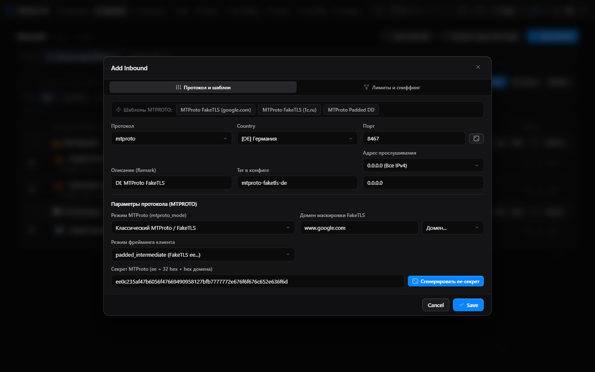

# 15. MTProto (FakeTLS / Padded DD / telegram-ws)

| Parameter | Value |
| :--- | :--- |
| **Role in `tachyon-ui`** | `Inbound` + `Outbound` |
| **L4 Transport** | `TCP` only (UDP is not supported). Outbound additionally supports `telegram-ws` / `kws` (`wss://` with TCP fallback) |
| **TLS / REALITY / ACME** | The TLS tab is hidden for classic `inbound` (`none`; FakeTLS camouflage is embedded in the secret). For `telegram-ws` / `kws` outbounds, `tls: { enabled: true }` is enabled automatically |
| **Status in `tachyon-core 0.6.9`** | Full schema (`check`) and runtime (`run`) support |

---

## Purpose and How It Works in `tachyon-core`

**MTProto** is a specialized proxy protocol built exclusively for the Telegram messenger. Unlike general-purpose VPN and proxy tunnels, it requires no separate VPN client on mobile or desktop: users simply open a `tg://proxy?...` link directly inside the Telegram app.

In `tachyon-core 0.6.9`, the protocol operates in two roles:

1. **Inbound (server for Telegram clients):** accepts TCP connections from Telegram authenticated by a secret, obfuscated with an `obfuscated2` header in the selected framing mode (`padded_intermediate`, `intermediate`, `abridged`, `full`).
2. **Outbound (egress relay):** forwards traffic to a remote MTProto server or runs in native **`telegram-ws` / `kws`** mode — intercepting the 64-byte `obfuscated2` header, detecting the target Telegram data center (`DC1..DC5`), and tunneling traffic over a standard secure WebSocket `wss://kws{dc}[-1].web.telegram.org/apiws` with automatic fallback to direct TCP if WebSocket fails.

> [!IMPORTANT]
> **Key `tachyon-core 0.6.9` invariant:** the core's secret parser accepts **strictly 32 hexadecimal characters** (16 bytes) **without** `ee`/`dd` prefixes or a hex-encoded domain suffix.
> In the `tachyon-ui` form, the FakeTLS secret generator creates a user-friendly string formatted as `ee + <32 hex> + <domain hex>`, but upon saving, generating the core JSON, and exporting subscriptions, the panel automatically extracts the exact 32 raw hex characters (stripping `ee`/`dd` and the trailing domain hex).

---

## Panel Form Screenshot



---

## Step-by-Step Setup in `tachyon-ui`

### Configuring an Inbound

1. Open **Inbounds → Add** and select the **`mtproto`** protocol.
2. Pick one of the panel's built-in presets:
   - **`MTProto FakeTLS (google.com)`** — TCP port `8467`, FakeTLS domain `www.google.com`, transport `padded_intermediate`.
   - **`MTProto FakeTLS (1c.ru)`** — TCP port `8467`, FakeTLS domain `1c.ru`, transport `padded_intermediate`.
   - **`MTProto Padded DD`** — TCP port `8467`, domain `www.cloudflare.com`, transport `abridged`.
3. Optionally enter a custom **FakeTLS Mask Domain** (for example, `www.microsoft.com` or `panel.example.com`) and click the secret generator button in the form: the panel generates a valid FakeTLS secret and automatically normalizes it to 32 hex characters for `tachyon-core` when saved.
4. For client WebSocket export mode, you may select **`telegram-ws`** or **`kws`** (leave the mode empty for standard Telegram inbound connections).
5. Save the rule and apply the configuration.

### Configuring an Outbound

1. Go to **Outbounds → Add** and choose **`mtproto`**.
2. Enter the **Server**, **Port**, **Secret** (32 hex characters; if you paste `ee...`, the panel normalizes it during config generation), **Transport** (`padded_intermediate`, `intermediate`, `abridged`, `full`), and optionally **Mode** (`telegram-ws` or `kws`).
3. For `telegram-ws` / `kws`, the panel automatically appends `tls: { "enabled": true }` to the generated configuration.

---

## Field, Toggle, and Parameter Reference

### Inbound

| Panel Field | `tachyon-core` JSON Key | Allowed Values / Default | Purpose |
| :--- | :--- | :--- | :--- |
| **Listen Address** (`inb-listen`) | `listen` | IPv4/IPv6; default `0.0.0.0` (or `::`) | Network interface listening for TCP |
| **Port** (`inb-port`) | `listen_port` | `1..65535`; preset `8467` | Inbound TCP port for the MTProto server |
| **MTProto Mode** (`inb-mtp-mode`) | *(client export only)* `mode` | `""` (classic), `telegram-ws`, `kws` | Mode injected when exporting client configurations |
| **FakeTLS Mask Domain** (`inb-mtp-domain`) | *(UI helper)* | Domain name (e.g. `www.google.com`, `1c.ru`) | Used by the UI generator to build `ee<32hex><hex_domain>` |
| **Client Framing Mode** (`inb-mtp-trans`) | `transport` | `padded_intermediate` (default), `intermediate`, `abridged`, `full` | MTProto framing format inside `obfuscated2` |
| **MTProto Secret** (`inb-mtp-secret`) | `users[].secret` | Strictly 32 hex characters (`[0-9a-f]{32}`) | Access secret; `ee`/`dd` prefixes and domain suffixes are automatically stripped to 32 hex before writing the core config |

### Outbound

| Panel Field | `tachyon-core` JSON Key | Allowed Values / Default | Purpose |
| :--- | :--- | :--- | :--- |
| **Server** (`out-server`) | `server` | IP or domain (`198.51.100.10`, `panel.example.com`) | Remote MTProto proxy address (or target endpoint) |
| **Port** (`out-port`) | `server_port` | `1..65535` | Remote server TCP port |
| **Mode** (`out-mtp-mode`) | `mode` | `""`, `telegram-ws`, `kws` | When set to `telegram-ws`/`kws`, opens WebSocket over TLS to `wss://kws{dc}[-1].web.telegram.org/apiws` |
| **Secret** (`out-mtp-secret`) | `secret` | Strictly 32 hex characters | Connection secret (if `ee...`/`dd...` is entered, the panel extracts the 32 hex chars) |
| **Transport** (`out-mtp-trans`) | `transport` | `padded_intermediate`, `intermediate`, `abridged`, `full` | MTProto transport variant |
| **TLS** *(auto)* | `tls` | `{ "enabled": true }` (auto-added) | Automatically enabled by the panel for `telegram-ws` and `kws` modes |

---

## Networking, TLS, and Firewall

- **TLS / REALITY / ACME:** An MTProto `inbound` requires neither your own TLS certificates nor an ACME domain. FakeTLS camouflage relies on the symmetric secret and decoy domain name, while `telegram-ws`/`kws` establishes outbound TLS directly toward Telegram servers.
- **Firewall:** The panel opens **only `TCP`** on `listen_port` (for example, `8467/tcp`). MTProto does not use UDP.
- **Application Scope:** MTProto handles Telegram messenger traffic exclusively; web browsers, OS updates, and other applications are not routed through it.

---

## Subscription Export, Compatible Clients, and Valid `tachyon-core` JSON

- **Subscription Export Formats (`GET /sub/{sub_id}?format=...`):**
  - **URI (`raw` / Base64):** `tg://proxy?server=198.51.100.10&port=8467&secret=0123456789abcdef0123456789abcdef&transport=padded_intermediate#MTProto`
  - **Client JSON (`?format=singbox` / `tachyon` / `outbounds`):** generates a `type: "mtproto"` object with the 32-char `secret`, `transport`, and (for `telegram-ws`/`kws`) `mode` + `tls`.
  - **Clash Meta YAML and SIP008:** not exported.
- **Compatible Clients:** Official Telegram clients (Desktop, iOS, Android, macOS), `tachyon-core`.

### Valid `tachyon-core` JSON Example

#### Inbound (`inbounds[]`)

```json
{
  "type": "mtproto",
  "tag": "mtproto-in-8467",
  "listen": "::",
  "listen_port": 8467,
  "transport": "padded_intermediate",
  "users": [
    {
      "secret": "0123456789abcdef0123456789abcdef"
    }
  ]
}
```

#### Outbound (`outbounds[]`, `telegram-ws` mode)

```json
{
  "type": "mtproto",
  "tag": "mtproto-out-kws",
  "server": "198.51.100.10",
  "server_port": 8467,
  "secret": "0123456789abcdef0123456789abcdef",
  "transport": "padded_intermediate",
  "mode": "telegram-ws",
  "tls": {
    "enabled": true
  }
}
```

---

## Diagnostics and Common Errors

| Symptom / Error | Cause | Resolution |
| :--- | :--- | :--- |
| Error `secret must be 32 hex characters` when editing JSON manually | An `ee...` or `dd...` secret longer than 32 characters was pasted directly into `tachyon-core` JSON | Keep strictly 32 hex characters (stripping the leading `ee`/`dd` and domain hex suffix) or save the rule via `tachyon-ui` |
| Telegram client fails to connect even though the port is open | Incompatible `transport` selected or the secret was manually sliced from the wrong offset | Use `padded_intermediate` for FakeTLS; skip the first 2 characters (`ee`/`dd`) and take the next 32 hex characters |
| Startup error when configuring `telegram-ws` / `kws` in manual JSON | Missing `tls: { "enabled": true }` block on the outbound | Add `"tls": { "enabled": true }` or create the outbound using the `tachyon-ui` form |

---

## See Also

- [Complete Guide](../00-complete-guide.md)
- [Protocols Encyclopedia](../09-protocols-encyclopedia.md)
- [UI Every Tab and Button Guide](../11-ui-every-tab-and-button-guide.md)
- [Protocol Catalog](./README.md)
- [14. Snell](./14-snell.md)
- [16. FPTN](./16-fptn.md)
