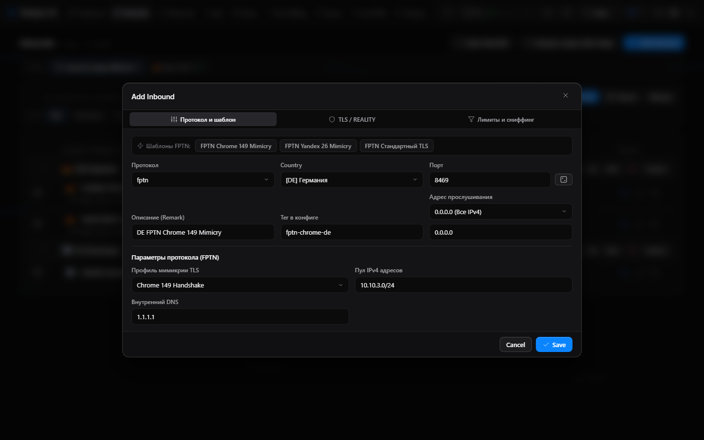

# 16. FPTN

| Parameter | Value |
| :--- | :--- |
| **Role in `tachyon-ui`** | `Inbound` + `Outbound` (HTTPS + WebSocket L3 VPN with `smoltcp` userspace stack) |
| **L4 Transport** | `TCP` (HTTPS/TLS + WebSocket `/api/v1/fptn`, encapsulating L3 IPv4/IPv6 packets: TCP, UDP, ICMP) |
| **TLS / REALITY / ACME** | Supports **`tls`** and **`reality`** (outer protection is mandatory; browser mimicry profiles use `RealityMode2`) |
| **Status in `tachyon-core 0.6.9`** | Full schema (`check`) and runtime (`run`) support |

---

## Purpose and How It Works in `tachyon-core`

**FPTN** is a Layer 3 VPN protocol disguised end-to-end as a standard web application (HTTPS + REST + WebSocket) with browser-grade TLS fingerprint mimicry.

How it works in `tachyon-core 0.6.9`:

1. The client establishes an outer connection over **TLS** or **REALITY** using a browser mimicry profile (`reality_chrome149`, `reality_firefox151`, `reality_yandex26_4`, `reality_safari26_5`, etc.). On a single TLS-enabled port, the server automatically distinguishes standard TLS, obfuscated TLS (`0x17` records), and `RealityMode2` (decoy ClientHello with a 32-byte SessionID).
2. The client authenticates via `POST /api/v1/login`, obtains a JWT token (and optionally DNS settings via `/api/v1/dns`), and upgrades to the WebSocket channel `/api/v1/fptn` carrying `YaFF` / `Protobuf` batched frames.
3. The server assigns the client a virtual IP address from `ipv4_pool` (default `10.10.3.0/24`) and DNS (`dns`, default `1.1.1.1`), processing all IP packets (TCP, UDP, ICMP) through the built-in `smoltcp` userspace network stack.
4. On outbound, `tachyon-core` can also accept an `fptn:...` or `fptnb://...` subscription token (`token` field), automatically expanding it into a load-balanced group of servers.

> [!NOTE]
> Legacy `RealityMode1` obfuscation values (`"2"`, `"kSniRealityMode"`) are rejected in `tachyon-core 0.6.9` — use `reality` or modern browser mimicry profiles such as `reality_chrome149`.

---

## Panel Form Screenshot



---

## Step-by-Step Setup in `tachyon-ui`

### Configuring an Inbound

1. Open **Inbounds → Add** and select the **`fptn`** protocol.
2. Pick one of the panel's built-in presets:
   - **`FPTN Chrome 149 Mimicry`** — TCP port `8469`, TLS, SNI `www.microsoft.com`, subnet `10.10.3.0/24`, DNS `1.1.1.1`, profile `reality_chrome149`.
   - **`FPTN Yandex 26 Mimicry`** — TCP port `8469`, TLS, SNI `www.cloudflare.com`, subnet `10.10.3.0/24`, DNS `1.1.1.1`, profile `reality_yandex26_4`.
   - **`FPTN Standard TLS`** — TCP port `8469`, TLS, SNI `www.apple.com`, subnet `10.10.3.0/24`, DNS `8.8.8.8`, profile `tls`.
3. Under the protocol settings, verify the **Obfuscation Profile**, **IPv4 Pool (TUN Subnet)** (`10.10.3.0/24`), and **DNS Server** (`1.1.1.1`).
4. On the **TLS** tab, choose either `tls` (specify certificate/key paths or use an ACME certificate issued by `tachyon-ui` for `panel.example.com`) or `reality` (with REALITY keys and a 4–64 byte SNI).
5. Add at least one client (**Name** and **Password**) and save the inbound.

### Configuring an Outbound

1. Go to **Outbounds → Add** and select **`fptn`**.
2. Configure **Server**, **Port**, **Password**, and **TLS** settings.
3. In additional JSON settings (`out-settings`), optionally specify `username`, `obfuscation`, `sni` (mandatory 4–64 bytes when `reality*` is active), certificate `md5_fingerprint`, or a subscription `token` (`fptn:...` / `fptnb://...`).

---

## Field, Toggle, and Parameter Reference

### Inbound

| Panel Field | `tachyon-core` JSON Key | Allowed Values / Default | Purpose |
| :--- | :--- | :--- | :--- |
| **Listen Address** (`inb-listen`) | `listen` | IPv4/IPv6; default `0.0.0.0` (or `::`) | Network interface accepting HTTPS/WebSocket connections |
| **Port** (`inb-port`) | `listen_port` | `1..65535`; preset `8469` | Inbound TCP port for FPTN |
| **Obfuscation Profile** (`inb-fptn-obfs`) | `obfuscation` | `reality_chrome149`, `reality_firefox151`, `reality_yandex26_4`, `reality_safari26_5`, `tls`, `none` (plus `chrome145..149`, `firefox149..151`, `yandex24..26_4`, `safari26_4..5`) | TLS ClientHello / browser fingerprint mimicry mode |
| **TUN Subnet / IPv4 Pool** (`inb-fptn-pool`) | `ipv4_pool` | IPv4 CIDR; default `10.10.3.0/24` | Address subnet for virtual client L3 interfaces |
| **DNS Server** (`inb-fptn-dns`) | `dns` | DNS IP address; default `1.1.1.1` | DNS server pushed to connected tunnel clients |
| **Clients** (`clients[]`) | `users[].{username, password}` | Non-empty list of username/password pairs | Credentials verified by `POST /api/v1/login` |
| **TLS Tab** (`inb-tls-*`) | `tls` | `tls` or `reality` | Outer encryption, certificate paths, or REALITY key settings |

### Outbound

| Panel Field | `tachyon-core` JSON Key | Allowed Values / Default | Purpose |
| :--- | :--- | :--- | :--- |
| **Server** (`out-server`) | `server` | IP or domain (`198.51.100.10`, `panel.example.com`) | Remote FPTN server address |
| **Port** (`out-port`) | `server_port` | `1..65535` | Remote server TCP port |
| **Password** (`out-password`) | `password` | String | FPTN account password |
| **Username** *(in `out-settings`)* | `username` | String | FPTN account username |
| **Obfuscation** *(in `out-settings`)* | `obfuscation` | `reality`, `reality_chrome149`, `reality_firefox151`, `reality_yandex26_4`, `reality_safari26_5`, `tls`, `none` | Client handshake mimicry profile |
| **Camouflage SNI** *(in `out-settings`)* | `sni` | String, `4..64` bytes | Mandatory when `reality` / `reality_*` mode is active |
| **Fingerprint / Token** *(in `out-settings`)* | `md5_fingerprint`, `token` | Certificate MD5 hash; `fptn:...` / `fptnb://...` token string | Official server certificate pinning or token-based server cluster expansion |

---

## Networking, TLS, and Firewall

- **TLS / REALITY / ACME:** For `tls` mode, use a valid domain (`panel.example.com`) and a certificate managed by `tachyon-ui` via ACME (built-in ACME is not executed inside `tachyon-core` — the panel passes ready `certificate_path`/`key_path` files). For `reality_*` profiles on outbound, always specify an `sni` of `4..64` bytes even when connecting to a raw IP like `198.51.100.10`.
- **Firewall:** The panel opens **`TCP`** on `listen_port` (for example, `8469/tcp`).
- **MTU and Packet Loss:** Because L3 IP packets travel inside a TCP WebSocket, high-loss links can experience TCP-over-TCP head-of-line stalls; on unstable mobile networks, keep a UDP-capable fallback (`tewfai` or `wdtt`).

---

## Subscription Export, Compatible Clients, and Valid `tachyon-core` JSON

- **Subscription Export Formats (`GET /sub/{sub_id}?format=...`):**
  - **URI (`raw` / Base64):** generates an `fptn:<base64(json)>` token containing `{ "version": 1, "service_name": "...", "username": "...", "password": "...", "servers": [{ "name": "...", "host": "198.51.100.10", "port": 8469, "md5_fingerprint": "" }] }`.
  - **Subscription Tokens (`fptn:` / `fptnb://`):** supported on import and in client `outbound.token`.
  - **Client JSON (`?format=singbox` / `tachyon` / `outbounds`):** generates a `type: "fptn"` object.
  - **Clash Meta YAML and SIP008:** not exported.
- **Compatible Clients:** Official FPTN clients (Windows, macOS, Linux, Android, iOS) and `tachyon-core`.

### Valid `tachyon-core` JSON Example

#### Inbound (`inbounds[]`)

```json
{
  "type": "fptn",
  "tag": "fptn-in-8469",
  "listen": "::",
  "listen_port": 8469,
  "obfuscation": "reality_chrome149",
  "ipv4_pool": "10.10.3.0/24",
  "dns": "1.1.1.1",
  "users": [
    {
      "username": "alice",
      "password": "fptn-strong-password"
    }
  ],
  "tls": {
    "enabled": true,
    "server_name": "panel.example.com",
    "certificate_path": "data/certs/server.crt",
    "key_path": "data/certs/server.key"
  }
}
```

#### Outbound (`outbounds[]`)

```json
{
  "type": "fptn",
  "tag": "fptn-out",
  "server": "198.51.100.10",
  "server_port": 8469,
  "username": "alice",
  "password": "fptn-strong-password",
  "obfuscation": "reality_chrome149",
  "sni": "www.microsoft.com",
  "tls": {
    "enabled": true,
    "server_name": "www.microsoft.com",
    "insecure": true
  }
}
```

---

## Diagnostics and Common Errors

| Symptom / Error | Cause | Resolution |
| :--- | :--- | :--- |
| Outbound validation error when connecting by IP | `reality` / `reality_*` profile enabled without a `4..64` byte `sni` | Explicitly set `sni` (for example, `www.microsoft.com`) in the outbound configuration |
| Rejection of legacy `obfuscation` value | Deprecated `RealityMode1` (`"2"` or `"kSniRealityMode"`) specified | Switch to `reality` or a modern profile such as `reality_chrome149` / `reality_yandex26_4` |
| Client authenticates but has no internet inside the tunnel | `ipv4_pool` subnet overlaps with the local LAN or `dns` is unreachable | Change `ipv4_pool` to a non-overlapping subnet (e.g., `10.10.3.0/24`) and set a reachable DNS (`1.1.1.1` or `8.8.8.8`) |

---

## See Also

- [Complete Guide](../00-complete-guide.md)
- [Protocols Encyclopedia](../09-protocols-encyclopedia.md)
- [UI Every Tab and Button Guide](../11-ui-every-tab-and-button-guide.md)
- [Protocol Catalog](./README.md)
- [15. MTProto](./15-mtproto.md)
- [17. WDTT](./17-wdtt.md)
