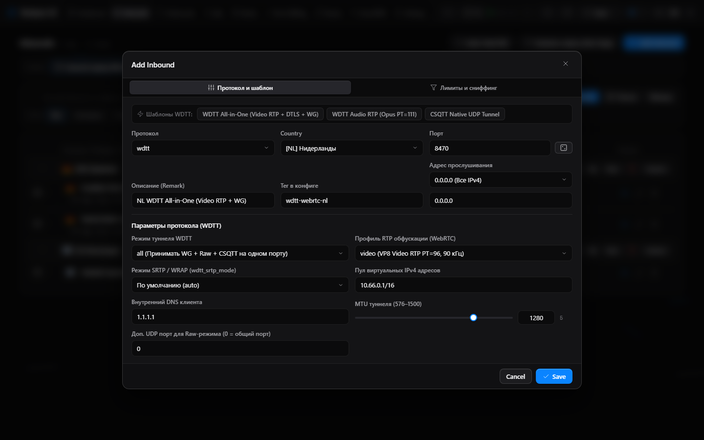

# 17. WDTT (WG / Raw / CSQTT)

| Parameter | Value |
| :--- | :--- |
| **Role in `tachyon-ui`** | `Inbound` + `Outbound` (L3 UDP tunnel with `smoltcp` userspace stack) |
| **L4 Transport** | `UDP` (primary `listen_port` + optional secondary `raw_port`) |
| **TLS / REALITY / ACME** | Not used (`none`); encryption is handled by `DTLS 1.2` (RFC 9146 CID), `Noise_IKpsk2`, or `ChaCha20-Poly1305` |
| **Status in `tachyon-core 0.6.9`** | Full schema (`check`) and runtime (`run`) support |

---

## Purpose and How It Works in `tachyon-core`

**WDTT** (including **qWDTT** and **CSQTT** variants) is a high-speed userspace Layer 3 VPN tunnel over UDP that shapes network traffic to resemble standard real-time media streams (**RTP** video/audio and **DTLS 1.2**).

How the protocol works in `tachyon-core 0.6.9`:

1. The outer wrapper frames UDP datagrams as an RTP stream (`video`, `audio` Opus `PT=111`, or `unified`) inside a `WDTT-WRAP-v1` / `CSQTT-WRAP-v1` container and/or `DTLS 1.2` with the Connection ID extension (RFC 9146).
2. Internally, it supports the following tunnel modes (`mode`):
   - **`all`** *(inbound only)*: combined server handling both `wg` and `raw` clients simultaneously; when `raw_port == 0` and `listen_port <= 65532`, the core automatically attempts to bind an extra UDP port at `listen_port + 3` for the `raw` fast path.
   - **`wg`**: parameter exchange (`GETCONF`/`READY`) followed by an encrypted WireGuard (`Noise_IKpsk2`) L3 tunnel.
   - **`raw`**: lightweight high-throughput channel with packet reordering protection (`RA` frames).
   - **`csqtt` / `csqtt_v1`**: native UDP tunnel using compact `GETCONF`/`TUNCONF` negotiation.
3. The userspace L3 stack `smoltcp` assigns client addresses from `ipv4_pool` (default `10.66.0.1/16`) and forwards TCP, UDP, and ICMP traffic.

---

## Panel Form Screenshot



---

## Step-by-Step Setup in `tachyon-ui`

### Configuring an Inbound

1. Open **Inbounds → Add** and choose **`wdtt`**.
2. Select one of the three presets at the top of the modal:
   - **`WDTT All-in-One (Video RTP + DTLS + WG)`** — UDP port `8470`, `mode: all`, `obfs: video`, `mtu: 1280`, pool `10.66.0.1/16`, DNS `1.1.1.1`.
   - **`WDTT Audio RTP (Opus PT=111)`** — UDP port `8470`, `mode: wg`, `obfs: audio`, `mtu: 1280`.
   - **`CSQTT Native UDP Tunnel`** — UDP port `8470`, `mode: csqtt`, `obfs: video`, `mtu: 1280`.
3. Configure the **RTP Obfuscation Profile** (`video` / `audio` / `unified`), **SRTP / DTLS Mode** (`srtp_mode`), **MTU** in the `576..1500` range (`1280` recommended), and optionally an explicit **Raw Port** (`raw_port`).
4. Add at least one client with a password (and optional `max_devices` limit) and save the inbound.

### Configuring an Outbound

1. Go to **Outbounds → Add** and select **`wdtt`**.
2. Enter **Server**, **Port**, **Password**, choose **WDTT Mode** (`wg`, `raw`, `csqtt`, `csqtt_v1` — note that `all` is server-only), **RTP Obfuscation Profile** (`video`, `audio`, `unified`), **SRTP Mode**, and **MTU** (`576..1500`).
3. The panel automatically adds `workers: 8` to the generated `tachyon-core` client configuration.

---

## Field, Toggle, and Parameter Reference

### Inbound

| Panel Field | `tachyon-core` JSON Key | Allowed Values / Default | Purpose |
| :--- | :--- | :--- | :--- |
| **Listen Address** (`inb-listen`) | `listen` | IPv4/IPv6; default `0.0.0.0` (or `::`) | Interface receiving UDP datagrams |
| **Port** (`inb-port`) | `listen_port` | `1..65535`; preset `8470` (core defaults `56000`, or `46000` for `csqtt*`) | Primary inbound UDP port |
| **Tunnel Mode** (`inb-wdtt-mode`) | `mode` | `all`, `wg`, `raw`, `csqtt`, `csqtt_v1` | Encapsulated L3 tunnel mode accepted by the server |
| **RTP Profile** (`inb-wdtt-obfs`) | `obfs` | `video`, `audio`, `unified` | Disguises UDP packets as RTP video, Opus audio (`PT=111`), or mixed media |
| **SRTP / DTLS Mode** (`inb-wdtt-srtp`) | *(client export)* `srtp_mode` | `""` (auto), `auto`, `dtls`, `wrap`, `dtls-srtp`, `wrap-srtp` | Controls DTLS/WRAP encapsulation in exported client configs |
| **IPv4 Pool** (`inb-wdtt-pool`) | `ipv4_pool` | IPv4 CIDR; default `10.66.0.1/16` | Virtual IP subnet allocated to clients |
| **Client DNS** (`inb-wdtt-dns`) | `client_dns` | IP address; default `1.1.1.1` | DNS server issued to connected clients |
| **MTU** (`inb-wdtt-mtu`) | `mtu` | `576..1500`; default `1280` | Maximum transmission unit of the tunnel interface |
| **Raw Port** (`inb-wdtt-rawport`) | `raw_port` | `0..65535`; default `0` | Secondary UDP port for `raw` fast-path (`0` = disabled, or auto `listen_port + 3` in `all` mode) |
| **Clients & Password** | `password`, `users[].{name, password, max_devices}` | Non-empty `password` or `users[]` required | Client authentication; `max_devices` enforces concurrent device limits |

### Outbound

| Panel Field | `tachyon-core` JSON Key | Allowed Values / Default | Purpose |
| :--- | :--- | :--- | :--- |
| **Server** (`out-server`) | `server` | IP or domain (`198.51.100.10`, `panel.example.com`) | WDTT server address |
| **Port** (`out-port`) | `server_port` | `1..65535` | Primary server UDP port |
| **Password** (`out-password`) | `password` | Non-empty string | Access key / password |
| **WDTT Mode** (`out-wdtt-mode`) | `mode` | `wg`, `raw`, `csqtt`, `csqtt_v1` | Client tunnel mode |
| **RTP Obfuscation Profile** (`out-wdtt-obfs`) | `obfs` | `video`, `audio`, `unified` | Must match the server's profile |
| **SRTP Mode** (`out-wdtt-srtp`) | `srtp_mode` | `""`, `auto`, `dtls`, `wrap` | DTLS/WRAP encapsulation mode |
| **MTU** (`out-wdtt-mtu`) | `mtu` | `576..1500`; default `1280` | Tunnel interface MTU |
| **Worker Threads** *(auto)* | `workers` | `8` (added automatically by panel) | Number of client UDP tunnel worker threads |

---

## Networking, TLS, and Firewall

- **TLS / REALITY / ACME:** No external TLS is used; neither a domain nor certificates are required.
- **Firewall:** `tachyon-ui` opens **`UDP`** on `listen_port` (for example, `8470/udp`) and additionally **`UDP`** on `raw_port` whenever `raw_port > 0`.
- **Important nuance of `mode: "all"`:** if you leave `raw_port: 0` with `mode: "all"` (e.g., port `8470`), the core also attempts to open `listen_port + 3` (`8473/udp`). If clients connect in `raw` mode, open `8473/udp` manually or set `raw_port` explicitly in the inbound settings so the panel creates the firewall rule automatically.

---

## Subscription Export, Compatible Clients, and Valid `tachyon-core` JSON

- **Subscription Export Formats (`GET /sub/{sub_id}?format=...`):**
  - **URI (`raw` / Base64):** `wdtt://wdtt-secret-pass@198.51.100.10:8470?mode=wg&obfs=video&mtu=1280#WDTT-Video`
  - **Client JSON (`?format=singbox` / `tachyon` / `outbounds`):** generates `type: "wdtt"` with `workers: 8`, `mode`, `obfs`, `mtu`, and optional `srtp_mode` / `raw_port`.
  - **Clash Meta YAML and SIP008:** not exported.
- **Compatible Clients:** `tachyon-core` (including OpenWrt routers and panel client profiles) and native WDTT/CSQTT clients.

### Valid `tachyon-core` JSON Example

#### Inbound (`inbounds[]`)

```json
{
  "type": "wdtt",
  "tag": "wdtt-in-8470",
  "listen": "::",
  "listen_port": 8470,
  "mode": "all",
  "obfs": "video",
  "ipv4_pool": "10.66.0.1/16",
  "client_dns": "1.1.1.1",
  "mtu": 1280,
  "raw_port": 8473,
  "password": "wdtt-master-password",
  "users": [
    {
      "name": "router-home",
      "password": "wdtt-client-password",
      "max_devices": 3
    }
  ]
}
```

#### Outbound (`outbounds[]`)

```json
{
  "type": "wdtt",
  "tag": "wdtt-out",
  "server": "198.51.100.10",
  "server_port": 8470,
  "password": "wdtt-client-password",
  "mode": "wg",
  "obfs": "video",
  "srtp_mode": "auto",
  "mtu": 1280,
  "workers": 8
}
```

---

## Diagnostics and Common Errors

| Symptom / Error | Cause | Resolution |
| :--- | :--- | :--- |
| `mtu` validation error during `tachyon-core check` | `mtu` is below `576` or above `1500` | Set `mtu` within `576..1500` (`1280` is optimal) |
| Empty `password` error | Neither top-level `password` nor a `users[]` entry is set on the inbound | Add at least one client with a password or configure a shared `password` |
| Client in `raw` mode cannot connect | Secondary UDP port `raw_port` (or `listen_port + 3`) is blocked by the firewall | Set `raw_port` explicitly in the inbound and re-apply firewall rules (or open `listen_port + 3/udp`) |
| Handshake stalls in `wg` mode | Mismatched `obfs` (`video` / `audio` / `unified`) or `mode` between server and client | Verify that `mode` and `obfs` match across client and server configurations |

---

## See Also

- [Complete Guide](../00-complete-guide.md)
- [Protocols Encyclopedia](../09-protocols-encyclopedia.md)
- [UI Every Tab and Button Guide](../11-ui-every-tab-and-button-guide.md)
- [Protocol Catalog](./README.md)
- [16. FPTN](./16-fptn.md)
- [18. Sudoku](./18-sudoku.md)
