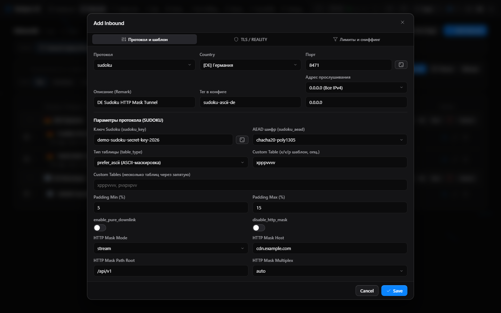

# 18. Sudoku

| Parameter | Value |
| :--- | :--- |
| **Role in `tachyon-ui`** | `Inbound` + `Outbound` (form builder, subscription parser, and schema validation) |
| **L4 Transport** | `TCP` (with optional HTTP mask `http_mask`) |
| **TLS / REALITY / ACME** | `none` or certificate `tls` (REALITY is not supported) |
| **Status in `tachyon-core 0.6.9`** | **Schema check only (`tachyon-core check`)** — **not implemented** in the `0.6.9` standard runtime |

---

## Purpose and How It Works in `tachyon-core`

**Sudoku** is a specialized transport with controllable wire-stream entropy. Instead of transmitting ciphertext as uniform high-entropy random noise, it maps AEAD-encrypted bytes (`chacha20-poly1305` / `aes-128-gcm`) through a substitution lookup table (`prefer_ascii`, `prefer_entropy`, or custom tables), adds randomized padding (`padding_min..padding_max`), and can wrap traffic in a configurable HTTP mask (`http_mask`) so the wire payload resembles readable ASCII/HTTP exchanges. A `enable_pure_downlink` mode is also defined to keep server-to-client throughput high with minimal expansion.

> [!WARNING]
> **Actual status in `tachyon-core 0.6.9`:**
> The `sudoku` type is registered in the known inbound and outbound type lists (configurations pass `tachyon-core check`), and `tachyon-ui` fully supports its UI form, URI import, and `sudoku://` subscription export.
> However, **the `sudoku` runtime handler is not implemented in `tachyon-core 0.6.9`** — starting the core (`run`) with an active `sudoku` inbound or outbound returns an initialization error.
> Use `sudoku` in `tachyon-ui` **only** for schema validation or generating subscriptions for external Sudoku-compatible clients and servers; for live `tachyon-core` nodes, choose `tewfai`, `vless`, `anytls`, or `shadowsocks`.

---

## Panel Form Screenshot



---

## Step-by-Step Setup in `tachyon-ui`

There are no built-in UI presets for `sudoku`; fields are configured manually.

### Preparing an Inbound / Outbound Configuration for Export and Schema Testing

1. Open **Inbounds** or **Outbounds → Add** and choose **`sudoku`**.
2. Enter the shared **Sudoku Key (`key`)** and select the **AEAD Cipher (`aead`)** (`chacha20-poly1305`, `aes-128-gcm`, or `none`).
3. Choose the **Table Type (`table_type`)** (`prefer_ascii` or `prefer_entropy`); optionally define a `custom_table` / `custom_tables` rotation list and padding bounds (`padding_min`, default `5`; `padding_max`, default `15`).
4. Optionally toggle **`enable_pure_downlink`** or configure the HTTP mask (`mode`, `host`, `path_root`, `multiplex`), or turn it off completely with `disable_http_mask`.
5. On the **TLS** tab, select `none` or certificate `tls`.
6. After saving, use the entry to export subscriptions for external clients. Do not keep a `sudoku` inbound or outbound enabled when starting `tachyon-core 0.6.9`, or the engine will fail to start with an unsupported runtime error.

---

## Field, Toggle, and Parameter Reference

### Inbound

| Panel Field | `tachyon-core` JSON Key | Allowed Values / Default | Purpose |
| :--- | :--- | :--- | :--- |
| **Listen Address** (`inb-listen`) | `listen` | IPv4/IPv6; default `0.0.0.0` (or `::`) | Interface listening for TCP |
| **Port** (`inb-port`) | `listen_port` | `1..65535` | Inbound TCP port |
| **Key** (`inb-sudoku-key`) | `key` | String | Shared authentication and encryption key |
| **AEAD Cipher** (`inb-sudoku-aead`) | `aead` | `chacha20-poly1305`, `aes-128-gcm`, `none` | Inner payload AEAD algorithm |
| **Table Type** (`inb-sudoku-table-type`) | `table_type` | `prefer_ascii`, `prefer_entropy` | Byte remapping profile |
| **Custom Table** (`inb-sudoku-custom-table`) | `custom_table` | String (optional) | Custom substitution table pattern |
| **Custom Tables** (`inb-sudoku-custom-tables`) | `custom_tables` | `string[]` | List of custom tables for rotation |
| **Padding Min / Max (%)** (`inb-sudoku-pmin` / `pmax`) | `padding_min`, `padding_max` | Integers; default `5` / `15` | Random packet padding percentage range |
| **Pure Downlink** (`inb-sudoku-pure-dl`) | `enable_pure_downlink` | `true` / `false` | Streamlined server-to-client downlink encoding |
| **Disable HTTP Mask** (`inb-sudoku-no-mask`) | `disable_http_mask` | `true` / `false` | Disables HTTP mask wrapping |
| **HTTP Mask Mode / Host / Path / Mux** (`inb-sudoku-mask-*`) | `http_mask.{mode, host, path_root, multiplex}` | `mode`: `stream`, `poll`, `auto`, `ws`; `multiplex`: `off`, `on`, `auto` | Server-side HTTP wrapper settings |
| **TLS Tab** (`inb-tls-*`) | `tls` | `none` or `tls` | Optional external TLS over TCP |

### Outbound

| Panel Field | `tachyon-core` JSON Key | Allowed Values / Default | Purpose |
| :--- | :--- | :--- | :--- |
| **Server** (`out-server`) | `server` | IP or domain (`198.51.100.10`, `panel.example.com`) | Sudoku server address |
| **Port** (`out-port`) | `server_port` | `1..65535` | Server TCP port |
| **Sudoku Fields** (`out-sudoku-*`) | `key`, `aead`, `table_type`, `custom_table`, `custom_tables`, `padding_min`, `padding_max`, `enable_pure_downlink`, `disable_http_mask` | Same as Inbound | Encryption and substitution table parameters |
| **HTTP Mask Fields** (`out-sudoku-mask-*`) | `http_mask_mode`, `http_mask_host`, `http_mask_path`, `http_mask_multiplex` | Flat `http_mask_*` keys in client JSON | Client outbound HTTP mask settings |

---

## Networking, TLS, and Firewall

- **TLS / REALITY / ACME:** Only `none` or standard certificate `tls` (via certificates managed by the panel) is supported. REALITY is not supported.
- **Firewall:** When an inbound is active, the panel opens **`TCP`** on the configured `listen_port`.

---

## Subscription Export, Compatible Clients, and Valid `tachyon-core` JSON

- **Subscription Export Formats (`GET /sub/{sub_id}?format=...`):**
  - **URI (`raw` / Base64):** `sudoku://<key>@198.51.100.10:8480?table_type=prefer_ascii&...#Sudoku`
  - **Client JSON (`?format=singbox` / `tachyon` / `outbounds`):** generates a `type: "sudoku"` object with flat `http_mask_*` keys.
  - **Clash Meta YAML and SIP008:** not exported.
- **Compatible Clients:** External Sudoku clients (native runtime execution is unavailable in `tachyon-core 0.6.9`).

### Valid JSON Example (passes `tachyon-core check`, does not run in `0.6.9` runtime)

```json
{
  "type": "sudoku",
  "tag": "sudoku-out-draft",
  "server": "198.51.100.10",
  "server_port": 8480,
  "key": "sudoku-example-key",
  "aead": "chacha20-poly1305",
  "table_type": "prefer_ascii",
  "padding_min": 5,
  "padding_max": 15,
  "enable_pure_downlink": true,
  "disable_http_mask": false,
  "http_mask_mode": "auto",
  "http_mask_host": "www.example.com",
  "http_mask_path": "/api",
  "http_mask_multiplex": "auto"
}
```

---

## Diagnostics and Common Errors

| Symptom / Error | Cause | Resolution |
| :--- | :--- | :--- |
| `tachyon-core check` succeeds, but `tachyon-core run` fails during startup | In `tachyon-core 0.6.9`, `sudoku` exists in the config parser/validator only; its runtime handler is not implemented | Disable or remove active `sudoku` inbounds/outbounds before starting the core, and use `tewfai`, `vless`, or `anytls` instead |
| Mask format mismatch on an external client | Nested `http_mask` object (inbound) confused with flat `http_mask_*` keys (outbound) | Use the `tachyon-ui` subscription generator rather than assembling JSON by hand |

---

## See Also

- [Complete Guide](../00-complete-guide.md)
- [Protocols Encyclopedia](../09-protocols-encyclopedia.md)
- [UI Every Tab and Button Guide](../11-ui-every-tab-and-button-guide.md)
- [Protocol Catalog](./README.md)
- [17. WDTT](./17-wdtt.md)
- [19. OpenConnect](./19-openconnect.md)
