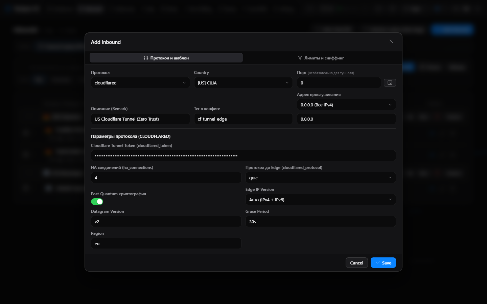

# 20. Cloudflared (Cloudflare Tunnel)

| Parameter | Value |
| :--- | :--- |
| **Role in `tachyon-ui`** | **`Inbound` only** (inbound tunnel connector; not present in `Outbound`) |
| **L4 Transport** | Outbound connections from the server to Cloudflare Edge over `QUIC` (`UDP`) or `HTTP/2` (`TCP`). **Opens no local listening port** |
| **TLS / REALITY / ACME** | Not used in panel settings (`none`); authenticated via Zero Trust tunnel token, with TLS terminated at Cloudflare Edge |
| **Status in `tachyon-core 0.6.9`** | **Schema check via `tachyon-core check`**, but **not compiled** into the standard `0.6.9` runtime build (requires rebuilding the core with `with_cloudflared` or running the external `cloudflared` daemon) |

---

## Purpose and How It Works in `tachyon-core`

**Cloudflared** is an inbound connector for **Cloudflare Tunnel** (Zero Trust). It solves inbound traffic delivery on servers behind CGNAT or strict firewalls with no public IPv4 address or open inbound ports: instead of listening for incoming connections, the server initiates multiple outbound encrypted tunnels (`ha_connections`) to the nearest Cloudflare Edge PoPs, and clients connect to your domain on the Cloudflare network.

> [!WARNING]
> **Actual status in `tachyon-core 0.6.9`:**
> `tachyon-ui` provides the configuration form for `cloudflared`, and `tachyon-core check` validates all of its schema fields.
> However, the standard release binary of `tachyon-core 0.6.9` does **not** include the embedded connector: attempting to start it returns `Cloudflared is not included in this build, rebuild with -tags with_cloudflared`.
> Two practical workflows are available with the current release:
> 1. Run the official external `cloudflared` daemon on the host (`cloudflared tunnel run --token ...`) and point its origin target to a local `tachyon-core` proxy inbound (for example, `VLESS WS` or `HTTP/Mixed` on `127.0.0.1`).
> 2. Rebuild `tachyon-core` with the `with_cloudflared` build tag if you need the connector embedded in a single process.

---

## Panel Form Screenshot



---

## Step-by-Step Setup in `tachyon-ui`

There are no built-in presets for `cloudflared`; setup uses a tunnel token from the Cloudflare Zero Trust dashboard.

1. Create a tunnel in Cloudflare Zero Trust (`Networks → Tunnels`) and copy the issued **Tunnel Token (`token`)**.
2. In `tachyon-ui`, open **Inbounds → Add** and select **`cloudflared`**. Notice that **Listen Address** (`listen`) is disabled and **Port** (`listen_port`) is optional (`0`) because the connector opens no local listening socket.
3. Paste the token into the **Tunnel Token** field.
4. Configure the number of redundant Edge connections (`ha_connections`, default `4`), transport **Protocol** (`auto`, `quic`, or `http2`), optional **Post-Quantum** key exchange (`post_quantum`), **Edge IP Version** (`edge_ip_version`), and graceful shutdown timeout as a duration string (for example, `"30s"`).
5. When using the standard `tachyon-core 0.6.9` binary built without `with_cloudflared`, run the official `cloudflared` service separately on the host with that same token and route traffic into a standard local inbound (`vless` WS/gRPC, etc.).

---

## Field, Toggle, and Parameter Reference

### Inbound

| Panel Field | `tachyon-core` JSON Key | Allowed Values / Default | Purpose |
| :--- | :--- | :--- | :--- |
| **Listen / Port** (`inb-listen`, `inb-port`) | *(unused)* | Disabled; port `0` | No local listening socket is opened |
| **Tunnel Token** (`inb-cf-tun-token`) | `token` | String (Cloudflare Zero Trust JWT/Base64 token) | Secret token binding the connector to your Cloudflare Tunnel |
| **HA Connections** (`inb-cf-tun-ha`) | `ha_connections` | `1..16`; default `4` | Number of parallel high-availability connections to Cloudflare Edge |
| **Protocol** (`inb-cf-tun-proto`) | `protocol` | `auto`, `quic`, `http2` | Transport protocol toward Cloudflare Edge |
| **Post-Quantum KEX** (`inb-cf-tun-pq`) | `post_quantum` | `true` / `false` | Enables post-quantum key exchange for Edge connections |
| **Edge IP Version** (`inb-cf-tun-edge-ip`) | `edge_ip_version` | `"0"` (auto), `"4"`, `"6"` | Forces IPv4 or IPv6 selection for Cloudflare Edge nodes |
| **Datagram Version** (`inb-cf-tun-dgram`) | `datagram_version` | String (e.g. `v2` / `v3`, optional) | UDP datagram encapsulation version across the tunnel |
| **Grace Period** (`inb-cf-tun-grace`) | `grace_period` | Duration string (e.g. `"30s"`) | Wait time for active connections to drain on shutdown (**strictly a string, not a number**) |
| **Region** (`inb-cf-tun-region`) | `region` | String (e.g. `"us"` or empty) | Pins tunnel connections to a specific Cloudflare Edge region |

---

## Networking, TLS, and Firewall

- **TLS / REALITY / ACME:** The TLS tab is hidden for `cloudflared` in the panel. Public HTTPS certificates for your domain (`panel.example.com`) are terminated directly by Cloudflare's edge infrastructure.
- **Firewall:** `tachyon-ui` **creates no inbound firewall rules** for `cloudflared`. The host only needs **outbound** network access to Cloudflare Edge (including port `7844` UDP/TCP for `quic`/`http2`).

---

## Subscription Export, Compatible Clients, and Valid `tachyon-core` JSON

- **Subscription Export:** As a client outbound, `cloudflared` is **not exported** — it is omitted from client JSON (`?format=singbox` / `tachyon` / `outbounds`) and Clash Meta YAML (any fallback `cloudflared://...` URI is informational only). End users connect to your Cloudflare hostname via the underlying proxy inbound (such as `VLESS WS + TLS`) receiving traffic from the tunnel.
- **Compatible Clients:** Any browser or proxy client connecting to the public Cloudflare Tunnel route (depending on the service exposed behind the tunnel).

### Valid JSON Example (passes schema check; requires a `with_cloudflared` build in `tachyon-core 0.6.9`)

```json
{
  "type": "cloudflared",
  "tag": "cloudflared-in",
  "token": "eyJhIjoiZXhhbXBsZSIsInQiOiJ0dW5uZWwtaWQiLCJzIjoic2VjcmV0In0=",
  "ha_connections": 4,
  "protocol": "quic",
  "post_quantum": true,
  "edge_ip_version": "4",
  "grace_period": "30s"
}
```

---

## Diagnostics and Common Errors

| Symptom / Error | Cause | Resolution |
| :--- | :--- | :--- |
| Error `Cloudflared is not included in this build, rebuild with -tags with_cloudflared` | Standard `tachyon-core 0.6.9` binary is built without the embedded `cloudflared` connector | Run the external `cloudflared` daemon forwarding to a local `tachyon-core` inbound (e.g., `vless` WS or `mixed`), or rebuild `tachyon-core` with `with_cloudflared` |
| `grace_period` parsing error during config validation | A numeric value (`30`) was passed instead of a duration string | Always provide a unit-suffixed duration string such as `"30s"` |
| Cannot reach Cloudflare Edge from a container/VPS | Outbound firewall blocks `7844/udp` for `quic` mode | Switch `protocol` to `"http2"` (runs over TCP) or allow outbound traffic on `7844/udp` and `7844/tcp` |

---

## See Also

- [Complete Guide](../00-complete-guide.md)
- [Protocols Encyclopedia](../09-protocols-encyclopedia.md)
- [UI Every Tab and Button Guide](../11-ui-every-tab-and-button-guide.md)
- [Protocol Catalog](./README.md)
- [19. OpenConnect](./19-openconnect.md)
- [21. WireGuard](./21-wireguard.md)
