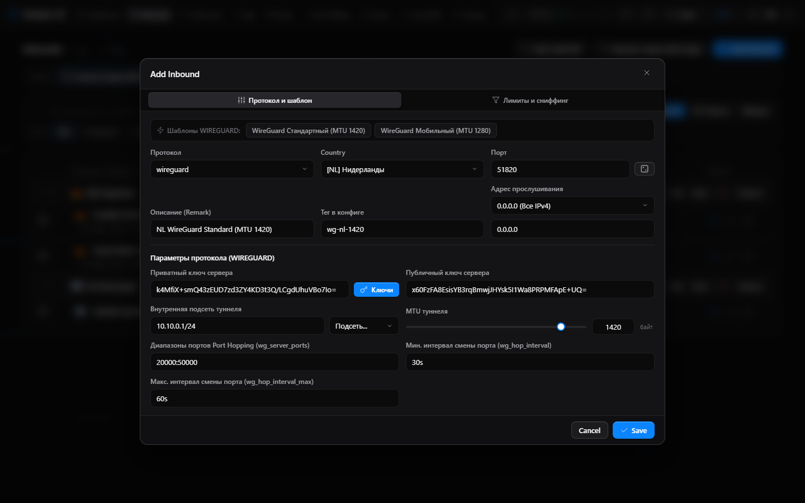

# 21. WireGuard

| Parameter | Value |
| :--- | :--- |
| **Role in `tachyon-ui`** | Endpoint Server (`#inbounds`) and Endpoint Client (`#outbounds`) |
| **`tachyon-core` Section** | Strictly `endpoints[]` with `"type": "wireguard"` (never `inbounds[]` or `outbounds[]`) |
| **L4 Transport** | UDP (`listen_port`, optional Port Hopping: `server_ports`, `hop_interval`, `hop_interval_max`) |
| **TLS / REALITY** | Not used (`Noise_IKpsk2` cryptography: X25519 + ChaCha20-Poly1305 + BLAKE2s) |
| **Status in `tachyon-core 0.6.9`** | Full runtime support (userspace `smoltcp` + `UdpHub` stack and Linux kernel mode) |

---

## 1. Purpose and How It Works in `tachyon-core`

**WireGuard** is a lightweight, high-performance Layer 3 VPN tunnel running over UDP with minimal overhead and modern fixed-suite cryptography (`Noise_IKpsk2`, X25519 key exchange, ChaCha20-Poly1305 encryption). Unlike L4/L7 proxies (VLESS, Trojan, SOCKS5), WireGuard encapsulates raw IP packets (TCP, UDP, ICMP) inside a virtual network interface, making it ideal for routers (OpenWrt, Keenetic, MikroTik), mobile clients, and inter-node tunnels.

In **`tachyon-core`**, WireGuard is implemented not as a conventional inbound or outbound proxy, but as a **bidirectional endpoint (`endpoints[]`)** of type `"wireguard"`. Sharing a unified tag namespace with `outbounds[]`, it can both accept peer client connections and act as a routing gateway target for `route.rules[]`. `tachyon-ui` preserves the familiar workflow: you configure a hub listener under **Inbounds (`#inbounds`)** and a remote peer client under **Outbounds (`#outbounds`)**, while the config generator outputs both into `endpoints[]`.

> [!IMPORTANT]
> In `tachyon-core` configurations, WireGuard objects **always** belong in the `endpoints[]` array. Placing `"type": "wireguard"` inside `outbounds[]` or `inbounds[]` when hand-editing JSON will be rejected by the core schema validator.

---

## 2. Panel Form Screenshot



---

## 3. Step-by-Step Setup in `tachyon-ui`

### Creating a Server Hub Endpoint under "Inbounds"

1. Open **Inbounds (`#inbounds`)** and click **+ Add Inbound**.
2. Select **WireGuard** from the protocol list.
3. Apply one of the built-in presets:
   - **`WireGuard Standard (MTU 1420)`** — UDP port `51820`, subnet `10.10.0.1/24`, `mtu: 1420` (recommended for most wired and broadband links).
   - **`WireGuard Mobile (MTU 1280)`** — UDP port `51820`, subnet `10.10.0.1/24`, `mtu: 1280` (safe packet size for LTE/5G cellular networks and PPPoE/encapsulated links).
4. Click **Keys** next to the server private key field—the panel generates a cryptographically strong X25519 key pair (populating both server private and public keys automatically).
5. Verify the **Tunnel Subnet** (defaults to `10.10.0.1/24`; the dropdown also offers `10.10.10.1/24` and `172.16.0.1/24`). In multi-node cluster cascades, each managed node is automatically allocated an isolated tunnel subnet.
6. Optionally configure **Port Hopping** ranges and intervals (`server_ports`, `hop_interval`, `hop_interval_max`).
7. Save the inbound and add clients directly or via a subscription—the panel issues each client its own X25519 key pair and a unique subnet address (for example, `10.10.0.2/32`).

### Creating a Client Outbound Endpoint under "Outbounds"

1. Open **Outbounds (`#outbounds`)** and click **+ Add Outbound**.
2. Select type **`wireguard`** and assign a unique `tag` (not colliding with any existing `outbounds` or `endpoints` tag).
3. Enter `Server Address` (e.g., `198.51.100.10` or `vpn.example.com`) and `Server Port` (`51820`).
4. Click the key-generation button next to `Client Private Key` (or paste a provided client key), and paste the remote server's public key into `Peer Public Key`.
5. Set the client's `Local Address` in CIDR notation (e.g., `10.10.0.2/32`), adjust `MTU`, and fill in `server_ports`, `hop_interval`, and `hop_interval_max` if Port Hopping is enabled.

---

## 4. Field, Toggle, and Parameter Reference

### Inbound Endpoint (`#inbounds` → `endpoints[]`)

| Panel Field | `tachyon-core` JSON Key | Allowed Values / Default | Purpose |
| :--- | :--- | :--- | :--- |
| **Tag** | `tag` | Unique string across `endpoints` and `outbounds` | Identifier of the WireGuard endpoint. |
| **Listen Address** | `listen` | `0.0.0.0` / `::` / IP | Server interface accepting incoming UDP packets. |
| **Port** | `listen_port` | `1..65535` (preset `51820`) | Primary UDP listening port for WireGuard. |
| **Server Private Key** | `private_key` | Base64 (32-byte X25519) | Server secret key. Generated with the **Keys** button. |
| **Server Public Key** | *(client export)* | Base64 (32-byte X25519) | Stored in the panel and exported to clients as `peer.public_key`. |
| **Tunnel Subnet** | `address` | CIDR array, default `["10.10.0.1/24"]` | Virtual server address inside the L3 tunnel (also used for NAT). |
| **Tunnel MTU** | `mtu` | `1280..1440` (step `10`, default `1400`) | Maximum tunnel packet size. Must be `>= 1280` when IPv6 is enabled. |
| **Port Hopping Ranges** | `server_ports` | String array (`"20000:50000"`, `"51820:51830"`) | UDP ports or ranges used for dynamic port rotation. |
| **Min Hop Interval** | `hop_interval` | Duration string (e.g., `"30s"`) | Minimum interval between port hops. |
| **Max Hop Interval** | `hop_interval_max` | Duration string (e.g., `"60s"`) | Upper bound of the randomized hop interval. |
| **Clients** (`wg_public_key`, `wg_client_ip`) | `peers[].public_key`, `peers[].allowed_ips` | Peer object array (`"10.10.0.2/32"`) | Client public key and assigned internal tunnel IP. |

### Outbound Endpoint (`#outbounds` → `endpoints[]`)

| Panel Field | `tachyon-core` JSON Key | Allowed Values / Default | Purpose |
| :--- | :--- | :--- | :--- |
| **Server Address** | `peers[0].address` | IPv4/IPv6 or domain (`198.51.100.10`) | External address of the remote WireGuard server. |
| **Server Port** | `peers[0].port` | `1..65535` | UDP port of the remote server. |
| **Client Private Key** | `private_key` | Base64 (32-byte X25519) | Local peer private key. |
| **Peer Public Key** | `peers[0].public_key` | Base64 (32-byte X25519) | Remote server public key. |
| **Local Address** | `address` | CIDR array (e.g., `["10.10.0.2/32"]`) | Local tunnel interface IP address. |
| **MTU** | `mtu` | `1280..1440` (default `1400`) | Client interface MTU. |
| **Port Hopping Ranges** | `server_ports` | Range array (`"20000:50000"`) | Server port list for client-side hopping. |
| **Hop Interval** | `hop_interval` | Duration string (e.g., `"30s"`) | Lower bound of port-hop interval. |
| **Max Hop Interval** | `hop_interval_max` | Duration string (e.g., `"60s"`) | Upper bound of port-hop interval. |

---

## 5. Networking and Firewall

- **Inbound Firewall Rules**: `tachyon-ui` automatically creates a **UDP** rule on `listen_port` (e.g., `51820/udp`).
- **Port Hopping**: When `server_ports` (e.g., `20000:50000`) is enabled server-side, ensure incoming UDP traffic is permitted across that entire port range (via firewall DNAT/REDIRECT to `listen_port` or by opening the range on the host).
- **NAT and IPv6**: Traffic from the WireGuard subnet (`10.10.0.1/24` by default) is NATed via the server's egress interface. If IPv6 addresses are included in `address` or `allowed_ips`, `mtu` must remain at least `1280` bytes (enforced by IPv6 and the `tachyon-core` validator).

---

## 6. Subscription Export, Clients, and Valid `tachyon-core` JSON Example

- **URI Format**:
  ```text
  wireguard://<client_privkey>@198.51.100.10:51820?publickey=<server_pubkey>&address=10.10.0.2/32&mtu=1420#wg-main
  ```
  When Port Hopping is configured, `server_ports`, `hop_interval`, and `hop_interval_max` query parameters are appended.
- **JSON Profiles (`?format=singbox`, `?format=tachyon`, `?format=outbounds`)**: Exported into the top-level `endpoints[]` section with `"type": "wireguard"`.
- **Clash Meta YAML (`?format=clashmeta`)**: Exported as `type: wireguard` with `ip`, `private-key`, `public-key`, and `udp: true`.
- **Compatible Clients**: `tachyon-core`, OpenWrt router builds with Port Hopping support, and standard WireGuard clients (without extended Port Hopping parameters).

### Valid `tachyon-core` JSON Example (Server and Client Endpoints in `endpoints[]`)

```json
{
  "endpoints": [
    {
      "type": "wireguard",
      "tag": "wg-in",
      "listen": "0.0.0.0",
      "listen_port": 51820,
      "private_key": "<SERVER_X25519_PRIVATE_KEY_BASE64>",
      "address": ["10.10.0.1/24"],
      "mtu": 1420,
      "peers": [
        {
          "public_key": "<CLIENT_X25519_PUBLIC_KEY_BASE64>",
          "allowed_ips": ["10.10.0.2/32"]
        }
      ]
    },
    {
      "type": "wireguard",
      "tag": "wg-out",
      "address": ["10.10.0.2/32"],
      "private_key": "<CLIENT_X25519_PRIVATE_KEY_BASE64>",
      "mtu": 1420,
      "server_ports": ["20000:50000"],
      "hop_interval": "30s",
      "hop_interval_max": "60s",
      "peers": [
        {
          "address": "198.51.100.10",
          "port": 51820,
          "public_key": "<SERVER_X25519_PUBLIC_KEY_BASE64>",
          "allowed_ips": ["0.0.0.0/0", "::/0"]
        }
      ]
    }
  ]
}
```

---

## 7. Diagnostics and Common Errors

- **Error placing WireGuard in `outbounds[]`**: When manually editing JSON, putting a WireGuard block in `outbounds[]` instead of `endpoints[]` causes core validation to fail.
- **Tag collision (`duplicate tag`)**: `endpoints[]` and `outbounds[]` share one tag namespace. Never assign a WireGuard endpoint the same `tag` as an outbound or balancer.
- **Overlapping `allowed_ips` across peers**: Assigning the same `wg_client_ip` (e.g., `10.10.0.2/32`) to two clients on the same inbound breaks return-path routing.
- **UDP fragmentation / mobile packet drops**: If HTTPS pages stall inside the tunnel, lower `mtu` from `1420` to `1280` (or apply the **WireGuard Mobile** preset).
- **Handshake signature blocking**: If an ISP blocks plain WireGuard `Noise_IKpsk2` UDP packets, switch to [22. AmneziaWG](./22-amneziawg.md).

---

## 8. See Also

- [Protocol Catalog](./README.md)
- [Complete Guide](../00-complete-guide.md)
- [Tachyon Protocol Encyclopedia](../09-protocols-encyclopedia.md)
- [UI Every Tab & Button Guide](../11-ui-every-tab-and-button-guide.md)
- [20. Cloudflared](./20-cloudflared.md)
- [22. AmneziaWG](./22-amneziawg.md)
- [23. Mixed / SOCKS / HTTP](./23-mixed-socks-http.md)
