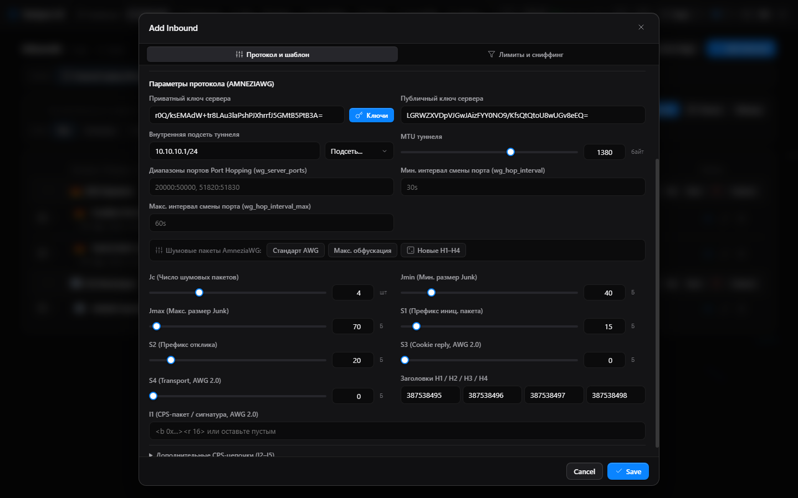

# 22. AmneziaWG

| Parameter | Value |
| :--- | :--- |
| **Role in `tachyon-ui`** | Endpoint Server (`#inbounds`) and Endpoint Client (`#outbounds`) |
| **`tachyon-core` Section** | Strictly `endpoints[]` with `"type": "wireguard"` and AWG fields (`jc`, `jmin`, `jmax`, `s1..s4`, `h1..h4`, `i1..i5`) |
| **L4 Transport** | UDP (including Port Hopping: `server_ports`, `hop_interval`, `hop_interval_max`) |
| **TLS / REALITY** | Not used (modified `Noise_IKpsk2` + junk packets and header replacement) |
| **Status in `tachyon-core 0.6.9`** | Full runtime support (AWG 1.0 / 2.0 / 3.x) |

---

## 1. Purpose and How It Works in `tachyon-core`

**AmneziaWG (AWG)** extends classic WireGuard to eliminate its primary DPI fingerprints: fixed handshake packet sizes (148 and 92 bytes) and constant 4-byte message type identifiers (`1`, `2`, `3`, `4`).

Inside `tachyon-core`, AmneziaWG uses the same `endpoints[]` architecture (`"type": "wireguard"`) as standard WireGuard and activates automatically whenever any obfuscation field (`jc`, `jmin`, `jmax`, `s1..s4`, `h1..h4`, `i1..i5`, or `header_protection_key`) is present. In `tachyon-ui`, it is exposed as a dedicated **`amneziawg`** protocol entry to separate junk-packet, preamble, and AWG 2.0 CPS signature controls from standard WireGuard:

1. **Junk Packets (`Jc`, `Jmin`, `Jmax`)** — Before each handshake, sends `Jc` random UDP packets with lengths sampled in `[Jmin..Jmax]`.
2. **Random Prefixes (`S1`, `S2`, plus `S3`, `S4` in AWG 2.0)** — Prepends random padding bytes to control and transport packets to defeat exact-length packet matching.
3. **Header Replacement (`H1..H4`)** — Replaces the standard WireGuard message type tags (`1..4`) with custom 32-bit integers (or ranges).
4. **CPS Chains (`I1..I5`, AWG 2.0)** — Programmable decoy packet sequences sent before the handshake, supporting template tags `<b 0x...>`, `<c>`, `<t>`, `<r N>`, `<rc N>`, `<rd N>`, `<d>`, `<ds>`, and `<dz N>` to mimic QUIC, STUN, or gaming UDP flows.
5. **Port Hopping** — Periodic UDP port rotation using `server_ports`.

> [!WARNING]
> For a session to establish, **`jc`, `jmin`, `jmax`, `s1..s4`, `h1..h4`, and `i1..i5`** on the server and client **must match identically**. Even a single mismatched value causes the server to silently drop incoming handshakes.

---

## 2. Panel Form Screenshot



---

## 3. Step-by-Step Setup in `tachyon-ui`

### Server Setup under "Inbounds"

1. Open **Inbounds (`#inbounds`)** → **+ Add Inbound** and select **AmneziaWG**.
2. Apply one of the three built-in protocol presets:
   - **`AmneziaWG Standard`** — port `51821`, subnet `10.10.10.1/24`, `mtu: 1380`, `jc: 4`, `jmin: 40`, `jmax: 70`, `s1: 15`, `s2: 20`. Balanced speed and resilience against typical signature filters.
   - **`AmneziaWG Heavy Junk`** — port `51821`, subnet `10.10.10.1/24`, `mtu: 1360`, `jc: 7`, `jmin: 60`, `jmax: 250`, `s1: 35`, `s2: 50`. Higher junk packet count and size for aggressive DPI environments.
   - **`AmneziaWG Mobile Lite`** — port `51821`, subnet `10.10.10.1/24`, `mtu: 1280`, `jc: 3`, `jmin: 20`, `jmax: 50`, `s1: 12`, `s2: 18`. Minimal overhead and safe MTU for cellular links.
3. Click **Keys** to generate the server's X25519 key pair.
4. In the **AmneziaWG Junk Packets** bar, you can also toggle quick presets: **`Standard AWG`**, **`Max Obfuscation`**, and **`New H1–H4`** (generates fresh random 32-bit `H1..H4` headers).
5. Optionally expand **Extra CPS Chains (I2–I5)** to configure `I1..I5` for AWG 2.0, as well as Port Hopping (`server_ports`, `hop_interval`, `hop_interval_max`).
6. Save the inbound and add clients to a subscription—`tachyon-ui` propagates all AWG parameters into exported client profiles automatically.

### Client Outbound Setup under "Outbounds"

1. Open **Outbounds (`#outbounds`)** and choose type **`amneziawg`**.
2. Enter the remote server address/port, `Client Private Key`, `Peer Public Key`, `Local Address` (e.g., `10.10.10.2/32`), and `MTU`.
3. Copy the exact `Jc`, `Jmin`, `Jmax`, `S1`, `S2`, and `H1..H4` values from the server (plus Port Hopping ranges if enabled).

---

## 4. Field, Toggle, and Parameter Reference

Alongside standard WireGuard fields (`private_key`, `address`, `mtu`, `peers[]`, `server_ports`, `hop_interval`, `hop_interval_max`), AmneziaWG exposes the following parameters:

| Panel Field | `tachyon-core` JSON Key | Allowed Values / Default | Purpose |
| :--- | :--- | :--- | :--- |
| **Jc (Junk Packet Count)** | `jc` | `1..12` (default `4`) | Number of random-payload UDP packets sent before handshake. |
| **Jmin (Min Junk Size)** | `jmin` | `10..200` bytes (default `40`) | Minimum junk packet length; must satisfy `jmin <= jmax`. |
| **Jmax (Max Junk Size)** | `jmax` | `50..1000` bytes (default `70`) | Maximum junk packet length. |
| **S1 (Init Prefix)** | `s1` | `5..150` bytes (default `15`) | Random padding prepended to Handshake Initiation (type `1`). |
| **S2 (Response Prefix)** | `s2` | `5..150` bytes (default `20`) | Random padding prepended to Handshake Response (type `2`). |
| **S3 (Cookie Reply, AWG 2.0)** | `s3` | `0..150` bytes (default `0`) | Random prefix for Cookie Reply packets (AWG 2.0). |
| **S4 (Transport, AWG 2.0)** | `s4` | `0..150` bytes (default `0`) | Random prefix for data transport packets (AWG 2.0). |
| **Headers H1 / H2 / H3 / H4** | `h1`, `h2`, `h3`, `h4` | 32-bit integers (default `102030401..102030404`) | Replacement type IDs for WireGuard packet types `1..4`. Must be pairwise unique. |
| **I1 (CPS Packet / Signature, AWG 2.0)** | `i1` | CPS template string (empty by default) | Primary decoy packet sent before handshake (e.g., `<b 0x...><r 16>`). |
| **I2–I5 (CPS, AWG 2.0)** | `i2`, `i3`, `i4`, `i5` | CPS template strings (e.g., `<r 32>`) | Additional AWG 2.0 decoy packet sequence. |

### `tachyon-core 0.6.9` Validator Constraints

- `jmin` must be less than or equal to `jmax`.
- When using `header_protection_key` (in manual JSON), every non-zero value in `s1..s4` must be `>= 12`.
- Declarative first-packet generator fields (`id`, `ip`, `ib`) conflict with an explicit `i1`.
- AmneziaWG parameters cannot be combined with Phobos obfuscation (`obfuscator_*`) on the same endpoint.

---

## 5. Networking and Firewall

- Opens inbound **UDP** on `listen_port` (default `51821/udp`).
- When `server_ports` is configured, permit UDP across all Port Hopping ports and route them to the service's local port (or open the full range on the host).
- Account for encapsulation overhead: non-zero `S4` reduces usable transport payload size, so lowering `mtu` (e.g., to `1360` or `1280`) is recommended for AWG 2.0 configurations with `S4 > 0`.

---

## 6. Subscription Export, Clients, and Valid `tachyon-core` JSON Example

- **URI Format**:
  ```text
  amneziawg://<privkey>@198.51.100.10:51821?publickey=<srv_pub>&address=10.10.10.2/32&mtu=1380&jc=4&jmin=40&jmax=70&s1=15&s2=20&h1=102030401&h2=102030402&h3=102030403&h4=102030404#awg-main
  ```
  If `s3`, `s4`, `i1..i5`, or Port Hopping fields are set, they are included in the query string.
- **JSON Profiles (`?format=singbox`, `?format=tachyon`, `?format=outbounds`)**: Exported into `endpoints[]` with `"type": "wireguard"` and all configured AWG fields.
- **Clash Meta YAML (`?format=clashmeta`)**: Exported as basic `type: wireguard` without AWG-specific fields. Use `tachyon`, `singbox`, or `amneziawg://` URI for full AWG support.
- **Clients**: `tachyon-core`, `tachyon-core`-based router clients, and official AmneziaWG / AmneziaVPN clients.

### Valid `tachyon-core` JSON Example

```json
{
  "endpoints": [
    {
      "type": "wireguard",
      "tag": "awg-in",
      "listen": "0.0.0.0",
      "listen_port": 51821,
      "private_key": "<SERVER_X25519_PRIVATE_KEY_BASE64>",
      "address": ["10.10.10.1/24"],
      "mtu": 1380,
      "jc": 4,
      "jmin": 40,
      "jmax": 70,
      "s1": 15,
      "s2": 20,
      "h1": 102030401,
      "h2": 102030402,
      "h3": 102030403,
      "h4": 102030404,
      "peers": [
        {
          "public_key": "<CLIENT_X25519_PUBLIC_KEY_BASE64>",
          "allowed_ips": ["10.10.10.2/32"]
        }
      ]
    }
  ]
}
```

---

## 7. Diagnostics and Common Errors

- **Handshake fails (packets sent, no reply)**: Verify that `jc`, `jmin`, `jmax`, `s1..s4`, `h1..h4`, and `i1..i5` match byte-for-byte between server and client.
- **Duplicate values in `H1..H4`**: If any two header IDs collide, the core cannot distinguish WireGuard message types. Click **New H1–H4** to regenerate distinct values.
- **Validation error `jmin > jmax`**: Ensure `Jmin` does not exceed `Jmax`.
- **Legacy AWG 1.0 client compatibility**: For older AmneziaWG clients, keep `s3 = 0`, `s4 = 0`, and `i1..i5` empty.

---

## 8. See Also

- [Protocol Catalog](./README.md)
- [Complete Guide](../00-complete-guide.md)
- [Tachyon Protocol Encyclopedia](../09-protocols-encyclopedia.md)
- [UI Every Tab & Button Guide](../11-ui-every-tab-and-button-guide.md)
- [21. WireGuard](./21-wireguard.md)
- [23. Mixed / SOCKS / HTTP](./23-mixed-socks-http.md)
