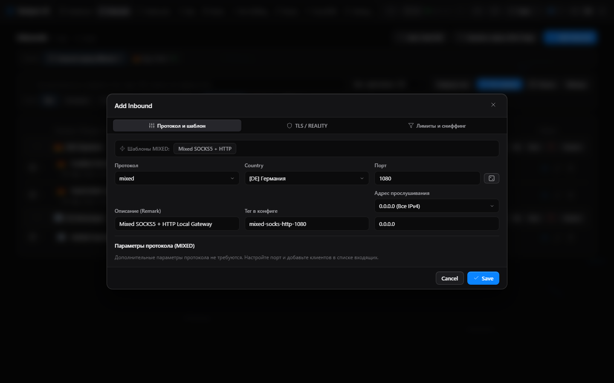

# 23. Mixed / SOCKS / HTTP

| Parameter | Value |
| :--- | :--- |
| **Role in `tachyon-ui`** | `mixed` — Inbound; `socks` and `http` — Inbound + Outbound |
| **L4 Transport** | `mixed` and `socks`: TCP + UDP (`SOCKS5 UDP ASSOCIATE`); `http`: TCP only |
| **TLS / REALITY** | `mixed` and `http`: `none` or certificate `tls`; `socks`: no TLS (`[]`) |
| **Status in `tachyon-core 0.6.9`** | Full runtime support |

---

## 1. Purpose and How It Works in `tachyon-core`

The local and transit proxy group—**`mixed`**, **`socks`**, and **`http`**—handles standard integration between applications, browsers, routers, external services, and `tachyon-core`:

- **`mixed` (Inbound)** — A dual-stack listener accepting **SOCKS4 / SOCKS4a / SOCKS5** (TCP and `UDP ASSOCIATE`) as well as **HTTP/1.1** (`CONNECT` for HTTPS and standard absolute-URI requests) on a single port. When TLS is enabled, it acts as an encrypted HTTPS proxy (client-side `SOCKS5 UDP ASSOCIATE` is not used over TLS).
- **`socks` (Inbound + Outbound)** — Standard SOCKS5 proxy (inbound also accepts SOCKS4/4a) with full TCP and UDP support (`UDP ASSOCIATE`; outbound also supports `udp_over_tcp`). External TLS is unsupported on both inbound and outbound.
- **`http` (Inbound + Outbound)** — Standard HTTP proxy (`CONNECT` and plain HTTP methods). Operates **strictly over TCP** (no UDP forwarding). Supports both plaintext (`none`) and certificate-based TLS (`tls`, i.e., HTTPS proxy).

> [!NOTE]
> `tachyon-core` also includes system-level local inbounds such as `tun`, `tproxy`, `redirect`, and `direct`, which `tachyon-ui` generates automatically for traffic interception and routing.

---

## 2. Panel Form Screenshot



---

## 3. Step-by-Step Setup in `tachyon-ui`

### Inbound Listeners (`#inbounds`)

1. Open **Inbounds (`#inbounds`)** → **+ Add Inbound**.
2. Choose `mixed`, `socks`, or `http`. The panel provides ready-to-use presets:
   - **`Mixed SOCKS5 + HTTP`** — port `1080`, TLS `none`.
   - **`SOCKS5 Proxy`** — port `1081`, TLS `none`.
   - **`HTTP CONNECT Proxy`** — port `8080`, TLS `none`.
3. **Critical `listen` address and authentication settings**:
   - For local-only access on the same host, set `listen = 127.0.0.1` (or `::1`).
   - If the port is reachable externally (`0.0.0.0`), **you must add at least one client** with a username and password. When the client list is empty, `users[]` is omitted from the core config and the proxy runs **without authentication (open proxy)**.
   - When clients exist, authentication is enforced; if every configured client is disabled or expired, the config generator injects a `__disabled__` sentinel user so the proxy never silently falls back to open anonymous access.
4. For `mixed` and `http` exposed over a network, enable the **TLS** tab (`tls` + server certificate). For `socks`, the TLS tab is intentionally hidden because the protocol does not support TLS.

### Outbound Upstreams (`#outbounds`)

1. Select type `socks` or `http`.
2. Fill in `Server Address`, `Server Port`, and optional `Username` / `Password`.
3. For `http`, you may enable TLS under **TLS & Transport** (connecting to an upstream HTTPS proxy) with SNI and `insecure` as needed. For `socks`, TLS blocks are never emitted into the outbound JSON.

---

## 4. Field, Toggle, and Parameter Reference

| Panel Field | `tachyon-core` JSON Key | Allowed Values / Default | Purpose |
| :--- | :--- | :--- | :--- |
| **Listen Address** (`#inbounds`) | `listen` | `0.0.0.0`, `127.0.0.1`, `::` | Network interface bound by the proxy. Use `127.0.0.1` for local apps. |
| **Port** (`#inbounds`) | `listen_port` | `1..65535` (presets `1080`, `1081`, `8080`) | Inbound listening port. |
| **Clients** (`username`, `password`) | `users[].username`, `users[].password` | Credential pairs (optional) | Client authentication. An empty list leaves the inbound unauthenticated. |
| **TLS Mode** (`mixed`, `http`) | `tls.enabled`, `tls.certificate_path`, `tls.key_path` | `none` / `tls` | Encrypts client connections (HTTPS proxy). Unavailable for `socks`. |
| **Server Address** (`#outbounds`) | `server` | IP or domain (`198.51.100.10`) | Upstream SOCKS5 or HTTP proxy host. |
| **Server Port** (`#outbounds`) | `server_port` | `1..65535` | Remote proxy port. |
| **Username** (`#outbounds`) | `username` | String (optional) | Username for upstream SOCKS5/HTTP authentication. |
| **Password** (`#outbounds`) | `password` | String (optional) | Password for upstream SOCKS5/HTTP authentication. |
| **Outbound TLS** (`http` only) | `tls.*` | `{ enabled, server_name, insecure, ... }` | Enables TLS when dialing an upstream HTTPS proxy. |

---

## 5. Networking, Firewall, and Open-Proxy Security

> [!CAUTION]
> **Never expose `mixed`, `socks`, or `http` on `0.0.0.0` without authentication (`users[]`) and/or strict firewall rules!**
> An open anonymous SOCKS/HTTP proxy on the public internet is discovered by automated scanners within minutes and abused for spam, scanning, and DDoS, resulting in VPS suspension.

- **Panel Firewall Rules**:
  - **`mixed`** and **`socks`**: Opens **TCP + UDP** on `listen_port` (UDP is required for `SOCKS5 UDP ASSOCIATE`).
  - **`http`**: Opens **TCP** only on `listen_port`.
- **Recommended Hardening**:
  1. Bind `127.0.0.1` when the proxy is consumed locally or over an SSH tunnel.
  2. For remote access, use `http` or `mixed` with mandatory **TLS** and strong passwords, or encapsulate traffic inside an encrypted tunnel (VLESS / TewFai / WireGuard).

---

## 6. Subscription Export, Clients, and Valid `tachyon-core` JSON Example

- **URI Format**:
  - `socks` and `mixed`: `socks5://<user>:<pass>@198.51.100.10:1081#label` (the `<user>:<pass>@` prefix is omitted when unauthenticated).
  - `http`: `http://<user>:<pass>@198.51.100.10:8080#label`.
- **JSON (`?format=singbox`, `?format=tachyon`, `?format=outbounds`)**:
  - An inbound `mixed` listener is exported to client configs as `"type": "socks"` (clients connect using SOCKS5).
  - `socks` → `"type": "socks"`; `http` → `"type": "http"`.
- **Clash Meta YAML (`?format=clashmeta`)**:
  - `mixed` and `socks` → `type: socks5`.
  - `http` → `type: http`.
- **Clients**: Web browsers, OS system proxy settings, `curl`, `tachyon-core`, and any SOCKS5/HTTP-capable application.

### Valid `tachyon-core` JSON Example

```json
{
  "inbounds": [
    {
      "type": "mixed",
      "tag": "mixed-local",
      "listen": "127.0.0.1",
      "listen_port": 1080,
      "users": [
        {
          "username": "router-client",
          "password": "<STRONG_PASSWORD>"
        }
      ]
    }
  ],
  "outbounds": [
    {
      "type": "http",
      "tag": "upstream-https",
      "server": "198.51.100.10",
      "server_port": 8443,
      "username": "proxy-user",
      "password": "<STRONG_PASSWORD>",
      "tls": {
        "enabled": true,
        "server_name": "panel.example.com"
      }
    }
  ]
}
```

---

## 7. Diagnostics and Common Errors

- **Games, voice calls, or QUIC fail over outbound `http`**: HTTP proxies are strictly TCP-only. Use `socks` (or plaintext `mixed` inbound) when UDP datagram forwarding is needed.
- **Attempting to enable TLS on `socks`**: `tachyon-core` does not support TLS wrapping on `socks`; use `http` + TLS, `mixed` + TLS, or tunnel over `shadowtls` / `vless`.
- **Auth errors on an inbound that looks "open"**: If clients were added in `tachyon-ui` but all of them are disabled or expired, the core enforces a `__disabled__` sentinel user and rejects anonymous connections.

---

## 8. See Also

- [Protocol Catalog](./README.md)
- [Complete Guide](../00-complete-guide.md)
- [Tachyon Protocol Encyclopedia](../09-protocols-encyclopedia.md)
- [UI Every Tab & Button Guide](../11-ui-every-tab-and-button-guide.md)
- [22. AmneziaWG](./22-amneziawg.md)
- [24. Desync](./24-desync.md)
