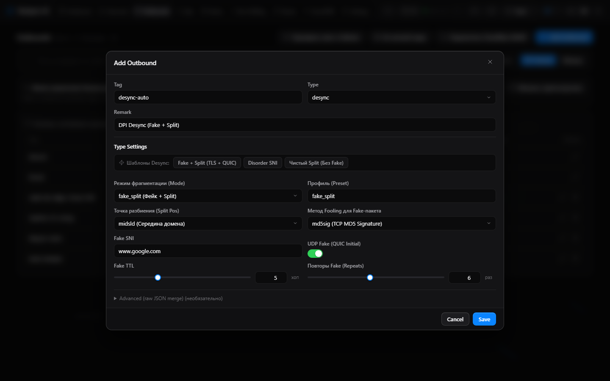

# 24. Desync

| Parameter | Value |
| :--- | :--- |
| **Role in `tachyon-ui`** | Outbound only (`#outbounds`, local direct-connection processor) |
| **L4 Transport** | TCP (TLS `ClientHello` / HTTP) and UDP (including QUIC Initial) |
| **TLS / REALITY** | Not used (operates on L3/L4 packets locally without an upstream proxy server) |
| **Status in `tachyon-core 0.6.9`** | Full runtime support (raw sockets for `fake*`/`disorder` and rootless userspace `tlsrec`) |

---

## 1. Purpose and How It Works in `tachyon-core`

**Desync** is a local outbound desynchronization engine for TCP segments and UDP/QUIC packets. Unlike VPNs or remote proxies, `desync` **does not relay traffic through an external server**: it reshapes the very first packets of a direct connection (TCP SYN/PSH carrying a TLS `ClientHello` or HTTP request, and initial QUIC UDP packets) so intermediate DPI boxes lose state or fail to extract `SNI` / `Host`, while the destination server reassembles the stream cleanly.

### How the `desync` Engine Works in `tachyon-core 0.6.9`

- **Segmentation (`split`, `disorder`, `multi_split`, `multi_disorder`, `tlsrec`, `oob`, `disoob`)**: Splits `ClientHello` across multiple TCP segments at `split_pos` (such as the middle of the domain SLD `midsld` or the SNI extension offset `sniext`), reorders segment delivery (`disorder`), or fragments at the TLS record layer (`tlsrec`).
- **Decoy Packets (`fake`, `fake_split`, `fake_disorder`) + Fooling**: Transmits a decoy packet bearing a spoofed domain (`fake_sni`) ahead of the real `ClientHello`. The DPI inspects the decoy while the target server discards it via a fooling technique (`md5sig`, `badsum`, `badseq`, `badack`, `ts`, `autottl`) or low `fake_ttl`.
- **QUIC Protection (`udp_fake` / `quic_desync`)**: Emits decoy or fragmented UDP datagrams prior to the real QUIC Initial packet.
- **Adaptive Mode (`auto` / `auto_tune: true`)**: Automatically probes and selects working strategies, persisting results across a 3-tier memory hierarchy (exact host → `eTLD+1`/subnet → global ranking) backed by `cache.db`.

> [!IMPORTANT]
> In **`tachyon-ui v0.4.12`** and **`tachyon-core 0.6.9`**, the legacy field **`udp_fake_packets` has been removed** and is rejected by the strict schema validator (`reject_unknown_fields`). Use **`udp_fake`**, **`quic_desync`**, and **`udp_repeats`** instead. The panel automatically migrates legacy `udp_fake_packets` on save and config generation.

---

## 2. Panel Form Screenshot



---

## 3. Step-by-Step Setup in `tachyon-ui`

1. Open **Outbounds (`#outbounds`)** and click **+ Add Outbound**.
2. Select type **`desync`** and assign a tag (e.g., `desync-direct`). Remote server address and port fields are not needed and are hidden automatically.
3. At the top of the modal, choose one of the **three built-in Desync templates**:
   - **`Fake + Split (TLS + QUIC)`**: sets `mode: "fake_split"`, `preset: "fake_split"`, `split_pos: "midsld"`, `fooling: "md5sig"`, `fake_sni: "www.google.com"`, `fake_ttl: 5`, `repeats: 6`, `udp_fake: true`.
   - **`Disorder SNI`**: sets `mode: "fake_disorder"`, `preset: "fake_disorder"` (replacing the legacy `disorder_tls` alias), `split_pos: "sniext"`, `fooling: "badseq"`, `fake_sni: "www.microsoft.com"`, `fake_ttl: 4`, `repeats: 4`, `udp_fake: true`.
   - **`Clean Split (No Fake)`**: sets `mode: "split"`, `preset: "split"`, `split_pos: "midsld"`, `fooling: ""`, `fake_ttl: 0` (omitted from JSON), `repeats: 1`, `udp_fake: false`.
4. Optionally pick **`auto`** to enable the built-in adaptive strategy tuner (`auto_tune: true`).
5. Bind the `desync` outbound tag to target domains or `.trs` rule sets under **Routes (`#routes`)**.

---

## 4. Field, Toggle, and Parameter Reference

| Panel Field | `tachyon-core` JSON Key | Allowed Values / Default | Purpose |
| :--- | :--- | :--- | :--- |
| **Fragmentation Mode** | `mode` | `auto`, `fake_split`, `fake_disorder`, `fake`, `disorder`, `split`, `multi_split`, `multi_disorder`, `tlsrec`, `oob`, `disoob` | Core TCP stream modification algorithm. |
| **Preset** | `preset` | String (e.g., `fake_split`, `fake_disorder`, `split`, `auto`, `multi_disorder`, `tlsrec`, ...) | Named strategy preset in the core. Legacy `disorder_tls` is normalized to `fake_disorder`. |
| *(Automatic with `auto`)* | `auto_tune` | `true` / `false` | Enables adaptive strategy selection persisted in `cache.db` when `mode` or `preset` is `auto`/`adaptive`. |
| **Split Position** | `split_pos` | UI: `midsld`, `sniext`, `1`, `2` (core also accepts `sni`, `sniext+1`, `host+1`, `midsld-2`, `midsld+2`, `endhost-1`, `extlen`, or array) | Byte/offset position where the TCP segment is split relative to SNI/Host. |
| **Fake Packet Fooling** | `fooling` | `""` (no fake), `md5sig`, `badsum`, `badseq`, `badack`, `ts`, `autottl`, `md5_badack` (core also accepts `hopbyhop`, `badseq_badack_badsum`, `datanoack`) | Mechanism ensuring the destination server discards decoy packets. `"none"` is never emitted into JSON. |
| **Fake SNI** | `fake_sni` | Domain string (default `www.google.com`) | Decoy hostname placed inside fake TLS `ClientHello` packets. |
| **Fake TTL** | `fake_ttl` | UI `0..16` (default `5`; core `1..128`, `0` is omitted) | Hop limit for decoy packets so they expire before reaching the destination server. |
| **Fake Repeats** | `repeats` | UI `1..12` (default `6`; core `1..100`) | Number of decoy/segmented packet repetitions per flow. |
| **UDP Fake (QUIC Initial)** | `udp_fake`, `quic_desync`, `udp_repeats` | Toggle `bool` (when `true`, panel also sets `udp_repeats: 6`) | Enables UDP/QUIC Initial desynchronization. Manual JSON also supports `udp_fake_ttl`, `udp_fake_payload` (hex <= 1472 B), `udp_out_range`, `udp_keep_socket`, `quic_repeats`. |

---

## 5. Networking, Privileges, and Firewall

- `desync` opens no inbound listening ports.
- Techniques that craft raw TCP/IP headers or options (`fake`, `fake_split`, `fake_disorder`, `disorder`, `multi_disorder`, `oob`, `disoob`) require `CAP_NET_RAW` on Linux (or `root`, which is standard on OpenWrt routers and system services).
- In unprivileged containers lacking `CAP_NET_RAW`, use **`mode: "tlsrec"`** or **`split`**, which operate strictly over standard userspace sockets.

---

## 6. Subscription Export, Clients, and Valid `tachyon-core` JSON Example

- **Subscriptions**: `desync` runs locally inside `tachyon-core` configurations (on routers, gateways, or local `tachyon-core` desktop profiles). It is not exported as a remote server into third-party URI lists or Clash Meta YAML.
- **Clients**: `tachyon-core` (desktop, gateway, OpenWrt router).

### Valid `tachyon-core` JSON Example

```json
{
  "outbounds": [
    {
      "type": "desync",
      "tag": "desync-direct",
      "mode": "fake_split",
      "preset": "fake_split",
      "auto_tune": false,
      "split_pos": "midsld",
      "fooling": "md5sig",
      "fake_sni": "www.google.com",
      "fake_ttl": 5,
      "repeats": 6,
      "udp_fake": true,
      "quic_desync": true,
      "udp_repeats": 6
    }
  ]
}
```

---

## 7. Diagnostics and Common Errors

- **`unknown field 'udp_fake_packets'` on config check**: Legacy configs used `udp_fake_packets`. Re-save the outbound in `tachyon-ui v0.4.12` or replace it manually with `udp_fake: true`, `quic_desync: true`, `udp_repeats: 6`.
- **Validation error from `fooling: "none"` or `fake_ttl: 0`**: To disable decoy packets in raw JSON, omit these fields completely instead of writing `"none"` or `0`.
- **Fake packets fail without root**: Grant `CAP_NET_RAW` to the `tachyon-core` process or switch to `mode: "tlsrec"`.
- **Sites fail to load when `fake_ttl` is too high**: If `fake_ttl` exceeds the actual hop count to the destination server, decoy packets reach the server and break the handshake (especially with empty `fooling`). Lower `fake_ttl` to `3..5` or enable `fooling: "md5sig"` / `"badseq"`.

---

## 8. See Also

- [Protocol Catalog](./README.md)
- [Complete Guide](../00-complete-guide.md)
- [Tachyon Protocol Encyclopedia](../09-protocols-encyclopedia.md)
- [UI Every Tab & Button Guide](../11-ui-every-tab-and-button-guide.md)
- [23. Mixed / SOCKS / HTTP](./23-mixed-socks-http.md)
- [27. Balancers and Chain (urltest / selector / chain)](./27-balancers-and-chain.md)
