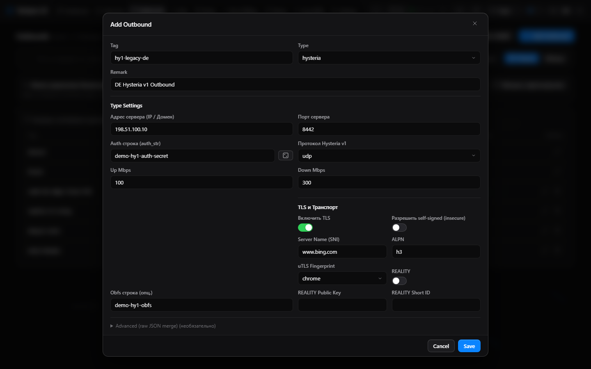

# 25. Hysteria v1

| Parameter | Value |
| :--- | :--- |
| **Role in `tachyon-ui`** | Outbound only (`#outbounds`, type `hysteria`) |
| **L4 Transport** | UDP (`udp`, `wechat-video`, `faketcp`) |
| **TLS / REALITY** | Certificate TLS (`tls.enabled: true`) is mandatory in the schema |
| **Status in `tachyon-core 0.6.9`** | **Schema and UI supported, but runtime is not implemented in `tachyon-core 0.6.9`** (`not implemented yet` at startup) |

---

## 1. Purpose and How It Works in `tachyon-core`

**Hysteria v1** is the first-generation high-speed UDP protocol built on modified QUIC with aggressive Brutal congestion control and multiple transport masking dialects (`udp`, `wechat-video`, `faketcp`).

> [!WARNING]
> **Honest Status in `tachyon-core 0.6.9`**:
> The `hysteria` type is present in the `tachyon-ui` form, the subscription import parser (`hysteria://` / `hy://`), and passes `tachyon-core check` schema validation. However, **its runtime handler is not implemented in `tachyon-core 0.6.9`**. Starting the core with an active `hysteria` outbound fails at initialization with `not implemented yet`.
>
> For production deployments, use the modern, fully supported **[03. Hysteria2](./03-hysteria2.md)** protocol instead.

The `hysteria` form in `tachyon-ui` is intended only for:
- importing and storing legacy `hysteria://` links prior to migrating them to `hysteria2`;
- testing and validating configuration schemas via `tachyon-core check`.

---

## 2. Panel Form Screenshot



---

## 3. Step-by-Step Setup in `tachyon-ui`

1. Open **Outbounds (`#outbounds`)** → **+ Add Outbound**.
2. Select type **`hysteria`** (no built-in presets exist in the panel).
3. Enter `Server Address` (e.g., `198.51.100.10`) and `Server Port` (`443` or the Hysteria v1 server port).
4. Set the **`auth_str`** authentication string (or generate a random secret with the dice button).
5. Pick the `Hysteria v1 Protocol` dialect (`udp`, `wechat-video`, `faketcp`), set `Up Mbps`, `Down Mbps`, and optionally `Obfs String`.
6. Under **TLS & Transport**, keep TLS enabled and configure `SNI` (if no explicit TLS block is present, the config generator injects `{ "enabled": true, "insecure": true, "server_name": <server> }`).

---

## 4. Field, Toggle, and Parameter Reference

| Panel Field | `tachyon-core` JSON Key | Allowed Values / Default | Purpose |
| :--- | :--- | :--- | :--- |
| **Server Address** | `server` | IP or domain (`198.51.100.10`) | Hysteria v1 server host. |
| **Server Port** | `server_port` | `1..65535` | Remote UDP port (or TCP for `faketcp`). |
| **Auth String (`auth_str`)** | `auth_str` | String (`auth` / `password` aliases are also accepted) | Client authentication secret for Hysteria v1. |
| **Hysteria v1 Protocol** | `protocol` | `udp`, `wechat-video`, `faketcp` | Transport dialect *(see note below regarding strict `check` validation)*. |
| **Up Mbps** | `up_mbps` | Integer `>= 1` (default `100`) | Declared upload bandwidth in Mbps. |
| **Down Mbps** | `down_mbps` | Integer `>= 1` (default `200`) | Declared download bandwidth in Mbps. |
| **Obfs String (opt.)** | `obfs` | String (empty by default) | Simple XOR packet obfuscation password for Hysteria v1. |
| **Enable TLS** | `tls.enabled` | `true` (mandatory) | Activates TLS; schema validation fails without a `tls` object. |
| **Server Name (SNI)** | `tls.server_name` | Domain string | Expected SNI on the server certificate. |
| **Allow Self-Signed** | `tls.insecure` | `bool` | Skips certificate chain verification for self-signed certs. |

> [!NOTE]
> During strict `tachyon-core check` validation, the allowed field whitelist for `hysteria` outbounds covers `up`, `up_mbps`, `down`, `down_mbps`, `obfs`, `auth`, `auth_str`, `server_ports`, `hop_interval`, `network`, and `tls` (omitting `protocol`). Keep this in mind when running strict schema checks manually.

---

## 5. Networking and Firewall

- As an outbound-only type, Hysteria v1 opens no inbound server ports in the panel.
- Outbound connectivity from the host to the external node requires outbound UDP (or TCP for `faketcp`).

---

## 6. Subscription Export, Clients, and Valid `tachyon-core` JSON Example

- **Inbound Subscription Parser**: The panel parses `hysteria://` and `hy://` links when importing into `#outbounds`.
- **Client Export**: Due to missing runtime support in `tachyon-core 0.6.9`, migrate active client profiles to `hysteria2`.

### JSON Schema Example for `tachyon-core check`

```json
{
  "outbounds": [
    {
      "type": "hysteria",
      "tag": "hy1-legacy",
      "server": "198.51.100.10",
      "server_port": 36712,
      "auth_str": "<AUTH_SECRET>",
      "up_mbps": 100,
      "down_mbps": 200,
      "obfs": "<OBFS_SECRET>",
      "tls": {
        "enabled": true,
        "server_name": "panel.example.com",
        "insecure": true
      }
    }
  ]
}
```

---

## 7. Diagnostics and Common Errors

- **`not implemented yet` error on core launch**: Expected behavior in `tachyon-core 0.6.9`—Hysteria v1 has no runtime implementation. Remove or replace the outbound with `hysteria2` (or `tuic` / `tewfai`).
- **Validation error on `protocol` in strict `check` mode**: Remove the `protocol` key in advanced JSON settings when validating against the minimal schema whitelist.
- **Missing `tls` object**: The Hysteria v1 schema requires `tls.enabled: true`.

---

## 8. See Also

- [Protocol Catalog](./README.md)
- [Complete Guide](../00-complete-guide.md)
- [Tachyon Protocol Encyclopedia](../09-protocols-encyclopedia.md)
- [UI Every Tab & Button Guide](../11-ui-every-tab-and-button-guide.md)
- [03. Hysteria2](./03-hysteria2.md)
- [26. SSH / Tor / Bridge](./26-ssh-tor-bridge.md)
