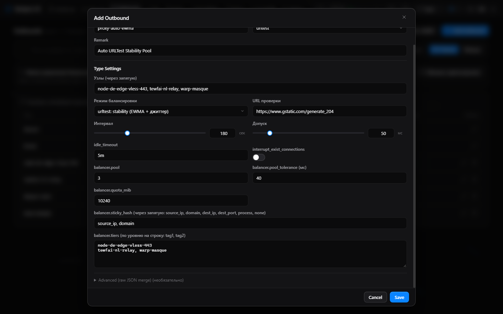
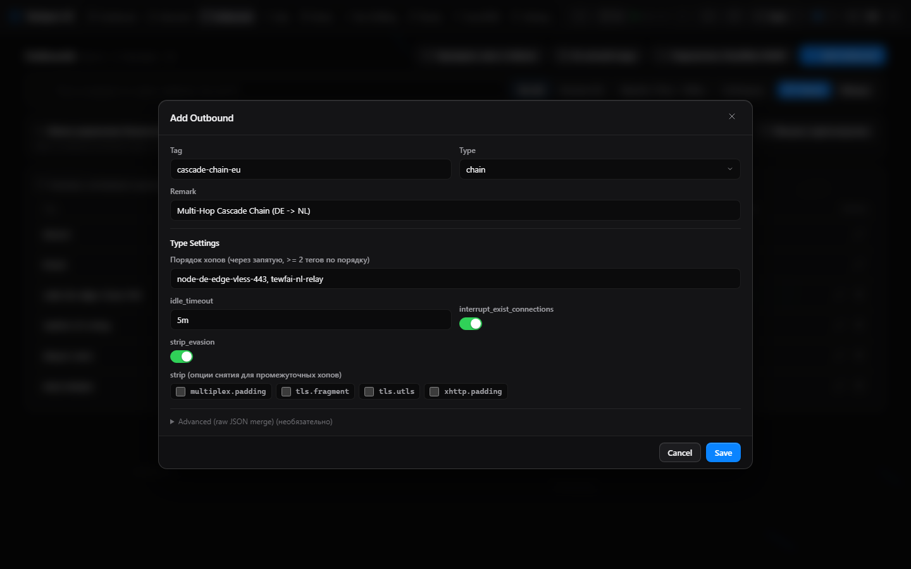

# 27. Balancers and Chain (`urltest`, `selector`, `chain`, `direct`, `block`)

| Parameter | Value |
| :--- | :--- |
| **Role in `tachyon-ui`** | Group and meta `outbounds[]` (`#outbounds` and the **Balancers** tab inside `#subs`) |
| **L4 Transport** | TCP and UDP (inherited from member `outbounds[]`) |
| **TLS / REALITY** | No TLS fields of their own; configured on leaf nodes |
| **Status in `tachyon-core 0.6.9`** | Full runtime support (all 12 `urltest` modes, `selector`, `chain`, built-in `direct` and `block`) |

---

## 1. Purpose and How They Work in `tachyon-core`

Rather than pinning routes to a single server, **`tachyon-core`** and **`tachyon-ui`** let you combine outbounds (and `wireguard`/`amneziawg` endpoints) into smart balancing groups and multi-hop cascades:

1. **`urltest`** — Automatic balancer featuring **12 selection algorithms**, periodic health probes (`url`), anti-flapping hysteresis (`tolerance`), automatic fallback across up to 8 backup nodes on dial error, and a passive Circuit-Breaker.
2. **`selector`** — Real-time manual node switcher (via Clash API or client UI) with optional `auto_failover` if the chosen outbound fails.
3. **`chain`** — Sequential multi-hop cascade of **2 or more nodes** (`Hop 1 → Hop 2 → ... → Target`), where each intermediate node serves as the dialer transport for the next. Supports stripping evasion flags (`strip_evasion` and granular `strip` options) on inner hops.
4. **`direct` and `block`** — Built-in core meta-outbounds: `direct` sends traffic directly without proxying (auto-added when the outbound pool is empty or referenced by rules), while `block` drops unwanted connections (such as BitTorrent or ad domains).

> [!TIP]
> Balancers can be defined globally under **Outbounds (`#outbounds`)** for server-side routing and cascades, as well as per subscription under **`#subs` → Balancers** (including automatic per-country groups like `auto-fi`, `auto-de`, etc.).

---

## 2. Panel Form Screenshots

### `urltest` Balancer



### `chain` Cascade



---

## 3. Step-by-Step Setup in `tachyon-ui`

### Configuring `urltest`

1. Open **Outbounds (`#outbounds`)** → **+ Add Outbound** and select type **`urltest`**.
2. In `Nodes (comma-separated)`, list the tags of existing outbounds or endpoints.
3. Pick one of the **12 balancing modes** (`mode`).
4. Verify the probe URL (defaults to `https://www.gstatic.com/generate_204`), interval (`10..600` s, default `180s` in the form), and tolerance (`10..300` ms, default `50` ms on the slider).
5. For modes that support extended options (all except `least_test` and `failover`), optionally configure `balancer.pool`, `balancer.pool_tolerance`, `balancer.quota_mib`, `balancer.sticky_hash`, or `balancer.tiers`.

### Configuring `selector` and `chain`

- For **`selector`**: enter member tags in `Nodes`, choose a `Default Node` (`default`), and optionally enable `auto_failover` and `interrupt_exist_connections`.
- For **`chain`**: list **at least 2 tags** in exact hop order (`entry_node, exit_node`), and optionally enable `strip_evasion` or toggle `strip` chips (`multiplex.padding`, `tls.fragment`, `tls.utls`, `xhttp.padding`) to strip redundant evasion settings on intermediate hops.

---

## 4. All 12 `urltest` Modes and Field Reference

### All 12 `urltest` Modes in `tachyon-ui v0.4.12` + `tachyon-core 0.6.9`

| Mode (`mode`) | `balancer` Object | Selection Algorithm | Best Used For |
| :--- | :--- | :--- | :--- |
| **`least_test`** *(default)* | **Forbidden** | Active `url` probe; selects lowest RTT with `tolerance` hysteresis and EWMA on live flows. | General-purpose fastest-node selection. |
| **`failover`** | **Forbidden** | Strict priority along `outbounds`: probes only the active node and switches only on failure. | Primary link + dedicated backup relay. |
| **`stability`** | Allowed | Composite score: RTT + EWMA + RFC 3550 jitter + packet-loss penalty. | Voice/video calls, streaming, SSH, remote desktop. |
| **`sticky`** | Allowed | Deterministic Rendezvous/HRW hashing keyed by `sticky_hash`. | Banking, portals, and services sensitive to mid-session IP changes. |
| **`least_load`** | Allowed | Selects the node minimizing `(active_conns + 1) * RTT`. | Spreading load evenly across a pool with many concurrent clients. |
| **`weighted`** | Allowed | Smooth Weighted Round-Robin (SWRR) weighted proportionally to `(best_rtt / rtt)^2`. | Load distribution biased toward lower-latency nodes. |
| **`round_robin`** | Allowed | Cyclic rotation of new flows across healthy pool members (`balancer.pool`). | High volumes of short HTTP/API requests. |
| **`passive`** | Allowed | Passive Circuit-Breaker driven by real flow telemetry (TTFB, failures, zero-RX stalls). | Saving background bandwidth and CPU on routers and mobile networks. |
| **`priority`** | Allowed | Multi-tier cascade across `balancer.tiers` (`Tier 1 → Tier 2 → ...`) with automatic failback. | Strict hierarchy from primary high-speed servers to fallback tiers. |
| **`hedged`** | Allowed | Speculative parallel TCP race when the primary exceeds `1.5 * EWMA RTT` within `80..600` ms. | Lowest tail latency for web browsing over unstable Wi-Fi/LTE. |
| **`throughput`** | Allowed | Selects the node with highest measured live transfer rate (EWMA KiB/s). | Large downloads, 4K streaming, and backups. |
| **`quota`** | Allowed | Distributes traffic while enforcing `balancer.quota_mib` per node. | Pools of budget VPS nodes with strict monthly transfer caps. |

> [!IMPORTANT]
> In **`least_test`** and **`failover`** modes, a non-empty `balancer` object is rejected by the `tachyon-core` validator. `tachyon-ui` automatically strips the `balancer` block when generating configs for these two modes.

### `urltest`, `selector`, and `chain` Parameter Table

| Type | Panel Field | `tachyon-core` JSON Key | Allowed Values / Default | Purpose |
| :--- | :--- | :--- | :--- | :--- |
| `urltest` | **Nodes** | `outbounds` | Non-empty tag array | List of candidate members. |
| `urltest` | **Balancer Mode** | `mode` | One of the 12 modes (default `least_test`) | Node selection strategy. |
| `urltest` | **Probe URL** | `url` | URL (default `https://www.gstatic.com/generate_204`) | HTTP 204 endpoint for availability checks. |
| `urltest` | **Interval** | `interval` | `10..600` s (default `180s` in UI, `300s` in core/subs) | Background probe period. |
| `urltest` | **Tolerance** | `tolerance` | `10..300` ms (default `50` / fallback `40`) | RTT difference threshold preventing flapping. |
| `urltest` | **idle_timeout** | `idle_timeout` | Duration string (e.g., `"5m"`) | Idle period before pausing background probes. |
| `urltest` | **interrupt_exist_connections** | `interrupt_exist_connections` | `bool` | Close existing sessions when switching the active node. |
| `urltest` | **balancer.pool** | `balancer.pool` | Integer `> 0` | Active pool size of top-ranked members. |
| `urltest` | **balancer.pool_tolerance** | `balancer.pool_tolerance` | `0..=15000` ms | Allowed RTT spread within the active pool. |
| `urltest` | **balancer.quota_mib** | `balancer.quota_mib` | Integer `> 0` (MiB) | Per-node traffic quota for `quota` mode. |
| `urltest` | **balancer.sticky_hash** | `balancer.sticky_hash` | Array of `source_ip`, `domain`, `dest_ip`, `dest_port`, `process` — **or** `["none"]` alone | Affinity hashing keys for `sticky` mode. |
| `urltest` | **balancer.tiers** | `balancer.tiers` | `string[][]` (one tier per line) | Priority tier lists for `priority` mode. |
| `selector` | **Nodes** | `outbounds` | Tag array | Selectable outbound choices. |
| `selector` | **Default Node** | `default` | Tag from `outbounds` | Initial active node. |
| `selector` | **auto_failover** | `auto_failover` | `bool` | Temporary automatic fallback when the selected node fails. |
| `selector` | **interrupt_exist_connections** | `interrupt_exist_connections` | `bool` | Reset active flows on manual node switch. |
| `chain` | **Hop Order** | `outbounds` | Array of `>= 2` tags | Ordered cascade `Hop 1 → ... → Exit Hop`. |
| `chain` | **idle_timeout** | `idle_timeout` | Duration string (e.g., `"5m"`) | Idle timeout for chained connections. |
| `chain` | **interrupt_exist_connections** | `interrupt_exist_connections` | `bool` | Close existing flows when chain state changes. |
| `chain` | **strip_evasion** | `strip_evasion` | `bool` | Strip evasion flags between intermediate hops. |
| `chain` | **strip** | `strip` | Object `{ "multiplex.padding": true, "tls.fragment": true, "tls.utls": true, "xhttp.padding": true }` | Granularly disable evasion options on inner hops. |

---

## 5. Networking and Firewall

- `urltest`, `selector`, `chain`, `direct`, and `block` open no inbound ports and create no firewall rules.
- Balancers and chains can reference both `outbounds[]` entries and `endpoints[]` entries (WireGuard / AmneziaWG), as all tags share a single namespace.

---

## 6. Subscription Export, Clients, and Valid `tachyon-core` JSON Example

- **JSON (`?format=singbox` / `?format=json`)**: Full generation of `selector`, `urltest` (including nested `balancer` and auto-generated country groups `country-<cc>`), `chain`, `direct`, and `block`. Missing or deleted tags are cleaned automatically (`prune_dangling_outbound_refs`).
- **JSON (`?format=tachyon`)**: Includes `urltest` balancers, including country groups.
- **Clash Meta YAML (`?format=clashmeta`)**:
  - `selector` → `select`
  - `failover` / `priority` → `fallback`
  - `sticky` → `load-balance` (`strategy: consistent-hashing`)
  - `round_robin` / `weighted` / `least_load` → `load-balance` (`strategy: round-robin`)
  - remaining `urltest` modes → `url-test`
  - **`chain` is not exported to Clash Meta YAML**—use native JSON (`?format=tachyon` / `?format=singbox`) for multi-hop cascades.

### Valid `tachyon-core` JSON Example

```json
{
  "outbounds": [
    {
      "type": "urltest",
      "tag": "auto-eu",
      "outbounds": ["de-tewfai", "nl-vless", "fi-wg"],
      "mode": "stability",
      "url": "https://www.gstatic.com/generate_204",
      "interval": "180s",
      "tolerance": 50,
      "idle_timeout": "5m",
      "interrupt_exist_connections": false,
      "balancer": {
        "pool": 2,
        "pool_tolerance": 80
      }
    },
    {
      "type": "selector",
      "tag": "manual-main",
      "outbounds": ["auto-eu", "de-tewfai", "nl-vless", "direct"],
      "default": "auto-eu",
      "auto_failover": true,
      "interrupt_exist_connections": true
    },
    {
      "type": "chain",
      "tag": "double-hop",
      "outbounds": ["entry-relay", "exit-nl"],
      "idle_timeout": "5m",
      "strip_evasion": true,
      "strip": {
        "tls.fragment": true,
        "xhttp.padding": true
      }
    },
    {
      "type": "direct",
      "tag": "direct"
    },
    {
      "type": "block",
      "tag": "block"
    }
  ]
}
```

---

## 7. Diagnostics and Common Errors

- **`balancer` object in `least_test` or `failover`**: Providing a non-empty `balancer` object in hand-edited JSON for these two modes is rejected during `urltest` initialization.
- **Fewer than 2 tags in `chain`**: A cascade requires at least 2 ordered tags; if one member is deleted, dangling-reference pruning automatically removes the broken chain.
- **Combining `"none"` with other keys in `sticky_hash`**: `"none"` may only appear on its own (`["none"]`).
- **Dangling references after node removal**: If a member outbound is deleted or skipped (such as an invalid `masque` entry), `tachyon-ui` automatically prunes the reference and removes empty groups so the core never fails on startup.
- **Live control & Circuit-Breaker reset**: Use the `#outbounds` pool or Core Diagnostics console to run manual latency checks, switch `selector` targets, or reset a tripped Circuit-Breaker (see [Chapter 4 — Balancers, Chain & Routes](../04-balancers-chain-and-routes.md)).

---

## 8. See Also

- [Protocol Catalog](./README.md)
- [Complete Guide](../00-complete-guide.md)
- [Tachyon Protocol Encyclopedia](../09-protocols-encyclopedia.md)
- [UI Every Tab & Button Guide](../11-ui-every-tab-and-button-guide.md)
- [Chapter 4 — Balancers, Chain & Routes](../04-balancers-chain-and-routes.md)
- [24. Desync](./24-desync.md)
- [26. SSH / Tor / Bridge](./26-ssh-tor-bridge.md)
