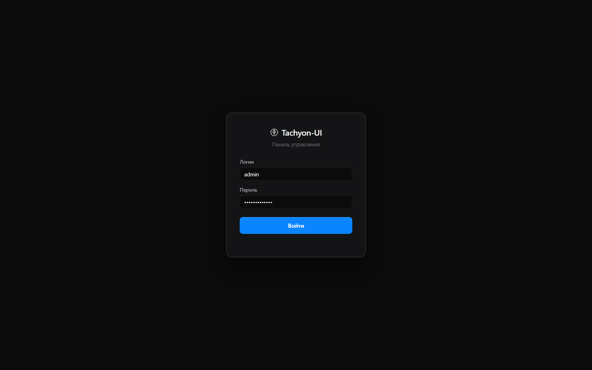
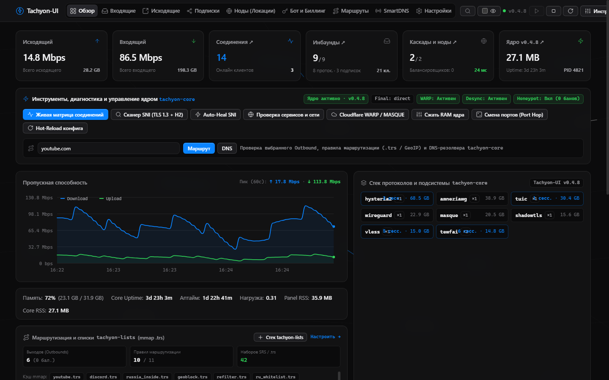
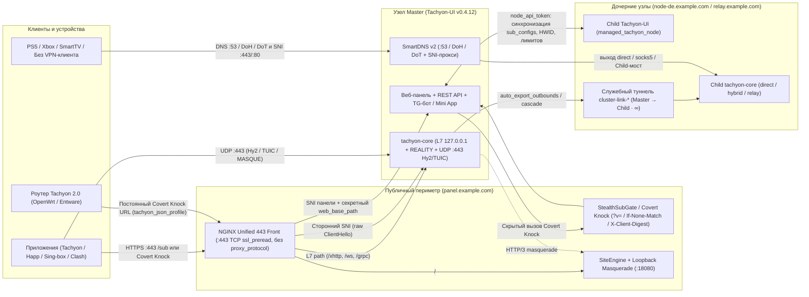

# 0. Сводный путеводитель: от чистого сервера до продакшена (Tachyon-UI v0.4.12)

[English version](../en/00-complete-guide.md) | [К оглавлению](../../README.ru.md) | [Полный справочник UI](./11-ui-every-tab-and-button-guide.md) | [Каталог 27 протоколов](./protocols/README.md)

Этот документ объединяет всю архитектуру **Tachyon-UI `v0.4.12`** в единую карту внедрения: от первого входа после установки на чистом VPS до мультинодового кластера `Master → Child`, роутерных подписок `Tachyon 2.0`, встроенного `SmartDNS v2 / GeoHide` и коммерческого сервиса через Telegram-бота.

> **Новые исчерпывающие справочники:**
> - [Полный справочник по всем вкладкам, кнопкам и модалкам UI](./11-ui-every-tab-and-button-guide.md) — точное описание каждого элемента управления, модальных окон, горячих клавиш и режимов интерфейса.
> - [Каталог 27 протокольных гайдов](./protocols/README.md) — технические паспорта каждого протокола в `tachyon-ui v0.4.12` + `tachyon-core 0.6.9` (включая [01. TewFai](./protocols/01-tewfai.md), [02. VLESS](./protocols/02-vless.md), [03. Hysteria2](./protocols/03-hysteria2.md), [04. TUIC](./protocols/04-tuic.md), [08. AnyTLS](./protocols/08-anytls.md), [11. MASQUE](./protocols/11-masque.md), [21. WireGuard](./protocols/21-wireguard.md), [22. AmneziaWG](./protocols/22-amneziawg.md), [24. Desync](./protocols/24-desync.md), [27. Балансировщики и Chain](./protocols/27-balancers-and-chain.md)).

---

## 1. Архитектура платформы `v0.4.12`

В `Tachyon-UI v0.4.12` панель управления, движок `tachyon-core`, DNS/SNI-прокси `SmartDNS v2`, веб-маскировка `SiteEngine` и кластерный контроллер работают внутри единого статического Rust-бинарника, а при необходимости закрываются внешним фронтендом `Unified 443 Front (NGINX + Core)` на единственном публичном порту `443` TCP/UDP.

### Ключевые обновления `v0.4.12`

- **TewFai REALITY пресеты и QUIC-носитель:** добавлены готовые пресеты (`TewFai REALITY Multi-Carrier`, `TewFai REALITY TCP Stealth`, `TewFai REALITY Video Stream + PQC`, `TewFai TLS + Свой домен`). На сервере REALITY защищает TCP-носитель, а при включённом QUIC-носителе клиентский экспорт автоматически добавляет `quic.tls` с `alpn: ["h3"]` и поддержкой обфускации `salamander` / `gecko`. Подробнее — [01. TewFai](./protocols/01-tewfai.md).
- **SmartDNS DoH для роутеров:** в блоке «Быстрое подключение» и на Шаге 4 Мастера SmartDNS добавлена кнопка **«Без https://»** (`domain.tld/dns-query?...`) для прямой вставки в прошивки Keenetic и OpenWrt без дублирования схемы URL. Подробнее — [Глава 8](08-smartdns-geohide-guide.md).
- **Автоматическая миграция Desync:** панель автоматически очищает устаревшие параметры (заменяет `udp_fake_packets` на `udp_fake` / `quic_desync` / `udp_repeats`, переводит `disorder_tls` в `fake_disorder`, удаляет `fooling: "none"` и `fake_ttl: 0`) в соответствии со строгой схемой `tachyon-core 0.6.9`. Подробнее — [24. Desync](./protocols/24-desync.md).
- **Единое управление и 16 тем:** глобальная палитра команд (`Ctrl+K`), нижний поток соединений (**Live Connections Dock**, `` Ctrl+` ``), режим скрытия приватных данных (`Alt+P`), быстрый инвайт в 1 клик и редактор пользовательских тем.

### Навигатор по разделам документации (`01..11` и `protocols/`)

| Раздел | Содержание |
| :--- | :--- |
| [01. Установка, CLI и первый вход](01-installation-and-cli.md) | Установка, сборка, CLI `tachyon-panel`, экран входа, топбар, меню «Инструменты», настройки, снапшоты |
| [02. Сайт, Домен, `Unified 443 Front`, ACME и Self-Audit](02-stealth-web-domain-tls.md) | Мастер маскировки (4 шага), 5 профилей домена, ACME HTTP-01 / DNS-01, 9 проверок Self-Audit |
| [03. Подписки, профили, 360°-инспектор и Covert Knock](03-subscriptions-and-covert-knock.md) | 5 вкладок редактора, быстрый инвайт в 1 клик, форматы экспорта, HWID, StealthSubGate |
| [04. Балансировщики, `chain` и маршрутизация](04-balancers-chain-and-routes.md) | 12 режимов `urltest`, `selector`, `chain`, `.trs` списки, `Flow-карта` и 2-уровневый симулятор |
| [05. Протоколы, кластер `Master → Child`, каскады и TG-бот](05-protocols-nodes-and-tgbot.md) | Конструктор инбаундов и пресеты, `TewFai`, ноды и каскады, бот и Live-симулятор |
| [06. Дашборд, диагностика ядра, темы, `Alt+P` и REST API](06-diagnostics-privacy-and-api.md) | 5-вкладочная диагностика `tachyon-core`, Live Dock, 16 тем, маскировка `Alt+P` и API |
| [07. Полное пошаговое руководство и кластер](07-full-setup-and-cluster-guide.md) | Сквозная сборка личного мультинодового кластера и единой подписки |
| [08. SmartDNS v2 / GeoHide и SNI-прокси](08-smartdns-geohide-guide.md) | DNS `:53`, DoH/DoT, SNI-прокси `:443/:80`, `tachyon-lists`, AdBlock и 4-шаговый Мастер |
| [09. Энциклопедия протоколов простыми словами](09-protocols-encyclopedia.md) | Обзорное сравнение и рекомендации по выбору протоколов под разные сети |
| [10. Подписка для роутера Tachyon 2.0](10-tachyon-router-subscription-guide.md) | Настройка `tachyon_json_profile`, стран, балансировщиков и `.trs` для роутеров |
| **[11. Полный справочник по всем вкладкам и кнопкам UI](./11-ui-every-tab-and-button-guide.md)** | **Исчерпывающий путеводитель по каждой вкладке, кнопке, форме, модалке и хоткею** |
| **[Каталог 27 протоколов (`01..27`)](./protocols/README.md)** | **Индивидуальные спецификации всех 27 протоколов, транспортов и балансировщиков** |

---

## 2. Пошаговые чеклисты для 5 типовых сценариев

Выберите сценарий, который соответствует вашей задаче, и проходите пункты по порядку — каждый шаг ведёт в профильную главу документации.

### Сценарий 1. Базовый одиночный сервер (максимальная скрытность и 1 подписка)

Подходит для личного или командного сервера `panel.example.com` (`198.51.100.10`), где всё работает на одном VPS без открытой админки на корневом URL.

- [ ] **Шаг 1. Установка и смена пароля.** Установите панель одной командой, войдите на `http://198.51.100.10:2053`, сразу смените пароль в **Настройки → Учётные данные** и проверьте состояние системного файрвола (`tachyon-ui:managed`). → [Глава 1](01-installation-and-cli.md)
- [ ] **Шаг 2. Маскировка под сайт и привязка домена.** В **Настройки → Сайт, Домен, HTTP/HTTPS и Анти-Детект** выберите шаблон на Шаге 1 (`SiteEngine` + Honeypot), на Шаге 2 привяжите домен `panel.example.com`, выпустите сертификат ACME (HTTP-01 или Cloudflare DNS-01) и выберите профиль **`unified_443_front`** (или `reality_self_steal`). → [Глава 2](02-stealth-web-domain-tls.md)
- [ ] **Шаг 3. Изоляция пути и Covert Knock.** На Шаге 3 сгенерируйте секретный `web_base_path` (например, `/p-8f3c21a9`), отключите совместимость с `3x-ui`, включите `sub_block_scanners` и `sub_portal_guard = secret_key`. На Шаге 4 активируйте `Covert Knock` и запустите **Self-Audit**, добившись оценки `90–100`. → [Глава 2](02-stealth-web-domain-tls.md)
- [ ] **Шаг 4. Создание входящих протоколов (`#inbounds`).** Создайте базовый стек через пресеты: `TewFai Multi-Carrier`, `VLESS REALITY`, `Hysteria2` / `TUIC` (при `unified_443_front` один UDP-инбаунд занимает `:443/udp` с masquerade `http://127.0.0.1:18080`). → [Глава 5](05-protocols-nodes-and-tgbot.md)
- [ ] **Шаг 5. Подписка и рулсеты.** В `#subs` создайте подписку, добавьте страновые и стековые `urltest`-балансировщики, настройте лимит устройств/HWID и проверьте итоговую выдачу в **Инспекторе заголовков** и боковом **360°-инспекторе**. → [Глава 3](03-subscriptions-and-covert-knock.md)

### Сценарий 2. Мультинодовый кластер (`Master → Child`)

Подходит, когда у вас несколько собственных VPS (`node-de.example.com` `198.51.100.20`, `relay.example.com` `203.0.113.30`) и нужна единая управляемая подписка + каскадные релеи без стороннего гранта.

- [ ] **Шаг 1. Подготовка `Master` и `Child` серверов.** Разверните `Tachyon-UI v0.4.12` на каждом сервере. На каждом дочернем узле откройте **Настройки → Кластерный API (Master → Child API)** и скопируйте `node_api_token` и `instance_id`. → [Глава 5](05-protocols-nodes-and-tgbot.md), [Глава 7](07-full-setup-and-cluster-guide.md)
- [ ] **Шаг 2. Регистрация Child на Master (`#nodes`).** На `Master` добавьте локации с типом **`managed_tachyon_node`**, выберите роль (`direct`, `hybrid` или `relay`) и при необходимости включите **`auto_export_outbounds`**, чтобы все инбаунды Child автоматически появились в `#outbounds` на Master. → [Глава 5](05-protocols-nodes-and-tgbot.md)
- [ ] **Шаг 3. Управление инбаундами и странами.** В `#inbounds` переключайтесь на нужную Child-ноду, размечайте коды стран и проверяйте статус служебного туннеля **`cluster-link-*`** (в таблице подписок помечен бейджем `Master → Child · ∞` без HWID-ограничений). → [Глава 3](03-subscriptions-and-covert-knock.md), [Глава 5](05-protocols-nodes-and-tgbot.md)
- [ ] **Шаг 4. Зеркалирование подписок и лимитов.** Убедитесь, что синхронизация передаёт `sub_configs`, `device_limit` и HWID-устройства на Child-панель; живой счётчик `Онлайн сейчас: N IP` в таблице и 360°-инспекторе агрегирует активные сессии. → [Глава 3](03-subscriptions-and-covert-knock.md)
- [ ] **Шаг 5. Каскады и транзитные маршруты.** Если часть трафика должна идти через российский или пограничный `relay`, соберите каскад или правило в `#routes` и проверьте его в 2-уровневом симуляторе. → [Глава 4](04-balancers-chain-and-routes.md)

### Сценарий 3. Домашний роутер `Tachyon 2.0` (OpenWrt / Entware)

Подходит для роутеров с прошивкой OpenWrt/Entware под управлением `Tachyon 2.0`, которым нужен нативный JSON-профиль и скрытая постоянная ссылка подписки.

- [ ] **Шаг 1. Единообразная разметка стран.** В `#inbounds` используйте массовую разметку стран, чтобы у всех локальных и Child-нод был точный 2-буквенный ISO-код (`DE`, `NL`, `FI`, `US` и т.д.). → [Глава 5](05-protocols-nodes-and-tgbot.md)
- [ ] **Шаг 2. Страновые и режимные `urltest`-балансировщики.** В редакторе подписки (вкладка **Балансировщики**) нажмите **«+ По странам (auto-fi, auto-de...)»** и **«По стекам»** — `sub_gen` автоматически отфильтрует только реально входящие в подписку листовые теги (`valid_leaf_tags`) и пересоберёт страновые группы. → [Глава 4](04-balancers-chain-and-routes.md)
- [ ] **Шаг 3. Настройка бинарных списков `.trs`.** В `#routes` (или карточке на дашборде) установите стек `tachyon-lists` и выберите клиентский режим (`?mode=ru-direct` или `antiblock`), при необходимости включите `smart_queue` и `udp_nat_mode`. → [Глава 4](04-balancers-chain-and-routes.md)
- [ ] **Шаг 4. Постоянный Covert Knock URL.** В карточке **Ссылки / Knock** скопируйте постоянный Covert Knock URL (`?v=...&fmt=tachyon`) или команду **OpenWrt 1-Click SSH** и вставьте в интерфейс `Tachyon 2.0` (при `User-Agent: tachyon-core/2.0` панель отдает плоский `tachyon_json_profile` со всеми протоколами, включая `TewFai` и `MASQUE`). → [Глава 3](03-subscriptions-and-covert-knock.md), [Глава 10](10-tachyon-router-subscription-guide.md)

### Сценарий 4. `SmartDNS v2 / GeoHide` для консолей, SmartTV и телефонов

Подходит для PlayStation, Xbox, Nintendo Switch, Apple TV, SmartTV и смартфонов, где невозможно или неудобно ставить VPN-приложение.

- [ ] **Шаг 1. Запуск Мастера SmartDNS (`#smartdns`).** Откройте 4-шаговый Мастер настройки: проверьте свободные порты (`53/udp+tcp`, `853/tcp`, `443/tcp`), включите авто-фоллбэк от `systemd-resolved` и TLS-сертификат для DoH/DoT. → [Глава 8](08-smartdns-geohide-guide.md)
- [ ] **Шаг 2. Выбор списков `tachyon-lists` и AdBlock.** Подключите нужные каталоги из `tachyon-lists` (стриминг, игры, AI, голосовые звонки) и при желании встроенный AdBlock. → [Глава 8](08-smartdns-geohide-guide.md)
- [ ] **Шаг 3. Выход через `direct`, `socks5` или Child-мост.** Если на том же сервере используется `Unified 443 Front` с REALITY (где `proxy_protocol` отключён и NGINX видит `127.0.0.1`), для привязки клиентского IP через `/dns-bind/<token>` и DoH-токенов используйте прямой порт панели, а выход для прокси-списков настройте на локальный SOCKS5 или экспортированный outbound Child-ноды. → [Глава 2](02-stealth-web-domain-tls.md), [Глава 8](08-smartdns-geohide-guide.md)
- [ ] **Шаг 4. Подключение устройств и проверка в живом логе.** Пропишите выданный IP DNS на консоли/ТВ или DoH/DoT на телефоне, активируйте динамическую привязку `/dns-bind/<token>` и убедитесь в срабатывании правил в живом журнале запросов `#smartdns`. → [Глава 8](08-smartdns-geohide-guide.md)

### Сценарий 5. Продажи и сервис через Telegram-бота, тарифы, ваучеры и Mini App

Подходит для автоматической выдачи триалов, приёма оплаты и самообслуживания пользователей прямо в Telegram.

- [ ] **Шаг 1. Проверка политики грантов.** Собственные серверы (`tachyon_node`, `managed_tachyon_node`) и локальные протоколы работают без ключа доступа. Если планируется коммерческая продажа подписок со сторонними внешними серверами (`sub_url`, `manual_uris`), каскадным реселлингом или `1→N` клонированием, предварительно получите ключ доступа `TACHYON-GRANT-V1`, обратившись напрямую к разработчику по вашему Host Fingerprint (`./tachyon-ui <data_dir> --host-fp` или в **Настройки → Ключ доступа по отпечатку хоста**). → [Глава 1](01-installation-and-cli.md), [Глава 3](03-subscriptions-and-covert-knock.md)
- [ ] **Шаг 2. Профили подписок и портал.** Создайте профили подписок (`Gaming Low-Ping`, `AI & Dev`, `Streaming 4K` и т.п.), настройте брендинг клиентского портала, белый список приложений и `sub_portal_guard = secret_key` (Telegram Mini App авторизуется автоматически по `tgWebAppData`). → [Глава 3](03-subscriptions-and-covert-knock.md)
- [ ] **Шаг 3. Настройка бота и тарифов (`#tgbot`).** Укажите токен бота, `admin_tg_ids`, параметры триала, реферальную программу, способы оплаты (СБП, платёжная ссылка, `@CryptoBot`, Telegram Stars) и тарифную сетку (привязанную к профилям подписок). → [Глава 5](05-protocols-nodes-and-tgbot.md)
- [ ] **Шаг 4. Ваучеры и проверка в Live-симуляторе.** Сгенерируйте партию ваучеров для `/redeem`, протестируйте сценарий покупки в **Интерактивном предпросмотре бота (Live-симулятор)** и включите автобэкапы и алерты администратору (`auto_backup_hours`, Zero-Traffic Watchdog). → [Глава 5](05-protocols-nodes-and-tgbot.md)

---

## 3. Полная карта экранов и документация (`34 экрана`)

| № | Экран / Модальное окно | Скриншот | Что здесь настраивается | Профильная глава |
| :---: | :--- | :--- | :--- | :--- |
| 1 | Экран входа | `01-login.png` | Аутентификация администратора (`sid` cookie, нейтральный HTTP-профиль) | [Глава 1](01-installation-and-cli.md), [Глава 2](02-stealth-web-domain-tls.md) |
| 2 | Главный дашборд (`#dashboard`) | `02-dashboard.png` | График RX/TX, память/Uptime/RSS, карточка `tachyon-lists` (`.trs`), онлайн-клиенты и сводка протоколов | [Глава 1](01-installation-and-cli.md), [Глава 6](06-diagnostics-privacy-and-api.md) |
| 3 | Live Connections Dock (`Ctrl+\``) | `03-live-connections-dock.png` | Нижний живой поток активных соединений с фильтром по домену, клиенту, IP и выходу | [Глава 6](06-diagnostics-privacy-and-api.md) |
| 4 | Список входящих (`#inbounds`) | `04-inbounds-list.png` | Группы стран, индикаторы внешнего фронта `:443 TLS`, переключатель серверов `Master / Child` | [Глава 5](05-protocols-nodes-and-tgbot.md) |
| 5 | Конструктор инбаунда и пресеты | `05-inbound-modal-presets.png` | Быстрые пресеты протоколов, генераторы ключей, параметры TLS/REALITY и транспортов | [Глава 5](05-protocols-nodes-and-tgbot.md), [Глава 9](09-protocols-encyclopedia.md) |
| 6 | Входящий `TewFai Multi-Carrier` | `06-inbound-tewfai-multi.png` | Носители `quic`/`tcp`/`http`, `salamander`/`gecko`, `xhttp`, `desync`, `sni_pool`, `server_ports`, `handover` | [Глава 5](05-protocols-nodes-and-tgbot.md), [Глава 9](09-protocols-encyclopedia.md) |
| 7 | Массовая разметка стран | `07-inbound-batch-country.png` | Выделение `Shift+Click`, пакетное назначение ISO-кода страны, включение/отключение без рестарта ядра | [Глава 5](05-protocols-nodes-and-tgbot.md) |
| 8 | Пул исходящих (`#outbounds`) | `08-outbounds-pool.png` | Список исходящих драйверов, экспорт с Child-нод, 1-Click WARP/MASQUE, L7-проверки задержек | [Глава 4](04-balancers-chain-and-routes.md), [Глава 5](05-protocols-nodes-and-tgbot.md) |
| 9 | Редактор исходящего `TewFai` | `09-outbound-tewfai-editor.png` | Тонкая настройка клиентского исходящего `TewFai`, `server_ports` и таймаутов `handover` | [Глава 5](05-protocols-nodes-and-tgbot.md), [Глава 9](09-protocols-encyclopedia.md) |
| 10 | Список подписок (`#subs`) | `10-subscriptions-list.png` | Поиск, срезы (`Онлайн сейчас`, `Anti-Share`, истёкшие), `cluster-link-*` с бейджем `Master → Child · ∞` | [Глава 3](03-subscriptions-and-covert-knock.md) |
| 11 | Редактор подписки: «Узлы» | `11-sub-modal-nodes.png` | Отбор локальных инбаундов, личных Child-нод, фильтры по странам/стекам и переименование `sub_id` | [Глава 3](03-subscriptions-and-covert-knock.md) |
| 12 | Редактор подписки: «Балансировщики» | `12-sub-modal-balancers.png` | Все 12 режимов `urltest`, страновые `auto-*`, `selector`, `chain`, `tiers`, `sticky_hash`, `quota_mib` | [Глава 4](04-balancers-chain-and-routes.md) |
| 13 | Редактор подписки: «Лимиты и устройства» | `13-sub-modal-devices-limits.png` | `device_limit`, `strict_hwid`, квота ГБ, стратегия сброса трафика, On-Hold и список HWID-устройств | [Глава 3](03-subscriptions-and-covert-knock.md) |
| 14 | Редактор подписки: «Точки входа (CDN)» | `14-sub-modal-hosts-cdn.png` | Дополнительные или замещающие хосты (IP/домен, порт, SNI, Host) для CDN и релеев | [Глава 3](03-subscriptions-and-covert-knock.md) |
| 15 | Редактор подписки: «Рулсеты и трафик нод» | `15-sub-modal-node-rules.png` | Привязка нод к `.trs` и портам (`only_this` / `prefer_node`), пресеты, `strict_routing_only` | [Глава 3](03-subscriptions-and-covert-knock.md), [Глава 4](04-balancers-chain-and-routes.md) |
| 16 | Боковой 360°-инспектор подписки | `16-sub-drawer-360.png` | Живой онлайн (`Онлайн сейчас: N IP`), сброс сессий, `Happ Routing`, выбор профиля, HWID-отвязка | [Глава 3](03-subscriptions-and-covert-knock.md) |
| 17 | Ссылки / Knock / OpenWrt 1-Click / QR | `17-sub-links-covert-knock.png` | Полиморфные URL, прямой экспорт по форматам, Covert Knock (временный/постоянный), OpenWrt 1-Click и QR | [Глава 3](03-subscriptions-and-covert-knock.md), [Глава 10](10-tachyon-router-subscription-guide.md) |
| 18 | Инспектор заголовков | `18-sub-header-inspector.png` | Симулятор `User-Agent`, матрица форматов (`tachyon`, `singbox`, `clash`, `base64`, `html`) и `Routing` JSON | [Глава 3](03-subscriptions-and-covert-knock.md) |
| 19 | Профили подписок | `19-sub-profiles.png` | Готовые пресеты правил маршрутизации, лимитов и `Happ Routing` с привязкой к подпискам и тарифам | [Глава 3](03-subscriptions-and-covert-knock.md) |
| 20 | Карта потока трафика (`#routes`) | `20-routes-topology.png` | Интерактивная 3-колоночная топология «Инбаунд → Правило / `.trs` → Выход» и `udp_nat_mode`/`smart_queue` | [Глава 4](04-balancers-chain-and-routes.md) |
| 21 | Симулятор маршрутов (`#routes`) | `21-routes-simulator.png` | 2-уровневая симуляция (клиент + сервер) и трассировка цели в живом ядре `tachyon-core` | [Глава 4](04-balancers-chain-and-routes.md) |
| 22 | Мультиноды и кластер (`#nodes`) | `22-nodes-cluster.png` | Управление `managed_tachyon_node`, `tachyon_node`, `auto_export_outbounds` и Health-Check | [Глава 5](05-protocols-nodes-and-tgbot.md), [Глава 7](07-full-setup-and-cluster-guide.md) |
| 23 | Инспектор ноды и каскад | `23-node-drawer-cascade.png` | Трафик инбаунда, цепочка выхода (`relay`), быстрая смена SNI/страны и настройка `.trs`-политики | [Глава 5](05-protocols-nodes-and-tgbot.md) |
| 24 | SmartDNS / GeoHide (`#smartdns`) | `24-smartdns-overview.png` | DNS `:53`, DoH `/dns-query`, DoT `:853`, SNI-прокси `:443/:80`, списки, AdBlock и живой лог | [Глава 8](08-smartdns-geohide-guide.md) |
| 25 | Мастер настройки SmartDNS | `25-smartdns-wizard.png` | 4-шаговая пошаговая настройка портов, пресетов, выхода (`direct`/`socks5`/Child) и устройств | [Глава 8](08-smartdns-geohide-guide.md) |
| 26 | Бот и Биллинг (`#tgbot`) | `26-tgbot-billing.png` | Токен бота, платёжные шлюзы, тарифная сетка, промокоды, ваучеры `/redeem` и Live-симулятор | [Глава 5](05-protocols-nodes-and-tgbot.md) |
| 27 | Мастер маскировки: Шаг 1 (Сайт) | `27-wizard-site-masking.png` | Выбор 6 шаблонов `SiteEngine` или `.zip` до 15 МБ, живой предпросмотр, активный Honeypot | [Глава 2](02-stealth-web-domain-tls.md) |
| 28 | Мастер маскировки: Шаг 2 (`Unified 443`) | `28-wizard-domain-unified443.png` | 5 профилей домена, `Unified 443 Front`, ACME HTTP-01 / Cloudflare DNS-01, сниппеты NGINX/Caddy | [Глава 2](02-stealth-web-domain-tls.md) |
| 29 | Мастер маскировки: Шаги 3–4 (Аудит) | `29-wizard-stealth-audit.png` | Секретный `web_base_path`, Covert Knock, фильтр сканеров и 9-критериальный `Self-Audit` (`0–100`) | [Глава 2](02-stealth-web-domain-tls.md) |
| 30 | Настройки, файрвол и темы (`#settings`) | `30-settings-firewall-themes.png` | Порт панели, `auto_firewall_enabled`, конструктор 16 тем, учётные данные, грант и `Cluster API` | [Глава 1](01-installation-and-cli.md), [Глава 2](02-stealth-web-domain-tls.md) |
| 31 | Снапшоты и откат в 1 клик | `31-snapshots-rollback.png` | Кольцевой буфер до 10 ревизий (`snapshots.json`), ручные точки сохранения и мгновенный откат | [Глава 1](01-installation-and-cli.md) |
| 32 | Консоль диагностики ядра | `32-core-diagnostics.png` | 5 вкладок Runtime API: соединения, Health & Аномалии, Failover & Прокси, журналы и память | [Глава 6](06-diagnostics-privacy-and-api.md) |
| 33 | Режим приватности (`Alt+P`) | `33-privacy-mask-alt-p.png` | Маскирование IP, доменов, ключей, токенов и секретных URL во всём интерфейсе для скриншотов | [Глава 6](06-diagnostics-privacy-and-api.md) |
| 34 | Палитра команд (`Ctrl+K`) | `34-command-palette.png` | Быстрый вызов переходов `Alt+1..9`, мастеров, диагностики, снапшотов и инструментов панели | [Глава 6](06-diagnostics-privacy-and-api.md) |

---

[К оглавлению](../../README.ru.md) | [Полный справочник UI](./11-ui-every-tab-and-button-guide.md) | [Каталог 27 протоколов](./protocols/README.md) | [Далее: Глава 1 — Установка, сборка, CLI и первый вход](01-installation-and-cli.md)
