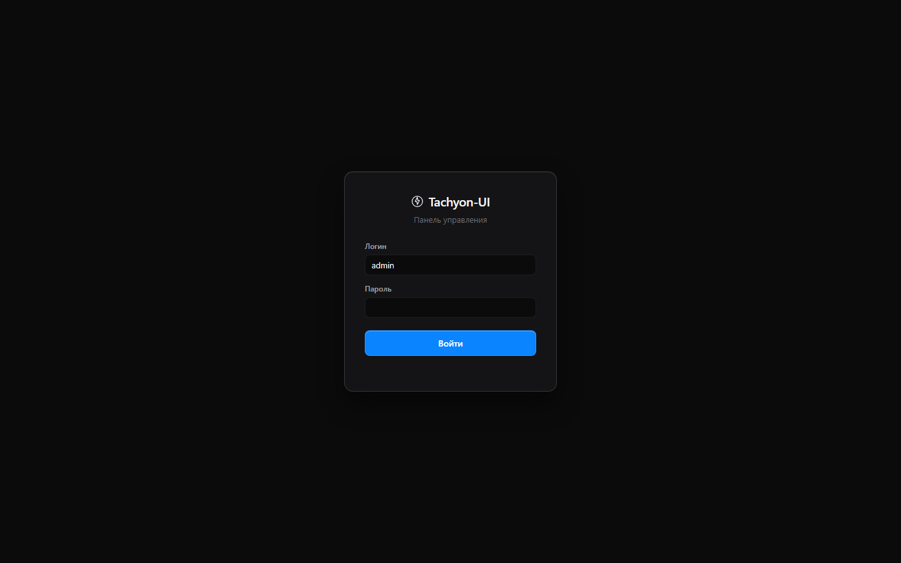
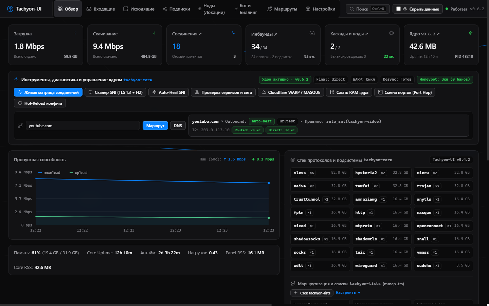

# 1. Установка, Docker, сборка из исходников и CLI

[English version](../en/01-installation-and-cli.md) | [К оглавлению](../../README.ru.md)

## Системные требования

- **ОС**: Linux x86_64 или aarch64 (Ubuntu, Debian, CentOS/RHEL, Alpine). На Windows возможна локальная сборка/запуск панели управления и кросс-компиляция Linux-бинарника.
- **ОЗУ**: от 64 МБ для панели (вместе с `tachyon-core` зависит от числа соединений и наборов правил).
- **Сеть**: открытый TCP-порт панели (по умолчанию `2053`), а также прокси-порты (например `443/tcp`, `443/udp`) и при использовании нативных веб-профилей — `80/tcp` / `443/tcp`.

---

## Способ 1: Установка одной командой (Linux + systemd)

```bash
bash <(curl -Ls https://raw.githubusercontent.com/Dushnilin/tachyon-ui/main/install.sh)
```

Скрипт `install.sh`:
1. Определяет архитектуру и устанавливает бинарник в `/opt/tachyon-ui/tachyon-ui`.
2. Создаёт каталог данных `/opt/tachyon-ui/data` (конфигурация хранится в `/opt/tachyon-ui/data/tachyon-ui.json`).
3. Загружает движок `tachyon-core` с распаковкой безопасными флагами (`tar --no-same-owner --no-same-permissions`).
4. Настраивает службу `systemd` (`tachyon-ui.service`) и устанавливает CLI-утилиту `/usr/local/bin/tachyon-panel`.
5. Открывает порт панели в `ufw` / `firewalld` / `iptables` (при передаче `OPEN_WEB_PORTS=1` или настройке публичных `web_http_port` / `web_https_port` открываются и `80/tcp`, `443/tcp`).
6. Генерирует первичные учётные данные администратора и выводит URL доступа.

---

## Способ 2: Docker

Файл `Dockerfile` собирает минимальный образ на `debian:bookworm-slim` с примонтированным томом `/data`:

```bash
docker build -t tachyon-ui .
docker run -d \
  --name tachyon-ui \
  --restart unless-stopped \
  --network host \
  -v /opt/tachyon-ui/data:/data \
  tachyon-ui
```

> При использовании проброса портов вместо `--network host` обязательно пробросьте порт панели (`2053`), веб-порты (если включены `80`/`443`) и порты ваших inbound-серверов (`443/tcp`, `443/udp`, WireGuard/AmneziaWG и др.).

---

## Способ 3: Сборка из исходников и кросс-компиляция `musl`

`tachyon-ui` не зависит от C-библиотек и линкуется статически через `rust-lld` без системных `openssl-sys`, `ring` или `aws-lc-rs`.

```bash
# Обычная локальная сборка (Windows / Linux)
cargo test
cargo build --release

# Статический Linux x86_64 бинарник (кросс-компиляция с Windows или Linux)
rustup target add x86_64-unknown-linux-musl
cargo build --release --target x86_64-unknown-linux-musl
```

Готовый бинарник располагается в `target/x86_64-unknown-linux-musl/release/tachyon-ui` (~5,5 МБ). Запуск вручную:

```bash
./tachyon-ui /opt/tachyon-ui/data
```

Первый позиционный аргумент задаёт `data_dir` (по умолчанию `./data`), в котором создаются:
- `tachyon-ui.json` — основное хранилище настроек, подписок, протоколов, правил и бота;
- `cert.pem`, `key.pem` — текущий TLS-сертификат панели/домена;
- `www/` — каталог пользовательского статического сайта (`custom_static`);
- `tachyon.json` — сгенерированный конфиг для `tachyon-core`.

---

## Первый вход и обзор интерфейса



При первом входе используйте логин/пароль, выведенный установщиком (при ручном запуске без параметров с пустым `data_dir` создаётся `admin` / `admin` — сразу смените пароль в разделе **Настройки → Учётные данные**).



После авторизации на главном дашборде отображаются:
- **Состояние `tachyon-core`**: версия ядра, аптайм, RSS-память, кнопки **Запуск / Стоп / Перезапуск / Hot-Reload**.
- **Сетевой трафик и активные соединения**: графики RX/TX, онлайн-пользователи с возможностью быстрого сброса соединений (`kick`) и трассировщик маршрутов прямо с главного экрана.
- **Топбар**: переключатель языка **RU / EN**, чекбокс **Скрыть данные (`Alt+P`)**, кнопка **Соединения** (5-вкладочная консоль диагностики) и быстрый переход к командной палитре (`Ctrl+K`).

---

## Автообновление `tachyon-core` и панели с GitHub

- **Через веб-интерфейс**:
  - Ядро: **Настройки → Путь к ядру → Обновить с GitHub** (`/api/core/releases`, `/api/core/update`). Можно выбрать конкретный релиз из GitHub `Dushnilin/tachyon-core` и установить его без потери настроек.
  - Панель: `/api/panel/releases` и `/api/panel/self-update` с атомарной заменой бинарника.
- **Через CLI**: `tachyon-panel update-core`.

---

## Справочник CLI `tachyon-panel`

Утилита `/usr/local/bin/tachyon-panel` предназначена для администрирования сервера и аварийного восстановления доступа:

| Команда | Назначение |
| :--- | :--- |
| `tachyon-panel` | Интерактивное меню управления (пункты `0–9`). |
| `tachyon-panel info` | Выводит статус службы, режим TLS (`web_tls_mode`), порты (`listen_port`, `web_http_port`, `web_https_port`), `web_domain`, `web_base_path`, `site_mode` и актуальные URL доступа. |
| `tachyon-panel status` | Подробный статус `systemctl status tachyon-ui`. |
| `tachyon-panel start \| stop \| restart` | Управление службой панели и ядра. |
| `tachyon-panel logs` | Потоковый просмотр логов `journalctl -u tachyon-ui -f -n 100`. |
| `tachyon-panel reset-pass` | Сброс логина/пароля администратора. |
| `tachyon-panel reset-path` | **Аварийное восстановление доступа**: создаёт бэкап `tachyon-ui.json.bak.<ts>`, сбрасывает `settings.web_base_path` в `""` (в корень `/`), перезапускает службу и печатает URL доступа. |
| `tachyon-panel set-port` | Интерактивная смена порта панели с открытием нового порта в фаерволе. |
| `tachyon-panel open-web-ports [80] [443]` | Безопасно открывает порты `80/tcp` и `443/tcp` в `ufw`, `firewalld` или `iptables`/`ip6tables`. |
| `tachyon-panel update-core` | Загружает последний релиз `tachyon-core` с GitHub с безопасной распаковкой и перезапуском службы. |

---

## Резервные копии и снапшоты

- **Снапшоты конфигурации**: перед критическими операциями (применение профиля домена, каскадирование) панель автоматически сохраняет точку отката (`/api/snapshots`, `/api/snapshots/restore`).
- **Экспорт / Импорт JSON**: кнопки **Скачать бэкап (.json)** и **Восстановить бэкап** в правом верхнем углу раздела **Настройки** выгружают и загружают полную конфигурацию (`/api/backup`, `/api/restore`).
- **Бэкапы через Telegram**: в разделе **Бот и Биллинг** настраивается периодическая автоматическая отправка архивной копии администраторам в Telegram (`auto_backup_hours`).

---

Далее: [Глава 2 — Публичный сайт, Dual HTTP+HTTPS, домен, ACME и Self-Audit](02-stealth-web-domain-tls.md).
