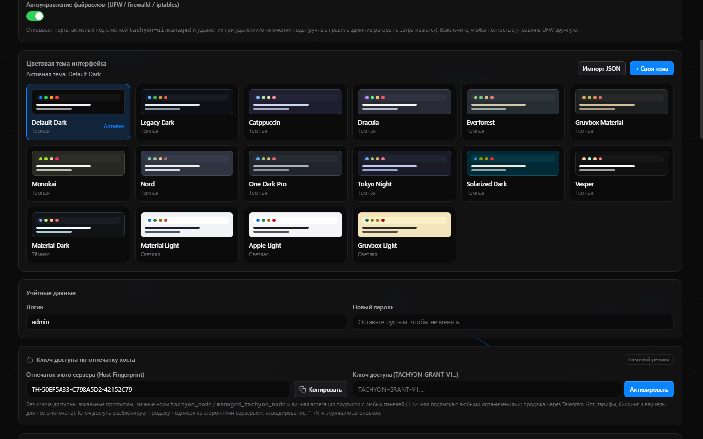

# 1. Установка, Docker, сборка из исходников, CLI и первый вход

[English version](../en/01-installation-and-cli.md) | [Сводный путеводитель](00-complete-guide.md) | [К оглавлению](../../README.ru.md) | [Полный справочник UI](./11-ui-every-tab-and-button-guide.md)

## Системные требования

- **ОС**: Linux x86_64 или aarch64 (Ubuntu, Debian, CentOS/RHEL, Alpine). На Windows возможна локальная сборка/запуск панели управления и кросс-компиляция Linux-бинарника.
- **ОЗУ**: от 64 МБ для панели (вместе с `tachyon-core` зависит от числа соединений и наборов правил).
- **Сеть**: открытый TCP-порт панели (по умолчанию `2053`), а также прокси-порты (например `443/tcp`, `443/udp`), при использовании нативных веб-профилей или `Unified 443 Front` — `80/tcp` / `443/tcp`, а для `SmartDNS` — `53/udp+tcp`, `853/tcp`.

---

## Способ 1: Установка одной командой (Linux + systemd)

```bash
bash <(curl -Ls https://raw.githubusercontent.com/Dushnilin/tachyon-ui/main/install.sh)
```

Скрипт [install.sh](https://github.com/Dushnilin/tachyon-ui/blob/main/install.sh):
1. Определяет архитектуру (`x86_64` или `aarch64`) и устанавливает статический бинарник в `/opt/tachyon-ui/tachyon-ui`.
2. Создаёт каталог данных `/opt/tachyon-ui/data` (конфигурация хранится в `/opt/tachyon-ui/data/tachyon-ui.json`).
3. Загружает движок `tachyon-core` с распаковкой безопасными флагами (`tar --no-same-owner --no-same-permissions`).
4. Настраивает службу `systemd` (`tachyon-ui.service`) и устанавливает CLI-утилиту `/usr/local/bin/tachyon-panel`.
5. Открывает порт панели в `ufw` / `firewalld` / `iptables` (при передаче `OPEN_WEB_PORTS=1` или настройке публичных `web_http_port` / `web_https_port` открываются и `80/tcp`, `443/tcp`).
6. Генерирует и применяет первичные учётные данные через `tachyon-ui --reset-creds`, запускает службу (движок `tachyon-core` стартует в фоне без блокировки запуска веб-панели) и выводит URL доступа.

Поддерживаемые переменные окружения для неинтерактивного запуска:
- `ADMIN_PASS` — явный пароль администратора `admin` при новой установке (если не задан, генерируется случайно через `openssl rand -hex 8`).
- `PANEL_PORT` — порт веб-панели при установке (по умолчанию `2053`).
- `PUBLIC_IP` — явный публичный IPv4/домен сервера (если не задан, определяется автоматически).
- `SERVER_COUNTRY` — 2-буквенный ISO-код локации сервера (если не задан, панель определяет страну нейтрально по метаданным хоста без жёсткой подстановки).
- `OPEN_WEB_PORTS=1` — сразу открыть порты `80/tcp` и `443/tcp` в системном файрволе.

---

## Способ 2: Docker

Контейнерный образ собирается на базе `debian:bookworm-slim` с примонтированным томом `/data`:

```bash
docker build -t tachyon-ui .
docker run -d \
  --name tachyon-ui \
  --restart unless-stopped \
  --network host \
  -v /opt/tachyon-ui/data:/data \
  tachyon-ui
```

> При использовании проброса портов вместо `--network host` обязательно пробросьте порт панели (`2053`), веб-порты (если включены `80`/`443`) и порты ваших inbound-серверов (`443/tcp`, `443/udp`, WireGuard/AmneziaWG и др.).

---

## Способ 3: Сборка из исходников и кросс-компиляция `musl`

`tachyon-ui` не зависит от C-библиотек и линкуется статически через `rust-lld` без системных `openssl-sys`, `ring` или `aws-lc-rs`.

```bash
# Обычная локальная сборка (Windows / Linux)
cargo test
cargo build --release

# Статический Linux x86_64 бинарник (кросс-компиляция с Windows или Linux)
rustup target add x86_64-unknown-linux-musl
cargo build --release --target x86_64-unknown-linux-musl

# Статический Linux ARM64 (aarch64) бинарник
rustup target add aarch64-unknown-linux-musl
cargo build --release --target aarch64-unknown-linux-musl

# Нативный Windows x86_64 бинарник
cargo build --release --target x86_64-pc-windows-msvc
```

Готовые бинарники располагаются в каталоге сборки релиза (`tachyon-ui` или `tachyon-ui.exe` для Windows). Запуск вручную:

```bash
./tachyon-ui /opt/tachyon-ui/data

# Сброс логина/пароля администратора и базовых параметров через переменные окружения (без запуска веб-сервера)
TACHYON_ADMIN_USER=admin TACHYON_ADMIN_PASS='StrongPass123!' ./tachyon-ui /opt/tachyon-ui/data --reset-creds

# Показать отпечаток хоста (Host Fingerprint)
./tachyon-ui /opt/tachyon-ui/data --host-fp
```

> **Политика коммерческого гранта (`TACHYON-GRANT-V1`):** для личного использования, своих серверов (`tachyon_node`, `managed_tachyon_node`) и локальных протоколов ключ доступа не требуется. Если вам нужен ключ доступа для коммерческого реселлинга сторонних подписок, каскадного перевыпуска чужих нод или `1→N` клонирования, передайте полученный `Host Fingerprint` (`TH-...`) напрямую разработчику.

Переменные окружения, поддерживаемые флагом `--reset-creds`:

| Переменная | Обязательность | Назначение |
| :--- | :--- | :--- |
| `TACHYON_ADMIN_PASS` | Обязательная | Новый пароль администратора (непустая строка; хешируется salted SHA-256). |
| `TACHYON_ADMIN_USER` | Опционально | Новый логин администратора (`settings.admin_user`; если не задан, сохраняется текущий). |
| `TACHYON_LISTEN_PORT` | Опционально | Порт веб-панели (`settings.listen_port`, целое число `1..65535`). |
| `TACHYON_PUBLIC_HOST` | Опционально | Публичный IP или домен сервера (`settings.public_host`, например `198.51.100.10` или `panel.example.com`). |
| `TACHYON_CORE_BIN` | Опционально | Путь к бинарнику `tachyon-core` (`settings.core_bin_path`). |
| `TACHYON_SERVER_COUNTRY` | Опционально | 2-буквенный ISO-код страны (заполняет пустое поле `country` у не-каскадных инбаундов). |

Первый позиционный аргумент задаёт `data_dir` (по умолчанию `./data`), в котором создаются:
- `tachyon-ui.json` — основное хранилище настроек, подписок, протоколов, правил, кластера и бота;
- `snapshots.json` — кольцевой буфер до 10 ревизий конфигурации (точек отката);
- `cert.pem`, `key.pem` — текущий TLS-сертификат панели/домена;
- `www/` — каталог пользовательского статического сайта (`custom_static`);
- `tachyon.json` — сгенерированный конфиг для `tachyon-core`.

---

## Первый вход и обзор интерфейса


При первом входе используйте логин/пароль, выведенный установщиком (при ручном запуске без параметров с пустым `data_dir` создаётся `admin` / `admin` — сразу смените пароль в разделе **Настройки → Учётные данные**).

### Элементы экрана входа

| Элемент | Назначение и поведение |
| :--- | :--- |
| **Поле `Логин`** | Ввод имени администратора панели (`admin` по умолчанию). |
| **Поле `Пароль`** | Ввод пароля администратора; поддерживает нажатие `Enter` для мгновенной отправки формы. |
| **Кнопка `Войти`** | Отправляет учётные данные (`POST /api/login`), сохраняет нейтральную cookie `sid` (`HttpOnly; SameSite=Strict`) и загружает интерфейс. При ошибке выводит баннер `401`; при включённом `web_base_path` страница входа доступна только по секретному префиксу. |

> **Что сделать сразу после первого запуска:**
> 1. Перейдите в **Настройки (`Alt+9`) → Учётные данные** и смените логин/пароль.
> 2. Проверьте `public_host` (публичный IP или домен для ссылок подписок) и состояние тумблера **`auto_firewall_enabled`**.
> 3. Запустите 4-шаговый Мастер **«Сайт, Домен, HTTP/HTTPS и Анти-Детект»** для настройки маскировки, ACME TLS и секретного `web_base_path` ([Глава 2](02-stealth-web-domain-tls.md)).
> 4. Создайте входящие протоколы во вкладке **Входящие (`Alt+2`)** через быстрые пресеты (`TewFai Multi-Carrier`, `VLESS REALITY`, `Hysteria2` и др.) и нажмите **Применить (`Apply`)**.

### Верхняя панель (`Topbar`), меню «Инструменты» и главная навигация


Верхняя панель присутствует на всех экранах и позволяет управлять движком `tachyon-core` и служебными инструментами без ухода с текущей вкладки:

| Элемент Topbar | Хоткей | Что делает |
| :--- | :--- | :--- |
| **Меню** *(на узких экранах)* | — | Открывает выдвижную боковую панель навигации на мобильных устройствах. |
| **Поиск…** *(Палитра команд)* | `Ctrl+K` / `Cmd+K` | Быстрый поиск и переход по всем 9 вкладкам, действиям (`Apply`, `Restart`, диагностика, снапшоты, темы) и конкретным инбаундам, исходящим, подпискам и нодам. |
| **Скрыть данные** *(Privacy Mask)* | `Alt+P` | Включает визуальное маскирование IP, доменов, UUID, ключей, токенов и размытие QR-кодов для безопасных скриншотов и скринкастов. |
| **Статус и версия `tachyon-core`** | — | Индикатор состояния и версии процесса `tachyon-core`; клик открывает **Центр обновлений**. |
| **Старт / Стоп / Рестарт** | — | Запуск, остановка или полный перезапуск процесса `tachyon-core` (при правках конфигурации также используйте **Применить** на дашборде). |
| **Инструменты** | — | Открывает выпадающее меню со всеми диагностическими и сервисными модулями. |
| **Выбор темы** | — | Поповер из **16 встроенных тем** (13 тёмных, 3 светлых) и пользовательских палитр с кнопкой **`+ Создать свою тему...`**. |
| **`RU` / `EN`** | — | Мгновенное переключение языка интерфейса между русским и английским. |
| **Выйти** | — | Завершает сессию администратора (`POST /api/logout`) и возвращает на экран входа. |

#### Пункты выпадающего меню «Инструменты»

| Пункт меню | Хоткей | Назначение |
| :--- | :--- | :--- |
| **Поток соединений** | `` Ctrl+` `` | Открывает нижний док активных сокетов `tachyon-core` с поиском, паузой, разрывом сессий и мгновенной блокировкой/маршрутизацией доменов. |
| **История снимков** | — | Журнал до 10 автоматических и ручных снапшотов конфигурации с откатом в 1 клик. |
| **Диагностика ядра** | — | 5-вкладочная консоль (`Соединения`, `Health & Аномалии`, `Failover & Прокси`, `Утечки DNS и тест`, `Test Flight`). |
| **Проверка сети и Speedtest** | — | Аудит доступности зарубежных/РФ платформ, геоблокировок и замер пропускной способности канала. |
| **Центр обновлений** | — | Просмотр релизов и обновление бинарников `tachyon-core` и панели `tachyon-ui` из веб-интерфейса. |
| **Проект и поддержка** | — | Информация о версии, ссылки проекта и QR-коды поддержки. |
| **Горячие клавиши** | `?` | Шпаргалка по всем глобальным шорткатам (`Ctrl+K`, `Alt+P`, `` Ctrl+` ``, `Alt+1..9`, `Shift+Click`, `Esc`). |

#### 9 вкладок главной навигации

| Хоткей | Вкладка | Что настраивается |
| :---: | :--- | :--- |
| `Alt+1` | **Обзор** | KPI-карточки, трассировщик маршрутов и DNS, график RX/TX, `.trs` базы, топ клиентов и логи `tachyon-core`. |
| `Alt+2` | **Входящие** | Точки входа (25 протоколов), пресеты, переключатель `Master / Child`, `Auto-Heal SNI`, `Port Hop`, `1→N Clone`, `Cascade / Resell`. |
| `Alt+3` | **Исходящие** | Исходящие шлюзы (33 типа), Clash API Live-панель, `Run Health Check / Failover`, `Connect Cloudflare WARP`, `From Managed Node`. |
| `Alt+4` | **Подписки** | Подписки клиентов, `+ Быстрый инвайт в 1 клик`, профили, Инспектор заголовков, 360°-дровер и Covert Knock. |
| `Alt+5` | **Ноды (Локации)** | Управляемые дочерние ноды (`managed_tachyon_node`), внешние подписки/URI, синхронизация, каскады и мосты. |
| `Alt+6` | **Бот и Биллинг** | Telegram-бот, Mini App, Live-симулятор, тарифы, платёжные шлюзы, промокоды, ваучеры и CRM. |
| `Alt+7` | **Маршруты** | Правила маршрутизации, `Flow-карта`, пакет `tachyon-lists` (`.trs`), `udp_nat_mode`, `smart_queue`, 2-уровневый симулятор. |
| `Alt+8` | **SmartDNS** | DNS `:53`, DoH `/dns-query`, DoT `:853`, SNI-прокси `:443/:80`, 6 пресетов, кнопка **«Без https://»** и 4-шаговый Мастер. |
| `Alt+9` | **Настройки** | Учётные данные, `auto_firewall_enabled`, Мастер маскировки (4 шага), Cloudflare DNS API, Cluster API, темы и бэкапы. |

> Подробный справочник по каждому элементу управления внутри всех вкладок и модальных окон см. в [Полном справочнике по всем вкладкам и кнопкам UI](./11-ui-every-tab-and-button-guide.md).


После авторизации на главном дашборде отображаются:
- **График пропускной способности, память и маршрутизация**:
  - Живой график RX/TX с автоподбором отступов и цветами активной темы.
  - Карточка **Память / Uptime / Load / RSS** (`Core RSS`, `Panel RSS`, кнопка `Trim RAM`).
  - Непосредственно под блоком памяти в левой колонке расположена карточка **Маршрутизация и списки `tachyon-lists` (`mmap .trs`)** с быстрой установкой стека списков, счётчиками выходов/правил/наборов `.trs`, статусом Anti-Share и Auto-Heal SNI.
- **Стек протоколов и подсистемы `tachyon-core`**: правая панель со сводкой активных инбаундов и трафика по каждому протоколу.
- **Темы оформления (16 встроенных + конструктор)**: выбор из **13 тёмных** (`Default Dark`, `Legacy Dark`, `Catppuccin`, `Dracula`, `Everforest`, `Gruvbox Material`, `Monokai`, `Nord`, `One Dark Pro`, `Tokyo Night`, `Solarized Dark`, `Vesper`, `Material Dark`) и **3 светлых** (`Material Light`, `Apple Light`, `Gruvbox Light`) тем в меню тем топбара или в **Настройки → Тема оформления**, а также создание, импорт и экспорт собственных палитр.
- **Адаптивный топбар и быстрые панели**: переключатель языка **RU / EN**, меню тем, кнопка **Скрыть данные (`Alt+P`)**, меню инструментов (**Live Connections Dock `Ctrl+\``**, история снапшотов, 5-вкладочная диагностика ядра, палитра команд `Ctrl+K`) и быстрый переход по 9 разделам через `Alt+1..9`.

---

## Настройки панели, файрвол и темы (`#settings`)



В разделе **Настройки** сосредоточены базовые параметры инстанса и безопасности:
- **Панель**: порт прослушивания (`listen_port`), путь к бинарнику `tachyon-core` (с кнопкой обновления с GitHub), `public_host` (например `203.0.113.10` или `panel.example.com`), уровень логов ядра, ширина интерфейса (`1360px` или во всю ширину), тумблер приватности (`Alt+P`) и автоуправление файрволом.
- **Автоуправление файрволом (`auto_firewall_enabled`, по умолчанию `true`)**:
  1. **Точечное открытие портов**: панель открывает только требуемые `(port, proto)` (`tcp` или `udp`) для включённых публичных инбаундов и активных публичных портов самой панели (порты на `127.0.0.1` / `localhost` / `::1` и туннели `cloudflared` пропускаются).
  2. **Метка `tachyon-ui:managed` и автоочистка**: открытые панелью правила помечаются комментарием `tachyon-ui:managed` и отслеживаются в `managed_firewall_rules`. При удалении, выключении, смене порта/протокола или переносе инбаунда на `127.0.0.1` старое правило удаляется автоматически, если этот `(port, proto)` больше не используется.
  3. **Защита правил администратора и SSH**: правила, созданные вручную администратором или `install.sh` (включая диапазоны и порт `22`), не удаляются. При активном `ufw` или `firewalld` (`firewall-cmd`) панель работает строго через их штатный CLI.
  4. **Ручной режим**: переключателем **Автоуправление файрволом** (`auto_firewall_enabled: false`) модификацию правил можно полностью отключить.
- **Учётные данные, ключ доступа по отпечатку хоста и Кластерный API**: смена логина/пароля, просмотр `Host Fingerprint` (`TH-...`) и активация гранта (при получении у разработчика), а также `instance_id` и `node_api_token` для связи `Master → Child`.

---

## Автообновление `tachyon-core` и панели с GitHub

- **Через веб-интерфейс**:
  - Ядро: **Настройки → Путь к ядру → Обновить с GitHub** (`/api/core/releases`, `/api/core/update`). Можно выбрать конкретный релиз из GitHub `Dushnilin/tachyon-core` и установить его без потери настроек.
  - Панель: `/api/panel/releases` и `/api/panel/self-update` с атомарной заменой бинарника.
- **Через CLI**: `tachyon-panel update-core`.

---

## Справочник CLI `tachyon-panel`

Утилита `/usr/local/bin/tachyon-panel` предназначена для администрирования сервера и аварийного восстановления доступа:

| Команда | Назначение |
| :--- | :--- |
| `tachyon-panel` | Интерактивное меню управления (пункты `0–9`). |
| `tachyon-panel info` | Выводит статус службы, режим TLS (`web_tls_mode`), порты (`listen_port`, `web_http_port`, `web_https_port`), `web_domain`, `web_base_path`, `site_mode` и актуальные URL доступа. |
| `tachyon-panel status` | Подробный статус `systemctl status tachyon-ui`. |
| `tachyon-panel start \| stop \| restart` | Управление службой панели и ядра. |
| `tachyon-panel logs` | Потоковый просмотр логов `journalctl -u tachyon-ui -f -n 100`. |
| `tachyon-panel reset-pass` | Безопасный сброс логина и пароля администратора через `tachyon-ui --reset-creds` (с salted итеративным хешированием). |
| `tachyon-panel reset-path` | **Аварийное восстановление доступа**: создаёт бэкап `tachyon-ui.json.bak.<ts>`, сбрасывает `settings.web_base_path` в `""` (в корень `/`), перезапускает службу и печатает URL доступа. |
| `tachyon-panel set-port` | Интерактивная смена порта панели с открытием нового порта в фаерволе. |
| `tachyon-panel open-web-ports [80] [443]` | Безопасно открывает порты `80/tcp` и `443/tcp` в `ufw`, `firewalld` или `iptables`/`ip6tables`. |
| `tachyon-panel update-core` | Загружает последний релиз `tachyon-core` с GitHub с безопасной распаковкой и перезапуском службы. |

---

## Резервные копии и кольцевой буфер откатов (`snapshots.json`)


- **Кольцевой буфер откатов (до 10 снапшотов)**: перед критическими операциями (применение профиля домена, каскадирование, массовые изменения) панель автоматически сохраняет точку отката в `snapshots.json` (хранится до 10 последних ревизий, при появлении 11-й самая старая вытесняется). Через **Инструменты → История снимков** (или `Ctrl+K` → *История конфигураций*) можно создать ручную точку сохранения и выполнить откат в 1 клик (`/api/snapshots`, `/api/snapshots/restore`).
- **Экспорт / Импорт JSON**: кнопки **Скачать бэкап (.json)** и **Восстановить бэкап** в правом верхнем углу раздела **Настройки** выгружают и загружают полную конфигурацию (`/api/backup`, `/api/restore`).
- **Бэкапы через Telegram**: в разделе **Бот и Биллинг** настраивается периодическая автоматическая отправка архивной копии администраторам в Telegram (`auto_backup_hours`).

---

## Аварийное восстановление и частые ситуации

| Ситуация | Причина / диагностика | Действие для восстановления |
| :--- | :--- | :--- |
| Потерян пароль или логин администратора | Неверные учётные данные при входе | Выполните `tachyon-panel reset-pass` или `TACHYON_ADMIN_USER=admin TACHYON_ADMIN_PASS='NewPass123!' ./tachyon-ui /opt/tachyon-ui/data --reset-creds` и перезапустите службу. |
| Забыт секретный `web_base_path` | Панель возвращает публичный сайт на `/` | Выполните `tachyon-panel reset-path`: создаст `tachyon-ui.json.bak.<ts>`, сбросит `web_base_path` в `""` и перезапустит панель. |
| Конфликт портов `80`/`443` или ошибка TLS | Порт занят `nginx`/`caddy`/другим сервисом | Проверьте `GET /api/tls/status` (`Primary` / `HttpsDedicated`, предупреждения bind) и `ss -tulpn \| grep -E ':80\|:443'`; при необходимости откройте порты через `tachyon-panel open-web-ports` или выберите профиль `reverse_proxy` / `unified_443_front`. |
| Ошибка после смены профиля или конфига | Неудачная правка домена/каскада | Откатите ревизию из `snapshots.json` через UI (**Инструменты → История снимков**) или `POST /api/snapshots/restore`. |

---

[Назад: Сводный путеводитель](00-complete-guide.md) | [К оглавлению](../../README.ru.md) | [Полный справочник UI](./11-ui-every-tab-and-button-guide.md) | [Далее: Глава 2 — Публичный сайт, Dual HTTP+HTTPS, домен, ACME и Self-Audit](02-stealth-web-domain-tls.md)
