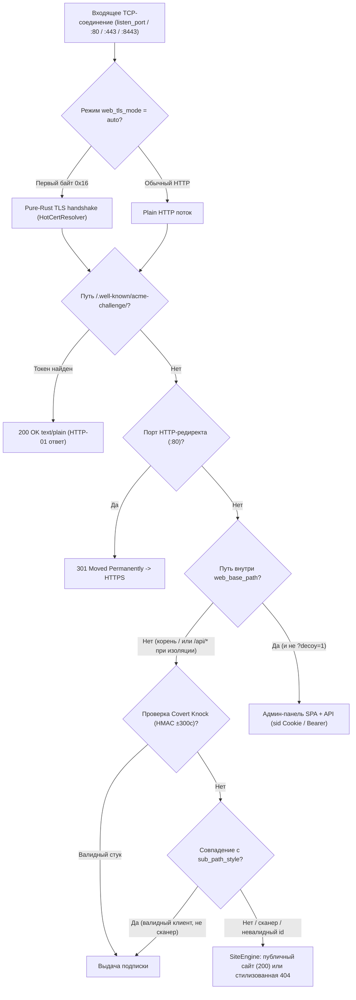
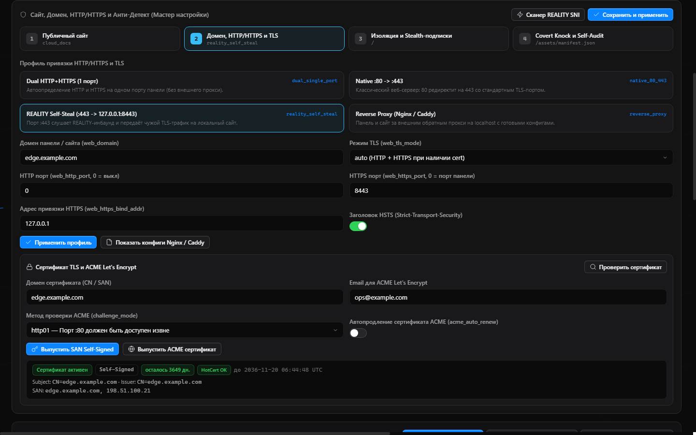
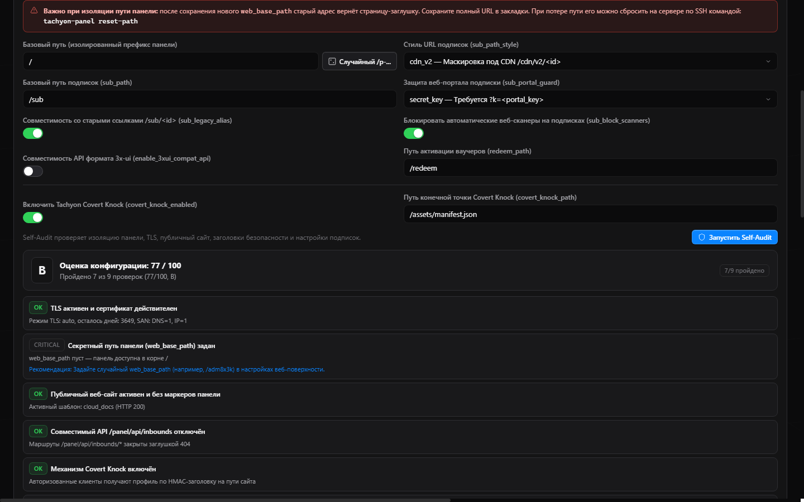

# 2. Публичный сайт, Dual HTTP+HTTPS, домен, ACME и Self-Audit

[English version](../en/02-stealth-web-domain-tls.md) | [К оглавлению](../../README.ru.md)

Начиная с версии **v20**, `tachyon-ui` маскирует порт панели под полноценный многостраничный публичный веб-сервер и позволяет принимать на одном или раздельных портах одновременно HTTP и HTTPS трафик без использования стороннего прокси (хотя при желании поддерживает и режим за Nginx / Caddy).

---

## Как обрабатывается каждый входящий запрос

---

## Мастер «Сайт, Домен, HTTP/HTTPS и Анти-Детект»

Откройте **Настройки → Сайт, Домен, HTTP/HTTPS и Анти-Детект** — настройка разделена на 4 последовательных шага.

### Шаг 1. Публичный сайт (`SiteEngine`)

На первом шаге задаётся внешний облик сервера, который видят браузеры, веб-краулеры и активные зонды на корневом адресе `/`:

- **6 встроенных многостраничных шаблонов** (`site_mode`):
  1. `blank_nginx` — классическая нейтральная страница `nginx/1.26.2`;
  2. `cloud_docs` — портал облачной документации (`Northwind Cloud Docs`);
  3. `status_page` — панель статуса инфраструктуры и нод (`Vertex Edge Status`);
  4. `devops_blog` — инженерный DevOps/SRE блог;
  5. `corporate_it` — корпоративный IT-портал;
  6. `maintenance` — страница плановых технических работ (`503` / `200`).
  Встроенные шаблоны обслуживают не только `/`, но и `/index.html`, `/about`, `/status`, `/docs`, `/assets/app.css`, `/assets/manifest.json`, `/robots.txt`, `/sitemap.xml`, `/favicon.ico` и стилизованную страницу `404 Not Found`.
- **Собственный статический сайт (`custom_static`)**:
  - Загрузите архив `.zip` (**до 15 МБ** сжатый, не более **50 МБ** в распакованном виде и **500 файлов**). Встроенный pure-Rust распаковщик блокирует обход каталогов (zip-slip), абсолютные пути, символические ссылки и исполняемые бинарники.
  - Файлы распаковываются в `<data_dir>/www/`, где доступен встроенный редактор `www/index.html` и кнопка удаления.
- **Живой предпросмотр**: встроенный `<iframe>` обращается к `${BASE}/api/site/preview` и позволяет переключить маршруты `/`, `/about`, `/status`, `/docs` до сохранения.
- **Активный Honeypot**: при включении запросы на типичные пути сканеров (`/.env`, `/wp-admin`, `/phpmyadmin`) фиксируются в журнале безопасности с опциональной автоблокировкой IP.

---

### Шаг 2. Домен, HTTP/HTTPS и сертификаты TLS

#### 4 профиля привязки (`web_domain_profile`)

| Профиль | Порты и схема | Когда выбирать |
| :--- | :--- | :--- |
| **`dual_single_port`** | Один порт (`listen_port`, напр. `2053`), режим `web_tls_mode = auto` | Самый быстрый старт: один порт отвечает как по `http://`, так и по `https://` без реверс-прокси. |
| **`native_80_443`** | `web_http_port = 80` (HTTP-01 ACME + `301` редирект на HTTPS), `web_https_port = 443` | Когда домен смотрит прямо на сервер без внешнего Nginx/Caddy и нужен стандартный HTTPS без указания порта. |
| **`reality_self_steal`** | `web_https_bind_addr = 127.0.0.1`, `web_https_port = 8443`, `web_http_port = 80`; порт `:443` отдан REALITY | Рекомендуемый вариант для **REALITY Self-Steal**: REALITY слушает внешний `:443`, а при зондировании или обычном HTTPS-запросе перенаправляет TLS-рукопожатие на локальный сайт `127.0.0.1:8443` самого `tachyon-ui`. |
| **`reverse_proxy`** | Панель в режиме `http` на loopback/порту панели; впереди Nginx или Caddy | Когда на одном сервере уже работают другие веб-проекты на `:80/:443`. Мастер сам генерирует готовые конфиги Nginx и Caddy с кнопкой копирования. |

> При нажатии **Применить профиль** сервер сначала автоматически создаёт точку восстановления (`/api/snapshots`), обновляет порты через `ListenerSupervisor` без перезапуска процесса и (для `reality_self_steal`) синхронизирует `handshake.server = "127.0.0.1"` и `handshake.server_port = 8443` в REALITY inbound.

#### Сертификаты TLS (`cert.pem` и `key.pem` в `<data_dir>`)

- **SAN Self-Signed** (`POST /api/tls/self-signed`): мгновенно выпускает X.509 сертификат с расширениями SAN для домена и/или IPv4/IPv6 и сразу загружает его в `HotCertResolver`.
- **ACME Let's Encrypt — HTTP-01**: использует встроенный обработчик `/.well-known/acme-challenge/<token>` прямо внутри `tachyon-ui` (при открытом порте `:80` или `listen_port`) и не требует остановки службы.
- **ACME Let's Encrypt — Cloudflare DNS-01**: автоматически создаёт и удаляет TXT-запись `_acme-challenge.<domain>` через Cloudflare API (`cf_api_token` + `cf_zone_id`), позволяя получить доверенный сертификат даже при закрытом 80 порту или REALITY на `:443`.
- **Автопродление (`acme_auto_renew`)**: фоновый цикл раз в 12 часов проверяет срок действия (`days_left <= 30`) для публичных доменных имён (IP-адреса и `localhost` автоматически пропускаются) и обновляет сертификат горячей подменой без обрыва соединений.

---

### Шаг 3. Изоляция панели и Stealth-настройки

- **`web_base_path` (секретный путь панели)**: при задании префикса (например `/p-8f3c21a9`, генерируется одной кнопкой) корневые маршруты `/`, `/login`, `/api/*` перестают отдавать админ-интерфейс и API. Любой запрос вне `<web_base_path>` обрабатывается только как ACME challenge, Covert Knock, подписка или публичный сайт `SiteEngine`.
  > **Если потеряли секретный URL:** подключитесь к серверу по SSH и выполните `tachyon-panel reset-path` — утилита сбросит `web_base_path` в корень `/` с сохранением бэкапа и перезапустит панель.
- **`enable_3xui_compat_api` (по умолчанию `false`)**: при выключенном флаге маршруты `/panel/api/inbounds/*` отдают `404 Not Found` в стиле публичного сайта, убирая типовые сигнатуры сторонних панелей.
- **`redeem_path`**: отдельный путь для страницы активации ваучеров (при пустом значении и заданном `web_base_path` работает только внутри `<web_base_path>/redeem`).
- **Нейтральный HTTP-профиль**: панель всегда отвечает с `Server: nginx/1.26.2`, корректным заголовком `Date` (RFC-7231), корректными причинами статуса (`404 Not Found`), нейтральной cookie `sid=...; HttpOnly; SameSite=Strict` (с `; Secure` на HTTPS), без `Set-Cookie: 3x-ui` и без глобального `Access-Control-Allow-Origin: *`. Параметр `/?decoy=1` никогда не раскрывает интерфейс панели.

---

### Шаг 4. Covert Knock и Self-Audit (`0–100`)

После настройки нажмите **Запустить Self-Audit** (`POST /api/web/self-audit`). Сервер выполняет **9 автоматических проверок** (включая живую внутреннюю пробу `StealthSubGate` на несуществующий `sub_id`) и выставляет итоговый балл от `0` до `100`:

| ID проверки | Вес / критичность | Что проверяется | Как набрать балл |
| :--- | :--- | :--- | :--- |
| `tls_active` | critical | `web_tls_mode != "http"`, сертификат загружен в `HotCertResolver`, не истёк и содержит SAN | Выберите режим `auto`/`https` и выпустите ACME или SAN Self-Signed сертификат. |
| `web_base_path_isolated` | critical | Задан непустой секретный `web_base_path` (отличный от `/`) | Сгенерируйте `/p-...` на Шаге 3 и сохраните закладку. |
| `public_site_clean` | high | Настроен шаблон `SiteEngine` (или загружен `www/index.html` для `custom_static`), ответ на `/` не содержит `window.__PANEL_BASE__` или маркеров сессии | Выберите шаблон или загрузите статический сайт на Шаге 1. |
| `legacy_3xui_disabled` | high | `enable_3xui_compat_api == false` | Оставьте совместимость с 3x-ui API выключенной. |
| `covert_knock_enabled` | medium | Включён `covert_knock_enabled` | Включите на Шаге 4 для скрытой выдачи подписок через сайт. |
| `scanners_filtered` | medium | Включён `sub_block_scanners` | Включите фильтр сетевых сканеров и краулеров на Шаге 3. |
| `sub_path_obfuscated` | medium | `sub_path_style != "sub"` (или кастомный `sub_path`) И отключён `sub_legacy_alias` | Переключите стиль на `cdn_v2` / `static_feed` / `rss_updates` и выключите старый `/sub/`. |
| `portal_guard_enabled` | low | `sub_portal_guard == "secret_key"` | Включите защиту браузерного портала ключом `?k=`. |
| `zero_oracle_404` | high | Живая внутренняя проба несуществующей подписки возвращает HTML `404 Not Found` с `Server: nginx/1.26.2` без JSON-оракулов | Работает автоматически на движке v20. |

---

Далее: [Глава 3 — Подписки, веб-портал, ваучеры и Tachyon Covert Knock](03-subscriptions-and-covert-knock.md).
