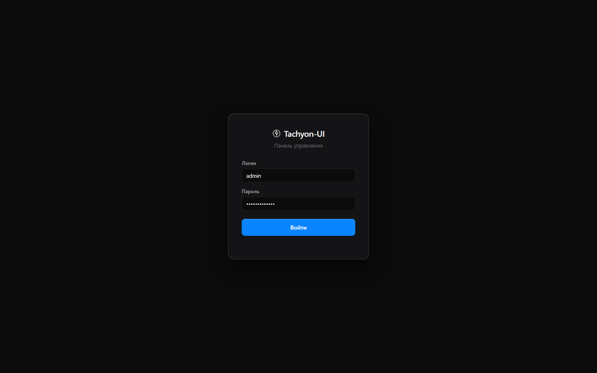
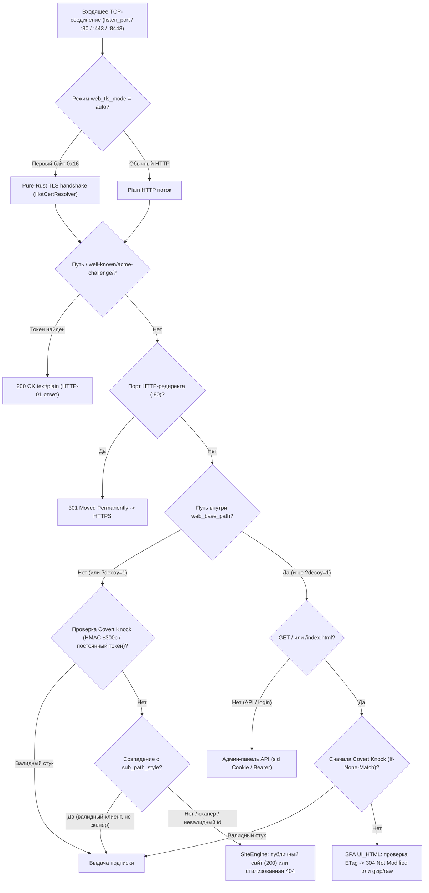
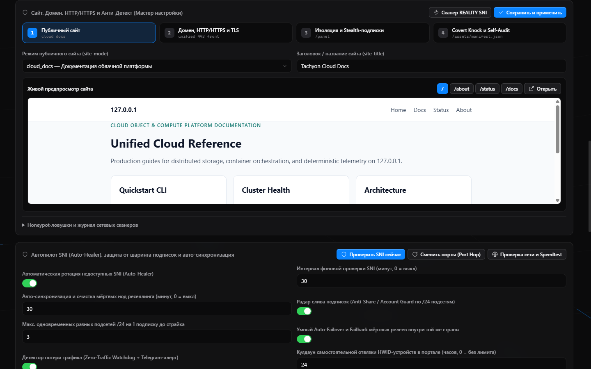
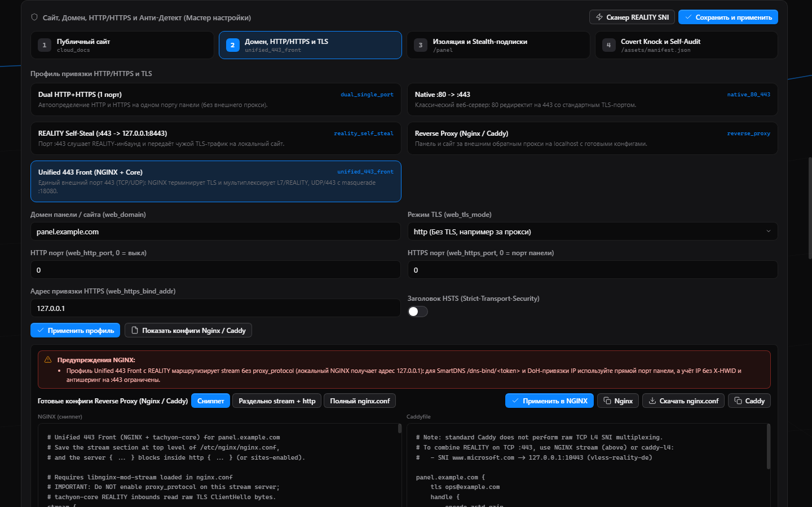
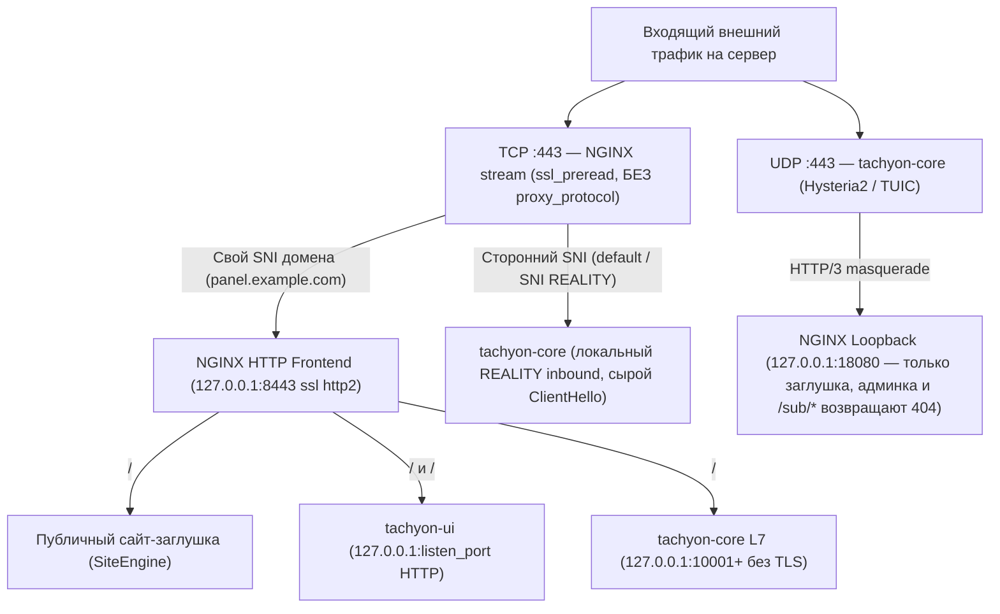
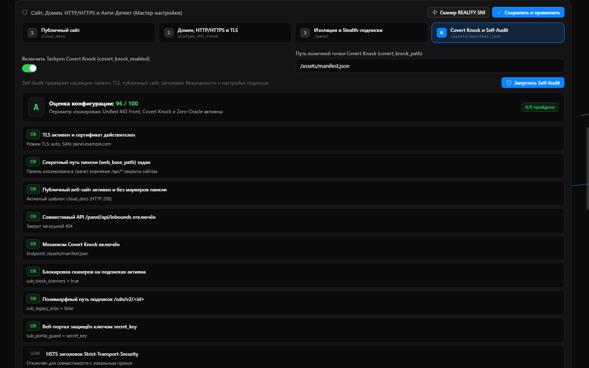
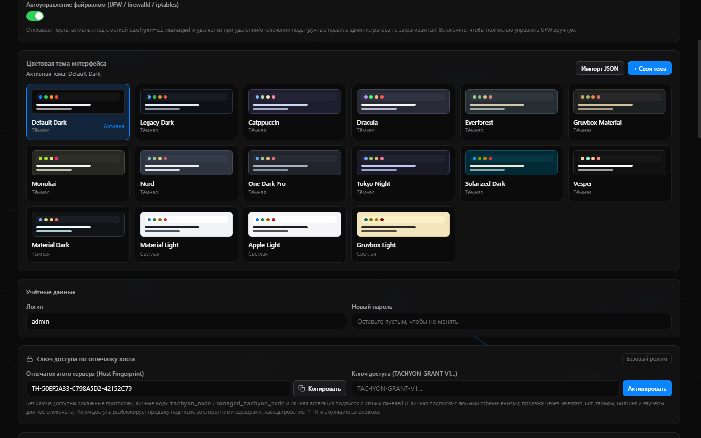

# 2. Публичный сайт, Dual HTTP+HTTPS, домен, `Unified 443 Front`, ACME и Self-Audit

[English version](../en/02-stealth-web-domain-tls.md) | [Сводный путеводитель](00-complete-guide.md) | [К оглавлению](../../README.ru.md) | [Полный справочник UI](./11-ui-every-tab-and-button-guide.md) | [Каталог 27 протоколов](./protocols/README.md)

`tachyon-ui` маскирует порт панели под полноценный многостраничный публичный веб-сервер и позволяет принимать на одном или раздельных портах одновременно HTTP и HTTPS трафик без стороннего прокси — либо работать в связке с NGINX/Caddy в режиме **`Unified 443 Front`** на едином внешнем порту `443`.

---

## Как обрабатывается каждый входящий запрос

> **Порядок `Covert Knock` и кэширования `ETag`:** при запросе `GET /` (или `/index.html`) внутри `web_base_path` (без `?decoy=1`) сервер сначала проверяет `Covert Knock` (`If-None-Match` / `X-Client-Digest` / `?v=`), и только если стук не сработал — передаёт запрос в `serve_cached_ui_asset` для проверки `ETag` (`304 Not Modified`) и отдачи предсжатого `gzip` (`~225 КБ` против `~1.05 МБ`, с заголовками `Vary: Accept-Encoding` и `Cache-Control: no-cache`). Благодаря этому клиентский `If-None-Match` кэш браузера никогда не блокирует скрытый стук.

---

## Мастер «Сайт, Домен, HTTP/HTTPS и Анти-Детект»

Откройте **Настройки → Сайт, Домен, HTTP/HTTPS и Анти-Детект** — настройка разделена на 4 последовательных шага.

### Шаг 1. Публичный сайт (`SiteEngine`) и Honeypot

На первом шаге задаётся внешний облик сервера, который видят браузеры, веб-краулеры и активные зонды на корневом адресе `/`:

- **6 встроенных многостраничных шаблонов** (`site_mode`):
  1. `blank_nginx` — классическая нейтральная страница `nginx/1.26.2`;
  2. `cloud_docs` — портал облачной документации (`Northwind Cloud Docs`);
  3. `status_page` — панель статуса инфраструктуры и нод (`Vertex Edge Status`);
  4. `devops_blog` — инженерный DevOps/SRE блог;
  5. `corporate_it` — корпоративный IT-портал;
  6. `maintenance` — страница плановых технических работ (`503` / `200`).
  Встроенные шаблоны обслуживают не только `/`, но и `/index.html`, `/about`, `/status`, `/docs`, `/assets/app.css`, `/assets/manifest.json`, `/robots.txt`, `/sitemap.xml`, `/favicon.ico` и стилизованную страницу `404 Not Found`.
- **Собственный статический сайт (`custom_static`)**:
  - Загрузите архив `.zip` (**до 15 МБ** сжатый, не более **50 МБ** в распакованном виде и **500 файлов**). Встроенный pure-Rust распаковщик блокирует обход каталогов (zip-slip), абсолютные пути, символические ссылки и исполняемые бинарники.
  - Файлы распаковываются в `<data_dir>/www/`, где доступен встроенный редактор `www/index.html` и кнопка удаления.
- **Живой предпросмотр**: встроенный `<iframe>` обращается к `${BASE}/api/site/preview` и позволяет переключить маршруты `/`, `/about`, `/status`, `/docs` до сохранения.
- **Активный Honeypot**: при включении запросы на типичные пути сканеров (`/.env`, `/wp-admin`, `/phpmyadmin`) фиксируются в журнале безопасности с опциональной автоблокировкой IP.

---

### Шаг 2. Домен, HTTP/HTTPS и сертификаты TLS

#### 5 профилей привязки (`web_domain_profile`)

| Профиль | Порты и схема | Когда выбирать |
| :--- | :--- | :--- |
| **`dual_single_port`** | Один порт (`listen_port`, напр. `2053`), режим `web_tls_mode = auto` | Самый быстрый старт: один порт отвечает как по `http://`, так и по `https://` без реверс-прокси. |
| **`native_80_443`** | `web_http_port = 80` (HTTP-01 ACME + `301` редирект на HTTPS), `web_https_port = 443` | Когда домен (`panel.example.com`) смотрит прямо на сервер без внешнего Nginx/Caddy и нужен стандартный HTTPS без указания порта. |
| **`reality_self_steal`** | `web_https_bind_addr = 127.0.0.1`, `web_https_port = 8443`, `web_http_port = 80`; порт `:443` отдан REALITY | Рекомендуемый вариант для **REALITY Self-Steal**: REALITY слушает внешний `:443`, а при зондировании или обычном HTTPS-запросе перенаправляет TLS-рукопожатие на локальный сайт `127.0.0.1:8443` самого `tachyon-ui`. |
| **`reverse_proxy`** | Панель в режиме `http` на loopback/порту панели; впереди Nginx или Caddy | Когда на одном сервере уже работают другие веб-проекты на `:80/:443`. Мастер сам генерирует готовые конфиги Nginx и Caddy с кнопкой копирования. |
| **`unified_443_front`** | Впереди NGINX на `443/tcp` (`ssl_preread` + HTTP/L7), `tachyon-core` на `443/udp` + локальные `127.0.0.1` инбаунды | Максимальная маскировка всей ноды на единственном открытом порту `443` (`80/tcp` используется только для ACME HTTP-01 и редиректа). Мастер автоматически адаптирует инбаунды, генерирует/применяет `nginx.conf` и проверяет `nginx -t` с автооткатом при ошибке. |

> При нажатии **Применить профиль** сервер сначала автоматически создаёт точку восстановления (`/api/snapshots`) и обновляет порты через `ListenerSupervisor` без перезапуска процесса:
> - Для `reality_self_steal` синхронизирует `handshake.server = "127.0.0.1"` и `handshake.server_port = 8443` в REALITY inbound.
> - Для `unified_443_front` переводит активные L7-инбаунды (`ws`, `httpupgrade`, `grpc`, `xhttp`/`http`) на `127.0.0.1:10001+` без TLS с сохранением клиентского экспорта `<domain>:443` + строгий TLS (`external_port` / `external_tls`), а основной UDP-инбаунд (`hysteria2` или `tuic`) — на `0.0.0.0:443/udp` с loopback-маскарадом `http://127.0.0.1:18080`.

#### Профиль `Unified 443 Front (NGINX + Core)`

- **Запрет `proxy_protocol` в `stream { ... }`**: при генерации блока `stream { ... }` в `nginx.conf` намеренно **не** добавляется `proxy_protocol on;`, потому что `tachyon-core` REALITY считывает сырые байты TLS `ClientHello` (включение `proxy_protocol` сломает REALITY-рукопожатие).
- **Изолированный loopback `:18080`**: внутри `http { ... }` поднимается локальный сервер `listen 127.0.0.1:18080;`, куда направляется HTTP/3 `masquerade` для Hysteria2/TUIC на `443/udp`. На `:18080` отдаётся только заглушка `SiteEngine`, а пути админки и `/sub/*` возвращают `404`.
- **Рекомендации для DoH и SmartDNS при `Unified 443 Front`**: так как `stream` маршрутизируется без `proxy_protocol`, локальный NGINX при наличии REALITY видит подключения с адреса `127.0.0.1`. Поэтому для привязки клиентских IP в SmartDNS через `/dns-bind/<token>` и DoH-привязки IP используйте **прямой порт панели** (например, `:2053` в профиле `Dual HTTP+HTTPS`) или DoT (`:853/tcp`), а учёт IP без `X-HWID` и антишеринг через `:443` в этом режиме ограничены.
- **Удобное управление NGINX прямо из Мастера**: доступны режимы просмотра **Сниппет / Раздельно stream + http / Полный nginx.conf**, кнопка **Применить в NGINX** (запись конфига, `nginx -t` и `systemctl reload nginx` с автооткатом при ошибке), скачивание `nginx.conf` / сниппета `Caddyfile` и тумблер **Автоприменение NGINX при правках панели**. В таблице `#inbounds` адаптированные ноды помечаются бейджем внешнего фронта `-> :443 TLS`.

#### Сертификаты TLS (`cert.pem` и `key.pem` в `<data_dir>`) и диагностика портов

- **SAN Self-Signed** (`POST /api/tls/self-signed`): мгновенно выпускает X.509 сертификат с расширениями SAN для домена и/или IPv4/IPv6 и сразу загружает его в `HotCertResolver`.
- **ACME Let's Encrypt — HTTP-01**: работает без внешнего Caddy или Nginx. При запуске выпуска панель (при включённом `auto_firewall_enabled`) открывает `80/tcp` в системном файрволе, поднимает временный HTTP-01 сервер на `:80` (если `:80` ещё не слушается панелью) и дожидается готовности слушателя перед отправкой запроса ACME. Если порт `80` занят другим процессом или закрыт провайдером, карточка возвращает точную диагностическую подсказку.
- **ACME Let's Encrypt — Cloudflare DNS-01**: автоматически создаёт и удаляет TXT-запись `_acme-challenge.<domain>` через Cloudflare API (`cf_api_token` + `cf_zone_id`), позволяя получить доверенный сертификат даже при закрытом 80 порту или REALITY на `:443`.
- **Автопродление (`acme_auto_renew`) и кэширование X.509 (`read_cert_info_cached`)**: фоновый цикл раз в 12 часов проверяет срок действия (`days_left <= 30`) для публичных доменных имён (IP-адреса и `localhost` автоматически пропускаются) и обновляет сертификат горячей подменой без обрыва соединений. Метаданные X.509-сертификатов кэшируются в памяти функцией `read_cert_info_cached` с автоматической инвалидацией по `(mtime, size)` файла при перевыпуске или обновлении сертификата.
- **Статус слушателей (`GET /api/tls/status`)**: в карточке TLS отдельно отображаются основной порт панели (`Primary`, принимающий HTTPS в режиме `auto`) и выделенный `web_https_port` (`HttpsDedicated`), список актуальных HTTPS URL и явные предупреждения о занятых или конфликтующих портах.

---

### Шаг 3. Изоляция панели и Stealth-настройки

- **`web_base_path` (секретный путь панели)**: при задании префикса (например `/p-8f3c21a9`, генерируется одной кнопкой) корневые маршруты `/`, `/login`, `/api/*` перестают отдавать админ-интерфейс и API. Любой запрос вне `<web_base_path>` обрабатывается только как ACME challenge, Covert Knock, подписка или публичный сайт `SiteEngine`.
  > **Если потеряли секретный URL:** подключитесь к серверу по SSH и выполните `tachyon-panel reset-path` — утилита сбросит `web_base_path` в корень `/` с сохранением бэкапа и перезапустит панель.
- **`enable_3xui_compat_api` (по умолчанию `false`)**: при выключенном флаге маршруты `/panel/api/inbounds/*` отдают `404 Not Found` в стиле публичного сайта, убирая типовые сигнатуры сторонних панелей.
- **`redeem_path`**: отдельный путь для страницы активации ваучеров (при пустом значении и заданном `web_base_path` работает только внутри `<web_base_path>/redeem`).
- **Нейтральный HTTP-профиль**: панель всегда отвечает с `Server: nginx/1.26.2`, корректным заголовком `Date` (RFC-7231), корректными причинами статуса (`404 Not Found`), нейтральной cookie `sid=...; HttpOnly; SameSite=Strict` (с `; Secure` на HTTPS), без `Set-Cookie: 3x-ui` и без глобального `Access-Control-Allow-Origin: *`. Параметр `/?decoy=1` никогда не раскрывает интерфейс панели.

---

### Шаг 4. Covert Knock и Self-Audit (`0–100`)

После настройки нажмите **Запустить Self-Audit** (`POST /api/web/self-audit`). Сервер выполняет **9 автоматических проверок** (включая живую внутреннюю пробу `StealthSubGate` на несуществующий `sub_id`) и выставляет итоговый балл от `0` до `100` (грейды от `A+` до `D`):

| ID проверки | Критичность | Что проверяется | Как набрать балл |
| :--- | :--- | :--- | :--- |
| `tls_active` | `critical` | Встроенный TLS (`web_tls_mode != "http"`) или внешний TLS-профиль (`reverse_proxy` / `unified_443_front`) с заданным доменом (не `localhost`), плюс валидный неистёкший SAN-сертификат в `HotCertResolver` | Выберите режим `auto`/`https` и выпустите сертификат, либо используйте `reverse_proxy` / `unified_443_front` с доменом и валидным SAN-сертификатом. |
| `web_base_path_isolated` | `critical` | Задан непустой секретный `web_base_path` (отличный от `/`) | Сгенерируйте префикс (например `/p-...`) на Шаге 3 и сохраните закладку. |
| `public_site_active` | `high` | Настроен шаблон `SiteEngine` (или загружен `www/index.html` для `custom_static`), ответ на `/` не содержит `window.__PANEL_BASE__` и `tachyon_session` | Выберите шаблон или загрузите статический сайт на Шаге 1. |
| `compat_3xui_disabled` | `high` | `enable_3xui_compat_api == false` | Оставьте совместимый API `/panel/api/inbounds/*` выключенным. |
| `covert_knock_enabled` | `medium` | Включён `covert_knock_enabled == true` | Включите на Шаге 4 для скрытой выдачи подписок через публичный сайт. |
| `sub_block_scanners` | `high` | Включён `sub_block_scanners == true` | Включите фильтр сетевых сканеров и краулеров на Шаге 3. |
| `sub_path_obfuscated` | `high` | `sub_path_style != "sub"` (или нестандартный `sub_path`) И отключён `sub_legacy_alias == false` | Переключите стиль на `static_feed` / `cdn_v2` / `rss_updates` (или свой путь) и отключите старый `/sub/`. |
| `sub_portal_guard_secret` | `high` | `sub_portal_guard == "secret_key"` | Включите защиту браузерного портала ключом `?k=` (или Telegram WebApp). |
| `zero_oracle_neutral_headers` | `critical` | Живая внутренняя проба `StealthSubGate` для несуществующей подписки возвращает `ServeDecoy404` HTML `404 Not Found` с `Server: nginx/1.26.2` без JSON-оракулов | Работает автоматически при соблюдении нейтрального HTTP-профиля. |

---

## Автоуправление файрволом (`tachyon-ui:managed`)

В связке с Мастером маскировки и профилями домена панель автоматически синхронизирует правила `UFW` / `firewalld` / `iptables`:
- Все правила, открытые панелью (публичные инбаунды и порты `80`/`443` / `listen_port`), помечаются комментарием **`tachyon-ui:managed`**.
- При отключении или удалении инбаунда либо переводе L7-узлов на `127.0.0.1` в режиме `Unified 443 Front` устаревшие внешние порты автоматически закрываются.
- **Защита SSH и ручных правил**: порт `22` и правила, созданные администратором вручную, никогда не затрагиваются. При необходимости в **Настройки → Панель** можно полностью отключить `auto_firewall_enabled`.

---

## Справочник элементов управления маскировки, домена, TLS и `#settings`

Полное покнопочное описание всей панели вынесено в [Полный справочник по всем вкладкам и кнопкам UI](./11-ui-every-tab-and-button-guide.md), а детали совместимости TLS/REALITY/ACME по каждому из 27 протоколов — в [Каталог 27 протоколов](./protocols/README.md).

### Кнопки и поля Мастера маскировки (Шаги 1–4)

| Шаг Мастера | Элементы управления и кнопки | Назначение и на что обратить внимание |
| :--- | :--- | :--- |
| **Шаг 1: Сайт-прикрытие и Honeypot** | Выбор режима сайта (6 встроенных шаблонов / свой HTML-редактор / **Загрузить ZIP-архив сайта** до 15 МБ), кнопки **Живой предпросмотр** (`/`, `/about`, `/status`, `/docs`), сброс кастомного сайта; блок **Honeypot** (журнал срабатываний и кнопка очистки) | Формирует публичный сайт на корне домена и перехватывает сканеры на ловушках (`/.env`, `/wp-admin`, `/phpmyadmin`). |
| **Шаг 2: Домен, Профили и ACME / Unified 443 Front** | Поле домена, выбор профиля (`dual_single_port`, `native_80_443`, `reality_self_steal`, `reverse_proxy`, `unified_443_front`), кнопка **Применить профиль**, **Применить в NGINX**, **Получить сниппет прокси** (NGINX / Caddy) и тумблер **Автоприменение NGINX**; кнопки **Выпустить Let's Encrypt ACME TLS** (HTTP-01 / Cloudflare DNS-01), **Самоподписанный TLS** и таблица статуса TLS (`Primary` / `HttpsDedicated`) | Перед применением профиля создаётся автоматическая точка отката. Для `unified_443_front` L7-инбаунды автоматически получают `external_port: 443` и `external_tls` для корректного экспорта подписок. |
| **Шаг 3: Скрытые пути и защита подписок** | Поле и генератор секретного `web_base_path`, выбор стиля ссылок подписок (`sub_path_style`: `sub`, `static_feed`, `cdn_v2`, `rss_updates`), флаг `sub_legacy_alias`, тумблер совместимости `3x-ui`, фильтры `sub_block_scanners`, `sub_portal_guard` и `redeem_path` | Убирает админку и ссылки подписок с типовых путей. Обязательно сохраните сгенерированный `web_base_path` в закладки. |
| **Шаг 4: Covert Knock и Web Self-Audit** | Переключатель `covert_knock_enabled`, параметры скрытого стука и кнопка **Запустить Self-Audit** | Выполняет 9 проверок (`0–100`, грейды `A+..D`), включая живую внутреннюю пробу `StealthSubGate` на отсутствие JSON-оракулов. |

### Карточки настройки периметра и безопасности в `#settings`

| Карточка в `#settings` | Основные кнопки и поля | Назначение |
| :--- | :--- | :--- |
| **Панель и Авто-файрвол** | `web_base_path`, `public_host`, порт панели, уровень логов `tachyon-core`, тумблер **`auto_firewall_enabled`** | Задаёт точку входа и автоматическое управление правилами `ufw` / `firewalld` / `iptables` с меткой `tachyon-ui:managed`. |
| **Cloudflare DNS API** | `API Token`, `Zone ID`, проверка записей зоны (`list`), создание и переключение A/AAAA/CNAME-записей | Интеграция с DNS-01 сертификатами, CDN и быстрое переключение домена на резервный IP. |
| **Конструктор портала подписки** | Заголовок бренда, логотип/описание, скрытие блоков и режим **`sub_portal_guard`** | Настраивает страницу, которую видит клиент при открытии ссылки подписки в браузере или Telegram Mini App. |
| **Резервное копирование** | **Скачать бэкап (JSON)** и **Восстановить из файла** | Полный экспорт и импорт конфигурации (ноды, подписки, правила, настройки). Храните файл в защищённом месте. |

---

[Назад: Глава 1 — Установка, сборка, CLI и первый вход](01-installation-and-cli.md) | [К оглавлению](../../README.ru.md) | [Полный справочник UI](./11-ui-every-tab-and-button-guide.md) | [Далее: Глава 3 — Подписки, 360°-инспектор, веб-портал и Covert Knock](03-subscriptions-and-covert-knock.md)
