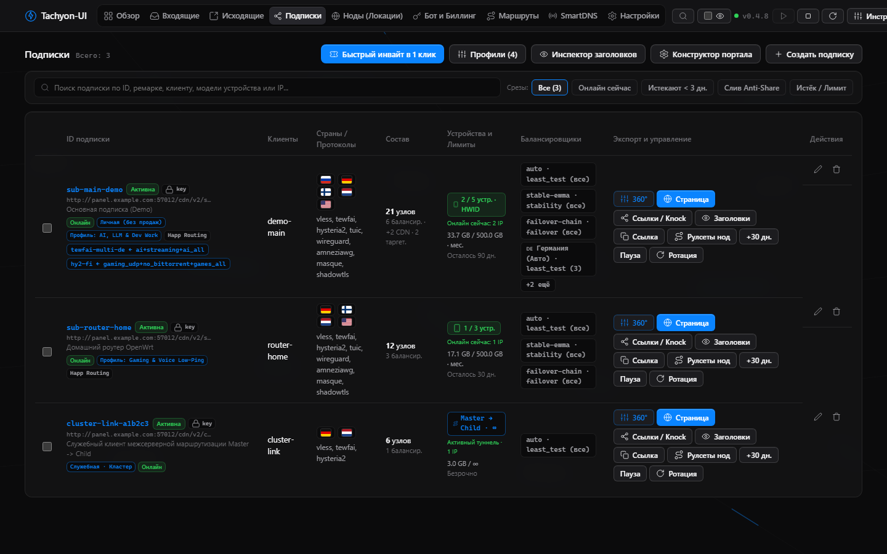
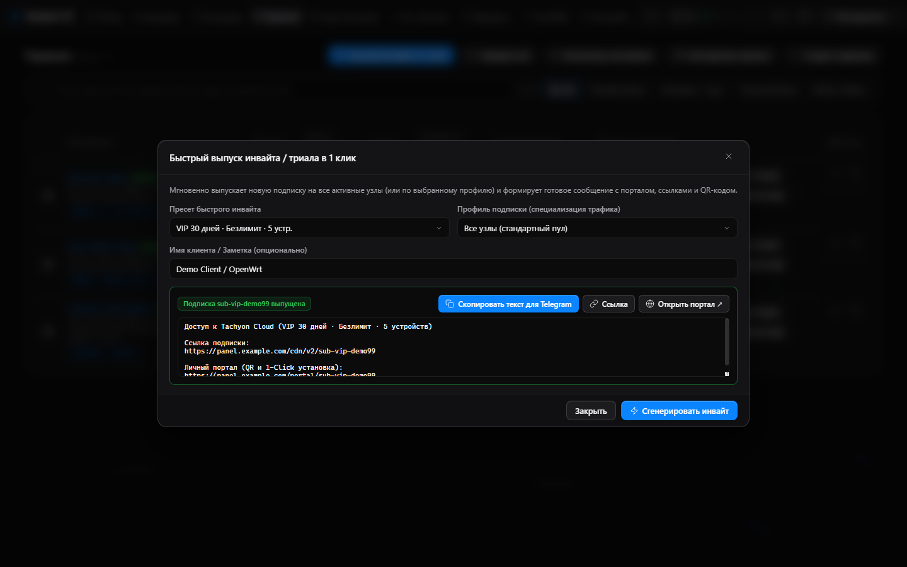
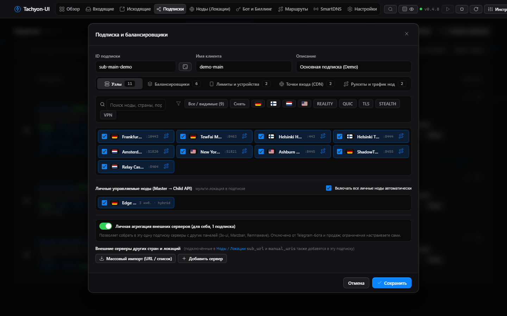
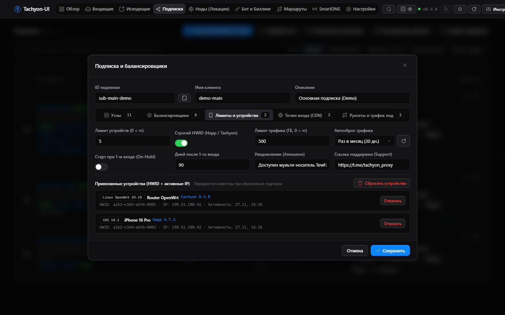
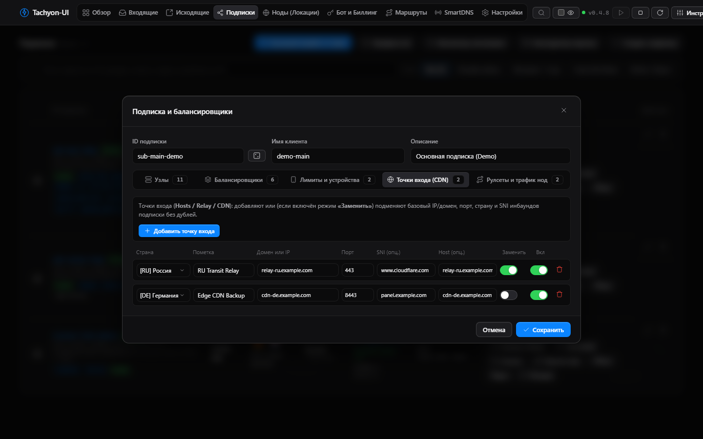
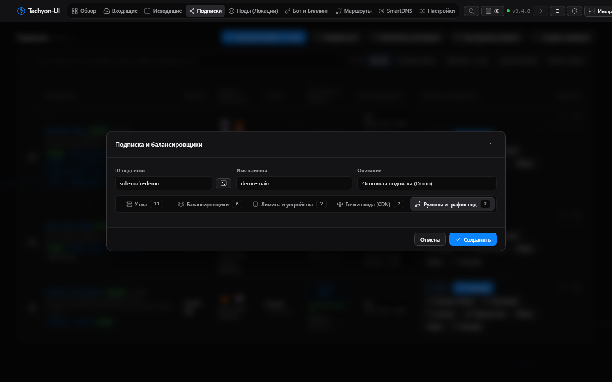
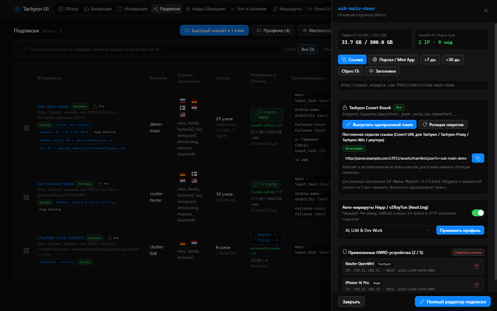
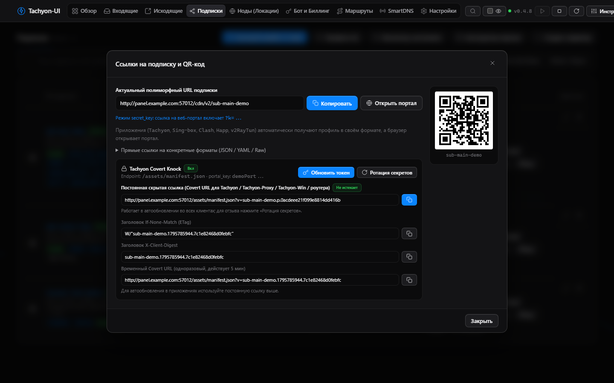
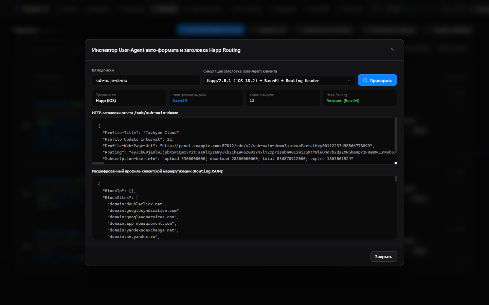
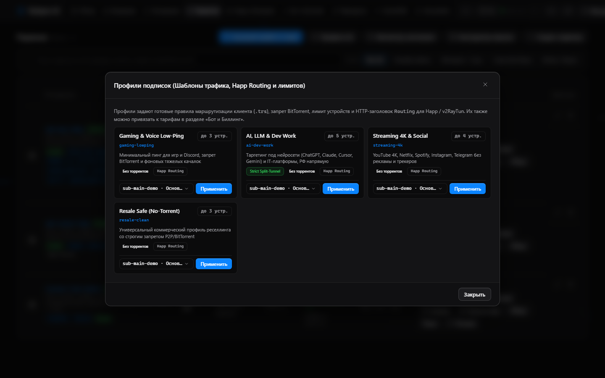

# 3. Подписки, 360°-инспектор, веб-портал, профили и Tachyon Covert Knock

[English version](../en/03-subscriptions-and-covert-knock.md) | [Сводный путеводитель](00-complete-guide.md) | [К оглавлению](../../README.ru.md) | [Полный справочник UI](./11-ui-every-tab-and-button-guide.md) | [Каталог 27 протоколов](./protocols/README.md)

Раздел **Подписки (`#subs`)** объединяет локальные протоколы, дочерние серверы кластера и балансировщики пользователя в единую ссылку или веб-портал, обеспечивая 4 уровня защиты от обнаружения эндпоинтов.



---

## Управление подписками, быстрый инвайт, 5 вкладок редактора и кластерный режим `v0.4.12`

В списке подписок доступны строка поиска (по ID, ремарке, клиенту, модели устройства или IP), быстрые срезы (**Все**, **Онлайн сейчас**, **Истекают < 3 дн.**, **Слив Anti-Share**, **Истёк / Лимит**), плавающая панель пакетных действий при выделении чекбоксами или `Shift+Click`, кнопка **+ Быстрый инвайт в 1 клик** и живой счётчик **`Онлайн сейчас: N IP`**.

### Кнопки тулбара и строк таблицы подписок

| Область | Элемент / кнопка | Что делает и когда использовать |
| :--- | :--- | :--- |
| **Тулбар `#subs`** | **Поиск и срезы статуса** | Фильтрация по `sub_id`, имени, заметке, IP, активным, истекающим, превысившим лимит и нарушениям Anti-Share. |
| **Тулбар `#subs`** | **+ Добавить подписку** | Открывает 5-вкладочную карточку создания новой подписки (в базовом режиме без гранта доступна 1 персональная подписка). |
| **Тулбар `#subs`** | **+ Быстрый инвайт в 1 клик** | Создаёт готовую ссылку-приглашение и QR-код по пресету срока/лимита и профиля без заполнения 5 вкладок. |
| **Тулбар `#subs`** | **Профили подписок** | Управление шаблонами наборов узлов, лимитов, DNS и правил с массовым применением к подпискам. |
| **Тулбар `#subs`** | **Инспектор заголовков** | Эмуляция запроса с выбранным `User-Agent` (Happ, Hiddify, v2rayNG, Shadowrocket, Clash, Sing-box) с выводом реальных заголовков и тела ответа. |
| **Тулбар `#subs`** | **Конструктор портала** | Переход к настройкам брендинга и защиты клиентской веб-страницы подписки (`sub_portal_guard`). |
| **Тулбар `#subs`** | **Импорт внешней подписки** | Импорт стороннего URL или списка URI в локальную базу или агрегатор (с учётом `country`, `user_agent`, `hwid`). |
| **Строка подписки** | **Тумблер Вкл/Выкл**, **`+30д`**, **Ссылки / QR**, **Ротация ссылки**, **Сброс страйков**, **Редактировать**, **Удалить** | Быстрые операции над конкретным абонентом в 1 клик. Массовое продление (`+30д`), отключение, смена профиля и удаление доступны через чекбоксы и `Shift+Click`. |

### Быстрый инвайт в 1 клик



Модальное окно **+ Быстрый инвайт в 1 клик** предназначено для моментальной выдачи гостевых, тестовых или дружеских доступов: выберите готовый пресет длительности/квоты трафика, профиль подписки (при наличии) и комментарий — панель сразу сформирует активную подписку, готовую ссылку и QR-код.

### Особенности кластерного режима (`v0.4.12`)
- **Зеркалирование `sub_configs`, `device_limit` и HWID-устройств на Child**: при синхронизации `Master → Child` мастер-сервер передаёт на дочерние ноды не только клиентов инбаундов, но и конфигурацию подписок (`sub_configs`), эффективный лимит устройств (`device_limit`), флаг `strict_hwid` и зарегистрированные устройства, чтобы ограничения соблюдались согласованно по всему кластеру.
- **Служебная подписка `cluster-link-*`**: межсерверные туннели `Master → Child` в таблице подписок помечаются бейджем **«Служебная · Кластер»** и индикатором **`Master → Child · ∞`** (лимит устройств отключён, HWID-привязка не применяется, при активности отображается `Активный туннель · N IP`).

---

## 5 вкладок редактора подписки

Нажмите **Добавить** или кнопку редактирования подписки — в верхней части задаются `sub_id` (поддерживается **переименование на месте** через `old_sub_id`, при коллизии возвращается `409 Conflict`), имя клиента и ремарка, а ниже расположены 5 вкладок:

### Вкладка 1. Узлы



- Поиск и фильтрация доступных локальных инбаундов по стране и стеку (`REALITY`, `QUIC`, `TLS`, `STEALTH`, `VPN`), выбор чипами с быстрыми кнопками «Все / видимые» и «Снять».
- Блок **Личные управляемые ноды (Master → Child API)** с переключателем **«Включать все личные ноды автоматически»** и бейджами ролей (`direct`, `hybrid`, `relay`).
- При активированном ключе доступа (`TACHYON-GRANT-V1`, выдаётся напрямую разработчиком по Host Fingerprint) — блок внешних серверов (`sub_url`, `manual_uris`, `1→N` клонирование). Без ключа доступна **1 личная агрегация внешних серверов** (для себя, без продаж и Telegram-бота).

### Вкладка 2. Балансировщики

Отвечает за автосборку `urltest` (12 режимов), `selector` и цепочек `chain`, включая кнопки 1-клик генерации по стекам и **«+ По странам (auto-fi, auto-de...)»**. Подробный разбор см. в [главе 4](04-balancers-chain-and-routes.md).

### Вкладка 3. Лимиты и устройства



- **Лимит устройств (`device_limit`, `0 = ∞`)** и **Строгий HWID (`strict_hwid`)** — при включении клиент обязан передавать заголовок `x-hwid`.
- **Лимит трафика (`total_limit_bytes`, в ГБ)** и **Автосброс трафика (`traffic_reset_strategy`)**: `none`, `daily`, `weekly`, `monthly` плюс кнопка немедленного обнуления счётчиков.
- **Старт при 1-м входе (`On-Hold` / `start_on_first_use`)**, длительность в днях после первого входа, персональное уведомление (`announce`) и ссылка поддержки (`support_url`).
- **Привязанные устройства (HWID + активные IP)**: таблица устройств с ОС, моделью, приложением, версией, последним IP и кнопкой сброса. В клиентском веб-портале пользователь может самостоятельно отвязать устройство (`POST <sub_path>/unbind-device`) с настраиваемым кулдауном `sub_unbind_cooldown_hours`.
- **Радар аномалий (Anti-Share / Account Guard)**: отслеживает число одновременных `/24`-подсетей (`anti_share_max_subnets`), начисляет страйки и фиксирует `suspect_ips` (сброс через `/api/subs/clear-strikes`).

### Вкладка 4. Точки входа (CDN)



Позволяет добавить к подписке или **подменить** (флаг **«Заменить»**, `replace_default`) базовый IP/домен, порт, страну, SNI и заголовок `Host` для работы через CDN (например, `cdn.example.com`) или транзитные точки входа без дублирования карточек. При активном профиле `unified_443_front` локальные L7-ноды автоматически экспортируются как `<domain>:443` со строгим TLS без `insecure`.

### Вкладка 5. Рулсеты и трафик нод (`node_rules` и `strict_routing_only`)



- Позволяет привязать отдельные ноды подписки только под нужные наборы правил `.trs`, типы трафика, домены или порты (`only_this` — пропускать только выбранное, `prefer_node` — приоритет узла; принуждение на сервере через `server_unmatched`: `block` / `direct` / `client_only`).
- **Быстрые пресеты (1 клик)**: *Без BitTorrent*, *Только YouTube + Discord*, *Только AI*, *Только Стриминг*, *Звонки и Мессенджеры*, *Игры + UDP*, *Соцсети*, *Только Web 80/443 без торрентов*.
- **Переключатель `strict_routing_only` («Строгий режим подписки»)**: если включён (или все ноды переведены в режим `only_this`), весь трафик вне выбранных рулсетов и типов трафика направляется напрямую (`final: direct` в клиентском профиле), а серверное ядро `tachyon-core` блокирует обращения к любым неразрешённым сайтам и портам даже при подключении по одиночному URI-ключу.

---

## Боковой 360°-инспектор, Ссылки/Knock, Инспектор заголовков и Профили

### Боковой 360°-инспектор подписки



Открывается по клику на ID подписки или кнопку **360°** в таблице. В одной боковой панели собраны:
- Суммарный трафик (`↑ / ↓` и квота) и живой счётчик **`Онлайн IP / Нод в пуле`** (на Child-панели с удалённой выдачей показывается число активных IP, например `N IP`).
- Быстрые действия: копирование ссылки, открытие портала/Mini App, продление `+7 дн.` / `+30 дн.`, сброс ГБ, вызов **Инспектора заголовков** и кнопка **Сбросить сессии** (`/api/core/kick` по `user_online_ips`).
- Управление **Covert Knock** прямо из панели, тумблер **Авто-маршруты `Happ / v2RayTun` (`Routing`)**, выпадающий список быстрого применения **Профиля подписки** и список привязанных HWID-устройств с отвязкой в 1 клик.

### Модалка «Ссылки / Knock / OpenWrt 1-Click / QR»



В окне **Ссылки / Knock** собраны:
- Актуальный полиморфный URL подписки и кнопка открытия веб-портала (с учётом `?k=` при `sub_portal_guard = secret_key`);
- Прямые ссылки на конкретные форматы (`?format=singbox`, `clash`, `outbounds`, `raw`, `openwrt`) и готовая команда **OpenWrt / Keenetic / Linux 1-Click SSH (`wget -qO- "...format=openwrt-install" | sh`)**;
- Блок **Tachyon Covert Knock** (генерация временного токена на `±300` секунд, постоянный Covert Knock URL для роутера и ротация секретов);
- QR-код для мгновенного сканирования с телефона.

### Инспектор заголовков и User-Agent матрица



Окно **Инспектор заголовков** (`POST /api/subs/inspect-headers`) симулирует запрос с выбранным `User-Agent`, показывает определённое приложение, ОС, авто-формат выдачи, число узлов, HTTP-заголовки ответа (`Profile-Title`, `Profile-Update-Interval`, `Subscription-Userinfo`) и расшифрованный JSON заголовка **`Routing` (`Happ / v2RayTun`)**.

Матрица автоматического выбора формата по `User-Agent` / `Accept` (или явного `?format=` / `?fmt=`):

| Значение `?format=` / авто-определение | Формат выдачи (`detected_format`) | Что отдаётся и особенности протоколов |
| :--- | :--- | :--- |
| *(пусто)* или `Happ/*`, `v2RayTun/*`, `Hiddify/*`, `v2rayN/*`, `Shadowrocket/*` | `base64` | Base64-список URI (`tewfai://`, `vless://`, `hy2://`, `tuic://`, `trojan://`, `vmess://`, `ss://`, `anytls://`, `shadowtls://`, `naive+https://`, `naive+quic://`, `masque://`, `trusttunnel://`, `mieru://`, `snell://`, `tg://proxy`, `fptn:`, `wdtt://`, `sudoku://`, `openconnect://`, `wireguard://`, `amneziawg://`, `socks5://`, `http://`) с заголовками `Subscription-Userinfo`, `Profile-Update-Interval` и `Routing`. |
| `raw` / `uri` / `plain` | `raw` | Построчный текстовый список URI-ссылок без Base64-кодирования (удобен для отладки и ручного импорта). |
| `tachyon` или `User-Agent` содержит `tachyon` (например `tachyon-core/2.0`) | `tachyon` (`tachyon_json_profile`) | Плоский JSON-профиль: все листовые `outbounds` (вкл. **`TewFai`**, `MASQUE`, `TrustTunnel`, `Snell`, `FPTN`, `MTProto`, `WDTT`), `endpoints` (`WireGuard`/`AWG`) и страновые/режимные `urltest`-балансировщики. |
| `singbox` / `sing-box` / `json` или `sing-box`, `sfa`, `sfi`, `sfm`, `karing` | `singbox` | Полный клиентский JSON-конфиг (`inbounds` `mixed:2080`, `dns`, `outbounds`, `endpoints`, `route`, `experimental.clash_api`) со всеми 12 режимами `urltest`, `balancer`, `chain`, `time_window` и `.trs`-маршрутизацией. |
| `outbounds` | `outbounds` | Только JSON-массив аутбаундов и эндпоинтов (`outbounds_only`) для встраивания во внешний конфиг. |
| `clash` / `clashmeta` / `meta` / `mihomo` / `yaml` | `clash` | YAML-профиль (`proxies`, `proxy-groups`, `rules`) с группами `select`, `url-test`, `fallback`, `load-balance`, `relay`. Включает только поддерживаемые форматом типы (`vless`, `trojan`, `anytls`, `vmess`, `hysteria2`, `tuic`, `shadowsocks`, `mieru`, `snell`, `socks`/`http`, `wireguard`; протоколы `tewfai`, `fptn`, `naive`, `masque`, `trusttunnel`, `wdtt`, `chain`, `xhttp`/`httpupgrade` в YAML пропускаются). |
| `sip008` | `sip008` | JSON-профиль SIP008 (`version: 1`, `servers[]`) — **только** для узлов `shadowsocks`. |
| `openwrt` / `router`, `openwrt-install` | `openwrt` | Роутерный JSON-профиль или готовый 1-Click shell-инсталлятор (`wget -qO- "...format=openwrt-install" \| sh`). |
| `html` / `portal` или браузер `Accept: text/html` | `html` | Интерактивная веб-страница портала / Telegram Mini App с кнопками импорта, остатком трафика и отвязкой устройств. |

Дополнительно доступны динамические query-фильтры по странам `?country=DE,NL` (`?cc=`) и режимам маршрутизации `?mode=antiblock|ru-direct|split|gaming|full`.

### Сводка кнопок и действий в 360°-инспекторе и редакторе подписки

| Область | Элементы управления и действия | Назначение |
| :--- | :--- | :--- |
| **360°-инспектор подписки** | `Ссылки / QR`, `+7д` / `+30д`, `Сбросить трафик`, `Сбросить сессии`, `Ротировать токен`, `Очистить страйки`, тумблер `Happ Routing`, выбор **Профиля подписки**, отвязка HWID-устройства (`unbind`) / всех устройств, `Редактировать`, `Удалить` | Полноценное оперативное управление подписчиком в боковой панели без открытия 5-вкладочной модалки. |
| **Модалка «Ссылки / Knock»** | Полиморфный URL, кнопка веб-портала (`?k=`), прямые кнопки форматов (`singbox`, `clash`, `outbounds`, `raw`, `openwrt`), команда **OpenWrt 1-Click SSH**, генератор временного токена и постоянный URL **Covert Knock**, **Ротация секретов**, QR-код | Выдача и защита всех клиентских форматов и скрытого стука из одного окна. |
| **Редактор `#modal-sub` (5 вкладок)** | `0: Узлы` (переименование `sub_id`, профиль, чипы инбаундов, личные ноды), `1: Балансировщики` (`Добавить балансировщик`, `+ По странам`), `2: Лимиты и устройства` (`Сбросить трафик`, `On-Hold`, HWID, Anti-Share), `3: Точки входа (CDN)` (`Добавить хост/CDN`, `Заменить`), `4: Рулсеты и трафик нод` (пресеты, `Happ Routing`, `strict_routing_only`) | Полная настройка состава узлов, квот и серверно-клиентских правил подписки; подробнее по каждой кнопке — в [Полном справочнике UI](./11-ui-every-tab-and-button-guide.md). |

### Профили подписок (`Sub Profiles`)



**Профили подписок** (`/api/sub-profiles`) — готовые шаблоны (`Gaming Low-Ping`, `AI & Dev`, `Streaming 4K`, `Clean Resale` и др.), задающие лимит устройств, обязательные `.trs`-правила, запрет BitTorrent, `strict_routing_only` и заголовок `Happ Routing`. Профиль можно применить к любой подписке в 1 клик или привязать к тарифу в `#tgbot`.

---

## Учёт мультиподписок, онлайн-клиенты и переименование `sub_id`

- **Автоматическая дизамбигуация имён клиентов (`core_user_name_for_client` / `InboundUserNameResolver`)**: при наличии нескольких клиентов с одинаковым `name` (или пустым именем) на одном инбаунде панель детерминированно преобразует их теги для `tachyon-core` в формат `name [sub_id]` (или `sub_id` при пустом `name`, а при совпадении пары `(name, sub_id)` — в `name [id]` / `client [id]`), гарантируя точный раздельный учёт трафика и онлайна `O(C)`.
- **Точный учёт онлайн-IP и строгий single-client fallback**:
  - Телеметрия хранит раздельные карты активных IP по пользователям (`user_online_ips`) и по подпискам (`sub_online_ips`, до 64 IP на запись).
  - Трафик и подключения уровня инбаунда без тега пользователя засчитываются только тогда, когда на инбаунде ровно один фактически активный клиент (`single_fallback_client_user`).
  - Отключённые, исчерпавшие квоту и истёкшие клиенты немедленно удаляются из `user_online_ips` и `recent_online`.
- **Автовыделение `wg_client_ip`**: при добавлении подписки на инбаунды WireGuard / AmneziaWG / MASQUE через `POST /api/subs` автоматически подбирается минимальный свободный октет `2..=254` (`10.10.0.<octet>/32`).

---

## 4 уровня защиты подписок (`StealthSubGate`)

### Уровень 1 — Полиморфные маршруты (`sub_path_style`)

Настраивается в Шаге 3 мастера. Единый хелпер `resolve_subscription_url` синхронно формирует ссылки в веб-UI, API и Telegram-боте:

| Значение `sub_path_style` | Шаблон пути |
| :--- | :--- |
| `sub` | `/<sub_path>/<sub_id>` (по умолчанию `/sub/<sub_id>`) |
| `static_feed` | `/static/feed/<sub_id>` |
| `cdn_v2` | `/cdn/v2/<sub_id>` |
| `rss_updates` | `/rss/updates/<sub_id>` |

Флаг `sub_legacy_alias` (по умолчанию `true` для совместимости при миграции) позволяет временно принимать и классический `/sub/<sub_id>`. Для максимального балла Self-Audit отключите `sub_legacy_alias`.

### Уровень 2 — Zero-Oracle и фильтр автоматических сканеров

- **Zero-Oracle**: при обращении с несуществующим, отключённым или истёкшим `sub_id` сервер **никогда** не возвращает JSON-ошибок. Всегда отдаётся HTML-страница `HTTP/1.1 404 Not Found` активного шаблона `SiteEngine` с заголовком `Server: nginx/1.26.2`.
- **Фильтр сетевых сканеров (`sub_block_scanners`)**: запросы с User-Agent инструментов сканирования и обхода сайтов (`curl`, `wget`, `python-requests`, `go-http-client`, `zgrab`, `censys`, `shodan`, `masscan`, `nmap`, `httpx`, `nuclei`, `googlebot`, `bingbot`, `yandex`, `ahrefs`, `semrush`, `sqlmap`, `nikto`) даже на **валидную** ссылку подписки получают ответ публичного сайта или decoy `404`. Настоящие прокси-клиенты обслуживаются штатно.

### Уровень 3 — Защита браузерного портала (`sub_portal_guard`)

При значении `secret_key` открытие веб-портала подписки из браузера требует либо секретного параметра `?k=<portal_key>`, либо валидно подписанных данных Telegram Mini App (`tgWebAppData`). При отсутствии ключа браузер получает decoy-ответ, тогда как клиентские приложения по-прежнему скачивают профиль без дополнительных параметров URL.

### Уровень 4 — Tachyon Covert Knock (скрытая выдача поверх обычных страниц сайта)

Механизм **Tachyon Covert Knock** позволяет полностью отказаться от выделенных URL подписок вроде `/sub/` или `/cdn/v2/`. Подписка отдаётся на обычных маршрутах публичного сайта (по умолчанию `/assets/manifest.json` или `/`).

**Принцип работы:**
1. Каждая подписка имеет собственный криптостойкий секрет `knock_secret`.
2. Временный токен стука имеет формат `<sub_id>.<unix_ts>.<hmac16>`, где `<hmac16>` — первые 16 hex-символов `HMAC-SHA256(knock_secret, "{sub_id}:{unix_ts}")`, сравниваемые в постоянном времени (`constant_time_eq`), с окном свежести `|now - unix_ts| <= 300` секунд. Для роутера `Tachyon 2.0` и клиентов без генерации динамического заголовка доступен **постоянный Covert Knock URL**.
3. Токен может передаваться тремя способами:
   - заголовок `If-None-Match: W/"<sub_id>.<ts>.<hmac16>"` (мимикрирует под обычный ETag браузерного кэша);
   - заголовок `X-Client-Digest: <sub_id>.<ts>.<hmac16>`;
   - query-параметр `?v=<sub_id>.<ts>.<hmac16>` (опционально с `&fmt=<format>`).
4. **Результат проверки:**
   - при валидном стуке сервер возвращает конфигурацию подписки (`200 OK`);
   - при отсутствии токена, просроченной метке или неверной подписи возвращается обычный `200 OK` JSON-манифест или HTML-страница сайта **без каких-либо сообщений об ошибке стука**.

```bash
# Запрос без стука -> обычный манифест публичного сайта (200 OK, application/json)
curl -s https://edge.example.com/assets/manifest.json

# Запрос с валидным ETag-стуком -> конфигурация подписки
curl -s -A "Happ/2.5.0" \
  -H 'If-None-Match: W/"sub-pro-team.1795400000.a1b2c3d4e5f60708"' \
  https://edge.example.com/assets/manifest.json
```

---

[Назад: Глава 2 — Публичный сайт, Dual HTTP+HTTPS, домен, ACME и Self-Audit](02-stealth-web-domain-tls.md) | [Оглавление](../../README.ru.md) | [Полный справочник UI](./11-ui-every-tab-and-button-guide.md) | [Каталог 27 протоколов](./protocols/README.md) | [Далее: Глава 4 — Балансировщики (12 режимов `urltest`), `chain` и маршрутизация](04-balancers-chain-and-routes.md)
