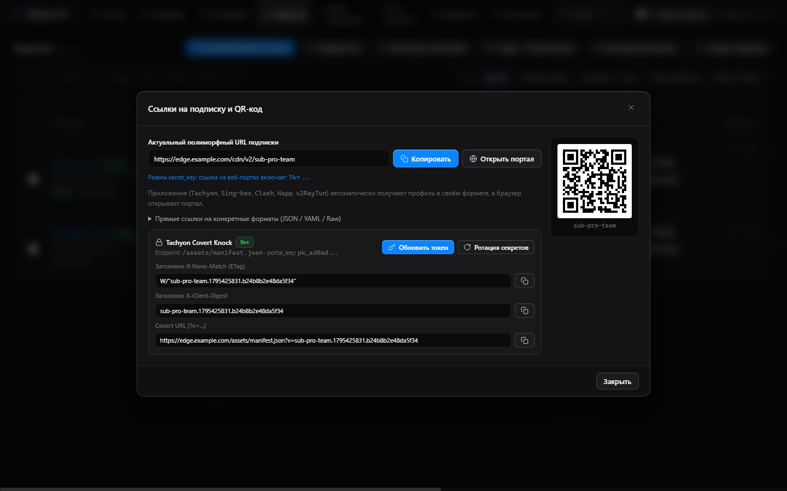

# 3. Подписки, веб-портал, ваучеры и Tachyon Covert Knock

[English version](../en/03-subscriptions-and-covert-knock.md) | [К оглавлению](../../README.ru.md)

Раздел **Подписки** объединяет все протоколы и локации пользователя в единую ссылку или веб-портал и обеспечивает 4 уровня защиты от обнаружения эндпоинтов подписок.



---

## Управление подписками, профилями и устройствами

- **Группировка по `sub_id`**: клиенты из разных inbound-протоколов (например, VLESS+REALITY, Hysteria2, TUIC, WireGuard/AWG, Sudoku, WDTT) с одинаковым `sub_id` объединяются в одну подписку.
- **Профили подписок (`/api/sub-profiles`) и быстрый инвайт (`/api/subs/quick-invite`)**: готовые шаблоны параметров (ограничение устройств, On-Hold «старт при первом подключении» `start_on_first_use`, стратегия сброса трафика `daily` / `weekly` / `monthly`, набор балансировщиков, приветственный баннер `announce`) применяются к подпискам в один клик или при мгновенной выдаче инвайта.
- **360°-инспектор, массовые действия и импорт**: правый боковой инспектор подписки, пакетные действия (`/api/subs/batch-action` для включения/отключения, продления срока, смены профиля), быстрая ротация токена (`/api/subs/rotate-token`), сброс страйков (`/api/subs/clear-strikes`), инспектор клиентских заголовков (`/api/subs/inspect-headers`) и импорт внешних подписок (`/api/subs/import-external`, доступен при активированном ключе доступа по отпечатку хоста).
- **Контроль сторонних подписок по отпечатку хоста (`TACHYON-GRANT-V1`)**: без ключа доступа, подписанного автором (вводится в **Настройки → Ключ доступа по отпечатку хоста** для конкретного `TH-...` идентификатора сервера), импорт сторонних URL-подписок (`sub_url`), внешних `external_nodes`, `manual_uris` и подмена клиентских заголовков (`User-Agent` / `x-hwid`) отклоняются (`403 grant_required`) и не попадают в клиентскую выдачу или фоновую автосинхронизацию; локальные протоколы и собственные серверы `tachyon_node` работают без ограничений (а с ключом нет ограничений по числу подписок).
- **Учёт устройств (HWID) и лимиты**:
  - `device_limit` ограничивает число привязанных устройств / одновременных IP; `strict_hwid` требует явный заголовок `x-hwid`.
  - В клиентском веб-портале пользователь может самостоятельно отвязать старое устройство (`POST <sub_path>/unbind-device`) с настраиваемым кулдауном `sub_unbind_cooldown_hours`.
- **Радар аномалий (Anti-Share / Account Guard)**: отслеживает число одновременных `/24`-подсетей на одну подписку (`anti_share_max_subnets`), начисляет страйки и фиксирует подозрительные IP (`suspect_ips`).
- **Дополнительные хосты (`hosts`), внешний фронт и `node_rules`**: позволяет подменять адрес/порт/SNI/Host-заголовок для CDN или транзитных узлов (а при профиле `unified_443_front` — автоматически экспортировать локальные L7-ноды как `<domain>:443` со строгим TLS без `insecure`) и задавать правила привязки конкретных нод только под нужные наборы правил `.trs` или типы трафика (`only_this` / `prefer_node`, принуждение на сервере через `server_unmatched`: `block` / `direct` / `client_only`).
- **Брендинг клиентского веб-портала**: в настройках задаются макет страницы (`sub_page_layout`), цвет акцента (`sub_theme_accent`), логотип (`sub_logo_url`), объявление (`sub_announce`), кнопки поддержки и покупки (`sub_support_url`, `sub_buy_url`, `sub_buy_label`, `sub_tg_channel_url`), отображение узлов/FAQ/донатов (`sub_show_nodes`, `sub_show_faq`, `sub_show_donate`), белый список клиентских приложений (`sub_enabled_apps`), клиентский DNS и блокировка рекламы (`sub_client_dns`, `sub_client_block_ads`), а также собственный `sub_custom_css` / `sub_custom_html`.
- **Ваучеры (`/redeem`)**: пакетная генерация кодов активации (`/api/vouchers/batch`), которые пользователь вводит на странице активации (`redeem_path`) и сразу получает готовую подписку.

### Учёт мультиподписок, онлайн-клиенты и переименование `sub_id`

- **Автоматическая дизамбигуация имён клиентов (`core_user_name_for_client` / `InboundUserNameResolver`)**: при наличии нескольких клиентов с одинаковым `name` (или пустым именем) на одном инбаунде панель детерминированно преобразует их теги для `tachyon-core` в формат `name [sub_id]` (или `sub_id` при пустом `name`, а при совпадении пары `(name, sub_id)` — в `name [id]` / `client [id]`), оставляя уникальные имена без изменений. Линейная резолвация `O(C)` гарантирует раздельный учёт трафика и онлайна по каждой подписке.
- **Точный учёт онлайн-IP и строгий single-client fallback**:
  - Телеметрия хранит раздельные карты активных IP по пользователям (`user_online_ips`) и по подпискам (`sub_online_ips`, до 64 IP на запись).
  - **Строгий single-client fallback (`single_fallback_client_user`)**: трафик и подключения уровня инбаунда без тега пользователя засчитываются только тогда, когда на инбаунде ровно один фактически активный клиент. Если активных клиентов два и более (или ноль), статистика уровня инбаунда никогда не приписывается первому клиенту.
  - **Мгновенная очистка онлайна**: отключённые, исчерпавшие квоту и истёкшие клиенты немедленно удаляются из `user_online_ips` и `recent_online` (60-секундное окно удержания действует только для активных клиентов). На дашборде в виджете онлайн-клиентов отображается до **20** активных пользователей с их IP-адресами, числом соединений и кнопкой быстрого отключения (`/tachyon/kick`).
- **Атомарное переименование `sub_id`, квота, периодический сброс и `wg_client_ip`**:
  - **Переименование `sub_id` на месте**: доступно в форме редактирования подписки в UI и через `POST /api/subs` с передачей поля `old_sub_id` вместе с новым `sub_id`. Атомарно обновляет `sub_configs`, клиентов во всех инбаундах (`inbounds[].clients`), привязки бота (`tg_bot.users`, `trial_template_sub_id`) и каскадов (`remote_nodes[].cascade_sub_id`) с сохранением UUID и ключей; при коллизии с существующим `sub_id` возвращает **`409 Conflict`**.
  - **Квота и периодический сброс трафика**: поле `total_limit_bytes` (также поддерживается алиас `traffic_limit_bytes`) задаёт лимит трафика подписки, а `traffic_reset_strategy` (`none`, `daily`, `weekly`, `monthly`) автоматически обнуляет счётчики `up`/`down` по расписанию (и инициирует перезагрузку ядра, если ранее заблокированный по квоте клиент снова становится активным).
  - **Автовыделение `wg_client_ip`**: при добавлении подписки на инбаунды WireGuard / AmneziaWG / MASQUE через `POST /api/subs` автоматически подбирается минимальный свободный октет `2..=254` (`10.10.0.<octet>/32`), исключая конфликты адресов после удаления клиентов.

---

## Поддерживаемые форматы клиентов и query-параметры

Единый URL подписки автоматически подстраивается под клиентское приложение по заголовку `User-Agent`, либо может быть принудительно запрошен через параметр `?format=` (или `?fmt=`):

| Формат | Параметр `?format=` | Примечание |
| :--- | :--- | :--- |
| **`tachyon-core` / `sing-box`** | `singbox` / `sing-box` / `tachyon` / `json` | Полный JSON-конфиг со всеми 12 режимами `urltest`, `balancer`, `chain`, `time_window`, `.trs` правилами и протоколами `tachyon-core`. Для исходящих `masque` (при включённом TLS) автоматически задаются `keep_alive_period: "20s"`, `idle_timeout: "50s"` и `tls.alpn: ["h3"]`. |
| **Только выходы JSON** | `outbounds` | Массив JSON-объектов `outbounds` без обвязки маршрутами и DNS. |
| **Clash / Mihomo** | `clash` / `clashmeta` / `meta` / `mihomo` / `yaml` | YAML с группами `select`, `url-test`, `fallback`, `load-balance`, `relay`. |
| **Raw URI** | `raw` / `uri` / `plain` | Открытый построчный список URI (`vless://`, `hy2://`, `tuic://`, `trojan://`, `ss://`, `vmess://`). |
| **Base64 (по умолчанию)** | Авто / остальные клиенты | Base64-закодированный список URI с заголовками `Subscription-Userinfo`, `Profile-Update-Interval` и поддержкой `Happ Routing Header` (`happ_routing_enabled`). |
| **SIP008 (Shadowsocks)** | `sip008` | Стандартный JSON-профиль SIP008 для клиентов Shadowsocks. |
| **Роутер OpenWrt** | `openwrt` / `router` | Готовый конфиг для роутерного клиента OpenWrt (`build_openwrt_router_config_with_opts`); для `masque` outbounds автоматически выставляет `keep_alive_period: "20s"`, `idle_timeout: "50s"` и `tls.alpn: ["h3"]` для стабильных роутерных туннелей. |
| **1-клик скрипт OpenWrt** | `openwrt-install` / `router-install` / `install.sh` | Исполняемый shell-скрипт установки и настройки подписки на роутере. |
| **WireGuard / AmneziaWG** | Экспорт из портала / карточки | Готовый `.conf` файл туннеля с параметрами `jc`/`jmin`/`jmax`/`s1`/`s2`/`h1..h4`. |
| **Веб-портал** | `html` / `portal` / `page` (или `Accept: text/html`) | Интерактивная страница подписки для пользователя с кнопками импорта в клиенты, статистикой трафика/устройств и QR-кодом. |

### Динамические query-параметры подписок

К любой ссылке подписки можно добавлять параметры фильтрации и маршрутизации:
- `?country=DE,NL` (или `?cc=US`) — включает в выдачу только узлы указанных стран (2-буквенные ISO-коды через запятую).
- `?mode=<режим>` — переопределяет политику клиентских правил маршрутизации:
  - `antiblock` — выборочная маршрутизация зарубежных сервисов и платформ через туннель, остальной трафик напрямую;
  - `ru-direct` / `split` — региональные домены (`.ru`, `.su`, `.рф` и локальные сервисы) идут напрямую (`direct`), остальной трафик — через туннель;
  - `gaming` / `game` — профиль маршрутизации с приоритетом на игровые и низкозадержечные потоки;
  - `full` / `global` — весь трафик направляется через выбранный прокси/балансировщик.

---

## 4 уровня защиты подписок (`StealthSubGate`)

### Уровень 1 — Полиморфные маршруты (`sub_path_style`)

Настраивается в Шаге 3 мастера. Единый хелпер `resolve_subscription_url` синхронно формирует ссылки в веб-UI, API и Telegram-боте:

| Значение `sub_path_style` | Шаблон пути |
| :--- | :--- |
| `sub` | `/<sub_path>/<sub_id>` (по умолчанию `/sub/<sub_id>`) |
| `static_feed` | `/static/feed/<sub_id>` |
| `cdn_v2` | `/cdn/v2/<sub_id>` |
| `rss_updates` | `/rss/updates/<sub_id>` |

Флаг `sub_legacy_alias` (по умолчанию `true` для совместимости при миграции) позволяет временно принимать и классический `/sub/<sub_id>`. Для максимального балла Self-Audit отключите `sub_legacy_alias`.

### Уровень 2 — Zero-Oracle и фильтр автоматических сканеров

- **Zero-Oracle**: при обращении с несуществующим, отключённым или истёкшим `sub_id` сервер **никогда** не возвращает JSON-ответы вида `{"error": "subscription not found"}`. Всегда отдаётся HTML-страница `HTTP/1.1 404 Not Found` активного шаблона `SiteEngine` с заголовком `Server: nginx/1.26.2`.
- **Фильтр сетевых сканеров (`sub_block_scanners`)**: запросы с User-Agent инструментов сканирования и обхода сайтов (`curl`, `wget`, `python-requests`, `go-http-client`, `zgrab`, `censys`, `shodan`, `masscan`, `nmap`, `httpx`, `nuclei`, `googlebot`, `bingbot`, `yandex`, `ahrefs`, `semrush`, `sqlmap`, `nikto`) даже на **валидную** ссылку подписки получают ответ публичного сайта или decoy `404`. Настоящие прокси-клиенты (`tachyon`, `sing-box`, `clash`, `mihomo`, `v2ray`, `hiddify`, `nekobox`, `shadowrocket`, `happ`, `streisand`, `karing`, `flclash`) обслуживаются штатно.

### Уровень 3 — Защита браузерного портала (`sub_portal_guard`)

При значении `secret_key` открытие веб-портала подписки из браузера требует либо секретного параметра `?k=<portal_key>`, либо валидно подписанных данных Telegram Mini App (`tgWebAppData`). При отсутствии ключа браузер получает decoy-ответ, тогда как клиентские приложения по-прежнему скачивают профиль без дополнительных параметров URL.

### Уровень 4 — Tachyon Covert Knock (скрытая выдача поверх обычных страниц сайта)

Механизм **Tachyon Covert Knock** позволяет полностью отказаться от выделенных URL подписок вроде `/sub/` или `/cdn/v2/`. Подписка отдаётся на обычных маршрутах публичного сайта (по умолчанию `/assets/manifest.json` или `/`).

**Принцип работы:**
1. Каждая подписка имеет собственный криптостойкий секрет `knock_secret`.
2. Токен стука имеет формат `<sub_id>.<unix_ts>.<hmac16>`, где `<hmac16>` — первые 16 hex-символов `HMAC-SHA256(knock_secret, "{sub_id}:{unix_ts}")`, сравниваемые в постоянном времени (`constant_time_eq`).
3. Сервер проверяет окно свежести `|now - unix_ts| <= 300` секунд (защита от повторного воспроизведения перехваченного запроса).
4. Токен может передаваться тремя способами:
   - заголовок `If-None-Match: W/"<sub_id>.<ts>.<hmac16>"` (мимикрирует под обычный ETag браузерного кэша);
   - заголовок `X-Client-Digest: <sub_id>.<ts>.<hmac16>`;
   - query-параметр `?v=<sub_id>.<ts>.<hmac16>` (опционально с `&fmt=<format>`).
5. **Результат проверки:**
   - при валидном стуке сервер возвращает конфигурацию подписки (`200 OK`);
   - при отсутствии заголовка, просроченной метке времени или неверной подписи возвращается обычный `200 OK` JSON-манифест или HTML-страница сайта **без каких-либо сообщений об ошибке стука**.

В карточке **Ссылки / Knock** в `#subs` можно:
- сгенерировать готовый временный токен и пример команды `curl` нажатием кнопки (`POST /api/subs/:id/covert-token`);
- выполнить ротацию `portal_key` и `knock_secret` для немедленного отзыва старых токенов (`POST /api/subs/:id/rotate-secrets`).

```bash
# Запрос без стука -> обычный манифест публичного сайта (200 OK, application/json)
curl -s https://edge.example.com/assets/manifest.json

# Запрос с валидным ETag-стуком -> конфигурация подписки
curl -s -A "Happ/2.5.0" \
  -H 'If-None-Match: W/"sub-pro-team.1795400000.a1b2c3d4e5f60708"' \
  https://edge.example.com/assets/manifest.json
```

---

[Назад: Глава 2 — Публичный сайт, Dual HTTP+HTTPS, домен, ACME и Self-Audit](02-stealth-web-domain-tls.md) | [Оглавление](../../README.ru.md) | [Далее: Глава 4 — Балансировщики (12 режимов `urltest`), `chain` и маршрутизация](04-balancers-chain-and-routes.md)
