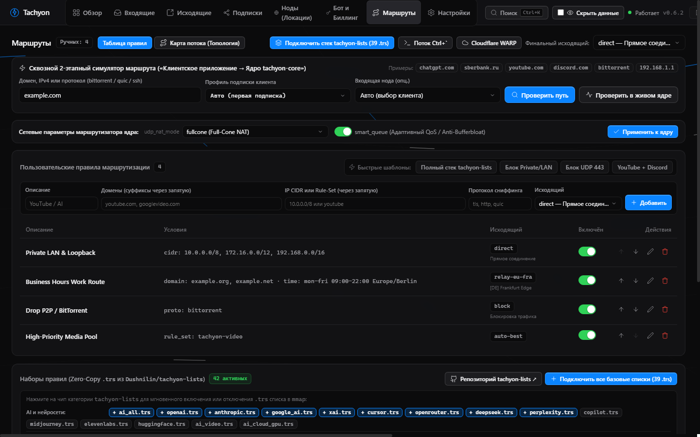

# 4. Балансировщики (12 режимов `urltest`), `chain` и маршрутизация

[English version](../en/04-balancers-chain-and-routes.md) | [К оглавлению](../../README.ru.md)

`tachyon-ui` обеспечивает полный паритет с конструктором групповых балансировщиков, многохоповых цепочек `chain` и правилами маршрутизации движка `tachyon-core`.

---

## Типы балансировщиков и 12 режимов `urltest`

Группы балансировки настраиваются в редакторе подписки (вкладка **Балансировщики**), при каскадировании (`POST /api/cascade`) и в исходящих подключениях (`#outbounds`).

### 1. Все 12 режимов `urltest`

| Режим (`mode`) | Алгоритм выбора узла | Ключевые параметры и когда применять |
| :--- | :--- | :--- |
| **`least_test`** | Активная периодическая проба `url` с выбором узла, показавшего минимальный RTT (с защитой от лишних переключений через `tolerance_ms`). | Базовый режим по умолчанию для универсального выбора самого быстрого узла. |
| **`stability`** | EWMA-сглаживание задержки с учётом джиттера и потери пакетов при пробах. | Для голосовой связи, стримов, удалённых рабочих столов и длительных TCP-сессий без скачков задержки. |
| **`failover`** | Строгий приоритет по порядку перечисления в `outbounds`: всегда используется первый рабочий узел, переход на резерв только при его сбое. | Основной + резервный канал (например, выделенный сервер + резервный релей). |
| **`sticky`** | Детерминированная привязка потока к одному и тому же узлу по выбранным ключам хеширования `sticky_hash`. | Банки, игровые сессии, SaaS-кабинеты и сервисы, чувствительные к смене выходного IP на лету. |
| **`least_load`** | Направляет каждое новое соединение на узел с наименьшим количеством текущих открытых соединений. | Равномерная разгрузка нескольких равнозначных серверов при большом числе параллельных клиентов. |
| **`weighted`** | Вероятностное распределение трафика с весом `1 / RTT`. Чем ниже задержка узла, тем выше его доля сессий. | Мультирегиональный пул, где основные потоки идут через ближайший узел, а часть распределяется по соседним. |
| **`round_robin`** | Последовательная циклическая ротация новых потоков по всем здоровым узлам пула. | Распределение большого числа коротких запросов (API, веб-сёрфинг). |
| **`passive`** | Пассивный Circuit-Breaker: не шлёт частых активных проб `url`, отсекает узел по реальным ошибкам соединений. | Экономия ресурсов и фонового трафика на мобильных устройствах и роутерах с ограниченным каналом. |
| **`priority`** | Многоуровневый каскад по массиву `tiers` (Tier 1 → Tier 2 → ...): работает в пределах верхнего здорового уровня, опускаясь ниже только при отказе всего уровня. | Когда есть «золотая» группа ближайших узлов и запасные резервные группы других регионов. |
| **`hedged`** | Спекулятивное дублирование: если первичный узел не отвечает за время ожидания, параллельно запускается попытка через резервный узел и побеждает первый ответ. | Критически низкая задержка открытия страниц на нестабильных беспроводных или мобильных сетях. |
| **`throughput`** | Измеряет и отбирает узел с максимальной подтверждённой пропускной способностью канала. | Загрузки крупных файлов, видео в высоком битрейте, резервное копирование. |
| **`quota`** | Отслеживает объём трафика на узлах (учитывает `quota_mib`) и переводит нагрузку на следующий узел при исчерпании лимита. | Использование нескольких VPS с жёсткими помесячными лимитами трафика. |

#### Вложенные параметры `urltest` и `balancer`

- **Общие поля `urltest`**:
  - `url` — URL проверки доступности (по умолчанию `https://www.gstatic.com/generate_204`);
  - `interval` (`interval_secs`) — период проб (например `180s`);
  - `tolerance` (`tolerance_ms`) — порог разницы RTT (в мс), ниже которого активный узел не меняется;
  - `idle_timeout` — время простоя перед приостановкой фоновых проб (например `5m`);
  - `interrupt_exist_connections` — принудительно закрывать старые соединения при переключении узла.
- **Объект `balancer`** (сериализуется автоматически только при наличии хотя бы одного заданного параметра):
  - `pool` — размер активного пула лучших узлов;
  - `pool_tolerance` — допуск разброса RTT (мс) внутри активного пула;
  - `sticky_hash` — набор ключей привязки для режима `sticky` (чекбоксы: `source_ip`, `domain`, `dest_ip`, `dest_port`, `process`, `none`);
  - `quota_mib` — лимит трафика в МиБ на узел для режима `quota`;
  - `tiers` — упорядоченные уровни тегов `Vec<Vec<String>>` для режима `priority` (визуальный редактор уровней с добавлением/удалением Tier и выбором чипов узлов).

---

### 2. Ручной переключатель (`selector`) и живое управление

- Поля: `outbounds` (список участников), `default` (узел по умолчанию), `interrupt_exist_connections`, `auto_failover` (автоматический временный переход на рабочий узел при сбое выбранного).
- На карточках балансировщиков и в консоли диагностики доступно **живое управление** работающим ядром без перезагрузки конфига:
  - переключение активного узла в `selector` (`POST /api/core/proxies/select` → Clash `PUT /proxies/<group>`);
  - принудительный замер задержек группы или пакета тегов (`POST /api/core/proxies/delay` → `/group/<tag>/delay` или `/tachyon/delay-batch`);
  - сброс состояния Circuit-Breaker конкретного outbound (`POST /api/core/outbound/reset` → `/tachyon/outbound/reset`).

---

### 3. Последовательные цепочки (`chain`)

Тип **`chain`** строит многохоповый каскад из **2 и более последовательных узлов** (в конструкторе порядок хопов настраивается стрелками вверх/вниз):

- `outbounds` — упорядоченный список хопов (`len >= 2`), трафик последовательно проходит `Хоп 1 → Хоп 2 → ... → Цель`.
- `idle_timeout` и `interrupt_exist_connections` — общие тайм-ауты и политика сброса.
- `strip_evasion` — снятие дополнительных флагов обфускации между промежуточными хопами.
- `strip` — гранулярные чекбоксы отключения параметров на внутренних звеньях цепочки:
  - `multiplex.padding`
  - `tls.fragment`
  - `tls.utls`
  - `xhttp.padding`
- `rewrite` — опциональный JSON-объект перезаписи параметров заголовков/протокола.

---

## Маршрутизация (`#routes`) и живой симулятор

### Правила и глобальные параметры маршрута

- **Фильтры правил**: `inbound` (теги входящих), `auth_user` (логины/клиенты), `domain_suffix`, `domain_keyword`, `ip_cidr`, `rule_set` (наборы `.trs`/`.json` из `tachyon-lists`), `protocol` (`bittorrent`, `quic`, `tls`, `dns`, `ssh`).
- **Расписание по времени (`time_window`)**: активация правила строго по окну времени и дням недели (например `mon-fri 09:00-22:00 Europe/Berlin`). Поддерживаются интервалы с переходом через полночь.
- **Глобальные флаги секции `route`**:
  - `udp_nat_mode`: `""` (по умолчанию), `fullcone`, `eim_eif` или `symmetric`;
  - `smart_queue`: интеллектуальная приоритизация интерактивных пакетов и ограничение буферного разбухания (Bufferbloat).
- **1-Click стек `tachyon-lists`**: кнопка установки готовых бинарных списков `.trs` (YouTube, Discord, AI, потоковые сервисы, соцсети, региональные подсети) в `/api/routes/tachyon-lists-pack`.

### Route Simulator и проверка в живом ядре

В верхней части раздела **Маршруты** доступны два режима проверки цели (домен, IPv4 или протокол):
1. **Симуляция конфигурации** (`POST /api/routes/simulate`) — проверяет сгенерированные серверные и клиентские правила подписки без обращения к сети.
2. **Проверить в живом ядре** (`POST /api/core/route-check` → `/tachyon/route-check`) — отправляет трассировку прямо в работающий процесс `tachyon-core`, возвращает точный сработавший rule, выбранный `effective_outbound`, резолв IP / FakeIP и результаты параллельных проб (`Routed`, `Direct`, `Proxy`).

---

Далее: [Глава 5 — Протоколы, мультиноды, каскады и Telegram-бот](05-protocols-nodes-and-tgbot.md).
